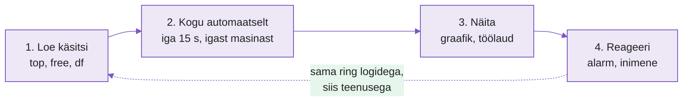

---
tags:
  - Info
  - Monitooring
---

# Kursuse ülesehitus

Kursus on 50 kontakttundi ja 15 tundi iseseisvat tööd. Kohtumised on **mõisteplokid**, mitte tööriistakursused: iga kohtumine vastab ühele küsimusele serveri kohta. Tööriist (Prometheus, Grafana, Loki...) tuleb ploki sees kui üks viis seda küsimust lahendada.

Järjekord on alati sama:

<figure markdown="span">

  <figcaption>Joonis 0.1. Kursuse spiraal: iga signaal loetakse enne käsitsi, siis kogutakse, siis näidatakse ja lõpuks reageeritakse. Sama ring korratakse mõõdikute, logide ja teenuse kättesaadavusega.</figcaption>
</figure>

Pildil on neli sammu, mis korduvad. Kõigepealt vaatad masina seisu ise käsurealt, siis paned masina seda ise koguma, siis teed sellest pildi ja lõpuks paned süsteemi ise häirekella lööma. Esimene ring käib mõõdikutega (protsessor, mälu, ketas), teine logidega ja kolmas teenuse kättesaadavusega.

## Laborikeskkond

Kasutad samu kolme Proxmoxi sõlme, mis automatiseerimise kursusel: `proxmox1`, `proxmox2`, `proxmox3`. Ühendud nagu seal (`ssh proxmox1`, VS Code Remote-SSH).

| Sõlm | Roll monitooringus |
|---|---|
| `proxmox1` | Seiresüsteem: Prometheus, Grafana, hiljem Loki. Käivitub Docker Compose'iga. |
| `proxmox2`, `proxmox3` | Jälgitavad masinad. node_exporter paigaldatakse Ansiblega sinu arvutist. |
| Sinu arvuti | Ansible, Git, VS Code, brauser |

*Tabel 1. Kes mida teeb*

Docker Compose (automatiseerimise nädal 6) ja Ansible (nädalad 3-4) on eeldus. Neid siin uuesti ei õpetata.

## Kohtumised

| Nädal | Tunde | Mõisteplokk | Põhiküsimus | Tööriist ploki sees | Loeng / labor (min) |
|---|---|---|---|---|---|
| N7 | 4 | Kuidas masin oma seisundist räägib | Kas server on terve? Kuidas ma seda tean? | `uptime`, `top`, `free`, `df`, `/proc`, `stress-ng` | 35 / 125 |
| N8 | 2 | Mõõtmine ilma inimeseta | Kuidas saada samad numbrid iga 15 sekundi järel ilma, et keegi käsku sisestaks? | Prometheus, node_exporter | 20 / 60 |
| N9 | 2 | Küsimused andmetele *(veebiõpe)* | Kuidas küsida "kui kiiresti ketas täitub?" | PromQL | 20 / 60 |
| N10 | 2 | Numbrid pildiks | Miks graafik ütleb rohkem kui number? | Grafana | 20 / 60 |
| N11 | 4 | Töölaud, millest on kasu | Mida peab nägema 5 sekundiga, kui midagi on katki? | Grafana, Ansible (node_exporter kõigile sõlmedele) | 35 / 125 |
| N12 | 4 | Millal on midagi valesti | Kus on piir "normaalse" ja "probleemi" vahel? | Prometheuse reeglid | 35 / 125 |
| N13 | 4 | Alarm jõuab inimeseni | Kes saab teada, kuidas ja mitu korda? | Alertmanager | 35 / 125 |
| N14 | 2 | Mida masin endale üles kirjutab | Mis juhtus kell 03:12? | `journalctl`, `/var/log` | 20 / 60 |
| N15 | 6 | Kõik logid ühte kohta | Kuidas otsida logist kolmes masinas korraga? | Loki, Alloy | 45 / 200 |
| N19 | 4 | Päris teenuse jälgimine | Kuidas rakendus ise oma tervisest räägib? | rakenduse `/metrics`, nginx exporter | 35 / 125 |
| N20 | 4 | Kas see üldse töötab? | Mida näeb kasutaja väljastpoolt? | blackbox_exporter | 35 / 125 |
| N21 | 4 | Oma seiresüsteem | Lõputöö: kõik plokid ühes | kõik eelnev | 35 / 125 |
| N22 | 8 | Lõputöö ja kaitsmine | Näita ja põhjenda | kõik eelnev | 15 / 240 + 90 kaitsmisi |

*Tabel 2. Kohtumised, kokku 50 tundi (1 tund = 45 min). Iga kohtumine lõpeb 10-15-minutilise kokkuvõttega. Nädalad 16-18 on jõuluvaheaeg.*

Neljatunnise kohtumise labor on kahes osas: **A** on juhendatud, pärast pausi tuleb **B**, kus kasutad sama oskust muudetud olukorras. Kuuetunnisel kohtumisel on osad A, B ja C. Iga labori lõpus on lisaülesanded neile, kes saavad varem valmis, kergest päris raskeni.

## Tugi väheneb kursuse jooksul

| Etapp | Kohtumised | Kuidas töö käib |
|---|---|---|
| Suur tugi | N7-N10 | Iga samm on lahti kirjutatud, iga käsu järel on oodatav tulemus. |
| Keskmine tugi | N11-N15 | Eesmärk ja vihjed on antud, konfiguratsiooni paned ise kokku. |
| Väike tugi | N19-N20 | Ülesanne on probleemina ("teenus on aeglane, leia miks"), lahenduse tee valid ise. |
| Iseseisev | N21-N22 | Lõputöö: ise kavandad, ehitad ja kaitsed. |

*Tabel 3. Toe vähendamine*

## Iseseisev töö

Kokku 15 tundi: igal kohtumisel umbes tunnine kodutöö (12 × 1 h) ja N21 juures umbes 3 tundi lõputöö ettevalmistust. Kodutöö jätkab laborit ja on alati seotud sinu enda sõlmedega.

N9 on veebiõppe nädal. Õpetajat pole kõrval, seega on loeng ja labor kirjutatud täiesti iseseisvaks läbitöötamiseks: selgitust on rohkem ja iga sammu järel on kontrollpunkt.

## Hindamine

| Komponent | Osakaal |
|---|---|
| Laborid (GitHub Classroom, automaatkontroll) | 40% |
| Kodutööd | 20% |
| Lõputöö ja kaitsmine (N21-N22) | 40% |

*Tabel 4. Hindamine*

Laborite automaatkontroll annab kuni 100 punkti. Kodutöö kontrollid annavad lisapunkte ega takista esitamist.

## Mis kursusele ei mahu

ELK, TICK, Wazuh, Zabbix, jälitus (tracing, OpenTelemetry, Tempo) ja Kubernetes on olemas, aga need ei mahu 50 tunni sisse. Mõned loengud mainivad neid osas "Taust ja edasijõudnutele", et teaksid, kuhu edasi minna.
