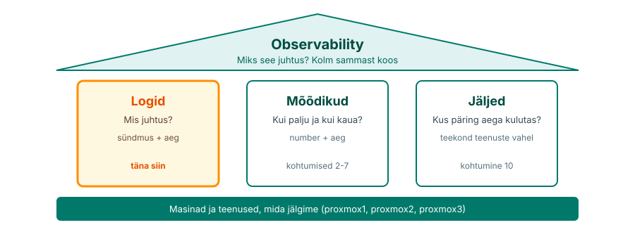
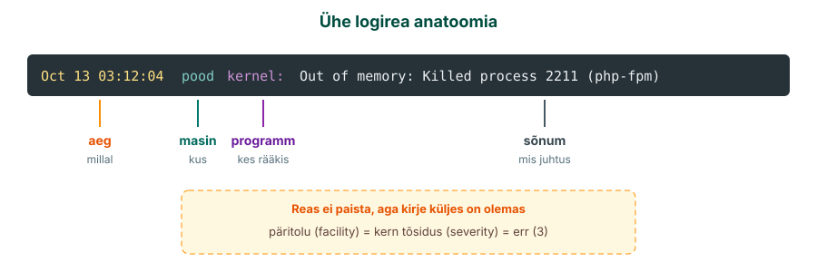
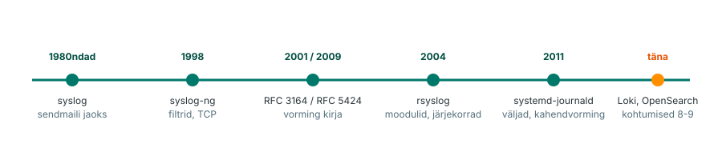
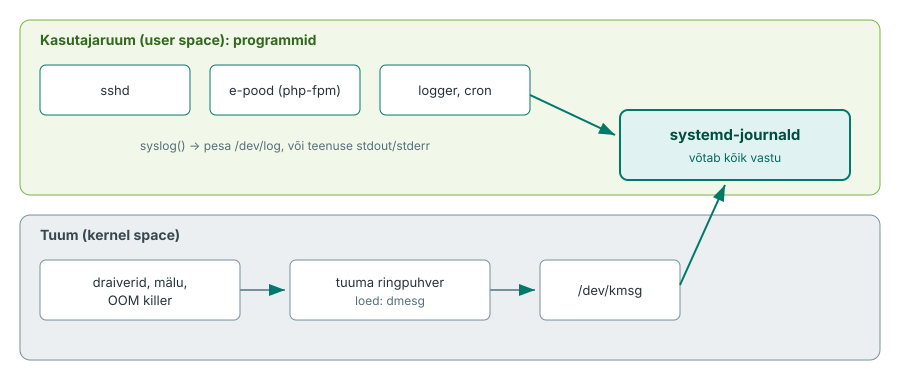
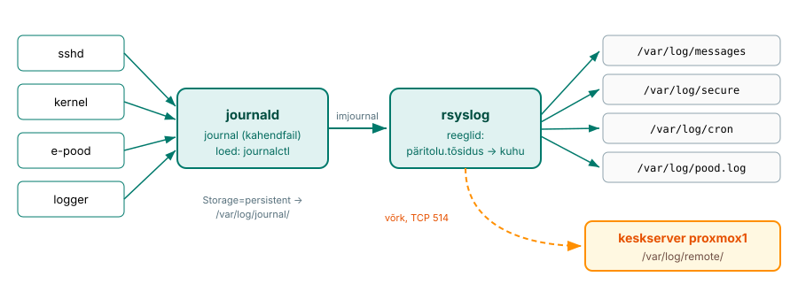
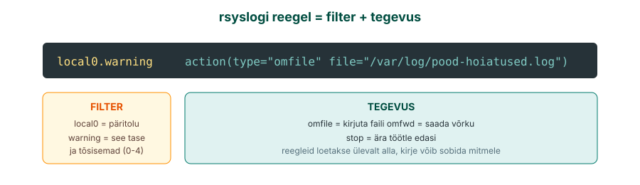
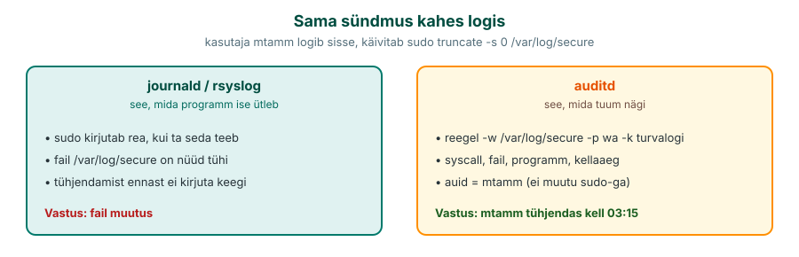
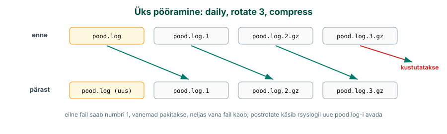
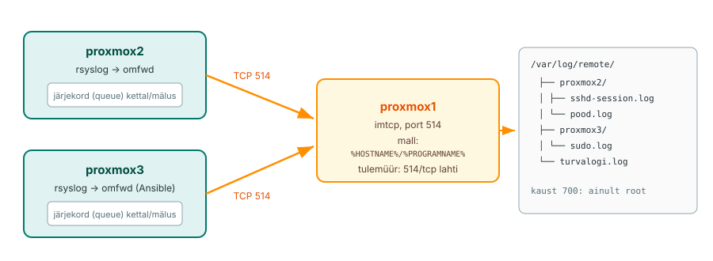

---
tags:
  - Loeng
  - Monitooring
  - Logid
  - Linux
---

# Loeng: Linuxi logid ja keskne logiserver

Automatiseerimise kursusel seadistasid samu masinaid käsitsi ja Ansible'iga. Nüüd vaatad, mida need masinad oma tööst üles kirjutavad, ja kogud nende logid ühte kohta.

??? abstract "Õpiväljundid"
    Pärast loengut ja praktikumi oskad:

    - lugeda logireast välja aja, masina, programmi, päritolu, tõsiduse ja sõnumi;
    - kirjeldada logi teed programmist faili: tuum, journald, rsyslog;
    - otsida journalist teenuse, aja ja tõsiduse järgi ning kirjutada rsyslogi reegli, mis suunab valitud kirjed eraldi faili;
    - leida auditi logist, kes faili muutis, ning selgitada, miks logrotate logisid pöörab;
    - põhjendada keskse logiserveri vajadust ja võrrelda UDP, TCP ja RELP saatmist;
    - leida suurest logist vastus võttega „filtreeri, loenda, vaata“.

## 1. Mis juhtus kell 03:12?

Väikese e-poe juhataja ütleb esmaspäeva hommikul: „Pood oli öösel pool tundi maas. Klient kirjutas kell 03:20. Mis juhtus?“ Öösel ei olnud kedagi serveri juures, seega tuleb vastust otsida serveri logist:

```text
Oct 13 03:12:04 pood kernel: Out of memory: Killed process 2211 (php-fpm)
Oct 13 03:12:05 pood systemd[1]: php-fpm.service: Main process exited, status=9/KILL
Oct 13 03:41:17 pood systemd[1]: php-fpm.service: Scheduled restart job
Oct 13 03:41:18 pood systemd[1]: Started php-fpm.service - The PHP FastCGI Process Manager.
```

Kell 03:12 sai mälu otsa ja tuum lõpetas veebipoe protsessi. Kell 03:41 ajastas systemd teenuse taaskäivitamise ja sekund hiljem teenus käivitus. Miks mälu otsa sai, need read veel ei ütle, kuid sündmuste järjekord on selge.

Rikke avastas esimesena klient. Kursuse eesmärk on, et rike avastatakse enne kasutaja teadet. Selleks kogutakse masinate logid ja mõõdikud ühte kohta ning seadistatakse neile alarmid.

<figure markdown="span">
  
  <figcaption>Joonis 1.1. Kursuse neli osa: logid, mõõdikud ja jäljed on kolm sammast, observability seob need kokku. Täna on teemaks vasakpoolne sammas (Talvik, 2026).</figcaption>
</figure>

**Logid** vastavad küsimusele „mis juhtus?“: iga rida on üks sündmus koos ajaga. **Mõõdikud** (kohtumised 2–7) vastavad küsimusele „kui palju ja kui kaua?“, näiteks protsessori koormus või vaba mälu. **Jäljed** (kohtumine 10) näitavad, kuidas üks päring liikus läbi mitme teenuse. Kui need kolm on omavahel seotud, saab küsida ka „miks see juhtus?“. Seda nimetatakse jälgitavuseks (observability).

Rikke uurimist alustatakse tavaliselt logidest. Süsteemiteenused kirjutavad logisid juba vaikeseadistuses, nende jaoks ei pea midagi paigaldama.

## 2. Logirida lähemalt

Logid võivad olla eri vormingus, kuid enamasti on neis aeg, allikas ja sõnum. Linuxis on kõige levinum syslogi kirje. Osa selle väljadest on tekstireal näha, osa on ainult kirje küljes.

<figure markdown="span">
  
  <figcaption>Joonis 1.2. Syslogi kirje osad. Aeg, masin, programm ja sõnum on reas näha. Päritolu (facility) ja tõsidus (severity) on kirje küljes, aga tekstifaili neid vaikimisi ei kirjutata (Talvik, 2026).</figcaption>
</figure>

- **Aeg** ütleb, millal sündmus juhtus. Ilma ajata ei saa sündmusi järjestada ega teise masina logidega võrrelda.
- **Masin** (hostname) ütleb, kus see juhtus. Keskserveris, kuhu kogunevad paljude masinate logid, on see kõige tähtsam väli.
- **Programm** (tag) ütleb, mis kirje kirjutas. Number nurksulgudes, näiteks `sshd[2211]`, on protsessi ID.
- **Sõnum** on vaba tekst. Hea sõnum ütleb, mis juhtus ja millega: „makse ebaõnnestus, tellimus 1003, pank vastas 503“.
- **Päritolu** (facility) ütleb, millisest süsteemi osast kirje tuli. **Tõsidus** (severity) ütleb skaalal 0–7, kui tõsine sündmus on. Nende järgi otsustab rsyslog, kuhu kirje läheb (peatükk 7).

Vorming pärineb vanast syslogi standardist (RFC 3164[^rfc3164]). Selles puudub aastaarv ja ajavöönd. Uuem standard RFC 5424[^rfc5424] lisab täpse aja koos ajavööndiga (`2026-10-13T03:12:04.512+03:00`). Seetõttu peavad masinate kellad olema sünkroonis ja ajavöönd peab olema teada, muidu ei saa kolme masina logisid omavahel võrrelda.

## 3. Miks on kaks logisüsteemi

AlmaLinuxis töötavad korraga journald ja rsyslog. **journald** kogub kirjed ühte kohta, hoiab neid kahendvormingus koos väljadega (teenus, protsess, kasutaja) ja laseb nende järgi kiiresti otsida. Journal on aga ühe masina põhine: kahendfaili ei saa lihtsalt `grep`-ida ega teise masinasse saata. **rsyslog** loeb kirjed journaldist, jagab need tekstifailidesse ja saadab võrku.

??? info "Ajalugu: syslogist journaldini"
    <figure markdown="span">
      
      <figcaption>Joonis 1.3. Linuxi logimise ajalugu. Iga uus tööriist lahendas eelmise puuduse, aga vanad jäid kasutusse (Talvik, 2026).</figcaption>
    </figure>

    syslog tekkis 1980ndatel e-posti serveri sendmaili jaoks ja sai Unix-süsteemide ühiseks logimisviisiks. Programm saadab teksti, syslogi deemon kirjutab selle faili või saadab UDP kaudu teise masinasse. syslog-ng (1998) ja rsyslog (2004) lisasid filtrid, TCP, krüpteerimise, järjekorrad ja moodulid. rsyslog on Red Hati, AlmaLinuxi, Debiani ja Ubuntu vaikevalik. systemd-journald (2011) tuli koos systemd-ga. Kohtumistel 8–9 kasutad Lokit ja OpenSearchi, kus paljude masinate logidest saab otsida nagu andmebaasist.

## 4. Kust logid tulevad

**Tuum** (kernel space) haldab riistvara, mälu ja protsesse. **Kasutajaruumis** (user space) töötavad programmid: sshd, veebiserver, e-pood. Mõlemad kirjutavad logi, kuid eri teed pidi.

<figure markdown="span">
  
  <figcaption>Joonis 1.4. Kaks logi allikat. Programmid kirjutavad pessa `/dev/log` või teenusena oma väljundisse, tuum kirjutab ringpuhvrisse. journald loeb mõlemat (Talvik, 2026).</figcaption>
</figure>

Tuuma sõnumid lähevad **ringpuhvrisse** (ring buffer): kindla suurusega mälualasse, kus uus sõnum kirjutab vanima üle. Sealt loeb neid käsk `dmesg` ja journald salvestab need kohe.

Programm saab logida kolmel viisil:

1. saata kirje pessa `/dev/log` (nii teeb ka käsk `logger`);
2. kirjutada systemd teenusena ekraanile (stdout, stderr), mille journald ise kokku kogub;
3. kirjutada oma faili, näiteks `/var/log/nginx/`. Sellised failid jäävad journaldist ja rsyslogist mööda ning nende pööramise ja saatmise eest tuleb eraldi hoolitseda.

Kui otsid teenuse viga, vaata kõigepealt `journalctl -u <teenus>`. Kui seal pole midagi, kontrolli, kas rakendusel on oma logifail.

## 5. journald

journald paneb igale kirjele hulga **välju**: teenus (`_SYSTEMD_UNIT`), protsess (`_PID`), kasutaja (`_UID`) ja alglaadimine (`_BOOT_ID`). Väljade järgi on journalist otsimine kiire ja täpne.

Journal võib olla mälus (`/run/log/journal/`, kaob taaskäivitusel) või kettal (`/var/log/journal/`). Seadistus on failis `/etc/systemd/journald.conf`, vaikimisi `Storage=auto`: kui kaust `/var/log/journal` on olemas, kirjutab journald kettale, muidu mällu. AlmaLinuxis seda kausta vaikimisi ei ole, seega kaob journal iga taaskäivitusega. Kui server ootamatult taaskäivitub, on kadunud just see logi, mis põhjust näitaks. Praktikumis teed journali püsivaks.

Kettal olev journal ei kasva lõputult: vaikimisi hoiab journald kuni 10% failisüsteemi mahust ja kustutab vanimad osad. Mahu näitab `journalctl --disk-usage`.

??? note "Tabel 1.1. journalctl sagedasemad päringud"
    | Küsimus | Käsk |
    |---|---|
    | Ühe teenuse kirjed | `journalctl -u sshd` |
    | Vead ja tõsisemad | `journalctl -p err` |
    | Viimase tunni kirjed | `journalctl --since "1 hour ago"` |
    | Kindel ajavahemik | `journalctl --since "03:00" --until "03:30"` |
    | Uued kirjed reaalajas, nagu `tail -f` | `journalctl -f` |
    | Praegusest alglaadimisest | `journalctl -b` |
    | Eelmisest alglaadimisest | `journalctl -b -1` |
    | Ainult tuuma sõnumid | `journalctl -k` |
    | Kõik väljad ühe kirje kohta | `journalctl -u sshd -n 1 -o verbose` |

Valikuid saab kombineerida. Küsimus „mis juhtus veebipoega öösel kell kolm?“ on üks käsk:

```bash
journalctl -u php-fpm --since "03:00" --until "03:45" -p warning
```

`-p warning` tähendab hoiatust ja tõsisemaid tasemeid ehk tasemeid 0–4. `journalctl -b -1` näitab pärast ootamatut taaskäivitust eelmise alglaadimise viimaseid ridu, kuid ainult siis, kui journal on püsiv.

## 6. rsyslog: reeglid, failid ja võrk

rsyslog loeb kirjed journaldist (moodul `imjournal`) ja otsustab **reeglite** järgi, millisesse faili iga kirje kirjutatakse ja kas see saadetakse võrku.

<figure markdown="span">
  
  <figcaption>Joonis 1.5. Logi tee AlmaLinuxis. rsyslog loeb kirjed journaldist mooduli imjournal kaudu ja jagab need reeglite järgi failidesse. Katkendjoon on võrguühendus keskserverisse, mille seadistad praktikumis (Talvik, 2026).</figcaption>
</figure>

Mooduli nime algus ütleb, mis tööd see teeb: `im` toob kirjed sisse (`imjournal`, `imtcp`), `mm` muudab neid (`mmjsonparse`), `om` saadab välja (`omfile` faili, `omfwd` teise masinasse). Praktikumis kasutad `imjournal`, `omfile`, `imtcp` ja `omfwd`.

Peafail on `/etc/rsyslog.conf`. Oma reeglid lisa eraldi `.conf`-faili kaustas `/etc/rsyslog.d/`, näiteks `10-pood.conf`. Peafail laadib selle kausta failid tähestiku järjekorras **enne** oma vaikereegleid. Kui sinu reegel lõpetab kirje töötlemise käsuga `stop`, ei jõua kirje vaikereegliteni.

Pärast muudatust kontrolli süntaksit käsuga `sudo rsyslogd -N1` ja alles siis taaskäivita rsyslog. Vigase konfiguratsiooniga rsyslog võib jätta osa logisid kirjutamata.

rsyslogi konfiguratsioonis on kaks süntaksit. Vana on lühike (`authpriv.*  /var/log/secure`), uus ehk RainerScript (`authpriv.* action(type="omfile" file="/var/log/secure")`) võimaldab määrata kõik seaded. Võrku saatmiseks, järjekordade ja mallide jaoks on vaja uut süntaksit. AlmaLinux 9 vaikekonfiguratsioon ja dokumentatsioon[^rsyslog] kasutavad uut süntaksit.

## 7. Päritolu ja tõsidus

Masin kirjutab päevas tuhandeid ridu. Päritolu ja tõsidus lasevad kirjeid sorteerida juba siis, kui need tekivad.

??? note "Tabel 1.2. Sagedasemad päritolud"
    | Päritolu | Kust | Näide |
    |---|---|---|
    | `kern` | tuum | ketta viga, mälu otsas |
    | `authpriv` | sisselogimine, `sudo`, `su` | ebaõnnestunud SSH sisselogimine |
    | `cron` | ajastatud tööd | varundusskript käivitus |
    | `daemon` | taustateenused | teenus käivitus |
    | `mail` | e-posti server | kiri saadeti |
    | `user` | tavalised programmid | `logger` vaikimisi |
    | `local0` … `local7` | oma rakenduste jaoks | e-poe rakendus |

??? note "Tabel 1.3. Tõsiduse tasemed"
    | Nr | Nimi | Tähendus | Näide |
    |---|---|---|---|
    | 0 | `emerg` | süsteem ei tööta | tuum peatus |
    | 1 | `alert` | tegutse kohe | andmebaasi failid on rikutud |
    | 2 | `crit` | kriitiline | ketas ei vasta |
    | 3 | `err` | viga, muu töötab | makse ebaõnnestus |
    | 4 | `warning` | võib probleemiks muutuda | ketas 85% täis |
    | 5 | `notice` | tavaline, aga tähelepanuväärne | teenus taaskäivitati |
    | 6 | `info` | teave | tellimus vastu võetud |
    | 7 | `debug` | detailid veaotsinguks | päringu parameetrid |

Väiksem number on tõsisem. Reeglis tähendab tase „see ja tõsisemad“: `local0.warning` valib tasemed 0–4. Ainult ühe taseme valib `local0.=warning`. `local0`…`local7` on olemas selleks, et oma rakenduse logisid oleks lihtne teistest eraldada. Praktikumis logib e-pood päritoluga `local0`.

<figure markdown="span">
  
  <figcaption>Joonis 1.6. rsyslogi reegel. Filter valib kirjed päritolu ja tõsiduse järgi, tegevus ütleb, mis nendega teha (Talvik, 2026).</figcaption>
</figure>

AlmaLinuxi vaikereeglid:

```text
*.info;mail.none;authpriv.none;cron.none action(type="omfile" file="/var/log/messages")
authpriv.*                               action(type="omfile" file="/var/log/secure")
cron.*                                   action(type="omfile" file="/var/log/cron")
```

Esimene rida saadab faili `messages` kõik kirjed tasemest `info` alates, välja arvatud e-post, sisselogimised ja cron (`none`). Sisselogimised lähevad eraldi faili `secure`, sest neis on tundlikku teavet.

Üks kirje võib sobida mitmele reeglile. Reegli `local0.* /var/log/pood.log` korral läheb poe kirje nii faili `pood.log` kui ka faili `messages`. Kui kirje peab minema ainult poe faili, lisa järgmisele reale `& stop` (`&` tähendab „sama filtriga ka järgmine tegevus“). `stop` peatab kirje ka kõigi järgmiste reeglite jaoks, sealhulgas nende, mis saadavad logisid keskserverisse.

??? question "Kontrolli ennast"
    1. Nimeta logirea kuus osa. Millised kaks pole tekstireal näha ja milleks neid vaja on?
    2. Käivitad `logger "tere"`. Kus kahes kohas see rida nüüd on ja mis selle sinna kirjutas?
    3. Rakendus kirjutab `local0.err`. Kas see jõuab reegli `local0.warning` faili? Kas see jõuab ka faili `/var/log/messages`? Miks?

## 8. Logifailid ja õigused

Logifailid asuvad kaustas `/var/log/`. `wtmp` ja `btmp` on kahendfailid, neid loevad käsud `last` ja `lastb`.

??? note "Tabel 1.4. Tähtsamad logifailid AlmaLinuxis"
    | Fail | Mis seal on | Ubuntus |
    |---|---|---|
    | `/var/log/messages` | peaaegu kõik (`info` ja tõsisemad) | `/var/log/syslog` |
    | `/var/log/secure` | sisselogimised, `sudo` | `/var/log/auth.log` |
    | `/var/log/cron` | ajastatud tööd | `/var/log/syslog` sees |
    | `/var/log/dnf.log` | paketihaldus | `/var/log/apt/history.log` |
    | `/var/log/audit/audit.log` | auditi kirjed (peatükk 9) | sama |
    | `/var/log/wtmp`, `/var/log/btmp` | õnnestunud ja ebaõnnestunud sisselogimised | sama |

Logides on IP-aadressid, kasutajanimed ja failiteed. Kui keegi kirjutab SSH sisselogimisel kogemata parooli kasutajanime lahtrisse, jõuab see faili `/var/log/secure` kujul „Invalid user Salajane123“. Seetõttu on AlmaLinuxis tekstilogide õigused `600` ja neid loeb ainult root. Journalit loevad root ning grupid `systemd-journal`, `wheel` ja `adm`.

Kui kasutaja vajab veaotsinguks logisid, lisa ta gruppi `systemd-journal`. Siis saab ta lugeda journalit, kuid ei saa masinas `sudo`-ga midagi muuta. See on vähimate õiguste põhimõte.

## 9. auditd: kes seda tegi?

journald ja rsyslog salvestavad seda, mida programmid ise kirjutavad. Kui keegi tühjendab turvalogi, kirjutab `sudo` küll rea käsu kohta, kuid see rida oli just selles failis, mis tühjendati.

**auditd** salvestab sündmused tuuma tasemel: kes avas faili kirjutamiseks, kes muutis õigusi, kes käivitas käsu. Kui reegel on seadistatud, salvestab tuum sündmuse ka siis, kui programm ise midagi ei logi.

<figure markdown="span">
  
  <figcaption>Joonis 1.7. Sama sündmus kahes logis. journald ja rsyslog teavad seda, mida programm kirjutas. Audit teab, mida tuum registreeris ja kes algselt sisse logis (Talvik, 2026).</figcaption>
</figure>

Iga auditi kirje juures on väli **`auid`** (audit user ID): kasutaja, kes algselt sisse logis. See ei muutu `sudo` või `su` järel. Väli `uid` on `sudo` järel 0 (root) ega ütle, kes inimene oli.

Auditi reegel `-w /var/log/secure -p wa -k turvalogi` jälgib faili (`-w`), kirjutamist ja atribuutide muutmist (`-p wa`) ning paneb kirjetele otsinguvõtme (`-k`). `auditctl`-iga lisatud reeglid kaovad taaskäivitusel. Püsivad reeglid on kaustas `/etc/audit/rules.d/` ja need laeb `augenrules --load`. Otsimiseks on `ausearch -k <võti> -i`, kus `-i` tõlgib numbrid nimedeks, ja kokkuvõtteks `aureport`.

Jälgi faile, mille muutmine on kahtlane või oluline: rsyslogi konfiguratsioon (`/etc/rsyslog.d/`), turvalogi, ajastatud tööd (`/etc/cron.d/`), kasutajad (`/etc/passwd`) ja SSH seaded. Kui jälgid kõike, kasvab auditi logi kiiremini, kui jõuad seda lugeda.

??? question "Kontrolli ennast"
    1. Kasutaja vajab veaotsinguks journalit. Mida teed ja miks ei anna talle `sudo`-t?
    2. Keegi tühjendas `sudo`-ga turvalogi. Millise auditi välja järgi leiad, kes see oli, ja miks `uid` ei aita?

## 10. Logi ei tohi kasvada lõputult

Veebiserver kirjutab iga päringu kohta rea, päevas näiteks 200 MB. Kui logi kasvab piiramatult, saab ketas täis ja server lõpetab vastamise: andmebaas ei saa kirjutada ja sessioone ei salvestata.

**logrotate** pöörab logifailid: praegune fail saab nimeks `.1`, vana `.1` saab `.2`, vanad pakitakse ja kõige vanem kustutatakse. AlmaLinuxis käivitab logrotate'i kord ööpäevas systemd taimer `logrotate.timer`. Olekufail `/var/lib/logrotate/logrotate.status` hoiab meeles, millal iga faili viimati pöörati.

<figure markdown="span">
  
  <figcaption>Joonis 1.8. Üks pööramine reeglitega `daily`, `rotate 3` ja `compress`. Iga fail liigub sammu edasi ja kettale jääb kindel arv faile (Talvik, 2026).</figcaption>
</figure>

Üldseaded on failis `/etc/logrotate.conf`, iga logi reeglid eraldi failis kaustas `/etc/logrotate.d/`.

??? note "Tabel 1.5. logrotate'i valikud"
    | Valik | Tähendus |
    |---|---|
    | `daily`, `weekly`, `monthly` | millal pöörata |
    | `size 100M` | pööra, kui fail on suurem, sõltumata ajast |
    | `rotate 7` | mitu vana faili alles hoida |
    | `compress` | vanad failid pakitakse (`.gz`) |
    | `delaycompress` | eelmist faili veel ei pakita |
    | `missingok`, `notifempty` | puuduv fail ei ole viga, tühja faili ei pöörata |
    | `copytruncate` | kopeeri fail ja tühjenda originaal |
    | `postrotate` … `endscript` | käsk pärast pööramist |

Programm, mis kirjutab faili, hoiab seda lahti. Kui logrotate nimetab `pood.log` ümber `pood.log.1`-ks, kirjutab rsyslog edasi samasse faili uue nime all. Signaal `HUP` (plokis `postrotate`) paneb rsyslogi failid sulgema ja uuesti avama. Kui programm `HUP`-signaali ei toeta, kasutatakse `copytruncate`'i, kuid siis võivad kopeerimise ja tühjendamise vahel kirjutatud read kaduda.

Pööramist saab proovida kohe: `logrotate -d` näitab, mida tehtaks, midagi muutmata, `logrotate -f` sunnib pöörama.

Kui kaua logisid hoida, sõltub nende kasutusest. Masina kettal hoitakse päevi kuni kuid igapäevaseks veaotsinguks. Sisselogimiste ja auditi logisid hoitakse kauem, sest turvaintsident avastatakse sageli alles nädalaid hiljem, ja need on keskserveris või arhiivis.

??? question "Kontrolli ennast"
    1. Reegel on `daily` ja `rotate 7`. Mitu päeva vana logi leiad kettalt kõige rohkem?
    2. Miks peab rsyslog pärast pööramist saama `HUP`-signaali?

## 11. Keskne logiserver

Masina enda logist on vähe kasu kolmes olukorras:

1. **Masin on kadunud.** Ketas läks katki ja logid olid samal kettal.
2. **Jäljed on kustutatud.** Ründaja pääses masinasse ja tühjendas `/var/log/secure`.
3. **Masinaid on mitu.** Viga tekkis veebiserveris, põhjus oli andmebaasis. Logisid on vaja näha kõrvuti ja ajajärjekorras.

Kõigi kolme lahendus on, et iga masin saadab oma logid kohe ka **keskserverisse** (central log server). Praktikumis on keskserver `proxmox1`.

<figure markdown="span">
  
  <figcaption>Joonis 1.9. Keskne logimine. Kliendid saadavad kirjed keskserverisse ja hoiavad neid järjekorras, kui server ei vasta. Keskserver kirjutab kirjed masina ja programmi järgi eraldi failidesse (Talvik, 2026).</figcaption>
</figure>

Siin saadab klient kirjed ise (push). Sama mudelit kasutab kohtumisel 4 Zabbixi aktiivne agent. Kohtumisel 5 küsib Prometheus andmeid masinatelt ise (pull).

??? note "Tabel 1.6. Logide saatmise viisid"
    | | UDP | TCP | RELP |
    |---|---|---|---|
    | Kinnitus | ei ole | ühendus on, katkestusel võib mõni kirje kaduda | iga kirje kinnitatakse |
    | Kui server ei vasta | kirjed kaovad | klient hoiab järjekorras, kuni järjekord täis saab | klient hoiab järjekorras, kuni järjekord täis saab |
    | Port | 514/udp | 514/tcp | tavaliselt 2514/tcp |
    | Sobib | palju vähetähtsaid kirjeid | enamik juhte | kui kirjeid ei tohi kaduda ka ühenduse katkemisel |

Praktikumis kasutad TCP-d ja kliendi **järjekorda** (queue). Kui keskserver ei vasta või tulemüür ühenduse blokeerib, kogub klient kirjed järjekorda ja saadab need, kui ühendus taastub. Praktikumi seadistuses mahub järjekorda 10 000 kirjet ja see asub mälus: kui järjekord saab täis või rsyslog kliendis taaskäivitub, võivad kirjed kaduda.

Keskserver peab:

1. **kuulama**: moodul `imtcp` avab pordi 514 ja tulemüür peab selle lubama;
2. **lahterdama**: **mall** (template) `/var/log/remote/%HOSTNAME%/%PROGRAMNAME%.log` annab igale masinale oma kausta ja igale programmile oma faili;
3. **kaitsma**: keskserveri logid on tõendid, kaust on loetav ainult rootile ja ka need logid pööratakse.

Kolme masina logisid saab ajajärjekorda panna ainult siis, kui masinate kellad on sünkroonis. Kui `proxmox2` kell käib kaks minutit ees, näib, et viga juhtus enne põhjust. Automatiseerimise kursusel seadistatud chrony hoiab kellad sünkroonis.

Port 514 saadab logid avatud tekstina. Töökohas kasutatakse TLS-i (port 6514), et keegi ei saaks logisid pealt kuulata ega võltsida.

??? question "Kontrolli ennast"
    1. Nimeta kolm olukorda, kus masina enda logist ei ole abi, aga keskserverist on.
    2. Mille poolest erinevad UDP ja TCP logide saatmisel? Mis on järjekorra (queue) roll?

## 12. Suurest logist vastuse leidmine

Keskserveris on varsti miljoneid ridu ja faili ei saa enam tekstiredaktoriga avada. Vastus leitakse kolme sammuga.

<figure markdown="span">
  
  <figcaption>Joonis 1.10. Filtreeri, loenda, vaata. Iga samm vähendab ridade arvu, kuni alles jääb nii vähe, et saab lugeda (Talvik, 2026).</figcaption>
</figure>

1. **Filtreeri:** jäta alles ainult küsimusega seotud read (aeg, masin, programm, tõsidus, sõna).
2. **Loenda:** mitu korda, kellelt kõige rohkem, mis minutil.
3. **Vaata:** loe paari rida, mis järele jäid.

Näide: veebilogis on 2 miljonit rida ja küsimus on, mis minutil oli kõige rohkem vigu.

```bash
grep -c 'staatus=500' veeb.log                    # mitu viga kokku
grep 'staatus=500' veeb.log | cut -c1-12 \
  | sort | uniq -c | sort -rn | head -5           # mis minutil kõige rohkem
grep 'staatus=500' veeb.log | grep 'Oct 13 03:12' | head -3   # vaata paari rida
```

`cut -c1-12` jätab reast alles aja minuti täpsusega, `uniq -c` loendab samad read kokku ja `sort -rn` paneb suurima ette. Kui rida on kujul `nimi=väärtus`, on filtreerimine täpne: `grep 'staatus=500'` ei leia rida, kus `500` on tellimuse number või millisekundid. Journalis on väljad juba olemas, seal piisab sageli käsust `journalctl -u sshd -p warning --since today`.

??? question "Kontrolli ennast"
    Logis on 2 miljonit rida ja küsimus on, milliselt IP-aadressilt tuli kõige rohkem ebaõnnestunud sisselogimisi. Kirjelda filtreerimise, loendamise ja vaatamise samme.

??? info "Taust: PRI number, logide terviklikkus ja struktureeritud logid"
    **PRI number.** Võrgus algab syslogi kirje kujul `<132>Oct 13 …`. Number on päritolu × 8 + tõsidus: `local0` (16) ja `warning` (4) annavad 16 × 8 + 4 = 132.

    **Terviklikkus.** Ründaja, kes pääseb keskserverisse, saab ka seal logisid muuta. Selle vastu arvutatakse pööratud logidest räsi (`sha256sum`) ja hoitakse räsisid mujal. Suuremates süsteemides saadetakse logid kirjutuskaitstud arhiivi.

    **Struktureeritud logid.** Paljud rakendused kirjutavad logi JSON-vormingus, kus iga väli on eraldi: `{"aeg":"…","tase":"error","tellimus":1003}`. rsyslogi moodul `mmjsonparse` võtab sellise kirje lahti. Kohtumistel 8–9 saadad logid Lokisse ja OpenSearchi, kohtumisel 12 loeb turvasüsteem (SIEM) sama `secure` faili ja annab häire paroolide äraarvamise katsete kohta.

??? abstract "Kokkuvõte"
    | Mõiste | Lühidalt |
    |---|---|
    | Logirida | aeg, masin, programm, sõnum; kirje küljes päritolu ja tõsidus |
    | Logi tee | tuum ja programmid → journald → rsyslog (`imjournal`) → failid ja võrk |
    | journald | väljadega journal; vaikimisi mälus, kaust `/var/log/journal` teeb püsivaks |
    | rsyslog | reegel = filter (päritolu.tõsidus) + tegevus; enne taaskäivitust `rsyslogd -N1`; `stop` peatab kirje |
    | Õigused | tekstilogid `600`, journal grupile `systemd-journal` |
    | auditd | `-w fail -p wa -k võti`, otsing `ausearch -k võti -i`; `auid` ei muutu `sudo`-ga |
    | logrotate | `logrotate.timer`, `/etc/logrotate.d/`, `postrotate` + `HUP`; proovi `-d`, siis `-f` |
    | Keskserver | TCP + järjekord, mall masina ja programmi kaupa, tulemüür, kellad sünkroonis |
    | Suur logi | filtreeri, loenda, vaata |

[^rfc3164]: RFC 3164, The BSD syslog Protocol. <https://datatracker.ietf.org/doc/html/rfc3164>
[^rfc5424]: RFC 5424, The Syslog Protocol. <https://datatracker.ietf.org/doc/html/rfc5424>
[^rsyslog]: rsyslogi dokumentatsioon. <https://docs.rsyslog.com/doc/>
