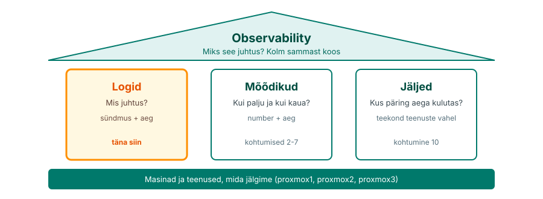
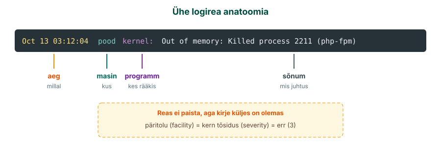
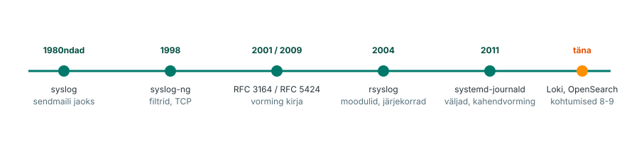
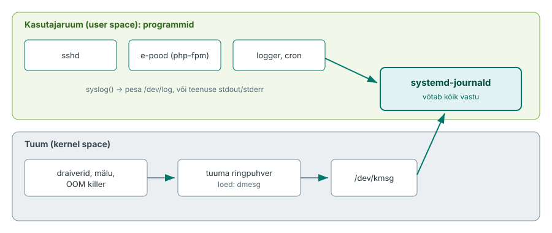
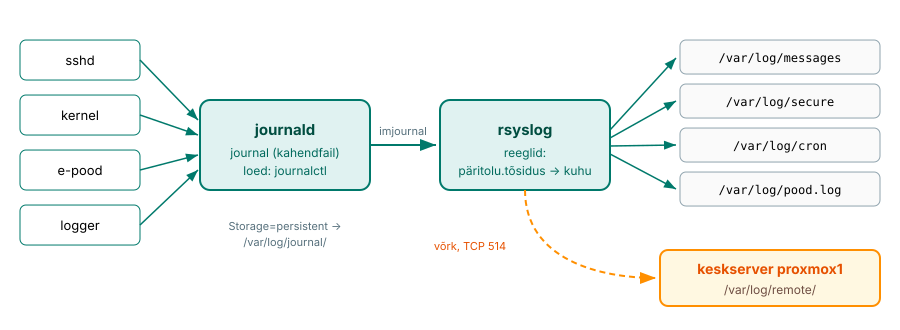
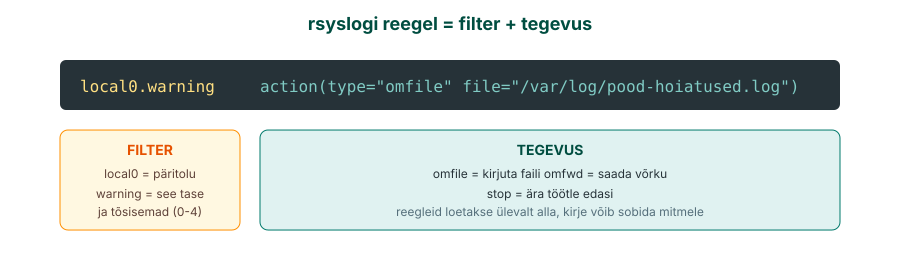
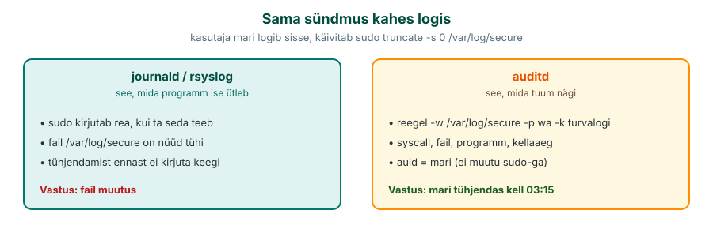
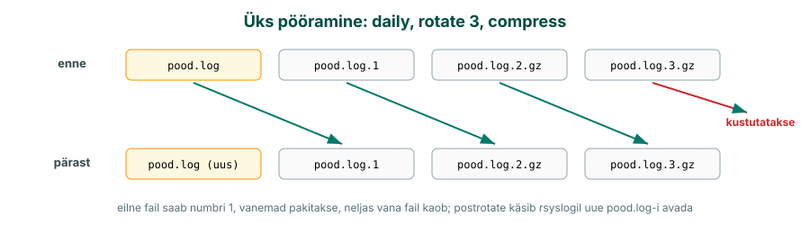
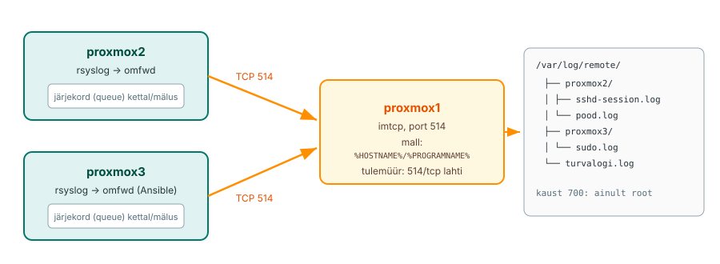

---
tags:
  - Loeng
  - Monitooring
  - Logid
  - Linux
---

# Loeng: Masina päevik ja logid ühte kohta

**Maht:** ~45 min iseseisvat lugemist, loe **enne** laborit
**Tase:** kolmas kursus. `journalctl`, `tail -f`, `grep` ja `systemctl` on tuttavad, siin vaatame neid monitooringu pilguga.

See leht on mõeldud iseseisvaks lugemiseks. Klassis käime põhiliini kiiremini üle, aga siit leiad kõik lahti seletatuna, koos näidetega, ja saad selle laboris spikrina lahti hoida.

**Labor vajab peatükke 1-11.** Peatükk 12 (vastuse leidmine suurest logist) on vajalik labori teises pooles. Lõpus olev osa "Taust ja edasijõudnutele" on lugemismaterjal neile, kes tahavad teada, kuidas seda tööd päriselt tehakse.

---

!!! abstract "Õpiväljundid"
    Pärast seda materjali oskad:

    - selgitada, miks logid on seire esimene signaal ja millisele küsimusele need vastavad
    - lugeda logireast välja aja, masina, programmi, päritolu, tõsiduse ja sõnumi
    - kirjeldada logi teed programmist faili: tuum, journald, rsyslog
    - teha journal püsivaks ja otsida sealt teenuse, aja ja tõsiduse järgi
    - kirjutada rsyslogi reegli, mis suunab valitud kirjed eraldi faili
    - seadistada auditd jälgima faili ja leida, **kes** seda muutis
    - selgitada, kuidas logrotate pöörab logisid ja miks seda vaja on
    - põhjendada keskse logiserveri vajadust ja võrrelda UDP, TCP ja RELP saatmist
    - leida suurest logist vastus võttega "filtreeri, loenda, vaata"

---

!!! info "Lisalugemine"
    Kui tahad sama teemat teise nurga alt või rohkem detaile:

    - [Linux Logging Complete Guide (devconnected)](https://devconnected.com/linux-logging-complete-guide/), inglisekeelne ülevaade tuuma logimisest, syslogi protokollist ja rsyslogist, palju jooniseid
    - [rsyslogi ametlik dokumentatsioon](https://docs.rsyslog.com/doc/), konfi süntaks, moodulid ja näited
    - [systemd/Journal (ArchWiki)](https://wiki.archlinux.org/title/Systemd/Journal), journald ja `journalctl` põhjalikult, kehtib ka AlmaLinuxis

---

## 1. Mis juhtus kell 03:12?

Kati teeb praktikat väikeses e-poes. Esmaspäeva hommikul ütleb juhataja: "Pood oli öösel pool tundi maas. Klient kirjutas kell 03:20. Mis juhtus?"

Öösel ei olnud kedagi serveri juures. Ainus tunnistaja on masin ise ja see, mis ta üles kirjutas. Kati logib serverisse ja küsib logilt:

```text
Oct 13 03:12:04 pood kernel: Out of memory: Killed process 2211 (php-fpm)
Oct 13 03:12:05 pood systemd[1]: php-fpm.service: Main process exited, status=9/KILL
Oct 13 03:41:17 pood systemd[1]: php-fpm.service: Scheduled restart job
```

Kolm rida ja vastus on käes. Kell 03:12 sai mälu otsa, tuum sulges veebipoe protsessi ja teenus käivitus uuesti alles 29 minutit hiljem. Ilma logideta oleks Kati vastus olnud "ei tea".

Aga vaata, kes rikke esimesena avastas: klient. Kogu see kursus käib ühe lause ümber: **kasutaja ei tohi olla see, kes rikke esimesena avastab.** Selleks on vaja, et masinad räägiksid oma seisundist ise ja et keegi (või miski) neid kuulaks.

<figure markdown="span">
  
  <figcaption>Joonis 1.1. Kursuse neli osa: logid, mõõdikud ja jäljed on kolm sammast, observability paneb need kokku. Täna oleme vasakul sambal.</figcaption>
</figure>

Kursusel on neli osa. **Logid** vastavad küsimusele "mis juhtus?": iga rida on üks sündmus koos ajaga. **Mõõdikud** (kohtumised 2-7) vastavad küsimusele "kui palju ja kui kaua?": protsessori koormus, vaba mälu, päringute arv sekundis. **Jäljed** (kohtumine 10) näitavad, kuidas üks päring liikus läbi mitme teenuse ja kus see aega kulutas. Kui need kolm on koos ja omavahel seotud, saad küsida ka "miks see juhtus?". Seda nimetatakse observability'ks (jälgitavus).

Logid on alati esimene koht, kust otsima hakatakse. Neid kirjutab iga programm, nende jaoks ei pea midagi paigaldama ja need on olemas juba siis, kui monitooringut veel ei ole.

---

## 2. Logirida lähemalt

Logid võivad olla eri vormingus, kuid peaaegu alati on neis aeg, allikas ja sõnum. Siin vaatame syslogi kirjet, mis on Linuxis kõige levinum. Osa selle osadest on tekstireal näha, osa on kirje küljes peidus.

<figure markdown="span">
  
  <figcaption>Joonis 1.2. Logirea anatoomia. Aeg, masin, programm ja sõnum on reas näha. Päritolu (facility) ja tõsidus (severity) on kirje küljes, aga tekstifaili neid vaikimisi ei kirjutata.</figcaption>
</figure>

- **Aeg** ütleb, millal sündmus juhtus. Ilma ajata ei saa sündmusi järjekorda panna ega teise masina logidega võrrelda.
- **Masin** (hostname) ütleb, kus see juhtus. Ühe masina logis on see alati sama, aga keskserveris, kuhu kogunevad paljude masinate logid, on see kõige tähtsam väli.
- **Programm** (tag) ütleb, kes rääkis. Nurksulgudes number, nagu `systemd[1]` või `sshd[2211]`, on protsessi ID.
- **Sõnum** on vaba tekst. Hea sõnum ütleb, mis juhtus ja millega: "makse ebaõnnestus, tellimus 1003, pank vastas 503", mitte "viga".
- **Päritolu** (facility) ütleb, millisest süsteemi osast kirje tuli: tuum, sisselogimine, ajastatud töö, sinu rakendus.
- **Tõsidus** (severity) ütleb, kui tõsine asi on, skaalal 0 kuni 7.

Kaks viimast on need, mille järgi rsyslog otsustab, kuhu kirje läheb. Nendest räägib peatükk 7.

Vorming, mida joonisel näed, pärineb vanast syslogi standardist (RFC 3164[^rfc3164]). Uuem standard RFC 5424[^rfc5424] lisab täpse aja koos aastaarvu ja ajavööndiga (`2026-10-13T03:12:04.512+03:00`) ning struktureeritud andmed. Vanas vormingus puudub aastaarv ja ajavöönd. See on üks põhjus, miks kõigi masinate kellad peavad olema sünkroonis ja ühes ajavööndis: muidu ei saa kolme masina logisid omavahel võrrelda.

---

## 3. Lühike ajalugu: syslogist journaldini

AlmaLinuxis töötavad korraga kaks logisüsteemi, journald ja rsyslog. Esmapilgul tundub see topelt tööna, aga ajalugu seletab, miks nii on.

<figure markdown="span">
  
  <figcaption>Joonis 1.3. Linuxi logimise ajalugu: iga uus tööriist lahendas eelmise puuduse, aga vanad ei kadunud kuhugi.</figcaption>
</figure>

**syslog** tekkis 1980ndatel e-posti serveri sendmail jaoks ja sai kiiresti kõigi Unix-süsteemide ühiseks logimisviisiks. Idee oli lihtne: programm saadab teksti, syslogi deemon kirjutab selle faili või saadab teise masinasse UDP kaudu. Päritolu ja tõsidus pärinevad juba sellest ajast.

**syslog-ng** (1998) ja **rsyslog** (2004) on syslogi edasiarendused. Need lisasid paindlikud filtrid, TCP, krüpteerimise, järjekorrad (et logid ei kaoks, kui võrk on maas) ja moodulid, millega saab logisid saata andmebaasi või otsingusüsteemi. rsyslog on tänapäeval Red Hati, AlmaLinuxi, Debiani ja Ubuntu vaikevalik.

**systemd-journald** (2011) tuli koos systemd-ga. See kogub kõik kirjed ühte kohta, hoiab neid kahendvormingus koos väljadega (mis teenus, mis protsess, mis kasutaja) ja laseb nende järgi kiiresti otsida. Puudus on see, et journal on ühe masina asi: kahendfaili ei saa lihtsalt `grep`-ida ega teise masinasse saata nii, nagu syslogi.

Seepärast kasutab AlmaLinux mõlemat: journald kogub, rsyslog jagab failidesse ja saadab võrku. Kohtumistel 8-9 näed järgmist sammu: Loki ja OpenSearch, kus paljude masinate logidest saab otsida nagu andmebaasist.

---

## 4. Kust logid tulevad: tuum ja programmid

Linuxis on kaks maailma. **Tuum** (kernel space) haldab riistvara, mälu ja protsesse. **Kasutajaruumis** (user space) töötavad programmid: sshd, veebiserver, sinu e-pood. Mõlemad kirjutavad logi, aga erinevat teed pidi.

<figure markdown="span">
  
  <figcaption>Joonis 1.4. Kaks logi allikat. Programmid kirjutavad pessa `/dev/log` või teenusena oma väljundisse, tuum kirjutab ringpuhvrisse. journald loeb mõlemat.</figcaption>
</figure>

**Tuuma sõnumid** lähevad kõigepealt **ringpuhvrisse** (ring buffer): kindla suurusega mälualasse, kus uus sõnum kirjutab vanima üle. Sealt loeb neid käsk `dmesg`. Ringpuhvris on näiteks sõnumid, et ketas andis lugemisvea, võrgukaabel ühendati lahti või mälu sai otsa ja tuum sulges protsessi (nagu Kati poes). Kuna puhver on väike ja elab mälus, loeb journald sõnumid sealt kohe välja ja salvestab need.

**Programmid** saavad logida kolmel viisil:

1. **syslog() kutse.** Programm saadab kirje pessa `/dev/log`. Nii logivad vanad ja klassikalised programmid, ka käsk `logger`.
2. **Teenuse väljund.** Kui programm töötab systemd teenusena, kogub journald kõik, mida see kirjutab ekraanile (stdout, stderr). Programm ei pea logimisest midagi teadma.
3. **Oma fail.** Mõni rakendus kirjutab ise faili, näiteks veebiserver kausta `/var/log/nginx/`. Need failid jäävad journaldist ja rsyslogist mööda ning nende eest peab eraldi hoolitsema (pööramine, keskserverisse saatmine).

Praktiline järeldus: kui otsid teenuse viga, vaata kõigepealt `journalctl -u teenus`. Kui seal pole midagi, vaata, kas rakendusel on oma logifail.

---

## 5. journald: kõik kirjed ühes kohas

journald võtab vastu kõik kirjed: tuumast, teenustest ja `/dev/log` kaudu. Iga kirje juurde paneb ta hulga **välju**: millise teenuse (`_SYSTEMD_UNIT`), millise protsessi (`_PID`), millise kasutaja (`_UID`) ja millise alglaadimise (`_BOOT_ID`) juurde see kuulub. Just väljade pärast on journalist otsimine kiire ja täpne.

### Kus journal elab

journald saab hoida journalit kahes kohas:

| Seade | Asukoht | Taaskäivitusel |
|---|---|---|
| mälus (volatile) | `/run/log/journal/` | kaob |
| kettal (persistent) | `/var/log/journal/` | jääb alles |

*Tabel 1.1. Journali asukoht*

Seadistus on failis `/etc/systemd/journald.conf`, rida `Storage=`. Vaikimisi on `Storage=auto`: kui kaust `/var/log/journal` on olemas, kirjutab journald kettale, kui ei ole, siis mällu. AlmaLinuxis seda kausta vaikimisi pole, nii et journal kaob iga taaskäivitusega.

Kui server jookseb kokku ja käivitub uuesti, on just see logi, mis ütleks miks, kadunud. Seepärast teed laboris journali püsivaks. Kettale kirjutatud journal ei kasva lõputult: journald hoiab vaikimisi kuni 10% failisüsteemi mahust ja kustutab ise vanimad osad. Kui palju ruumi journal võtab, näitab `journalctl --disk-usage`.

### journalctl: küsi, ära keri

Journal võib sisaldada miljoneid ridu. Neid ei loeta ülevalt alla, neilt küsitakse:

| Küsimus | Käsk |
|---|---|
| Ühe teenuse kirjed | `journalctl -u sshd` |
| Ainult vead ja hullem | `journalctl -p err` |
| Viimase tunni kirjed | `journalctl --since "1 hour ago"` |
| Kindel ajavahemik | `journalctl --since "03:00" --until "03:30"` |
| Jooksvalt, nagu `tail -f` | `journalctl -f` |
| Praegusest alglaadimisest | `journalctl -b` |
| Eelmisest alglaadimisest (pärast kokkujooksmist) | `journalctl -b -1` |
| Ainult tuuma sõnumid | `journalctl -k` |
| Kõik väljad ühe kirje kohta | `journalctl -u sshd -n 1 -o verbose` |
| Masinloetav väljund | `journalctl -u sshd -o json` |

*Tabel 1.2. journalctl sagedasemad küsimused*

Valikuid saab kombineerida. Kati küsimus "mis juhtus veebipoega öösel kell kolm?" on üks käsk:

```bash
journalctl -u php-fpm --since "03:00" --until "03:45" -p warning
```

`-p warning` tähendab "hoiatus ja hullem", ehk tasemed 0 kuni 4. Tõsiduse tasemetest räägib peatükk 7.

`journalctl -b -1` on eriti kasulik pärast seda, kui server käivitus ise uuesti: see näitab eelmise alglaadimise viimaseid ridu. Aga ainult siis, kui journal on püsiv.

---

## 6. rsyslog: reeglid, failid ja võrk

rsyslog loeb journaldist kõik kirjed (moodul `imjournal`) ja otsustab **reeglite** järgi, mis faili iga kirje läheb ja kas see saadetakse ka võrku.

<figure markdown="span">
  
  <figcaption>Joonis 1.5. Logi tee AlmaLinuxis. Programmid kirjutavad journaldisse, rsyslog loeb sealt mooduli imjournal kaudu ja jagab kirjed reeglite järgi failidesse. Katkendjoon on võrguühendus keskserverisse, mille laboris ise seadistad.</figcaption>
</figure>

### Moodulid

rsyslog on üles ehitatud moodulitest. Mooduli nime algus ütleb, mis tööd see teeb:

| Algus | Tähendus | Näited |
|---|---|---|
| `im` | input, kust kirjed tulevad | `imjournal` (journald), `imtcp` (võrk TCP), `imudp` (võrk UDP), `imfile` (suvaline fail) |
| `mm` | message modification, kirje muutmine | `mmjsonparse` (JSON lahti), `mmanon` (IP-aadresside peitmine) |
| `om` | output, kuhu kirjed lähevad | `omfile` (fail), `omfwd` (teise masinasse), `omrelp` (RELP), `omelasticsearch` |

*Tabel 1.3. rsyslogi moodulid*

Laboris kasutad `imjournal`, `omfile`, `imtcp` ja `omfwd`.

### Kus konf on

Peafail on `/etc/rsyslog.conf`. Oma reeglid pannakse eraldi faili kausta `/etc/rsyslog.d/`, nimega mis lõpeb `.conf`, näiteks `10-pood.conf`. Peafailis on rida, mis laadib selle kausta failid tähestiku järjekorras, ja see rida on **enne** peafaili enda reegleid. Seega töötavad sinu reeglid enne vaikereegleid. Järjekord on oluline: kui sinu reegel ütleb `stop`, ei jõua kirje enam vaikereegliteni.

Pärast iga muudatust kontrolli süntaksit ja alles siis taaskäivita:

```bash
sudo rsyslogd -N1          # kontrollib konfi, ei käivita midagi
sudo systemctl restart rsyslog
```

Kui `rsyslogd -N1` näitab viga, ära taaskäivita. Vigase konfiga rsyslog võib jätta osa logisid kirjutamata ja seda märkad alles siis, kui logi on vaja.

### Kaks süntaksit

rsyslogi konfi saab kirjutada kahel viisil. Vana süntaks pärineb syslogist ja on lühike:

```text
authpriv.*      /var/log/secure
```

Uus süntaks (RainerScript) on pikem, aga sellega saab määrata kõik seaded:

```text
authpriv.* action(type="omfile" file="/var/log/secure")
```

Mõlemad teevad lihtsal juhul sama. AlmaLinux 9 kasutab vaikekonfis uut kuju, vanemates süsteemides ja paljudes internetiõpetustes näed vana. Võrku saatmise, järjekordade ja mallide jaoks on vaja uut süntaksit. Laboris kasutad mõlemat ja dokumentatsioonis[^rsyslog] on näited uues süntaksis.

---

## 7. Päritolu ja tõsidus

Masin kirjutab tuhandeid ridu päevas. Kui kõik läheb ühte hunnikusse, ei leia olulist üles. Päritolu ja tõsidus lasevad kirjeid sorteerida juba siis, kui need tekivad.

### Päritolu (facility)

Päritolu ütleb, millisest süsteemi osast kirje tuli:

| Päritolu | Kust | Näide |
|---|---|---|
| `kern` | tuum | ketta viga, mälu otsas |
| `authpriv` | sisselogimine, `sudo`, `su` | ebaõnnestunud SSH sisselogimine |
| `cron` | ajastatud tööd | varundusskript käivitus |
| `daemon` | taustateenused | teenus käivitus |
| `mail` | e-posti server | kiri saadeti |
| `user` | tavalised programmid | `logger` vaikimisi |
| `local0` ... `local7` | jäetud sinu enda kasutuseks | e-poe rakendus |

*Tabel 1.4. Sagedasemad päritolud*

`local0` kuni `local7` on olemas just selleks, et oma rakenduse logid oleks lihtne teistest eraldada. Laboris logib e-pood päritoluga `local0`.

### Tõsidus (severity)

Tõsidus on skaalal 0 kuni 7. Väiksem number on tõsisem:

| Nr | Nimi | Tähendus | Näide koolist |
|---|---|---|---|
| 0 | `emerg` | süsteem ei tööta | maja põleb |
| 1 | `alert` | tegutse kohe | tuletõrjesignalisatsioon |
| 2 | `crit` | kriitiline | elekter on ära |
| 3 | `err` | viga, aga muu töötab | ühes klassis projektor katki |
| 4 | `warning` | võib probleemiks muutuda | printeril on toonerit 10% |
| 5 | `notice` | tavaline, aga tähelepanuväärne | tunniplaan muutus |
| 6 | `info` | informatsioon | söökla on avatud |
| 7 | `debug` | detailid veaotsinguks | kes mis kell ukse avas |

*Tabel 1.5. Tõsiduse tasemed*

Reeglis tähendab tase "see ja kõik tõsisemad". `local0.warning` püüab kinni tasemed 0-4. Kui tahad ainult üht taset, kirjuta `local0.=warning`.

### Reegel

rsyslogi reegel on kahe osaga: vasakul on **filter**, paremal **tegevus**.

<figure markdown="span">
  
  <figcaption>Joonis 1.6. rsyslogi reegel. Filter valib kirjed päritolu ja tõsiduse järgi, tegevus ütleb, mis nendega teha.</figcaption>
</figure>

Vaata AlmaLinuxi vaikereegleid:

```text
*.info;mail.none;authpriv.none;cron.none action(type="omfile" file="/var/log/messages")
authpriv.*                               action(type="omfile" file="/var/log/secure")
cron.*                                   action(type="omfile" file="/var/log/cron")
```

Esimene rida saadab faili `messages` kõik kirjed tasemest `info` alates, **välja arvatud** e-post, sisselogimised ja cron. `none` tähendab "selle päritoluga mitte midagi". Sisselogimised lähevad eraldi faili `secure`, sest seal on tundlikku infot ja seda faili hoitakse rangemalt.

Reegleid loetakse ülevalt alla ja üks kirje võib sobida mitmele reeglile. Kui lisad reegli `local0.* /var/log/pood.log`, lähevad poe kirjed nii faili `pood.log` kui ka (tasemel `info` ja kõrgem) faili `messages`. Kui tahad, et need ainult poe faili läheksid, lisa pärast oma reeglit `stop`:

```text
local0.*    action(type="omfile" file="/var/log/pood.log")
& stop
```

`&` tähendab "sama filtriga ka järgmine tegevus". Pane tähele: `stop` peatab kirje ka kõigi järgmiste reeglite jaoks, ka nende jaoks, mis saadavad logisid keskserverisse. Laboris näed seda oma silmaga.

---

## 8. Logifailid AlmaLinuxis ja kes neid loeb

Kaust `/var/log/` on masina päevikute riiul. Tähtsamad failid AlmaLinuxis:

| Fail | Mis seal on | Loed | Ubuntus |
|---|---|---|---|
| `/var/log/messages` | peaaegu kõik (`info` ja kõrgem) | `less`, `grep`, `tail` | `/var/log/syslog` |
| `/var/log/secure` | sisselogimised, `sudo` | `less`, `grep` | `/var/log/auth.log` |
| `/var/log/cron` | ajastatud tööd | `less`, `grep` | `/var/log/syslog` sees |
| `/var/log/boot.log` | teenuste käivitumine alglaadimisel | `less` | sama |
| `/var/log/dnf.log` | paketihaldus: mis paigaldati, millal | `less` | `/var/log/apt/history.log` |
| `/var/log/audit/audit.log` | auditi kirjed (peatükk 9) | `ausearch`, `aureport` | sama |
| `/var/log/wtmp` | õnnestunud sisselogimised (kahendfail) | `last` | sama |
| `/var/log/btmp` | ebaõnnestunud katsed (kahendfail) | `lastb` | sama |

*Tabel 1.6. Tähtsamad logifailid*

`wtmp` ja `btmp` on kahendfailid. `cat` näitab neist prügi, loe neid käskudega `last` ja `lastb`.

### Kes tohib logisid lugeda

Logides on IP-aadressid, kasutajanimed, failiteed ja vahel ka asju, mida seal olla ei tohiks.

!!! warning "Paroolid satuvad logisse"
    Kui keegi kirjutab SSH sisselogimisel kogemata parooli kasutajanime lahtrisse, jõuab see `/var/log/secure`-sse ja `btmp`-sse kujul "Failed password for invalid user Salajane123". Seepärast loeb neid faile ainult root.

AlmaLinuxis on tekstilogide õigused `600`: lugeda ja kirjutada saab ainult root. Journalit saavad lugeda root ja grupid `systemd-journal`, `wheel` ja `adm`. Tavakasutaja näeb `journalctl`-iga ainult enda protsesside kirjeid.

Kui kolleeg vajab veaotsinguks logisid, lisa ta gruppi `systemd-journal`. Nii saab ta lugeda journalit, aga ei saa `sudo`-ga masinas midagi muuta. See on vähimate õiguste põhimõte: anna ainult see, mida töö jaoks vaja on.

---

## 9. auditd: kes seda tegi?

journald ja rsyslog salvestavad seda, mida programmid ise ütlevad. Kui keegi tühjendab `sudo truncate -s 0 /var/log/secure`-iga turvalogi, kirjutab `sudo` küll rea "mari käivitas truncate", aga see rida oli just selles failis, mis tühjendati. Faili tühjendamist ennast ei pane kirja ükski programm.

**auditd** töötab teisel tasemel. See on tuuma auditisüsteemi teenus, mis salvestab, mida **tuum nägi**: kes avas faili kirjutamiseks, kes muutis õigusi, kes käivitas käsu. Programm ei saa seda vältida, sest tuum näeb iga süsteemikutset.

<figure markdown="span">
  
  <figcaption>Joonis 1.7. Sama sündmus kahes logis. journald ja rsyslog teavad seda, mida programm rääkis. Audit teab, mida tuum nägi, ja kes algselt sisse logis.</figcaption>
</figure>

### auid: kes algselt sisse logis

Iga auditi kirje juures on väli `auid` (audit user ID). See on kasutaja, kes algselt sisse logis, ja see **ei muutu**, kui ta kasutab `sudo`-t või `su`-d. `uid` on `sudo` järel 0 (root) ja sellest pole abi: root on kõik, kes `sudo`-t kasutavad. `auid` ütleb, kes see inimene tegelikult oli.

### Reeglid

Auditi reegel ütleb, mida jälgida. Faili või kausta jälgimise reegel:

```bash
sudo auditctl -w /var/log/secure -p wa -k turvalogi
```

| Osa | Tähendus |
|---|---|
| `-w /var/log/secure` | jälgi seda faili (watch) |
| `-p wa` | õigused, mida jälgida: `w` kirjutamine, `a` atribuutide muutmine (`r` lugemine, `x` käivitamine) |
| `-k turvalogi` | võti (key), mille järgi hiljem otsid |

*Tabel 1.7. Auditi reegli osad*

`auditctl`-iga lisatud reeglid kaovad taaskäivitusel. Püsivad reeglid pannakse faili kausta `/etc/audit/rules.d/` ja laaditakse käsuga `augenrules --load`. Kehtivad reeglid näitab `auditctl -l`.

### Otsimine

Auditi logi on masinale kirjutatud ja inimesele raske lugeda. Selle jaoks on kaks tööriista:

```bash
sudo ausearch -k turvalogi -i          # kõik kirjed võtmega, inimloetavalt
sudo ausearch -k turvalogi -i --start today
sudo aureport --summary                # kokkuvõte: sisselogimised, käsud, failid
```

`-i` (interpret) tõlgib numbrid nimedeks: `auid=1001` asemel näed `auid=mari`, süsteemikutse numbri asemel selle nime.

Mida jälgida? Alusta failidest, mille muutmine on alati kahtlane või oluline: logikonf (`/etc/rsyslog.d/`), turvalogi, ajastatud tööd (`/etc/cron.d/`), kasutajad (`/etc/passwd`), SSH seaded (`/etc/ssh/sshd_config`). Ära jälgi kõike, muidu kasvab auditi logi kiiremini kui jõuad lugeda.

---

## 10. Logi ei tohi kasvada lõputult

Mati koolis on veebiserver, mis kirjutab iga päringu kohta rea. Päevas on see 200 MB, aastas 70 GB. Ühel päeval on ketas täis ja server lõpetab vastamise. Andmebaas ei saa kirjutada, veebiserver ei saa sessioone salvestada, isegi sisselogimine jääb toppama. Põhjus on logi, mida keegi ei lugenud.

Lahendus on **logrotate**. See käib logifailid regulaarselt üle ja **pöörab** need: praegune fail saab nimeks `.1`, vana `.1` saab `.2`, vanad pakitakse kokku ja kõige vanem kustutatakse.

<figure markdown="span">
  
  <figcaption>Joonis 1.8. Üks pööramine reeglitega `daily`, `rotate 3` ja `compress`. Iga fail liigub sammu edasi, kettale jääb alati kindel arv faile.</figcaption>
</figure>

### Kuidas logrotate käivitub

logrotate ei ole teenus, mis töötab kogu aeg. AlmaLinuxis käivitab selle kord ööpäevas systemd taimer `logrotate.timer`. Millal see järgmine kord käivitub, näitab `systemctl list-timers logrotate.timer`. logrotate jätab meelde, millal ta iga faili viimati pööras (`/var/lib/logrotate/logrotate.status`), nii et `daily` reegel ei pööra faili kaks korda päevas, isegi kui käivitad selle käsitsi.

### Konf

Üldseaded on failis `/etc/logrotate.conf`, iga logi reeglid eraldi failis kaustas `/etc/logrotate.d/`. Näiteks e-poe logi:

```text
/var/log/pood.log {
    daily
    rotate 7
    compress
    delaycompress
    missingok
    notifempty
    postrotate
        /usr/bin/systemctl kill -s HUP rsyslog.service >/dev/null 2>&1 || true
    endscript
}
```

| Valik | Tähendus |
|---|---|
| `daily` / `weekly` / `monthly` | millal pöörata |
| `size 100M` | pööra, kui fail on suurem, sõltumata ajast |
| `rotate 7` | mitu vana faili alles hoida |
| `compress` | vanad failid pakitakse (`.gz`) |
| `delaycompress` | eilset faili veel ei pakita (mõni programm võib sinna veel kirjutada) |
| `missingok` | ära anna viga, kui faili pole |
| `notifempty` | tühja faili ei pöörata |
| `create 0600 root root` | loo uus tühi fail nende õigustega |
| `copytruncate` | kopeeri fail ja tühjenda originaal (kui programm ei oska faili uuesti avada) |
| `postrotate` ... `endscript` | käsk pärast pööramist |

*Tabel 1.8. logrotate'i valikud*

### Miks postrotate

Programm, mis kirjutab faili, hoiab seda lahti. Kui logrotate nimetab `pood.log` ümber `pood.log.1`-ks, kirjutab rsyslog edasi **samasse faili**, mis nüüd kannab nime `pood.log.1`. Uus `pood.log` jääb tühjaks. Signaal `HUP` ütleb rsyslogile "sulge failid ja ava uuesti", siis hakkab ta kirjutama uude faili.

Kui programm `HUP`-signaali ei toeta, kasutatakse `copytruncate`: fail kopeeritakse ja originaal tühjendatakse. Selle hind on, et kopeerimise ja tühjendamise vahel kirjutatud read võivad kaduda.

### Testimine

Pööramist ei pea ootama homseni:

```bash
sudo logrotate -d /etc/logrotate.d/pood    # kuivkäivitus: näitab, mida teeks, ei muuda midagi
sudo logrotate -f /etc/logrotate.d/pood    # sunnib pöörama kohe
```

Alati enne `-d`, siis `-f`.

### Kui kaua logisid hoida

Kui kaua logi alles hoida, sõltub sellest, milleks seda vaja on:

| Tase | Kui kaua | Kus | Milleks |
|---|---|---|---|
| kuum | päevad kuni kuud | kiire ketas, otsingusüsteem | igapäevane veaotsing ja seire |
| soe | kuud kuni paar aastat | odavam ketas, pakitud | vanade juhtumite uurimine |
| külm | aastaid | arhiiv | auditid ja seadused |

*Tabel 1.9. Logide säilitamise tasemed*

Sisselogimiste ja auditi logisid hoitakse kauem kui veaotsingu logisid, sest turvaintsident avastatakse sageli alles nädalaid hiljem. Masina enda kettal hoitakse ainult kuuma osa, ülejäänu on keskserveris või arhiivis.

---

## 11. Logid ühte kohta: keskne logiserver

Masina enda logist on vähe kasu kolmes olukorras:

1. **Masin on kadunud.** `proxmox2` ketas läks katki. Logid, mis oleksid öelnud, miks, olid samal kettal.
2. **Keegi kustutas jäljed.** Ründaja pääses `proxmox3`-sse ja tühjendas esimese asjana `/var/log/secure`.
3. **Masinaid on mitu.** Viga tekkis veebiserveris, aga põhjus oli andmebaasis. Pead nägema mõlema logisid kõrvuti, ajajärjekorras.

Kõigi kolme lahendus on sama: iga masin saadab oma logid kohe ka **keskserverisse** (central log server). Sinu laboris on keskserver `proxmox1`.

<figure markdown="span">
  
  <figcaption>Joonis 1.9. Keskne logimine. Kliendid saadavad iga kirje kohe keskserverisse ja hoiavad seda järjekorras, kui server ei vasta. Keskserver kirjutab kirjed masina ja programmi järgi eraldi failidesse.</figcaption>
</figure>

### Klient saadab ise

Siin saadab klient ise (push): iga uus kirje läheb kohe võrku. Sama mudelit näed kohtumisel 4 Zabbixi agendi juures. Kohtumisel 5 näed vastupidist: Prometheus käib ise masinatelt andmeid küsimas (pull). Mõlemal on oma koht ja kursuse jooksul võrdled neid.

### Kuidas saata

| | UDP | TCP | RELP |
|---|---|---|---|
| Võrdlus | tavaline kiri postkasti | tähitud kiri | tähitud kiri, kus iga ümbriku kättesaamine kinnitatakse eraldi |
| Kinnitus | ei ole | ühendus on, aga katkestusel võib paar kirjet kaduda | iga kirje kinnitatakse |
| Kui server on maas | kirjed kaovad | klient hoiab järjekorras ja saadab hiljem | klient hoiab järjekorras ja saadab hiljem |
| Port | 514/udp | 514/tcp | tavaliselt 2514/tcp |
| Sobib | palju vähetähtsaid kirjeid | enamik juhte | kui ükski kirje ei tohi kaduda |

*Tabel 1.10. Logide saatmise viisid*

Laboris kasutad TCP-d ja annad kliendile **järjekorra** (queue). Kui keskserver on hetkeks maas või tulemüür blokeerib, kogub klient kirjed järjekorda ja saadab need, kui ühendus taastub. Ilma järjekorrata läheksid need kaduma.

Port 514 saadab logid avatud tekstina: kes võrgus pealt kuulab, näeb kõike. Päriselus kasutatakse TLS-i (port 6514), sellest lähemalt peatüki lõpus.

### Keskserveri pool

Keskserver peab tegema kolme asja:

1. **Kuulama.** Moodul `imtcp` avab pordi 514. Ka tulemüür peab selle pordi lubama, muidu ühendus ei jõua rsyslogini.
2. **Lahterdama.** Kui kõik masinad kirjutaksid ühte faili, oleks sealt raske midagi leida. **Mall** (template) teeb failinime kirje väljadest: `/var/log/remote/%HOSTNAME%/%PROGRAMNAME%.log` annab igale masinale oma kausta ja igale programmile oma faili.
3. **Kaitsma.** Keskserveri logid on tõendid. Kaust peab olema loetav ainult rootile ja keskserveri logid peavad ka ise pöörlema.

### Kellad peavad käima ühte jalga

Kolme masina logisid saab ajajärjekorda panna ainult siis, kui masinate kellad on sünkroonis. Kui `proxmox2` kell käib kaks minutit ees, näib, et viga juhtus enne põhjust. Automatiseerimise kursusel seadistasid chrony. Nüüd näed, miks: ajasünkroonimine on seire eeldus.

---

## 12. Suurest logist vastuse leidmine

Keskserveris on varsti miljoneid ridu ja ühte faili ei saa enam tekstiredaktoriga avada. Neid ei loeta, neilt **küsitakse**. Töövõte on alati sama.

<figure markdown="span">
  
  <figcaption>Joonis 1.10. Filtreeri, loenda, vaata. Iga samm vähendab ridade arvu, kuni alles jääb nii vähe, et saab lugeda.</figcaption>
</figure>

1. **Filtreeri:** jäta alles ainult see, mis puudutab küsimust: aeg, masin, programm, tõsidus, sõna.
2. **Loenda:** mitu korda? kellelt kõige rohkem? mis minutil?
3. **Vaata:** alles nüüd loe paari rida, mis järele jäid.

Näide. Veebilogis on 2 miljonit rida ja küsimus on "mis minutil oli kõige rohkem vigu?":

```bash
grep -c 'staatus=500' veeb.log                    # mitu viga kokku
grep 'staatus=500' veeb.log | cut -c1-12 \
  | sort | uniq -c | sort -rn | head -5           # mis minutil kõige rohkem
grep 'staatus=500' veeb.log | grep 'Oct 13 03:12' | head -3   # vaata paari rida
```

`cut -c1-12` jätab reast alles aja minuti täpsusega, `uniq -c` loendab samad read kokku, `sort -rn` paneb suurima ette. Sama mustriga leiad, milliselt IP-aadressilt tuli kõige rohkem ebaõnnestunud sisselogimisi:

```bash
grep 'Failed password' secure | grep -oE 'from [0-9.]+' | sort | uniq -c | sort -rn | head
```

Kui rida on kujul `nimi=väärtus` (`staatus=500 ip=10.0.1.36`), on filtreerimine palju täpsem kui vaba teksti puhul: `grep 'staatus=500'` ei leia kogemata rida, kus `500` on hoopis tellimuse number või millisekundid. Seepärast kirjutavad head rakendused logi struktureeritult.

Journalis on väljad juba olemas, seal pole `grep`-i tihti vajagi: `journalctl -u sshd -p warning --since today` on filter, mis on juba valmis.

---

## Taust ja edasijõudnutele

See osa ei ole laboriks vajalik. Loe, kui tahad teada, kuidas seda tööd päriselt tehakse.

**Peidetud number PRI.** Syslogi kirje algab võrgus kujul `<132>Oct 13 ...`. Number nurksulgudes on päritolu ja tõsidus koos: päritolu × 8 + tõsidus. `local0` on päritolu 16 ja `warning` on tõsidus 4, seega 16 × 8 + 4 = 132. Kui näed keskserveris või võrguliikluses sellist numbrit, saad sealt välja lugeda, kust ja kui tõsine kirje oli.

**Krüpteerimine.** Port 514 saadab logid avatud tekstina. Päriselus kasutatakse TLS-i (port 6514): klient ja server vahetavad sertifikaadid ja keegi ei saa logisid pealt kuulata ega võltsida. rsyslogi dokumentatsioonis on selle jaoks eraldi juhend[^rsyslog].

**Logide terviklikkus.** Ründaja, kes pääseb keskserverisse, saab ka seal logisid muuta. Selle vastu arvutatakse pööratud logidest räsi (`sha256sum`) ja hoitakse räsisid kolmandas kohas. Kui fail hiljem muutub, ei klapi räsi. Suuremates süsteemides saadetakse logid kohe kirjutuskaitstud arhiivi.

**Struktureeritud logid.** Tekstirida on inimesele mugav, aga masinale raske lugeda. Paljud rakendused kirjutavad logi JSON-vormingus, kus iga väli on eraldi: `{"aeg":"...","tase":"error","tellimus":1003,"staatus":503}`. rsyslogi moodul `mmjsonparse` oskab sellise kirje lahti võtta. Kohtumistel 8-9 näed, miks see logide otsimisel nii palju muudab.

**Edasi.** Failid keskserveris on esimene samm. Kohtumisel 8 saadad samad logid Lokisse, kus saad neid sildi järgi otsida, ja kohtumisel 9 OpenSearchi, kus saad otsida iga sõna järgi. Kohtumisel 12 näed, kuidas turvasüsteem (SIEM) loeb sedasama `secure` faili ja annab ise häire, kui keegi proovib parooli ära arvata.

---

## Kokkuvõte

- **Logid vastavad küsimusele "mis juhtus?"**, audit küsimusele "kes tegi?". Kasutaja ei tohi olla see, kes rikke esimesena avastab.
- **Logirida:** aeg, masin, programm, sõnum; peidus päritolu ja tõsidus.
- **Logi tee AlmaLinuxis:** tuum ja programmid → journald → rsyslog (`imjournal`) → failid ja võrk.
- **journald:** väljad, kiire otsing. Vaikimisi mälus, `/var/log/journal` teeb püsivaks. `journalctl -u`, `-p`, `--since`, `-b -1`.
- **rsyslog:** moodulid `im`/`mm`/`om`, reegel = filter (päritolu.tõsidus) + tegevus. Enne taaskäivitust `rsyslogd -N1`. `stop` peatab kirje kõigi järgmiste reeglite jaoks.
- **Õigused:** tekstilogid `600` (ainult root), journal grupile `systemd-journal`. Logides võib olla paroole.
- **auditd:** `-w fail -p wa -k võti`, otsing `ausearch -k võti -i`. `auid` ei muutu `sudo`-ga.
- **logrotate:** käivitab `logrotate.timer`, konf `/etc/logrotate.d/`, `postrotate` + `HUP`. Testi `-d`, siis `-f`.
- **Keskserver:** masin kadunud, jäljed kustutatud, mitu masinat. TCP + järjekord, mall masina ja programmi kaupa, tulemüür, kellad sünkroonis.
- **Suur logi:** filtreeri, loenda, vaata.

---

## Küsimused enda kontrolliks

Vasta vihikusse. Laboris kasutad samu teadmisi.

1. Miks ei piisa Katil sellest, et pood hommikul jälle töötab? Mida ütleb talle 29-minutiline vahe kahe rea vahel?
2. Nimeta logirea kuus osa. Millised kaks pole tekstireal näha ja milleks neid vaja on?
3. Kati käivitab `logger "tere"`. Kus kahes kohas see rida nüüd on ja kes ta sinna viis?
4. Server käivitus öösel ise uuesti. Millise käsuga näed viimaseid ridu enne kokkujooksmist ja mis peab selleks olema eelnevalt tehtud?
5. Rakendus kirjutab `local0.err`. Kas see jõuab reegli `local0.warning` faili? Kas see jõuab ka faili `/var/log/messages`? Miks?
6. Kolleeg vajab veaotsinguks journalit. Mida teed ja miks mitte anda talle `sudo`?
7. Keegi tühjendas `sudo`-ga turvalogi. Millise auditi välja järgi leiad, kes see oli, ja miks `uid` sind ei aita?
8. Reegel on `daily` ja `rotate 7`. Mitu päeva vana logi leiad kettalt kõige rohkem? Miks peab rsyslog pärast pööramist saama `HUP`-signaali?
9. Nimeta kolm olukorda, kus masina enda logist ei ole abi, aga keskserverist on.
10. Selgita sõbrale UDP ja TCP vahet logide saatmisel kirja ja tähitud kirja abil. Mis on järjekorra (queue) roll?
11. Sul on 2 miljonit rida logi ja küsimus "milliselt IP-lt tuli kõige rohkem ebaõnnestunud sisselogimisi?". Kirjelda filtreeri-loenda-vaata samme.

---

[^rfc3164]: RFC 3164, The BSD syslog Protocol. <https://datatracker.ietf.org/doc/html/rfc3164>
[^rfc5424]: RFC 5424, The Syslog Protocol. <https://datatracker.ietf.org/doc/html/rfc5424>
[^rsyslog]: rsyslogi dokumentatsioon. <https://docs.rsyslog.com/doc/>

---

*Järgmine: laboris on sinu öövahetus. Kõigepealt õpid tundma üht masinat: kus logid elavad, kes neid loeb, kuidas kirjutada oma reegel, pöörata logi ja jälgida auditiga. Siis teed `proxmox1`-st keskserveri ja saadad sinna `proxmox2` ja `proxmox3` logid.*
