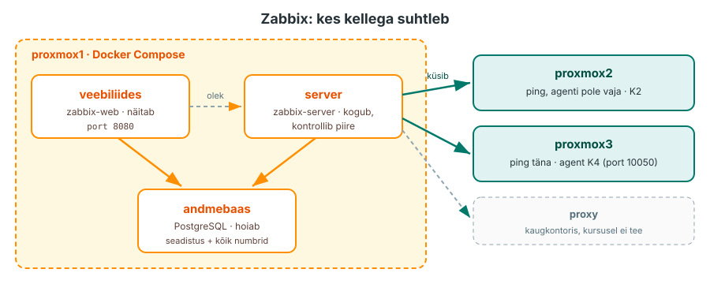

---
tags:
  - Praktikum
  - Monitooring
  - Zabbix
  - Docker
---

# Praktikum: Zabbix valvab

Täna käivitad `proxmox1`-s Zabbixi, mis kontrollib iga minut, kas `proxmox2` ja `proxmox3` vastavad. Ühe masina aadressi kirjutad meelega valesti ja jälgid, kuidas probleem tekib ja pärast parandust laheneb.

**Edenemine:** laboritahvel <http://192.168.125.187:8092/> (VPN-iga).

??? abstract "Õpiväljundid"
    Pärast loengut ja praktikumi oskad:

    1. käivitada Zabbixi serveri, andmebaasi ja veebiliidese Docker Compose'iga;
    2. leida põhjus, miks konteiner ei käivitu, kui port on juba kasutusel;
    3. lisada hosti, siduda selle template'iga ja leida hosti viimased andmed;
    4. tekitada probleemi, leida see veebiliidesest ja kontrollida, et see pärast parandust laheneb;
    5. näidata andmebaasist, et Zabbix hoiab hoste ja probleeme andmebaasis.

<figure markdown="span">
  
  <figcaption>Joonis 2.4. Praktikumi ülesehitus. Täna kontrollib Zabbix masinaid pingiga, agent lisandub N4-s (Talvik, 2026).</figcaption>
</figure>

Rida **Ennusta** tähendab, et enne käsku mõtled läbi, mis juhtub. Ennustuse kirjutad README-sse. Vastus on kokkuvolditud plokis. Repositooriumi README-s on iga osa jaoks jaotis A1–A5, mis vastab osadele 1–5.

## Osa 1 · Compose'i fail manuaali põhjal

**Masin:** sinu arvuti, Compose'i fail tuleb `proxmox1`-sse.

Pärast seda osa on `proxmox1`-s Compose'i fail, mille image'id ja seaded leidsid Zabbixi manuaalist.

### 1.1 Repositoorium ja IP-aadressid

Ava Classroom 50 link ([Praktikum 2 - Zabbix valvab](https://classroom50.org/hkhk-monitoring/it24-monitooring/assignments)) ja klooni oma repositoorium. Käivita käsud oma arvutis:

```bash
git clone <sinu-repo-url>
cd <sinu-repo>
ls -R
```

??? success "Oodatav tulemus"
    ```text
    .:
    README.md  konf  logid
    ```

    `README.md`-sse kirjutad ennustused ja vastused, pealkirjad on juba olemas. Kaustad `konf/` ja `logid/` on tõendite jaoks.

Zabbix vajab `proxmox1`-s Dockerit ja umbes 300 MB vaba mälu. Zabbix ühendub masinatega IP-aadressi kaudu, sest SSH aliaseid `proxmox2` ja `proxmox3` see ei tunne. Kontrolli Dockerit ja pane kirja kolme masina IP-aadressid:

```bash
ssh proxmox1 "docker --version; free -h | grep Mem"
for h in proxmox1 proxmox2 proxmox3; do echo "$h $(ssh $h hostname -I | cut -d' ' -f1)"; done
```

??? success "Oodatav tulemus"
    Dockeri versioon ja mälurida, kus veerg `available` on vähemalt 300 MB. Seejärel kolm rida, näiteks `proxmox2 192.168.35.12`. Need IP-aadressid lisad osades 4 ja 5 Zabbixisse.

??? warning "Kui tuleb `docker: command not found` või `permission denied`"
    Docker puudub või sinu kasutaja ei kuulu gruppi `docker`. Tee läbi automatiseerimise kursuse [N5 Osa 0](https://hkhk-automation.github.io/devops/week05/lab/) ja logi `proxmox1`-sse uuesti sisse.

### 1.2 Otsi manuaalist image'id ja silt

Zabbixi manuaal on PDF-ina üle 2000 lehekülje. Seda ei loeta algusest lõpuni, sealt otsitakse kindlat sõna.

??? tip "Kuidas manuaalist otsida"
    1. **Õige versioon:** veebiaadressis peab olema `/documentation/7.0/`. PDF: [Zabbix_Documentation_7.0.en.pdf](https://www.zabbix.com/documentation/7.0/downloads/Zabbix_Documentation_7.0.en.pdf) (umbes 50 MB).
    2. **Otsi täpse sõnaga:** muutuja nimi (`ZBX_SERVER_HOST`), item'i võti (`icmpping`), menüü nimi (`Latest data`). PDF-is **Ctrl+F**, veebis lehe ülaosa otsingukast.
    3. **Lehe sees:** veebis on **On this page** lehe sisukord, PDF-is vasakul järjehoidjad.
    4. **Näited:** koodiplokke saab kopeerida, kuid kontrolli paroole, porte ja versiooni.

**1. Ava õige versioon.** Ava [Zabbixi manuaal: Installation from containers](https://www.zabbix.com/documentation/7.0/en/manual/installation/containers). Vaata lehe ülaosa: seal on versiooni valik. Kui otsingumootor viib sind lehele, kus on kirjas **7.4 (current)**, vaheta see **7.0** peale. Kursusel on kasutusel 7.0 LTS. Versioonide vahel muutuvad image'ite sildid, seaded ja menüüd.

!!! warning "„current“ ei ole kursuse versioon"
    Link, mille aadressis on `/current/`, avab uusima versiooni manuaali. Kui manuaalis on midagi, mida sinu Zabbixis ei ole, kontrolli kõigepealt versiooni. Lisa järjehoidjasse aadress, milles on `/documentation/7.0/`.

**2. Leia image'id.** Ava lehe sisukorrast **On this page** jaotis **Available Docker images**. Tabelis on igal Zabbixi osal oma image. Leia:

- serveri image, mis kasutab **PostgreSQL**-i;
- veebiliidese image, mis kasutab **Nginx**-i ja **PostgreSQL**-i.

**3. Leia silt (tag).** Ava **Image tags**. Seal on silt kujul `zabbix/<image>:<os>-<version>`. Kasuta operatsioonisüsteemi **alpine** (väike image) ja versiooni **7.0.32**. Kirjuta sildi `latest` asemel konkreetne versioon, siis ei uuene Zabbix sinu teadmata. Uusimaid 7.0 versioone näed Docker Hubis, link on samas tabelis.

**4. Tõlgi `docker run` Compose'iks.** Ava **Docker (manual deployment) → Deploy Zabbix server (PostgreSQL) with SNMP traps**. Seal käivitatakse andmebaas, server ja veebiliides ükshaaval `docker run` käskudega. Iga `-e NIMI="väärtus"` on keskkonnamuutuja. Compose'is lähevad samad muutujad teenuse alla jaotisse `environment:`. Manuaali märkus ütleb ka, et `ZBX_SERVER_HOST` vastab Zabbixi seadele `Server`.

??? success "Oodatav tulemus"

    | Mis | Leid manuaalist |
    |---|---|
    | Server | `zabbix/zabbix-server-pgsql` |
    | Veebiliides | `zabbix/zabbix-web-nginx-pgsql` |
    | Silt | `alpine-7.0.32` |
    | Andmebaasi seaded | `DB_SERVER_HOST`, `POSTGRES_USER`, `POSTGRES_PASSWORD`, `POSTGRES_DB` |
    | Veebiliides leiab serveri | `ZBX_SERVER_HOST` |
    | Veebiliidese port konteineris | `8080` (`-p 80:8080`) |

README jaotises **A1** kirjuta `_vastus_` asemele, mis image'id ja sildi leidsid ning mis manuaali osast (pealkiri).

### 1.3 Loo Compose'i fail

Logi `proxmox1`-sse sisse ja loo töökaust:

```bash
ssh proxmox1
mkdir -p ~/zabbix && cd ~/zabbix
```

Andmebaasi parool läheb faili `.env`, mitte Compose'i faili. See fail on saladus ja reposse seda ei kopeerita. Parool luuakse ainult siis, kui faili veel pole: kui teed seda sammu uuesti, jääb vana parool alles ja olemasolev andmebaas avaneb edasi.

```bash
test -e .env || (umask 077; echo "ZBX_DB_PASSWORD=$(openssl rand -hex 12)" > .env)
ls -l .env
```

Loo `compose.yaml` (VS Code Remote-SSH või `nano compose.yaml`). Täida kolm kohta `<...>` manuaalist leitud image'i ja sildiga:

```yaml
services:
  postgres:
    image: postgres:16-alpine
    environment:
      POSTGRES_USER: zabbix
      POSTGRES_PASSWORD: ${ZBX_DB_PASSWORD}
      POSTGRES_DB: zabbix
    volumes:
      - zbx-db:/var/lib/postgresql/data

  zabbix-server:
    image: <serveri image>:<silt>
    environment:
      DB_SERVER_HOST: postgres
      POSTGRES_USER: zabbix
      POSTGRES_PASSWORD: ${ZBX_DB_PASSWORD}
      POSTGRES_DB: zabbix
    ports:
      - "10051:10051"
    depends_on:
      - postgres

  zabbix-web:
    image: <veebiliidese image>:<silt>
    environment:
      ZBX_SERVER_HOST: <serveri teenuse nimi selles failis>
      DB_SERVER_HOST: postgres
      POSTGRES_USER: zabbix
      POSTGRES_PASSWORD: ${ZBX_DB_PASSWORD}
      POSTGRES_DB: zabbix
      PHP_TZ: Europe/Tallinn
    ports:
      - "8080:8080"
    depends_on:
      - zabbix-server

volumes:
  zbx-db:
```

Need seaded erinevad manuaali näitest:

- `DB_SERVER_HOST: postgres`: manuaalis on konteineri nimi `postgres-server`, siin on teenuse nimi `postgres`. Compose'is leiavad teenused üksteist teenuse nime järgi.
- `${ZBX_DB_PASSWORD}`: manuaalis on parool `zabbix_pwd` otse käsus ja manuaal soovitab selle asendada tugeva parooliga. Siin tuleb parool failist `.env`.
- `8080:8080`: manuaalis on `-p 80:8080`, aga `proxmox1` port 80 võib olla automatiseerimise N3 nginx-i käes.
- `10051`: port, kuhu agendid N4-s andmeid saadavad ([Requirements: pordid](https://www.zabbix.com/documentation/7.0/en/manual/installation/requirements)).
- Ülejäänud seaded on manuaalis [Environment variables](https://www.zabbix.com/documentation/7.0/en/manual/installation/containers#environment-variables) ja iga image'i Docker Hubi lehel.

??? tip "Vihje: kas fail on õige?"
    `docker compose config` loeb faili, asendab muutujad failist `.env` ja näitab tulemust. Kui failis on viga või `<...>` on täitmata, näitab käsk seda kohe, ilma et midagi käivitaks.

**Ennusta:** kolm teenust kasutavad sama parooli. Mis juhtuks, kui `zabbix-server` all oleks parool vale, kuid veebiliidese all õige? Kas veebiliides avaneks? Kirjuta ennustus README jaotisse **A1**.

## Osa 2 · Port on kinni

**Masin:** `proxmox1`. Tõendi salvestad oma arvutis repositooriumi kaustas.

Pärast seda osa töötavad kõik kolm konteinerit. Enne seda tekitad vea, mis tuleb sageli ette siis, kui masinas töötab juba mõni teine teenus.

Kui automatiseerimise kursuse N6 konteinerid töötavad `proxmox1`-s, kasutavad need porti 8080. Kontrolli kõigepealt, kas port on juba hõivatud: `docker ps --filter publish=8080`. Kui seal on konteiner, on konflikt juba olemas: jäta `docker run` vahele ja tee ainult `docker compose` käsud. Kui port on vaba, tekita sama olukord ajutise konteineriga `ankur`. Käivita käsud `proxmox1`-s kaustas `~/zabbix`:

```bash
docker run -d --name ankur -p 8080:80 nginx:1.27
docker compose up -d
docker compose ps -a
```

??? success "Oodatav tulemus"
    ```text
    Error response from daemon: ... Bind for 0.0.0.0:8080 failed: port is already allocated
    ```

    `docker compose ps -a`: `postgres` ja `zabbix-server` on olekus `Up`, `zabbix-web` on olekus `Created`. Konteiner on loodud, kuid seda ei saanud käivitada.

??? question "Leia põhjus"
    Mis hoiab porti 8080? Leia see kahel viisil: `docker ps` (konteinerite pordid) ja `sudo ss -ltnp | grep 8080` (kõik, mis masinas porti kuulab). Miks on kasulik osata mõlemat? Kirjuta vastus README jaotisse **A2**.

Peata konteiner, mis porti hoiab, ja käivita Zabbix uuesti. Kui porti hoiab N6 Compose'i projekt, peata see selle kaustas `~/lab06` käsuga `docker compose stop`.

```bash
docker rm -f ankur
docker compose up -d
docker compose ps
```

??? success "Oodatav tulemus"
    Kolm rida, kõik olekus `Up`. `zabbix-web` real on `0.0.0.0:8080->8080/tcp`.

??? warning "Kui leht näitab `Database error`"
    Esimesel käivitusel loob server andmebaasi tabelid ja see võtab 1–3 minutit ([manuaal](https://www.zabbix.com/documentation/7.0/en/manual/installation/containers#docker-compose)). Vaata serveri logi: `docker compose logs -f zabbix-server`. Kui logis on `Database schema successfully created` või `server #0 started`, on server valmis. Logist väljumiseks vajuta **Ctrl+C**.

Salvesta tõend. Välju `proxmox1`-st käsuga `exit` ja käivita oma arvutis repositooriumi kaustas:

```bash
ssh proxmox1 "cd ~/zabbix && docker compose ps" > logid/a2-compose-ps.txt
scp proxmox1:zabbix/compose.yaml konf/
```

Faili `.env` reposse ei kopeeri.

## Osa 3 · Esimene sisselogimine

**Masin:** brauser sinu arvutis, Zabbix töötab `proxmox1`-s.

Pärast seda osa oled veebiliideses sisse loginud ja vaikimisi parooli vahetanud.

Ava brauseris `http://<proxmox1-IP>:8080`. Kasutaja on **Admin**, parool **zabbix**.

!!! warning "Vaheta parool kohe"
    `Admin / zabbix` on kirjas Zabbixi juhendis ([Basic configuration](https://www.zabbix.com/documentation/7.0/en/manual/quickstart/basic_config)) ja ründajad proovivad seda esimesena. Vali üleval paremal **User settings → Profile → Change password** ([User profile](https://www.zabbix.com/documentation/7.0/en/manual/web_interface/user_profile)). Pane uus parool kirja, kuid mitte reposse.

??? warning "Kui leht ei avane"
    Käivita `ssh proxmox1 "curl -s -o /dev/null -w '%{http_code}' localhost:8080"`. Kui vastus on `200`, töötab Zabbix ja viga on võrgus: kontrolli VPN-i ja IP-aadressi. Kui vastus ei ole `200`, vaata `proxmox1`-s kaustas `~/zabbix` logi `docker compose logs zabbix-web`.

Ava **Data collection → Hosts** ([Hosts](https://www.zabbix.com/documentation/7.0/en/manual/web_interface/frontend_sections/data_collection/hosts)). Seal on üks host: **Zabbix server**. Veerus **Availability** on punane **ZBX**.

??? question "Leia põhjus"
    Hoia hiirt punase ZBX kohal. Millise aadressiga üritab Zabbix ühendust võtta? Mitu konteinerit sul töötab ja kas mõni neist on agent? Vaata [loengu 3. peatükki](lecture.md#3-zabbix-kes-kellega-suhtleb). Kirjuta vastus README jaotisse **A3**.

Ava **Monitoring → Latest data** ja vali host **Zabbix server**.

??? success "Oodatav tulemus"
    Osal item'itel on väärtus olemas, näiteks `Zabbix server: Utilization of configuration syncer internal processes`. Need on serveri [sisemised item'id](https://www.zabbix.com/documentation/7.0/en/manual/config/items/itemtypes/internal), mis ei vaja agenti. Teised read on tühjad, sest need ootavad agenti, mille paigaldad N4-s.

## Osa 4 · Esimene host: proxmox2

**Masin:** brauser ja `proxmox1`.

Pärast seda osa kontrollib Zabbix iga minut pingiga, kas `proxmox2` vastab, ja näitab vastuse aega. Hosti lisamine on manuaalis [Configuring a host](https://www.zabbix.com/documentation/7.0/en/manual/config/hosts/host), template'id lehel [Templates](https://www.zabbix.com/documentation/7.0/en/manual/config/templates).

Vali **Data collection → Hosts → Create host** ja täida:

- **Host name:** `proxmox2`
- **Templates:** kirjuta `ICMP` ja vali **ICMP Ping**
- **Host groups:** **Linux servers**
- **Interfaces → Add → Agent**, **IP address:** `proxmox2` IP-aadress osast 1.1

Vajuta **Add**.

Enne veebiliideses ootamist kontrolli, kas ping jõuab serveri konteinerist sihtmasinani. Zabbix kasutab pingimiseks programmi `fping` ([ICMP ping kontrollid](https://www.zabbix.com/documentation/7.0/en/manual/config/items/itemtypes/simple_checks#icmpping)), mis on serveri konteineris olemas. Käivita `proxmox1`-s:

```bash
cd ~/zabbix && docker compose exec zabbix-server fping <proxmox2-IP>
```

??? success "Oodatav tulemus"
    `192.168.35.12 is alive`. Kui `fping` annab `is alive`, tuleb ka veebiliidesesse väärtus 1 (Up). Nii tead kohe, kas viga on võrgus või Zabbixi seadistuses.

Ava **Monitoring → Latest data** ([Latest data](https://www.zabbix.com/documentation/7.0/en/manual/web_interface/frontend_sections/monitoring/latest_data)), vali filtris **Hosts:** `proxmox2` ja vajuta **Apply**. Oota minut ja värskenda lehte.

??? success "Oodatav tulemus"
    Template'ist *ICMP Ping* tulevad kolm rida:

    | Name | Last value |
    |---|---|
    | ICMP ping | Up (1) |
    | ICMP loss | 0 % |
    | ICMP response time | mõni ms |

    Vajuta ühe rea kõrval **Graph**: see on sama väärtus ajas, iga minuti kohta üks punkt.

**Leia dokumentatsioonist:** ava [Simple checks](https://www.zabbix.com/documentation/7.0/en/manual/config/items/itemtypes/simple_checks) või otsi PDF-ist `icmpping`. Mida tähendab tagastatud väärtus `0` ja mida `1`? Mis on parameeter `count` ja mis on selle vaikeväärtus? Kirjuta vastus README jaotisse **A4**.

??? question "Mõtle"
    Liidese tüüp on **Agent**, kuid `proxmox2`-s agenti ei ole. Miks ping ikkagi töötab? Mida see ütleb selle kohta, kust Zabbix pingi saadab? Kirjuta vastus README jaotisse **A4**.

## Osa 5 · Probleem tekib ja laheneb

**Masin:** brauser ja `proxmox1`. Tõendi salvestad oma arvutis repositooriumi kaustas.

Pärast seda osa oled näinud probleemi elutsüklit: probleem tekib, on veebiliideses näha ja laheneb.

Lisa samamoodi teine host **`proxmox3`** template'iga **ICMP Ping**. IP-aadressi viimane number kirjuta **meelega valesti**, näiteks `.254`.

**Ennusta:** kas Zabbix näitab viga kohe, kui vajutad **Add**? Kui ei, siis millal ja kus? Kirjuta ennustus README jaotisse **A5**.

Kontrolli `proxmox1`-s sama käsuga nagu osas 4: `docker compose exec zabbix-server fping <vale-IP>`.

Ava **Monitoring → Problems** ([Problems](https://www.zabbix.com/documentation/7.0/en/manual/web_interface/frontend_sections/monitoring/problems)) ja oota umbes 3 minutit. Ära paranda IP-aadressi enne, kui probleem on nimekirjas. Muidu probleemi ei teki ja tõend jääb tühjaks.

??? success "Oodatav tulemus"
    Ilmub rida, kus **Host** on `proxmox3`, **Problem** on *Unavailable by ICMP ping* ja **Severity** on **High**. Veerus **Duration** loeb aeg üles.

    Nimekirjas võib olla ka rida **Zabbix server**: *Linux: Zabbix agent is not available*. See on oodatud, sest agenti veel ei ole (osa 3).

    Probleem ei tekkinud kohe, sest [trigger](https://www.zabbix.com/documentation/7.0/en/manual/config/triggers) ootab kolme järjestikust nurjunud pingi ([loengu 5. peatükk](lecture.md#5-probleemi-elutsukkel)). Zabbix ei tea, et IP-aadress on vale: talle on see masin, mis ei vasta.

**Leia dokumentatsioonist:** trigger'i tingimus on menüüs **Data collection → Templates → ICMP Ping → Triggers**. Avaldises on funktsioon `max(...)`. Otsi manuaalist (PDF-is `max(/host/key`, veebis [History functions](https://www.zabbix.com/documentation/7.0/en/manual/appendix/functions/history)), mida see funktsioon teeb. Kirjuta README jaotisse **A5** ühe lausega, millal trigger probleemi tekitab.

Paranda IP-aadress: **Data collection → Hosts → proxmox3**, sisesta õige IP-aadress ja vajuta **Update**. Oota 1–2 minutit, ava **Monitoring → Problems** ja vali filtris **Show: History**.

??? success "Oodatav tulemus"
    Aktiivsete probleemide hulgas probleemi enam ei ole. Ajaloo vaates on see olemas: **Status** on **RESOLVED** ([sündmused ja nende olekud](https://www.zabbix.com/documentation/7.0/en/manual/config/events)) ja näha on probleemi kestus.

Zabbix hoiab hoste ja probleeme andmebaasis. Võta sealt tõend, et mõlemad hostid on olemas ning probleem tekkis ja lahenes. Käivita oma arvutis repositooriumi kaustas:

```bash
ssh proxmox1 "cd ~/zabbix && docker compose exec -T postgres psql -U zabbix -c \"SELECT host FROM hosts WHERE host LIKE 'proxmox%' ORDER BY host;\" -c \"SELECT name, to_timestamp(clock) AS algas, to_timestamp(NULLIF(r_clock, 0)) AS lahenes FROM problem ORDER BY clock;\"" > logid/a5-andmebaas.txt
cat logid/a5-andmebaas.txt
```

??? success "Oodatav tulemus"

    Esimeses tabelis on `proxmox2` ja `proxmox3`. Teises on rida *Unavailable by ICMP ping*, kus on olemas nii `algas` kui ka `lahenes`. Kui `lahenes` on tühi, pole probleem veel lahenenud: kontrolli IP-d ja oota veel minut. Salvesta tõend samal päeval, sest Zabbix kustutab lahenenud probleemid sellest tabelist umbes ööpäeva pärast.

??? question "Mõtle"
    Sa ei ole andmebaasi midagi kirjutanud, kuid seal on sinu hostid ja probleem koos kellaaegadega. Mis need sinna kirjutas? Mis juhtub nende andmetega pärast `docker compose down`? Aga pärast `docker compose down -v`? Kirjuta vastus README jaotisse **A5**, käske ära käivita.

Zabbix jääb tööle, sest N3 ja N4 jätkavad selle seadistusega.

!!! warning "Ära kasuta `docker compose down -v`"
    Võti `-v` kustutab andmebaasi andmeköite ja koos sellega kõik hostid ning probleemide ajaloo. Kui mälu jääb väheks, peata Zabbix `proxmox1`-s kaustas `~/zabbix` käsuga `docker compose stop`. Andmed jäävad alles ja `docker compose start` käivitab Zabbixi uuesti.

## Töö esitamine

Repositooriumis on `konf/compose.yaml`, `logid/a2-compose-ps.txt`, `logid/a5-andmebaas.txt` ja README vastused. Faili `.env` repos ei ole. Käivita oma arvutis repositooriumi kaustas:

```bash
git status
git add README.md konf logid
git commit -m "Praktikum 2: Zabbix valvab"
git push
```

Tulemuse näed Classroom 50-s.

## Lisaülesanded

??? example "1 · Teine piir"
    Template *ICMP Ping* tekitab probleemi ka siis, kui vastuse aeg on liiga pikk. Leia menüüst **Data collection → Templates → ICMP Ping → Triggers**, milline see piir on. Miks ei tekita `proxmox2` seda probleemi?

??? example "2 · Kas server töötab?"
    Peata ainult server: `docker compose stop zabbix-server`. Värskenda veebiliidest ja vaata lehe allserva. Mida Zabbix näitab? Kas `proxmox3` probleem tekiks sel ajal? Käivita server uuesti: `docker compose start zabbix-server`.

??? example "3 · Kolmas host"
    Lisa host `proxmox1` template'iga **ICMP Ping**. Võrdle selle vastuse aega `proxmox2` omaga. Miks need erinevad?

??? example "4 · API"
    Zabbixil on JSON-RPC API, mida kasutavad skriptid ja Ansible. Küsi versiooni ilma sisselogimiseta:

    ```bash
    curl -s -X POST -H 'Content-Type: application/json-rpc' \
      -d '{"jsonrpc":"2.0","method":"apiinfo.version","params":{},"id":1}' \
      http://<proxmox1-IP>:8080/api_jsonrpc.php
    ```

    Leia [API juhendist](https://www.zabbix.com/documentation/7.0/en/manual/api), kuidas saada token ja küsida `host.get`.
