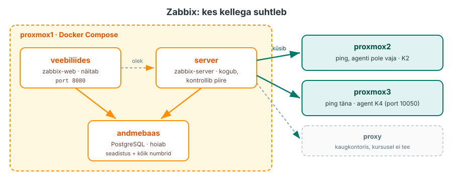
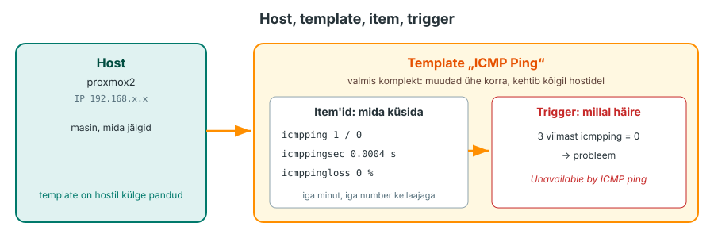
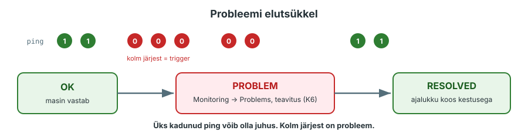

---
tags:
  - Loeng
  - Monitooring
  - Zabbix
---

# Loeng: keskne jälgimissüsteem

N1-s kogusid masinate logid keskserverisse ja leidsid neist, mis öösel juhtus. Täna vaatad, kuidas monitooringusüsteem kontrollib masinaid pidevalt ja teatab probleemist enne, kui kasutaja seda märkab.

??? abstract "Õpiväljundid"
    Pärast loengut ja praktikumi oskad:

    - selgitada, mille poolest monitooring logidest erineb
    - nimetada monitooringusüsteemi neli ülesannet: kogumine, hoidmine, näitamine ja teavitamine
    - kirjeldada Zabbixi osi (server, andmebaas, veebiliides, agent, proxy) ja nendevahelisi ühendusi
    - selgitada ühe näite põhjal mõisteid host, item, trigger ja template
    - kirjeldada probleemi elutsüklit: probleem tekib, on veebiliideses näha ja laheneb

## 1. Logid ja monitooring

N1 näites uuriti e-poe öist riket logidest. Logid vastasid küsimusele **„mis juhtus?“**. Logi avati aga alles hommikul, kui klient oli juba teatanud, et pood ei avane.

**Monitooring** (seire) vastab teisele küsimusele: **„kas praegu on kõik korras ja kui palju?“** Monitooringusüsteem kontrollib näiteks iga minut, kas masin vastab, kui täis on ketas ja kui kiiresti leht avaneb. Kui väärtus ületab seatud piiri, teavitab süsteem inimest kohe.

??? note "Tabel 2.1. Logid ja monitooring"
    | | Logid (N1) | Monitooring (N2–N7) |
    |---|---|---|
    | Küsimus | Mis juhtus? | Kas praegu on korras? Kui palju? |
    | Andmed | tekstiread sündmustest | numbrid ajas: 1 või 0, 73 %, 120 ms |
    | Millal vaatad | pärast, uurimiseks | pidevalt, süsteem kontrollib ise |
    | Kes märkab | inimene, kes logi loeb | süsteem, mis teavitab inimest |

??? question "Kontrolli ennast"
    E-poe serveri ketas sai öösel täis ja andmebaas peatus. Mida oleksid näinud logides ja mida monitooringus? Kumb oleks hoiatanud enne, kui ketas täis sai?

## 2. Monitooringusüsteemi neli ülesannet

Zabbix, Prometheus ja teised monitooringusüsteemid teevad nelja tööd:

1. **Kogumine:** süsteem küsib masinatelt numbreid või võtab vastu need, mida masinad ise saadavad.
2. **Hoidmine:** iga number salvestatakse koos kellaajaga andmebaasi. Hiljem saad vaadata, mis oli eile kell 3.
3. **Näitamine:** numbritest tehakse tabelid ja graafikud.
4. **Teavitamine:** kui number ületab piiri, tekib probleem ja süsteem teavitab inimest.

Ilma teavituseta peab inimene graafikuid ise jälgima. Teavitused seadistad N6-s.

## 3. Zabbix: kes kellega suhtleb

Kursusel kasutad Zabbixi versiooni **7.0 LTS** (pikaajalise toega). Zabbix sobib eriti kohtadesse, kus on palju eri tüüpi seadmeid: serverid, võrguseadmed, printerid ja UPS-id ([Zabbixi kirjeldus](https://www.zabbix.com/documentation/7.0/en/manual/introduction/about)).

??? info "Zabbixi taust"
    Zabbixi kirjutas 1998. aastal Riias Alexei Vladišev, esimene avalik versioon ilmus 2001 ([Zabbixi ajalugu](https://www.zabbix.com/about)). Praegu on see üks levinumaid vabavaralisi monitooringusüsteeme.

<figure markdown="span">
  
  <figcaption>Joonis 2.1. Zabbixi osad. Server kogub andmed ja hindab trigger'eid, andmebaas hoiab andmeid, veebiliides näitab neid (Talvik, 2026).</figcaption>
</figure>

??? note "Tabel 2.2. Zabbixi osad"
    | Osa | Mida teeb | Praktikumis |
    |---|---|---|
    | [**Server**](https://www.zabbix.com/documentation/7.0/en/manual/concepts/server) | küsib andmed, kirjutab need andmebaasi, kontrollib piire ja tekitab probleemid | konteiner `zabbix-server` |
    | **Andmebaas** | hoiab seadistust (mis masinad, mida küsida) ja mõõdetud väärtusi | konteiner `postgres` |
    | **Veebiliides** | näitab andmeid ja võimaldab seadistada, ise andmeid ei kogu | konteiner `zabbix-web`, port 8080 |
    | [**Agent**](https://www.zabbix.com/documentation/7.0/en/manual/concepts/agent) | väike programm jälgitavas masinas, annab protsessori, mälu ja ketta väärtused | N4 |
    | [**Proxy**](https://www.zabbix.com/documentation/7.0/en/manual/concepts/proxy) | kogub kaugkontoris andmed kokku ja saadab serverile ühe ühendusega | kursusel ei kasutata |

Veebiliides ja server kasutavad sama andmebaasi. Kui andmebaas ei tööta, ei tööta kumbki. Kui server ei tööta, näitab veebiliides vanu andmeid, uusi andmeid ei tule ja teavitusi ei saadeta. Veebiliidese allservas on siis teade *Zabbix server is not running: the information displayed may not be current*.

Andmeid saab koguda ka **ilma agendita**. Kõige lihtsam kontroll on ping: server saadab masinale ICMP-paketi ja ootab vastust. Samamoodi küsib Zabbix võrguseadmetelt andmeid **SNMP**-ga ja veebilehelt **HTTP**-ga, seadmesse midagi paigaldamata. Masina sisemised väärtused (protsessor, mälu, ketas) tulevad agendiga N4-s.

**Proxy** on vaja siis, kui server ei saa kõiki masinaid otse küsida:

- **kaugkontor:** 50 seadet teises linnas, proxy kogub nende andmed kohapeal ja saadab serverile ühe ühendusega;
- **eraldatud võrk (DMZ):** tulemüüris on vaja ühte reeglit (proxy → server), mitte 50;
- **ühendus katkeb:** proxy hoiab andmeid enda juures ja saadab need edasi, kui ühendus taastub.

Proxy kogub ja edastab andmeid, trigger'eid hindab server.

??? question "Kontrolli ennast"
    Andmebaasi konteiner peatub ootamatult. Mis juhtub veebiliidesega ja mis serveriga? Kas saad sel ajal teavituse, et midagi on katki?

## 4. Host, item, trigger ja template

Zabbixi seadistus põhineb neljal mõistel ([Zabbixi mõisted](https://www.zabbix.com/documentation/7.0/en/manual/definitions)). Näites tahad teada, kas `proxmox2` vastab.

??? note "Tabel 2.3. Zabbixi põhimõisted"
    | Mõiste | Mis see on | Näide |
    |---|---|---|
    | **Host** | masin või seade, mida jälgid | `proxmox2`, IP `192.168.x.x` |
    | **Item** | üks väärtus, mida hostilt küsid, koos võtmega (key) ja intervalliga | `icmpping`: kas vastab (1 või 0), iga minut |
    | **Trigger** | tingimus, mille täitumisel tekib probleem | „kolm viimast pingi on 0“ → *Unavailable by ICMP ping* |
    | **Template** | valmis komplekt item'eid ja trigger'eid, mille seod hostiga | *ICMP Ping*: kolm item'it ja kolm trigger'it |

<figure markdown="span">
  
  <figcaption>Joonis 2.2. Host saab template'ist item'id ja trigger'id. Item küsib väärtuse, trigger otsustab, kas see on probleem (Talvik, 2026).</figcaption>
</figure>

Viies mõiste on **action**: mis juhtub, kui probleem tekib. Action saadab e-kirja, sõnumi või käivitab skripti. Täna vaatad probleeme ainult veebiliideses, teavitused seadistad N6-s.

[Template](https://www.zabbix.com/documentation/7.0/en/manual/config/templates) säästab käsitsi tööd: item'eid ei pea igale masinale eraldi looma. Kui muudad template'is piiri, muutub see kõigil hostidel, millega template on seotud. Sama mõte on Ansible'i rollil.

Item'i **võti** (key) määrab, mida küsitakse. `icmpping` küsib, kas host vastab pingile, ja `icmppingsec` küsib vastuse aega sekundites. Võtmete loend on [Zabbixi dokumentatsioonis](https://www.zabbix.com/documentation/7.0/en/manual/config/items/itemtypes/simple_checks).

??? question "Kontrolli ennast"
    Sul on 30 veebiserverit ja tahad igaühelt teada, kas port 443 vastab. Mitu template'it teed ja mitu korda kirjutad trigger'i?

## 5. Probleemi elutsükkel

[Trigger'il](https://www.zabbix.com/documentation/7.0/en/manual/config/triggers) on kaks olekut: **OK** ja **PROBLEM**. Kui tingimus täitub, läheb trigger olekusse PROBLEM ja tekib **probleem** (problem). Probleemi näed veebiliideses menüüs **Monitoring → Problems**.

<figure markdown="span">
  
  <figcaption>Joonis 2.3. Probleem tekib, on näha ja laheneb, kui põhjus kaob (Talvik, 2026).</figcaption>
</figure>

Template *ICMP Ping* ootab kolme järjestikust nurjunud pingi. Üks kadunud pakett võib olla juhuslik. Kui trigger reageeriks igale nurjumisele, tuleks palju valehäireid ja teavitusi hakataks eirama. Häirete hulgast räägib N6.

Kui masin hakkab uuesti vastama, läheb trigger tagasi olekusse OK ja probleem saab märke **RESOLVED**. Ajalukku jääb probleemi algus ja kestus. Nende järgi saad hiljem öelda, et e-pood oli maas 40 minutit.

??? question "Kontrolli ennast"
    1. Mis vahe on Zabbixi serveril ja veebiliidesel? Kumb peab töötama, et teavitus tuleks?
    2. Pane järjekorda: template, host, trigger, item. Mis millest koosneb?
    3. Miks ei tekita template'i *ICMP Ping* trigger probleemi esimese kadunud pingi järel?
    4. Probleem on olekus RESOLVED. Mida saad sellest veel teada?

??? abstract "Kokkuvõte"
    | Mõiste | Lühidalt |
    |---|---|
    | Logid ja monitooring | logid vastavad küsimusele „mis juhtus“, monitooring küsimusele „kas praegu on korras“ |
    | Neli ülesannet | kogumine, hoidmine, näitamine ja teavitamine |
    | Zabbix | server kogub ja hindab, andmebaas hoiab, veebiliides näitab; agent ja proxy lisanduvad vajaduse korral |
    | Host, item, trigger, template | masin, üks väärtus, tingimus, valmis komplekt |
    | Probleemi elutsükkel | tekib, on näha, laheneb; trigger ootab mitut nurjumist, et vältida valehäireid |
