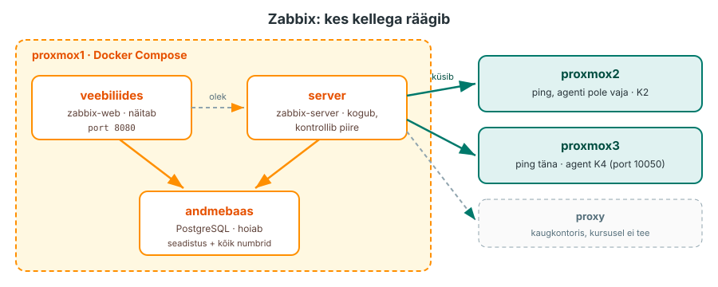
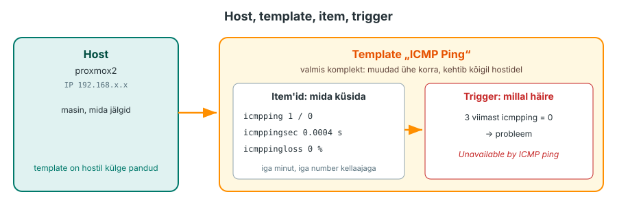
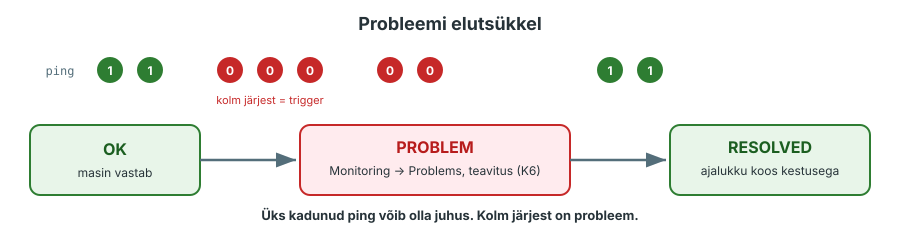

---
tags:
  - Loeng
  - Monitooring
  - Zabbix
---

# Loeng: keskne jälgimissüsteem

**Maht:** ~20 min klassis, ~30 min iseseisvalt lugedes
**Tase:** K1 on tehtud: tead, kus logid on ja kuidas need keskserverisse jõuavad. Docker Compose on tuttav automatiseerimise kursuse N6-st.

Selle loengu järel tead, mida teeb monitooringusüsteem ja millest Zabbix koosneb. Laboris paned Zabbixi `proxmox1`-s tööle ja lisad sinna esimesed masinad.

---

!!! abstract "Õpiväljundid"
    Pärast seda materjali oskad:

    - selgitada, mille poolest monitooring logidest erineb
    - nimetada monitooringusüsteemi neli tööd: kogub, hoiab, näitab, teavitab
    - kirjeldada Zabbixi osi (server, andmebaas, veebiliides, agent, proxy) ja seda, kes kellega räägib
    - selgitada mõisteid host, item, trigger ja template ühe näite peal
    - kirjeldada probleemi elutsüklit: tekib, on näha, laheneb

---

## 1. Logid räägivad tagantjärele

K1-s uuris Kati öösel juhtunut logidest. Logid vastasid küsimusele **„mis juhtus?“**. Aga keegi pidi need lahti tegema, ja ta tegi seda alles hommikul, kui klient helistas, et e-pood ei avane.

E-pood oli maas 40 minutit. Logides oli kõik kirjas, aga keegi ei vaadanud.

**Monitooring** (seire) küsib teist küsimust: **„kas praegu on kõik korras ja kui palju?“** Süsteem kontrollib ise iga minut, kas masin vastab, kui täis on ketas ja kui kiiresti leht avaneb. Kui midagi läheb valesti, ütleb ta seda kohe, enne kui klient helistab.

| | Logid (K1) | Monitooring (K2–K7) |
|---|---|---|
| Küsimus | Mis juhtus? | Kas praegu on korras? Kui palju? |
| Andmed | tekstiread sündmustest | numbrid ajas: 1 või 0, 73 %, 120 ms |
| Millal vaatad | pärast, uurimiseks | kogu aeg, süsteem vaatab sinu eest |
| Kes märkab | inimene, kes logi loeb | süsteem ise, ja teavitab inimest |

*Tabel 2.1. Logid ja monitooring vastavad eri küsimustele. Head tööd teevad mõlemad koos.*

??? question "Kordamisküsimus"
    Kati ketas sai öösel täis ja andmebaas jäi seisma. Mida oleks näinud logides ja mida monitooringus? Kumb oleks hoiatanud **enne**, kui ketas täis sai?

---

## 2. Monitooringusüsteemi neli tööd

Iga monitooringusüsteem, olgu see Zabbix, Prometheus või midagi muud, teeb sama nelja asja:

1. **Kogub:** küsib masinatelt numbreid või võtab vastu need, mis masinad ise saadavad.
2. **Hoiab:** salvestab iga numbri koos kellaajaga andmebaasi. Nii saad hiljem vaadata, mis oli eile kell 3.
3. **Näitab:** teeb numbritest tabelid ja graafikud.
4. **Teavitab:** kui number ületab piiri, tekib probleem ja süsteem annab inimesele teada.

Neist neljast on kõige olulisem neljas. Monitooring, mis kõike kogub, aga kellelegi midagi ei ütle, on lihtsalt kallis logi.

---

## 3. Zabbix: kes kellega räägib

Zabbixi kirjutas 1998. aastal Riias Alexei Vladišev, esimene avalik versioon ilmus 2001 ([Zabbixi ajalugu](https://www.zabbix.com/about)). Praegu on see üks levinumaid vabavaralisi monitooringusüsteeme. Seda kasutatakse eriti seal, kus on palju erinevaid seadmeid: serverid, võrguseadmed, printerid, UPS-id. Kasutame versiooni **7.0 LTS** (pikaajalise toega), vt [Zabbixi kirjeldus](https://www.zabbix.com/documentation/7.0/en/manual/introduction/about).

<figure markdown="span">
  
  <figcaption>Joonis 2.1. Zabbixi osad. Server kogub ja otsustab, andmebaas hoiab, veebiliides näitab.</figcaption>
</figure>

| Osa | Mida teeb | Laboris |
|---|---|---|
| [**Server**](https://www.zabbix.com/documentation/7.0/en/manual/concepts/server) | küsib andmed, kirjutab need andmebaasi, kontrollib piire ja tekitab probleemid | konteiner `zabbix-server` |
| **Andmebaas** | hoiab seadistust (mis masinad, mida küsida) ja kõiki mõõdetud numbreid | konteiner `postgres` |
| **Veebiliides** | näitab andmeid ja laseb seadistada; ise midagi ei kogu | konteiner `zabbix-web`, port 8080 |
| [**Agent**](https://www.zabbix.com/documentation/7.0/en/manual/concepts/agent) | väike programm jälgitavas masinas, annab CPU, mälu ja ketta numbrid | K4 |
| [**Proxy**](https://www.zabbix.com/documentation/7.0/en/manual/concepts/proxy) | kogub kaugkontoris andmed kokku ja saadab serverile ühe ühendusega | kursusel ei tee |

*Tabel 2.2. Zabbixi osad.*

Pane tähele: veebiliides ja server räägivad mõlemad sama andmebaasiga. Kui andmebaas ei tööta, ei tööta kumbki. Kui server ei tööta, näitab veebiliides küll vanu andmeid, aga uusi ei tule ja teavitusi ei saadeta. Zabbix ütleb selle kohta veebiliidese allservas: *Zabbix server is not running: the information displayed may not be current*. Laboris näed, mis siis juhtub.

Andmeid saab koguda ka **ilma agendita**. Kõige lihtsam on ping: server saadab masinale ICMP-paketi ja vaatab, kas vastus tuleb. Seda teeme täna. Samamoodi küsib Zabbix võrguseadmetelt (ruuterid, switchid) andmeid **SNMP**-ga ja veebilehelt **HTTP**-ga, seadmesse midagi paigaldamata. Agent tuleb K4-s, siis saame ka masina sisemised numbrid: CPU, mälu, ketas.

**Proxy** on vaja siis, kui server ei saa kõiki masinaid ise otse küsida:

- **kaugkontor:** 50 seadet teises linnas, proxy kogub need kohapeal kokku ja saadab serverile ühe ühendusega;
- **eraldatud võrk (DMZ):** tulemüüris on vaja ühte reeglit (proxy → server), mitte 50;
- **ühendus katkeb:** proxy hoiab andmeid enda juures ja saadab need edasi, kui ühendus on tagasi. Andmetesse auke ei jää.

Proxy kogub ja edastab, aga trigger'eid hindab alati server.

??? question "Kordamisküsimus"
    Andmebaasi konteiner jookseb kokku. Mis juhtub veebiliidesega ja mis serveriga? Kas sa saad sel ajal teavituse, et miski on katki?

---

## 4. Neli mõistet: host, item, trigger, template

Zabbixis on neli sõna, ilma milleta ei saa midagi teha ([Zabbixi mõisted](https://www.zabbix.com/documentation/7.0/en/manual/definitions)). Vaatame neid ühe näite peal: tahame teada, kas `proxmox2` vastab.

| Mõiste | Mis see on | Näide |
|---|---|---|
| **Host** | masin või seade, mida jälgid | `proxmox2`, IP `192.168.x.x` |
| **Item** | üks number, mida hostilt küsid, koos võtmega (key) ja intervalliga | `icmpping`: kas vastab (1 või 0), iga minut |
| **Trigger** | tingimus, mille täitumisel tekib probleem | „kolm viimast pingi on 0“ → *Unavailable by ICMP ping* |
| **Template** | valmis komplekt item'eid ja trigger'eid, mille saad hostile külge panna | *ICMP Ping*: kolm item'it ja kolm trigger'it |

*Tabel 2.3. Zabbixi põhimõisted.*

<figure markdown="span">
  
  <figcaption>Joonis 2.2. Host saab template'ist item'id ja trigger'id. Item küsib numbri, trigger otsustab, kas see on probleem.</figcaption>
</figure>

Viies mõiste on **action**: mis juhtub, kui probleem tekib. Saada e-kiri, sõnum või käivita skript. Täna vaatame probleeme ainult veebiliideses, teavitused seadistame K6-s. Kogu ahel on: **host → item → trigger → action**, ehk mida jälgid → mida mõõdad → millal on halb → kes saab teada.

[Template'i](https://www.zabbix.com/documentation/7.0/en/manual/config/templates) mõte: sa ei loo igale masinale käsitsi item'eid. Paned template'i külge ja kõik vajalik tuleb kaasa. Kui sul on 200 serverit ja template'is muudad ühe piiri, muutub see kõigil 200-l. Sama mõte nagu Ansible rollis.

Item'i **võti** (key) ütleb, mida täpselt küsitakse. `icmpping` küsib, kas host vastab pingile. `icmppingsec` küsib vastuse aega sekundites. Võtmete nimekiri on [Zabbixi dokumentatsioonis](https://www.zabbix.com/documentation/7.0/en/manual/config/items/itemtypes/simple_checks).

??? question "Kordamisküsimus"
    Sul on 30 veebiserverit ja tahad igaühelt teada, kas port 443 vastab. Mitu template'it teed ja mitu korda pead trigger'it kirjutama?

---

## 5. Probleemi elutsükkel

[Trigger'il](https://www.zabbix.com/documentation/7.0/en/manual/config/triggers) on kaks olekut: **OK** ja **PROBLEM**. Kui tingimus täitub, läheb trigger olekusse PROBLEM ja tekib **probleem** (*problem*), mida näed veebiliideses menüüs **Monitoring → Problems**.

<figure markdown="span">
  
  <figcaption>Joonis 2.3. Probleem tekib, on näha ja laheneb ise, kui põhjus kaob.</figcaption>
</figure>

Miks **kolm** pingi, mitte üks? Üks kadunud pakett võib olla juhus. Kui trigger reageeriks igale üksikule nurjumisele, saaksid öösel kümme valehäiret ja hakkaksid teavitusi ignoreerima. See on monitooringu kõige levinum viga: liiga palju häireid, mida keegi enam ei loe. Sellest räägime täpsemalt K6-s.

Kui masin hakkab jälle vastama, läheb trigger tagasi olekusse OK ja probleem saab märke **RESOLVED**. Ajalukku jääb, millal see algas ja kaua kestis. Selle järgi saad hiljem öelda, et e-pood oli maas 40 minutit, mitte „kuskil öösel“.

---

## Kokkuvõte

- **Logid** vastavad küsimusele „mis juhtus“, **monitooring** küsimusele „kas praegu on korras“.
- Monitooringusüsteem **kogub, hoiab, näitab ja teavitab**. Teavitus on neist kõige tähtsam.
- Zabbix = **server** (kogub ja otsustab) + **andmebaas** (hoiab) + **veebiliides** (näitab). Agent ja proxy tulevad juurde, kui vaja.
- **Host** on masin, **item** üks number, **trigger** tingimus, **template** valmis komplekt.
- Probleem **tekib**, **on näha** ja **laheneb**. Trigger ootab mitu nurjumist järjest, et vältida valehäireid.

---

## Küsimused enda kontrolliks

1. Kati e-pood oli 40 minutit maas ja keegi ei teadnud. Milline monitooringusüsteemi neljast tööst puudus?
2. Mis vahe on Zabbixi serveril ja veebiliidesel? Kumb neist peab töötama, et saaksid teavituse?
3. Pane ritta: template, host, trigger, item. Mis millest koosneb?
4. Miks ei tekita *ICMP Ping* template'i trigger probleemi kohe esimese kadunud pingi peale?
5. Probleem on olekus RESOLVED. Mis infot sellest veel saad?

---

*Järgmine: laboris paned Zabbixi `proxmox1`-s Docker Compose'iga tööle, logid sisse, lisad `proxmox2` ja `proxmox3` ning tekitad esimese probleemi.*
