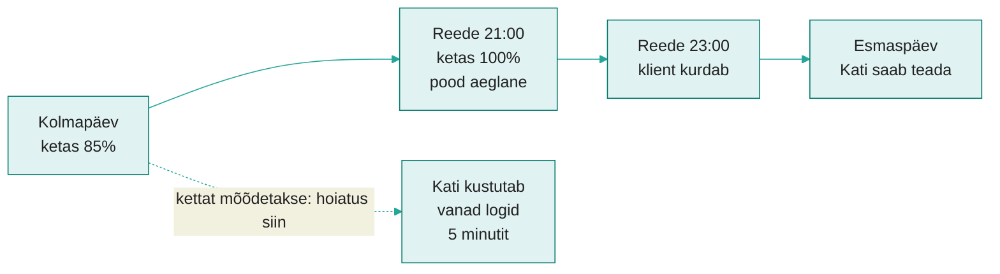
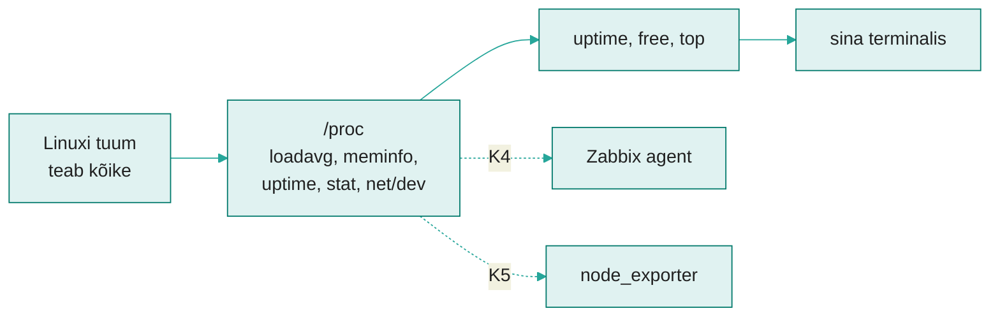
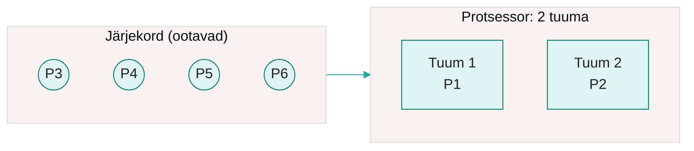

---
tags:
  - Loeng
  - Monitooring
  - Linux
  - Algaja
---

# Loeng: mõõdik, aegrida, agent

**Maht:** ~30 min iseseisvalt lugedes (veebiõpe)
**Tase:** K2 on tehtud: Zabbix töötab `proxmox1`-s ja pingib `proxmox2` ja `proxmox3`.

*Server ei oska kurta. Ta näitab numbreid ja sinu töö on neid lugeda.*

Täna on veebiõpe. Loe loeng läbi, vasta iga osa lõpus olevatele küsimustele oma vihikus ja mine siis laborisse. Laboris loed samu numbreid oma masinatest ja vaatad, mida Zabbix neist näeb ja mida mitte.

---

!!! abstract "Õpiväljundid"
    Pärast seda materjali oskad:

    - eristada mõõdikut (number ajas) ja sündmust (kirje sellest, mis juhtus);
    - selgitada, mis on aegrida ja proovivõtu intervall;
    - eristada gauge'i ja counterit ning tuua mõlemast näite;
    - rakendada USE-meetodit protsessori, mälu ja ketta kohta;
    - tõlgendada koormust (load average) tuumade arvu järgi ja mälu veeru `available` järgi;
    - selgitada, miks Zabbix näeb K2 seadistusega ainult seda, kas masin vastab, ja miks on vaja agenti.

---

## 1. Zabbix ütles „kõik korras“

!!! abstract "Miks see oluline on?"
    K2-s nägid, et Zabbix märkab, kui masin ei vasta. Aga masin võib vastata ja olla ikkagi hädas. Kui sa ei mõõda masina sisu, saad probleemist teada kasutajalt.

K2 lõpuks pingis Zabbix iga minut `proxmox2` ja `proxmox3`. Kui masin ei vastanud, tekkis probleem ja pärast parandust lahenes see ise. See on juba monitooring, aga see vastab ainult ühele küsimusele: **kas masin on võrgus, jah või ei.**

!!! example "Näidisstsenaarium"
    Kati teeb praktikat väikeses e-poes. Reede õhtul kell 21 läheb pood aeglaseks: leht laeb 15 sekundit. Server vastab pingile kenasti, seega Zabbix on roheline.

    Kell 22 lahkuvad esimesed ostjad. Kell 23 kirjutab üks klient Facebooki, et „pood on katki“. Esmaspäeva hommikul logib Kati serverisse. Ketas on 100% täis, sest logifail kasvas terve nädala.

    Kui keegi oleks kolmapäeval vaadanud, oleks ta näinud: ketas 85%, kasvab 5% päevas. Viis minutit tööd, null kaotatud ostjat.

<figure markdown="span">

  <figcaption>Joonis 3.1. Sama probleem kahe teekonnaga. Ping oli kogu aeg korras, seega K2 seadistusega Zabbix ei oleks midagi öelnud. Ketta mõõtmine oleks andnud hoiatuse kaks päeva varem.</figcaption>
</figure>

Monitooringu eesmärk on **teada enne kasutajat.** Selleks ei piisa sellest, et masin vastab. On vaja teada, mis toimub masina sees: kui kiiresti ta töötab, kui palju on mälu ja kettaruumi.

??? question "Kontrolli ennast"
    1. Miks oli Kati e-poe Zabbix reede õhtul roheline?
    2. Too oma elust üks näide, kus said probleemist teada liiga hilja, kuigi märgid olid varem olemas (telefoni aku, mäng, arvuti).

---

## 2. Mõõdik, sündmus ja aegrida

!!! abstract "Miks see oluline on?"
    K1-s töötasid sündmustega (logiread), K2-s nägid esimesi mõõdikuid. Need on kaks erinevat andmeliiki ja neid hoitakse ja loetakse erinevalt.

Mõtle telefoni akule. Ekraanil on **37%**. See on **mõõdik** (metric): üks mõõdetav suurus, millel on nimi ja väärtus. Mõõdikul on alati ka mõõtmise aeg.

Logirida on teist tüüpi andmed. `Oct 29 21:04:11 pood nginx: disk full` on **sündmus** (event): kirje sellest, mis ühel hetkel juhtus. Sündmust loed ja mõistad. Mõõdikut võrdled eelmise väärtusega.

| | Sündmus (K1) | Mõõdik (K2-K7) |
|---|---|---|
| Näide | `Failed password for root from 10.0.9.66` | `ketas_kasutusel = 85` |
| Mis see on | tekst sellest, mis juhtus | number, mis näitab olekut |
| Millal tekib | siis, kui midagi juhtub | iga kindla aja tagant, ka siis, kui midagi ei juhtu |
| Kuidas loed | otsid, filtreerid, loed läbi | võrdled, joonistad graafiku |

*Tabel 3.1. Sündmus ja mõõdik*

Kas 37% akut on hea või halb? Sellest numbrist üksi ei saa aru. Kui hommikul oli 100% ja praegu on kell 10, on midagi valesti. Kui kell on 22, on kõik hästi.

Telefoni seadetes on aku graafik: sama number iga paari minuti järel terve päeva jooksul. Sellist numbrite rida koos ajatemplitega nimetatakse **aegreaks** (time series).

<figure markdown="span">
```text
aku %
100 |█
 80 |  █
 60 |    █ █
 40 |        █ █ █
 20 |              █
  0 +--------------------
     8  10  12  14  16  18  kell
```
  <figcaption>Joonis 3.2. Aegrida: sama mõõdik (aku laetus) mõõdetuna iga kahe tunni järel. Graafikult on näha, et kell 12-14 ei kulunud akut peaaegu üldse.</figcaption>
</figure>

Kui tihti mõõdetakse, nimetatakse **proovivõtu intervalliks** (sampling interval). Zabbixi *ICMP Ping* template mõõdab iga 1 minuti järel. See tähendab, et 20-sekundilist katkestust ta tõenäoliselt ei näe: see jääb kahe mõõtmise vahele. Mida tihedam intervall, seda rohkem andmeid tuleb hoida. Masina mõõdikute jaoks on tavaline 15 kuni 60 sekundit.

??? question "Kontrolli ennast"
    1. Mis vahe on mõõdikul ja aegreal? Too näide autost.
    2. Kas `sshd: Accepted publickey for kasutaja` on mõõdik või sündmus? Aga `Mem available: 1.3 GiB`?
    3. Zabbix pingib iga minut. Server oli 30 sekundit maas. Kas Zabbix märkab seda kindlasti? Miks?

---

## 3. Gauge ja counter

!!! abstract "Miks see oluline on?"
    Kahte tüüpi numbrit loetakse täiesti erinevalt. Kui segad need ära, näed graafikul kas mõttetut sirget joont või kasvavat mäge, mis tegelikult ei tähenda midagi.

Mõtle autole. Armatuurlaual on kaks numbrit, mis näevad sarnased välja:

- **Spidomeeter** näitab, kui kiiresti sõidad **praegu**: 50, siis 90, siis 0. Number käib üles ja alla.
- **Läbisõidumõõdik** näitab, mitu kilomeetrit auto on **kokku** sõitnud: 152 300, siis 152 301. Number ainult kasvab.

Mõõdikute maailmas on need kaks tüüpi:

| Tüüp | Mis teeb | Auto | Masinas |
|---|---|---|---|
| **Gauge** (näidik) | käib üles ja alla, näitab hetkeseisu | spidomeeter, kütusenäit | koormus, vaba mälu, ketta täituvus, temperatuur |
| **Counter** (loendur) | ainult kasvab, loeb kokku alates algusest | läbisõidumõõdik | protsessori aeg, võrgukaardi baidid, päringute arv |

*Tabel 3.2. Gauge ja counter*

Gauge'i väärtust saad lugeda otse: „vaba mälu on 1,3 GiB“ on kohe arusaadav.

Counteri väärtus üksi ei ütle peaaegu midagi. Kui võrgukaart ütleb `bytes received: 8 412 663 210`, siis mis? See on kõik baidid alates masina käivitusest. Huvitav on **kui kiiresti** number kasvab. Selleks loed counterit kaks korda ja arvutad vahe:

```text
kell 10:00:00   8 412 663 210 baiti
kell 10:00:10   8 425 163 210 baiti
vahe 10 sekundiga: 12 500 000 baiti → 1,25 MB sekundis
```

Seda arvutust nimetatakse **kiiruseks** (rate). Täpselt nii töötab ka `top`: protsessori protsendi arvutab ta, lugedes protsessori aja counterit kaks korda ja võrreldes vahet. Laboris teed seda ise.

Counteril on üks lõks: kui masin taaskäivitub, algab loendur nullist. Hea monitooringusüsteem tunneb selle ära ega joonista graafikule tohutut negatiivset hüpet.

On ka kolmas tüüp, **histogramm** (histogram), mis jagab mõõtmised korvidesse, näiteks „mitu päringut vastas alla 100 ms, mitu alla 1 s“. Sellega kohtud K5-s Prometheuses.

??? question "Kontrolli ennast"
    1. Kumb on gauge ja kumb counter: ketta täituvus protsentides, sisse loginud kasutajate arv, kokku saadetud e-kirjade arv, protsessori temperatuur?
    2. Miks ei ole mõtet joonistada graafikut counteri toorväärtusest?
    3. Võrgukaardi counter näitas kell 12:00 väärtust 5 000 000 ja kell 12:01 väärtust 1 200. Mis juhtus?

---

## 4. Mida masinas mõõta: neli küsimust ja USE

!!! abstract "Miks see oluline on?"
    Server mõõdab tuhandeid asju. Algaja upub neisse. Lihtne meetod annab järjekorra, millest alustada.

Auto armatuurlaual on kümneid tulesid, aga juht vaatab kõigepealt mõnda: kiirus, kütus, mootori temperatuur ja kas mõni punane tuli põleb. Serveriga on sama. Alusta neljast küsimusest:

| Küsimus | Mida mõõdetakse | Käsk | Võrdlus autoga |
|---|---|---|---|
| Kas ta on üleval? | tööaeg (uptime) | `uptime` | kas mootor käib |
| Kas ta jõuab? | protsessori koormus | `uptime`, `top` | pöörded |
| Kas tal on ruumi mõelda? | mälu (RAM) | `free -h` | kõrvalistuja süli: mis on käepärast |
| Kas tal on ruumi hoida? | ketas | `df -h` | pagasiruum |

*Tabel 3.3. Neli küsimust, mida igalt serverilt esimesena küsitakse*

**Mälu** on kiire ja väike ning kaob, kui masin välja lülitada. Seal on asjad, millega praegu töötatakse. **Ketas** on aeglane ja suur ning jääb alles. Kui mälu saab täis, läheb masin aeglaseks. Kui ketas saab täis, lakkavad programmid töötamast, sest nad ei saa enam midagi kirjutada (nagu Kati e-poes).

Insener Brendan Gregg pani sama mõtte reegliks, mida nimetatakse **USE-meetodiks**. Iga ressursi kohta küsid kolme asja:

- **U**tilization (kasutus): kui suure osa ajast või mahust ressurss on hõivatud?
- **S**aturation (küllastus): kas tekib järjekord, kas keegi peab ootama?
- **E**rrors (vead): kas on vigu?

| Ressurss | Kasutus | Küllastus | Vead |
|---|---|---|---|
| Protsessor | `top`: `us` + `sy` (või 100 - `id`) | koormus suurem kui tuumade arv | harva, vaata `dmesg` |
| Mälu | `free -h`: `used` võrreldes `total`-iga | `available` nulli lähedal, swap kasutusel | OOM killer logis (`journalctl -k`) |
| Ketas | `df -h`: `Use%` | `top`: `wa` kõrge, koormus kõrge, kuigi protsessor puhkab | `I/O error` logis |

*Tabel 3.4. USE-meetod kolme ressursi kohta*

Pane tähele viimast veergu: vead leiad sageli **logidest**, mitte mõõdikutest. Siin saavad K1 ja K2 kokku. Lähemalt loe [Greggi lehelt](https://www.brendangregg.com/usemethod.html).

??? question "Kontrolli ennast"
    1. Kati e-pood jäi seisma täis ketta tõttu. Kas see oli kasutuse, küllastuse või vea probleem?
    2. Protsessor on 100% hõivatud, aga järjekorda pole. Kas see on halb? Mis siis, kui järjekorras ootab 6 protsessi?

---

## 5. Kust numbrid tulevad ja kes neid kogub

!!! abstract "Miks see oluline on?"
    Kui tead, kust number tuleb, tead ka, kes saab seda mõõta. Sellest sõltub, mida Zabbix näeb ja mida mitte.

Linuxis teab kõike masina kohta **tuum** (kernel): mitu protsessi ootab, kui palju mälu on kasutusel, kaua masin on üleval olnud. Tuum ei kirjuta neid numbreid kettale. Ta näitab neid kaustas **`/proc`**, mis näeb välja nagu tavaline kaust failidega, aga on tegelikult aken tuuma sisse. Iga kord, kui faili loed, paneb tuum sinna värsked numbrid.

<figure markdown="span">

  <figcaption>Joonis 3.3. Käsud `uptime`, `free` ja `top` ei mõõda midagi ise. Nad loevad tuuma numbreid kaustast `/proc`. Hiljem teevad sama Zabbix agent ja node_exporter.</figcaption>
</figure>

| Fail | Mis seal on | Tüüp | Mis käsk seda loeb |
|---|---|---|---|
| `/proc/uptime` | sekundid alates käivitusest | counter | `uptime` |
| `/proc/loadavg` | koormus 1, 5 ja 15 minuti keskmisena | gauge | `uptime`, `top` |
| `/proc/meminfo` | mälu, umbes 50 rida | gauge | `free`, `top` |
| `/proc/stat` | protsessori aeg alates käivitusest | counter | `top` |
| `/proc/net/dev` | võrgukaardi baidid ja paketid | counter | `ip -s link` |

*Tabel 3.5. Olulisemad failid kaustas `/proc`*

Ketta kohta küsib `df` tuumalt otse iga failisüsteemi kohta eraldi. Põhimõte on sama: number tuleb tuumast.

Nüüd tähtis järeldus. Neid faile saab lugeda **ainult masina seest**. K2 Zabbix istub `proxmox1`-s ja saadab `proxmox2`-le pingi. Ping näitab ainult, kas masin vastab ja kui kiiresti. Mälu ega ketast ta ei näe.

Mõõdikute kogumiseks on kaks võimalust:

| | Agendita (agentless) | Agendiga |
|---|---|---|
| Kuidas | server mõõdab väljast: ping, kas port on lahti, kas veebileht vastab | masinas jookseb väike programm (agent), mis loeb `/proc`-i ja annab numbrid serverile |
| Mida näeb | kas masin või teenus vastab, vastuse aeg | protsessor, mälu, ketas, protsessid, logid |
| Eelis | masinasse pole vaja midagi paigaldada | näeb sisse |
| Näide | K2 *ICMP Ping* | Zabbix agent (K4), node_exporter (K5) |

*Tabel 3.6. Agendiga ja agendita kogumine*

Laboris näed seda ise: paned `proxmox2` protsessori täiesti tööle ja vaatad, kas Zabbixi graafikul on midagi näha.

??? question "Kontrolli ennast"
    1. Miks näitab `cat /proc/uptime` iga kord erinevat numbrit, kuigi keegi faili ei muuda?
    2. Kati tahab teada, millal e-poe ketas täis saab. Kas K2 Zabbix suudab seda öelda? Mida on vaja juurde?
    3. Too üks olukord, kus agendita kontroll on parem kui agent.

---

## 6. Kuidas numbreid õigesti lugeda

!!! abstract "Miks see oluline on?"
    Kaks numbrit, koormus ja vaba mälu, lähevad algajatel kõige sagedamini valesti. Valesti loetud number on halvem kui lugemata number, sest sa paanitsed ilma põhjuseta või rahuned ilma põhjuseta.

### Koormus ja poe kassad

Käsk `uptime` näitab rea lõpus kolme numbrit:

```text
 10:14:02 up 3 days,  2:41,  1 user,  load average: 1.85, 0.92, 0.40
```

Need on **koormus** (load average): keskmiselt mitu protsessi tahtis viimase 1, 5 ja 15 minuti jooksul protsessorit kasutada (kas töötas või ootas järjekorras).

Mõtle poele. Kassad on protsessori **tuumad** (core). Ostjad on protsessid.

- 2 kassat, koormus 1: üks kassa töötab, teine ootab ostjat. Kõik on rahulik.
- 2 kassat, koormus 2: mõlemad kassad töötavad, järjekorda pole. Täis, aga hea.
- 2 kassat, koormus 6: mõlemad töötavad ja 4 inimest seisab järjekorras. Asjad venivad.

<figure markdown="span">

  <figcaption>Joonis 3.4. Koormus 6 kahe tuumaga masinas: kaks protsessi töötavad, neli ootavad. Koormus jagatud tuumade arvuga on 3: masin on kolm korda üle koormatud. See on USE-meetodi küllastus.</figcaption>
</figure>

**Koormus ilma tuumade arvuta ei tähenda midagi.** Tuumade arvu näitab käsk `nproc`. Rusikareegel: jaga koormus tuumade arvuga. Kuni 1 on korras, üle selle tekib järjekord.

Kolm numbrit koos näitavad suunda. `1.85, 0.92, 0.40` (viimane minut on kõrgeim) tähendab, et koormus **kasvab**. `0.40, 0.92, 1.85` tähendab, et koormus **langeb** ja hullem on möödas.

### Mälu: miks „vaba“ on väike

Käsk `free -h` näitab umbes nii:

```text
               total        used        free      shared  buff/cache   available
Mem:           3.8Gi       1.1Gi       210Mi        12Mi       2.5Gi       2.4Gi
```

Algaja näeb `free 210Mi` ja ehmatab. Tegelikult on kõik korras.

Linux ei lase mälul tühjalt seista. Kõik, mida programmid parasjagu ei kasuta, läheb **puhvrisse ja vahemällu** (buff/cache): seal hoitakse hiljuti loetud faile, et järgmine lugemine oleks kiire. Kui mõni programm vajab mälu, annab tuum selle vahemälust kohe ära.

Seepärast vaata alati veergu **`available`**: see on mälu, mille programm saaks kohe kasutada. Selles näites 2,4 GiB, mis on täiesti piisav. Kui `available` läheb nulli lähedale, alles siis on mure.

??? question "Kontrolli ennast"
    1. Kahel masinal on koormus 4. Ühel on 2 tuuma, teisel 8. Kumb on hädas ja miks?
    2. Mida tähendab `load average: 0.20, 1.50, 3.80`? Kas olukord läheb paremaks või halvemaks?
    3. Sõber saadab sulle `free -h` väljundi, kus `free` on 90 MiB ja `available` on 3 GiB. Mida talle vastad?

---

## 7. Number üksi ei ütle midagi

!!! abstract "Miks see oluline on?"
    Sama number võib ühes masinas tähendada „kõik hästi“ ja teises „kohe kukub kokku“. Selleks pead teadma, milline on sinu masina tavaline päev.

!!! example "Näidisstsenaarium"
    Mati vastutab koolis varukoopiaserveri eest. Iga öö kell 02:00 pakib see kõik failid kokku ja protsessor on tund aega 95% hõivatud. Kas see on probleem? Ei, see on tavaline öö. Aga kui sama 95% on keskpäeval, kui ühtegi varukoopiat ei tehta, on midagi valesti.

Masina tavalist seisu nimetatakse **baasjooneks** (baseline). Ilma baasjooneta ei saa öelda, kas number on hea või halb. Baasjoone leiad ainult aegreast: pead nägema, mis toimub tavaliselt päeval, öösel ja nädalavahetusel.

Siin on käsitsi vaatamise piir. `top` näitab ainult **praegust hetke**. Kui avad selle kolmapäeval kell 10, ei tea sa midagi sellest, mis juhtus öösel kell 3. Sellepärast kogub monitooringusüsteem numbreid ise ja hoiab neid andmebaasis, nagu K2-s nägid.

Testides tekitatakse koormus meelega. Tööriist **`stress-ng`** paneb protsessori, mälu või ketta tööle nii kauaks, kui ütled. Nii näed, mis juhtub numbritega, kui masin hätta jääb, ja tead hiljem, mida otsida.

??? question "Kontrolli ennast"
    1. Miks ei peaks Mati varukoopiaserveri 95% protsessorikoormusest öösel muretsema?
    2. Miks ei piisa sellest, et vaatad serverit `top`-iga kord päevas?

---

## 8. Taust ja edasijõudnutele

**Koormus ja ketas.** Linuxi koormuse sees on ka protsessid, mis ootavad ketast. Seega võib koormus olla kõrge ka siis, kui protsessor on peaaegu tühi. Seda näed `top`-is real `%Cpu(s)` väärtusena `wa` (wait).

**Neli kuldset signaali.** Masina jaoks on USE. Teenuse (veebilehe, API) jaoks kasutatakse Google'i SRE raamatu [nelja kuldset signaali](https://sre.google/sre-book/monitoring-distributed-systems/#xref_monitoring_golden-signals): latentsus, liiklus, vead ja küllastus. K11-s mõõdad neid.

**Push ja pull.** Zabbix agent saab töötada kahel moel: server küsib (passiivne) või agent saadab ise (aktiivne). Prometheus (K5) käib alati ise küsimas, Telegraf (K7) saadab ise. Kumb on parem, sõltub võrgust: kas server pääseb masinani või ainult masin serverini.

---

## Kokkuvõte

Monitooring tähendab, et masin mõõdab masinat ja sina saad probleemist teada enne kasutajat. Mõõdik on number ajas, sündmus on kirje sellest, mis juhtus. Gauge käib üles-alla, counter ainult kasvab ja sealt loed kiirust. Kõik masina numbrid tulevad tuumast kausta `/proc` kaudu, ja neid saab lugeda ainult masina seest: selleks on agent. Koormust loe tuumade arvu järgi, mälu puhul vaata `available` veergu. Üks number ütleb vähe, aegrida ja baasjoon ütlevad palju.

### Mõisted ühe pilguga

| Mõiste | Selgitus | Kuidas näed |
|---|---|---|
| **Mõõdik (metric)** | number, millel on nimi ja mõõtmise aeg | `free -h` veerg `available` |
| **Sündmus (event)** | kirje sellest, mis juhtus | logirida |
| **Aegrida (time series)** | sama mõõdik mitu korda ajas | Zabbixi graafik |
| **Intervall** | kui tihti mõõdetakse | ICMP Ping: 1 minut |
| **Gauge** | käib üles ja alla, hetkeseis | `cat /proc/loadavg` |
| **Counter** | ainult kasvab, loeb kokku | `cat /proc/net/dev` |
| **USE** | kasutus, küllastus, vead iga ressursi kohta | Tabel 3.4 |
| **Koormus (load average)** | mitu protsessi tahab protsessorit, 1/5/15 min | `uptime` |
| **Agent** | programm masinas, mis loeb `/proc`-i ja annab serverile | K4 |
| **Baasjoon (baseline)** | masina tavaline seis | ainult aegreast |

*Tabel 3.7. Mõisted ühe pilguga*

## 🎯 Lõplik kontroll

1. Selgita oma sõnadega, miks K2 Zabbix oleks Kati e-poe reede õhtul roheliseks jätnud.
2. Too kaks gauge'i ja kaks counterit oma telefonist või arvutist.
3. Selgita sõbrale poe kassade abil, mida tähendab koormus 3.0 neljatuumalises masinas.
4. Miks Linux kasutab peaaegu kogu „vaba“ mälu ära ja miks see ei ole viga?
5. Kati ütleb: „Server on täna aeglane.“ Käi USE-meetod läbi protsessori, mälu ja ketta kohta ja ütle, millise käsuga igale küsimusele vastuse leiad.
6. Miks on vaja agenti? Mida see näeb, mida ping ei näe?

---

*Laboris loed neid numbreid oma kolmest masinast, arvutad counterist kiiruse, paned masina `stress-ng`-ga higistama ja vaatad, mida Zabbix sellest märkab.*
