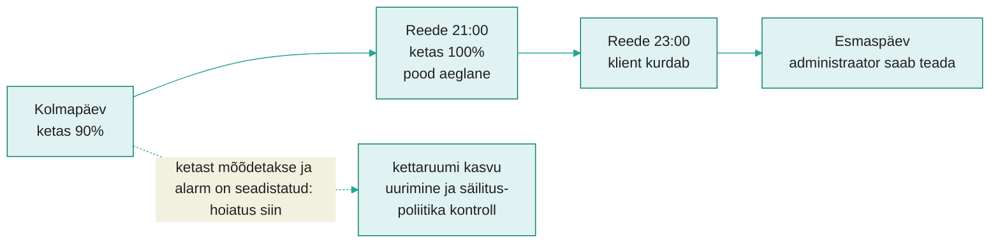
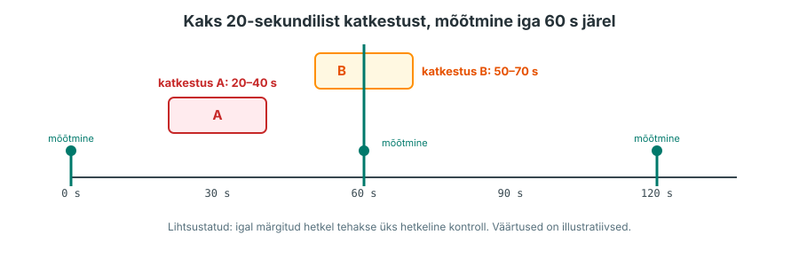
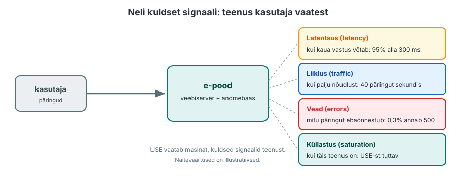
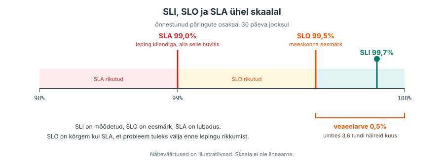
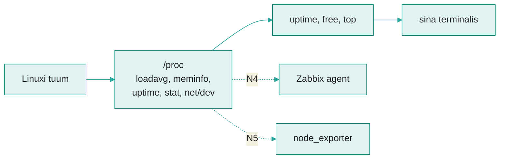
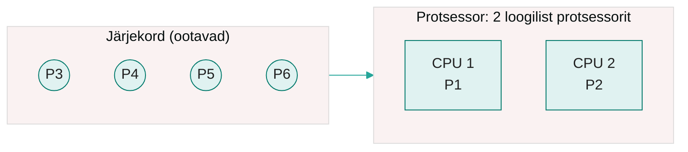

---
tags:
  - Loeng
  - Monitooring
  - Linux
  - Algaja
---

# Loeng: mõõdik, aegrida, agent

N2-s seadistasid Zabbixi, mis pingib masinaid ja annab teada, kui mõni ei vasta. Täna vaatad, mida masina sees mõõdetakse, kust need numbrid tulevad ja miks on nende kogumiseks vaja agenti. Veebiõppe ülesanne on Tahvlis: lood [Zabbix Cloudi](https://www.zabbix.com/zabbix_cloud) konto ja seadistad seal Browser item'i, mis jälgib üht veebilehte.

??? abstract "Õpiväljundid"
    Pärast loengut oskad:

    - eristada mõõdikut (number ajas) ja sündmust (kirje sellest, mis juhtus);
    - selgitada, mis on aegrida ja proovivõtu intervall;
    - eristada gauge'i ja counterit ning tuua mõlemast näite;
    - kasutada USE-meetodit uurimisküsimuste koostamiseks ja nimetada mõõtmiste piirid;
    - selgitada nelja kuldset signaali ning SLI, SLO ja SLA erinevust;
    - tõlgendada koormust (load average) koos protsessorite arvu ja ketta ootamisega ning mälu veeru `available` järgi;
    - selgitada, miks Zabbix näeb N2 seadistusega ainult seda, kas masin vastab, ja miks on vaja agenti.

## 1. Zabbix ütles „kõik korras“

N2 lõpuks pingis Zabbix iga minut `proxmox2` ja `proxmox3`. Kui masin ei vastanud, tekkis probleem ja pärast parandust lahenes see ise. See on juba monitooring, aga see vastab ainult ühele küsimusele: **kas masin on võrgus, jah või ei.**

Ping ei näita masina sisemist olekut. Näiteks võib e-poe server vastata pingile, kuigi leht laeb 15 sekundit, sest ketas on 100% täis: logifail kasvas terve nädala. Kolmapäeval oli ketas 90% täis ja täitus 5 protsendipunkti päevas, reedeks oli see täis. Kui ketta täituvust oleks kogutud ja sellele oleks olnud seadistatud alarmireegel, oleks hoiatus tulnud kaks päeva enne, kui klient poe aeglusest teatas.

<figure markdown="span">

  <figcaption>Joonis 3.1. Sama probleem kahe teekonnaga. Ping oli kogu aeg korras, seega N2 seadistusega Zabbix ei oleks midagi teatanud. Ketta mõõtmine koos alarmireegliga oleks andnud hoiatuse kaks päeva varem (Talvik, 2026).</figcaption>
</figure>

Rike tuleks avastada enne kasutaja teadet. Selleks ei piisa sellest, et masin vastab. Mõõta tuleb ka masina sisu: protsessori koormust, mälu ja kettaruumi.

??? question "Kontrolli ennast"
    1. Miks ei näidanud Zabbix e-poe ketta täitumise ajal probleemi?
    2. Too oma elust üks näide, kus said probleemist teada liiga hilja, kuigi märgid olid varem olemas (telefoni aku, mäng, arvuti).

## 2. Mõõdik, sündmus ja aegrida

Mõtle telefoni akule. Ekraanil on **37%**. See on **mõõdik** (metric): üks mõõdetav suurus, millel on nimi ja väärtus. Mõõdikul on alati ka mõõtmise aeg.

Logirida on teist tüüpi andmed. `Oct 29 21:04:11 pood nginx: disk full` on **sündmus** (event): kirje sellest, mis ühel hetkel juhtus. Sündmust loed ja mõistad. Mõõdikut võrdled eelmise väärtusega.

??? note "Tabel 3.1. Sündmus ja mõõdik"
    | | Sündmus (N1) | Mõõdik (N2–N7) |
    |---|---|---|
    | Näide | `Failed password for root from 10.0.9.66` | `ketas_kasutusel = 85` |
    | Mis see on | tekst sellest, mis juhtus | number, mis näitab olekut |
    | Millal tekib | siis, kui midagi juhtub | iga kindla aja tagant, ka siis, kui midagi ei juhtu |
    | Kuidas loed | otsid, filtreerid, loed läbi | võrdled, joonistad graafiku |

Kas 37% akut on hea või halb? Sellest numbrist üksi ei saa aru. Kui hommikul oli 100% ja praegu on kell 10, on aku kulunud kiiresti ja põhjuse leidmiseks vaatad, mis akut kasutas. Kui kell on 22, on see tavaline päev.

Telefoni seadetes on aku graafik: sama number iga paari minuti järel terve päeva jooksul. Sellist numbrite rida koos ajatemplitega nimetatakse **aegreaks** (time series).

<figure markdown="span">
```text
aku %
100 |█
 80 |  █
 60 |    █ █
 40 |        █ █ █
 20 |              █
  0 +--------------------
     8  10  12  14  16  18  kell
```
  <figcaption>Joonis 3.2. Aegrida: sama mõõdik (aku laetus) mõõdetuna iga kahe tunni järel. Graafikult on näha, et kell 12–14 ei kulunud akut peaaegu üldse (Talvik, 2026).</figcaption>
</figure>

Mõõtmiste vahe on **proovivõtu intervall** (sampling interval). Zabbixi *ICMP Ping* template mõõdab iga 1 minuti järel.

<figure markdown="span">
  
  <figcaption>Joonis 3.3. Kaks sama pikka katkestust ja mõõtmine iga 60 sekundi järel. Lihtsustatud: igal märgitud hetkel tehakse üks hetkeline kontroll (Talvik, 2026).</figcaption>
</figure>

??? question "Kumba katkestust mõõtmised märkavad?"
    Mõlemad katkestused kestavad 20 sekundit. Kumma neist mõõtmised märkavad ja miks ei määra katkestuse kestus üksi, kas see jääb nägemata?

    ??? success "Vastus"
        B, sest see kestab ka 60. sekundil, kui tehakse mõõtmine. A jääb kahe mõõtmise vahele. Lühike katkestus jääb nägemata siis, kui see ei kattu ühegi mõõtmise hetkega, seega loeb nii kestus kui ka see, millal katkestus juhtub.

Mida tihedam intervall, seda rohkem andmeid tuleb hoida. Masina mõõdikute jaoks on tavaline 15 kuni 60 sekundit.

??? question "Kontrolli ennast"
    1. Mis vahe on mõõdikul ja aegreal? Too näide autost.
    2. Kas `sshd: Accepted publickey for kasutaja` on mõõdik või sündmus? Aga `Mem available: 1.3 GiB`?
    3. Zabbix pingib iga minut. Server oli 30 sekundit maas. Kas Zabbix märkab seda kindlasti? Miks?

## 3. Gauge ja counter

Mõtle autole. Armatuurlaual on kaks numbrit, mis näevad sarnased välja:

- **Spidomeeter** näitab, kui kiiresti sõidad **praegu**: 50, siis 90, siis 0. Number käib üles ja alla.
- **Läbisõidumõõdik** näitab, mitu kilomeetrit auto on **kokku** sõitnud: 152 300, siis 152 301. Number ainult kasvab.

Mõõdikute maailmas on need kaks tüüpi:

??? note "Tabel 3.2. Gauge ja counter"
    | Tüüp | Mis teeb | Auto | Masinas |
    |---|---|---|---|
    | **Gauge** (näidik) | käib üles ja alla, näitab hetkeseisu | spidomeeter, kütusenäit | koormus, vaba mälu, ketta täituvus, temperatuur |
    | **Counter** (loendur) | loeb kokku alates algusest, tavaliselt ei vähene, kuid võib taaskäivitusel nullist alata | läbisõidumõõdik | protsessori aeg, võrgukaardi baidid, päringute arv |

Gauge'i väärtust saad lugeda otse: „vaba mälu on 1,3 GiB“ on kohe arusaadav.

Counteri väärtus üksi ei ütle peaaegu midagi. Väärtus `bytes received: 8 412 663 210` on võrgukaardi kaudu saabunud baitide arv alates masina käivitusest. Huvitav on **kui kiiresti** number kasvab. Selleks loed counterit kaks korda ja arvutad vahe:

```text
kell 10:00:00   8 412 663 210 baiti
kell 10:00:10   8 425 163 210 baiti
vahe 10 sekundiga: 12 500 000 baiti → 1,25 MB sekundis
```

Seda arvutust nimetatakse **kiiruseks** (rate). Täpselt nii töötab ka `top`: protsessori protsendi arvutab ta, lugedes protsessori aja counterit kaks korda ja võrreldes vahet.

Counteril on üks lõks: kui masin taaskäivitub, algab loendur nullist. Hea monitooringusüsteem tunneb selle ära ega joonista graafikule tohutut negatiivset hüpet.

On ka kolmas tüüp, **histogramm** (histogram), mis jagab mõõtmised korvidesse, näiteks „mitu päringut vastas alla 100 ms, mitu alla 1 s“. Histogramme kasutatakse teenuse vastamisaegade uurimisel.

??? question "Kontrolli ennast"
    1. Kumb on gauge ja kumb counter: ketta täituvus protsentides, sisse loginud kasutajate arv, kokku saadetud e-kirjade arv, protsessori temperatuur?
    2. Millisele küsimusele vastab counteri toorväärtuse graafik ja millisele selle kasvu kiirus?
    3. Võrgukaardi counter näitas kell 12:00 väärtust 5 000 000 ja kell 12:01 väärtust 1 200. Millised sündmused võiksid seda langust selgitada?

## 4. Mida masinas mõõta: neli küsimust ja USE

Auto armatuurlaual on kümneid tulesid, aga juht vaatab kõigepealt mõnda: kiirus, kütus, mootori temperatuur ja kas mõni punane tuli põleb. Serveriga on sama. Alusta neljast küsimusest:

??? note "Tabel 3.3. Neli küsimust, mida igalt serverilt esimesena küsitakse"
    | Küsimus | Mida mõõdetakse | Käsk | Võrdlus autoga |
    |---|---|---|---|
    | Kas masin töötab? | tööaeg (uptime) | `uptime` | kas mootor käib |
    | Kas protsessor jõuab? | protsessori koormus | `uptime`, `top` | pöörded |
    | Kas mälu jätkub? | mälu (RAM) | `free -h` | kindalaegas: mis on käepärast |
    | Kas kettaruumi jätkub? | ketas | `df -h` | pagasiruum |

**Mälu** on kiire ja väike ning kaob, kui masin välja lülitada. Seal on asjad, millega praegu töötatakse. **Ketas** on aeglane ja suur ning jääb alles. Kui mälu saab täis, läheb masin aeglaseks. Kui ketas saab täis, lakkavad programmid töötamast, sest need ei saa enam midagi kirjutada (nagu e-poe näites).

Brendan Gregg sõnastas sama mõtte **USE-meetodina**. Iga ressursi kohta küsid kolme asja:

- **U**tilization (kasutus): kui suure osa ajast või mahust ressurss on hõivatud?
- **S**aturation (küllastus): kas tekib järjekord, kas keegi peab ootama?
- **E**rrors (vead): kas on vigu?

??? note "Tabel 3.4. USE-meetod kolme ressursi kohta"
    | Ressurss | Kasutus | Küllastus: uurimisküsimus ja vihje | Vead |
    |---|---|---|---|
    | Protsessor | `top`: `us` + `sy` (programmid ja tuum). 100 − `id` sisaldab lisaks ka `wa` ja muud | Kas ülesanded ootavad protsessoriaega? Vihje: koormus üle protsessorite arvu, kui `wa` on väike. Koormus üksi seda ei tõenda | harva, vaata `dmesg` |
    | Mälu | `free -h`: `used` võrreldes `total`-iga | Kas mälusurve tekitab aktiivset saalimist? Vihje: `available` nulli lähedal ja swap'i kasutus kasvab. Swap kasutusel üksi seda ei tõenda | OOM killer logis (`journalctl -k`) |
    | Ketta maht | `df -h`: `Use%` | Kas programmid saavad veel kirjutada? Vihje: failisüsteem täis | `No space left on device` logis |
    | Ketta sisend-väljund | `iostat -x`: `%util` | Kas päringud kuhjuvad ja nende täitmise aeg kasvab? Vihje: `iostat -x` järjekord `aqu-sz`, `r_await` (ootamine järjekorras koos teenindamisega); `top`: `wa` | `I/O error` logis |

Pane tähele viimast veergu: vead leiad sageli **logidest**, mitte mõõdikutest. Siin saavad N1 ja N2 kokku. Lähemalt loe [Greggi lehelt](https://www.brendangregg.com/usemethod.html).

??? question "Kontrolli ennast"
    1. E-pood jäi seisma täis ketta tõttu. Kas see oli kasutuse, küllastuse või vea probleem?
    2. Protsessor on 100% hõivatud, aga järjekorda pole. Kas see on halb? Mis siis, kui järjekorras ootab 6 protsessi?

## 5. Teenuse vaade: neli kuldset signaali, SLI, SLO ja SLA

USE vaatab masinat. Kasutaja masinat ei näe, ta näeb teenust: kas leht avaneb ja kui kiiresti. Google'i SRE raamat soovitab teenuse kohta mõõta [nelja kuldset signaali](https://sre.google/sre-book/monitoring-distributed-systems/#xref_monitoring_golden-signals) (golden signals).

??? note "Tabel 3.5. Neli kuldset signaali"
    | Signaal | Küsimus | E-poe näide |
    |---|---|---|
    | **Latentsus** (latency) | kui kaua vastus võtab | 95% päringutest vastab alla 300 ms |
    | **Liiklus** (traffic) | kui palju on nõudlust | 40 päringut sekundis |
    | **Vead** (errors) | kui suur osa päringutest ebaõnnestub | 0,3% päringutest annab vea 500 |
    | **Küllastus** (saturation) | kui täis teenus on | andmebaasi ühendustest on kasutusel 90% |

<figure markdown="span">
  
  <figcaption>Joonis 3.4. Neli kuldset signaali kirjeldavad teenust kasutaja vaatest. Väärtused on illustratiivsed (Talvik, 2026).</figcaption>
</figure>

Küllastus on sama mõte mis USE-s: kui ressurss saab täis, tekib järjekord ja latentsus kasvab. Masina mõõdikud näitavad põhjust, kuldsed signaalid näitavad, kas kasutaja seda tunneb. Latentsust ja vigu mõõdetakse päringute kohta, kursusel teed seda N11-s.

??? example "Keskmine on hea, aga osa kasutajaid ootab"
    Kümnest päringust üheksa vastas 100 ms-ga ja üks 5 sekundiga. Enne arvutamist mõtle: kas keskmine vastamisaeg kirjeldab hästi kõigi kasutajate kogemust?

    Arvuta keskmine ja võrdle seda aeglaseima päringuga. Mida ütleb keskmine ja mida jääb sellest nägemata?

    ??? success "Vastus"
        Keskmine on (9 × 100 ms + 5000 ms) / 10 = 590 ms, see tundub talutav. Üks kasutaja ootas aga 5 sekundit. Keskmine peidab aeglased päringud, seepärast vaadatakse latentsuse juures ka aeglaseimaid päringuid.

Kuldsetest signaalidest saab teenuse kvaliteedi mõõdupuu ([Measurement is critical](https://manishagarwal.hashnode.dev/measurement-is-critical)):

- **SLI** (service level indicator) on mõõdetud näitaja, näiteks õnnestunud päringute osakaal viimase 30 päeva jooksul.
- **SLO** (service level objective) on meeskonna eesmärk sellele näitajale, näiteks 99,5%.
- **SLA** (service level agreement) on teenustaseme kokkulepe kliendiga. See määrab lubatud taseme, kuidas seda mõõdetakse ja mis juhtub rikkumise korral, näiteks teenusekrediit.

Meeskond võib seada sisemise SLO rangemaks kui kliendiga kokku lepitud tase, et jääks reageerimisvaru enne kokkuleppe rikkumist. SLO ja 100% vahe on **veaeelarve** (error budget). Kui SLO on, et 99,5% päringutest õnnestub, ja 30 päeva jooksul oli 100 000 päringut, võib ebaõnnestuda kuni 500 päringut.

Kui eesmärk on hoopis teenuse kasutatava aja osakaal, tähendab 99,5% 30 päeva jooksul umbes 3,6 tundi kasutamatut aega (30 × 24 h × 0,005). See on teine arvutus kui päringupõhise SLI puhul. Mida meeskond teeb, kui veaeelarve on kulunud, lepitakse kokku eraldi (veaeelarve poliitika), näiteks tegeletakse uute funktsioonide asemel töökindlusega ([Implementing SLOs](https://sre.google/workbook/implementing-slos/)).

<figure markdown="span">
  
  <figcaption>Joonis 3.5. SLI on mõõdetud, SLO on eesmärk, SLA on kokkulepe kliendiga. Väärtused on illustratiivsed (Talvik, 2026).</figcaption>
</figure>

??? question "Kontrolli ennast"
    1. E-poe leht avaneb, aga vastus võtab 8 sekundit. Ping ja USE näitavad, et masinal on kõik korras. Milline kuldne signaal seda näitab ja kust selle mõõtmise saaksid?
    2. SLO on ajapõhine: teenus on kasutatav 99,9% ajast 30 päeva jooksul. Mitu minutit võib teenus selle aja jooksul olla kasutamatu?
    3. Miks võib meeskond seada sisemise SLO rangemaks kui kliendiga kokku lepitud teenustase?

## 6. Kust numbrid tulevad ja kes neid kogub

Masina kohta käivaid numbreid haldab Linuxis **tuum** (kernel): mitu protsessi ootab, kui palju mälu on kasutusel, kaua masin on üleval olnud. Tuum ei kirjuta neid numbreid kettale, vaid näitab neid kaustas **`/proc`**. See näeb välja nagu tavaline kaust failidega, kuid failide sisu koostab tuum lugemise hetkel.

<figure markdown="span">

  <figcaption>Joonis 3.6. Käsud `uptime`, `free` ja `top` loevad tuuma avaldatud andmeid kaustast `/proc` ja töötlevad need loetavaks, näiteks arvutavad counterist protsendi. Hiljem teevad sama Zabbix agent ja node_exporter (Talvik, 2026).</figcaption>
</figure>

??? note "Tabel 3.6. Olulisemad failid kaustas `/proc`"
    | Fail | Selles näites kasutatav väli | Tüüp | Mis käsk seda loeb |
    |---|---|---|---|
    | `/proc/uptime` | esimene väli: sekundid alates käivitusest | counter | `uptime` |
    | `/proc/loadavg` | koormus 1, 5 ja 15 minuti keskmisena | gauge | `uptime`, `top` |
    | `/proc/meminfo` | väljad `MemTotal`, `MemAvailable` | gauge | `free`, `top` |
    | `/proc/stat` | protsessori aeg alates käivitusest | counter | `top` |
    | `/proc/net/dev` | võrgukaardi baidid ja paketid | counter | `ip -s link` |

Ketta kohta küsib `df` tuumalt otse iga failisüsteemi kohta eraldi. Põhimõte on sama: number tuleb tuumast.

Need failid kirjeldavad selle Linuxi masina olekut, kus neid loetakse. N2 Zabbix töötab `proxmox1`-s ja saadab `proxmox2`-le pingi. Ping näitab, kas masin vastab ja kui kiiresti, nende failide sisu see ei tagasta. Pidevaks kogumiseks lisame kursusel jälgitavasse masinasse agendi.

Järgmisena võrdleme kahte kursusel kasutatavat kogumisviisi:

??? note "Tabel 3.7. Kursuse N2 ja N4 kogumisviiside võrdlus"
    | | N2 pingikontroll | N4 Zabbixi agent |
    |---|---|---|
    | Kuidas | server pingib masinat väljast (ICMP) | masinas töötab väike programm (agent), mis loeb `/proc`-i ja annab numbrid serverile |
    | Mida näeb | kas masin või teenus vastab, vastuse aeg | protsessor, mälu, ketas, protsessid, logid |
    | Eelis | masinasse pole vaja midagi paigaldada | näeb sisse |
    | Näide | N2 *ICMP Ping* | Zabbix agent (N4), node_exporter (N5) |

??? question "Kontrolli ennast"
    1. Miks näitab `cat /proc/uptime` iga kord erinevat numbrit, kuigi keegi faili ei muuda?
    2. Tahad teada, millal e-poe ketas täis saab. Kas N2 Zabbix suudab seda öelda? Mida on vaja juurde?
    3. Too üks olukord, kus agendita kontroll on parem kui agent.

## 7. Kuidas numbreid õigesti lugeda

### Koormus ja poe kassad

Käsk `uptime` näitab rea lõpus kolme numbrit:

```text
 10:14:02 up 3 days,  2:41,  1 user,  load average: 1.85, 0.92, 0.40
```

Need on **koormus** (load average): käivitatavate ja katkestamatus ooteolekus ülesannete keskmine arv viimase 1, 5 ja 15 minuti jooksul. Käivitatavad ülesanded töötavad või ootavad protsessorit, katkestamatus ooteolekus ülesanded ootavad näiteks ketast ([proc_loadavg(5)](https://man7.org/linux/man-pages/man5/proc_loadavg.5.html)). Seega võib koormus olla kõrge nii protsessori kui ka ketta ootamise tõttu. Koormus ei ole protsessori kasutusprotsent.

See võrdlus on lihtsustatud ja kehtib protsessorikeskse koormuse kohta, kus ülesanded ketast ei oota. Mõtle poele. Kassad on loogilised protsessorid. Ostjad on protsessid.

- 2 kassat, koormus 1: üks kassa töötab, teine ootab ostjat. Kõik on rahulik.
- 2 kassat, koormus 2: mõlemad kassad töötavad, järjekorda pole. Täis, aga hea.
- 2 kassat, koormus 6: mõlemad töötavad ja 4 inimest seisab järjekorras. Asjad venivad.

<figure markdown="span">

  <figcaption>Joonis 3.7. Lihtsustatud protsessorikoormuse näide: kaks ülesannet töötavad ja neli ootavad protsessoriaega. Tegeliku masina hindamisel vaata ka protsessori kasutust ja ketta ootamist (Talvik, 2026).</figcaption>
</figure>

Koormust võrdle protsessorite arvuga. Käsk `nproc` näitab, mitu loogilist protsessorit on saadaval. Protsessorikeskse koormuse korral aitab suhe koormus / protsessorite arv hinnata, kui palju protsessoriaega soovitakse. See suhe üksi ei tõenda riket: vaata ka `top`-is protsessori kasutust ja `wa` väärtust.

Kolm numbrit koos näitavad suunda. `1.85, 0.92, 0.40` (viimane minut on kõrgeim) tähendab, et koormus **kasvab**. `0.40, 0.92, 1.85` tähendab, et viimase minuti keskmine on pikema perioodi keskmisest väiksem ehk koormus **langeb**.

### Mälu: miks „vaba“ on väike

Käsk `free -h` näitab umbes nii:

```text
               total        used        free      shared  buff/cache   available
Mem:           3.8Gi       1.1Gi       210Mi        12Mi       2.5Gi       2.4Gi
```

Väike väärtus veerus `free` ei tähenda selles näites probleemi.

Linux kasutab osa vabast mälust **puhvrite ja vahemäluna** (buff/cache): seal hoitakse hiljuti loetud faile, et järgmine lugemine oleks kiire. Osa sellest mälust saab tuum vajaduse korral programmidele vabastada.

Seepärast vaata veergu **`available`**: see on hinnang, kui palju mälu on uutele programmidele saadaval ilma saalimiseta ([free(1)](https://man7.org/linux/man-pages/man1/free.1.html)). Väike `free` ei tõenda selles näites mälupuudust. Kas 2,4 GiB on piisav, sõltub programmide vajadusest. Kui `available` läheb nulli lähedale, tasub uurida.

??? question "Kontrolli ennast"
    1. Kahel masinal on koormus 4 ja `wa` on väike. Ühel on 2 loogilist protsessorit, teisel 8. Kummas tasub protsessorikoormust lähemalt uurida ja miks?
    2. Mida tähendab `load average: 0.20, 1.50, 3.80`? Kas olukord läheb paremaks või halvemaks?
    3. Sõber saadab sulle `free -h` väljundi, kus `free` on 90 MiB ja `available` on 3 GiB. Mida talle vastad?

### Uurimisülesanne: kumb masin on hädas?

Kahes masinas on 4 loogilist protsessorit. Väärtused on illustratiivsed.

??? note "Tabel 3.8. Kaks masinat sama koormusega"
    | | Masin A | Masin B |
    |---|---|---|
    | Loogilisi protsessoreid | 4 | 4 |
    | `load1` | 8 | 8 |
    | Protsessori kasutus | 95% | 15% |
    | Teenuse vastamisaeg | tavapärane | tavapärasest pikem |

??? question "Kumb masin on hädas?"
    1. Kas sama `load1` tähendab mõlemas masinas sama probleemi?
    2. Kummas masinas kahtlustad protsessoriaja puudujääki ja miks?
    3. Mida uuriksid masina B puhul järgmisena?
    4. Kummas masinas on tõend, et probleem mõjutab kasutajaid?

??? tip "Vihje"
    Loe uuesti, mida koormus sisaldab: lisaks protsessorit kasutavatele ja ootavatele ülesannetele ka katkestamatus ooteolekus ülesandeid ([proc_loadavg(5)](https://man7.org/linux/man-pages/man5/proc_loadavg.5.html)). Millised mõõtmised näitavad, mida need ülesanded ootavad?

## 8. Number üksi ei ütle midagi

Sama number võib ühes masinas tähendada tavalist olekut ja teises riket. Varukoopiaserver pakib iga öö kell 02:00 failid kokku ja protsessor on tund aega 95% hõivatud. See on tavaline öö. Kui sama 95% on keskpäeval, kui varukoopiat ei tehta, erineb see tavalisest mustrist ja vajab uurimist.

Masina tavaline olek on **baasjoon** (baseline). Ilma baasjooneta ei saa öelda, kas number on hea või halb. Baasjoone kujundamiseks võrdled aegreas näite eri aegadel ja arvestad töökoormust: millised on numbrid tavaliselt päeval, öösel ja nädalavahetusel.

Siin on käsitsi vaatamise piir. `top` näitab ainult **praegust hetke**. Kui avad selle kolmapäeval kell 10, ei tea sa midagi sellest, mis juhtus öösel kell 3. Sellepärast kogub monitooringusüsteem numbreid ise ja hoiab neid andmebaasis, nagu N2-s nägid.

Testides tekitatakse koormus meelega. Tööriist **`stress-ng`** paneb protsessori, mälu või ketta tööle nii kauaks, kui ütled. Nii näed, mis juhtub numbritega, kui masin hätta jääb, ja tead hiljem, mida otsida.

??? question "Kontrolli ennast"
    1. Miks ei ole varukoopiaserveri 95% protsessorikoormus öösel probleem?
    2. Miks ei piisa sellest, et vaatad serverit `top`-iga kord päevas?

??? info "Koormus ja ketas"
    Linuxi koormuse sees on ka protsessid, mis ootavad ketast. Seega võib koormus olla kõrge ka siis, kui protsessor on peaaegu tühi. Seda näed `top`-is real `%Cpu(s)` väärtusena `wa` (wait).

??? info "Push ja pull"
    Zabbix agent saab töötada kahel moel: server küsib (passiivne) või agent saadab ise (aktiivne). Prometheus (N5) küsib andmeid ise, Telegraf (N7) saadab need ise. Kumb on parem, sõltub võrgust: kas server pääseb masinani või ainult masin serverini.

??? abstract "Kokkuvõte"
    Monitooring mõõdab masinate olekut, et rike tuleks välja enne kasutaja teadet. Mõõdik on number ajas, sündmus on kirje sellest, mis juhtus. Gauge käib üles-alla, counter kasvab (taaskäivitusel algab nullist) ja sealt loed kiirust. Masina mõõdikud loetakse tuumast kausta `/proc` kaudu, pidevaks kogumiseks on jälgitavas masinas agent. Koormust loe protsessorite arvu ja ketta ootamise järgi, mälu puhul vaata `available` veergu. Üks number ütleb vähe, aegrida ja baasjoon ütlevad palju.

    | Mõiste | Selgitus | Kuidas näed |
    |---|---|---|
    | **Mõõdik (metric)** | number, millel on nimi ja mõõtmise aeg | `free -h` veerg `available` |
    | **Sündmus (event)** | kirje sellest, mis juhtus | logirida |
    | **Aegrida (time series)** | sama mõõdik mitu korda ajas | Zabbixi graafik |
    | **Intervall** | kui tihti mõõdetakse | ICMP Ping: 1 minut |
    | **Gauge** | käib üles ja alla, hetkeseis | `cat /proc/loadavg` |
    | **Counter** | loeb kokku, võib taaskäivitusel nullist alata | `cat /proc/net/dev` |
    | **USE** | kasutus, küllastus, vead iga ressursi kohta | Tabel 3.4 |
    | **Neli kuldset signaali** | latentsus, liiklus, vead, küllastus teenuse kohta | Tabel 3.5 |
    | **SLI, SLO, SLA** | mõõdetud näitaja, eesmärk, kokkulepe kliendiga | Joonis 3.5 |
    | **Koormus (load average)** | käivitatavad ja ketast ootavad ülesanded, 1/5/15 min | `uptime` |
    | **Agent** | programm masinas, mis loeb `/proc`-i ja annab numbrid serverile | N4 |
    | **Baasjoon (baseline)** | masina tavaline olek | ainult aegreast |

??? question "Kontrolli ennast"
    1. Selgita oma sõnadega, miks N2 seadistusega Zabbix ei oleks e-poe täis ketast märganud.
    2. Too kaks gauge'i ja kaks counterit oma telefonist või arvutist.
    3. Selgita poe kassade abil, mida võib tähendada koormus 3.0 nelja loogilise protsessoriga masinas, kui `wa` on väike.
    4. Miks Linux kasutab peaaegu kogu „vaba“ mälu ära ja miks see ei ole viga?
    5. Kasutajad ütlevad: „Server on täna aeglane.“ Käi USE-meetod läbi protsessori, mälu ja ketta kohta ja ütle, millise käsuga igale küsimusele vastuse leiad.
    6. Miks on vaja agenti? Mida see näeb, mida ping ei näe?
    7. Ping vastab, protsessor pole täis ja mälu jätkub. Kas sellest piisab, et öelda „teenus töötab hästi“? Nimeta üks kontroll, millega uuriksid kasutaja tegelikku kogemust.
