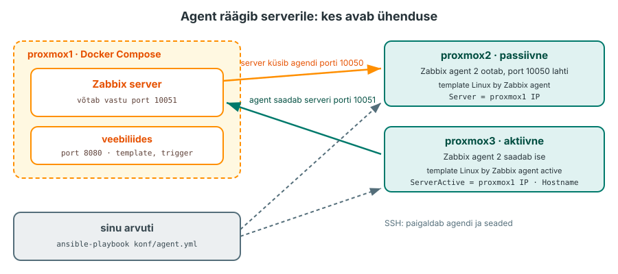
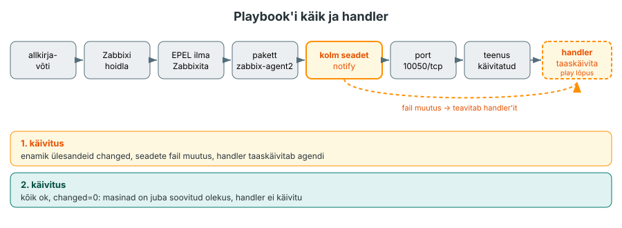
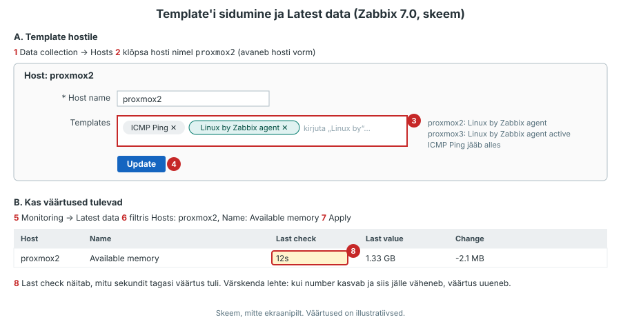
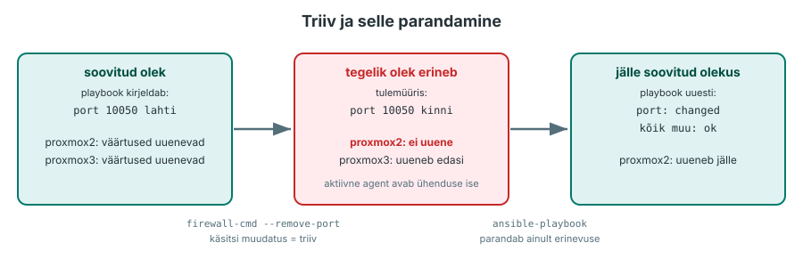
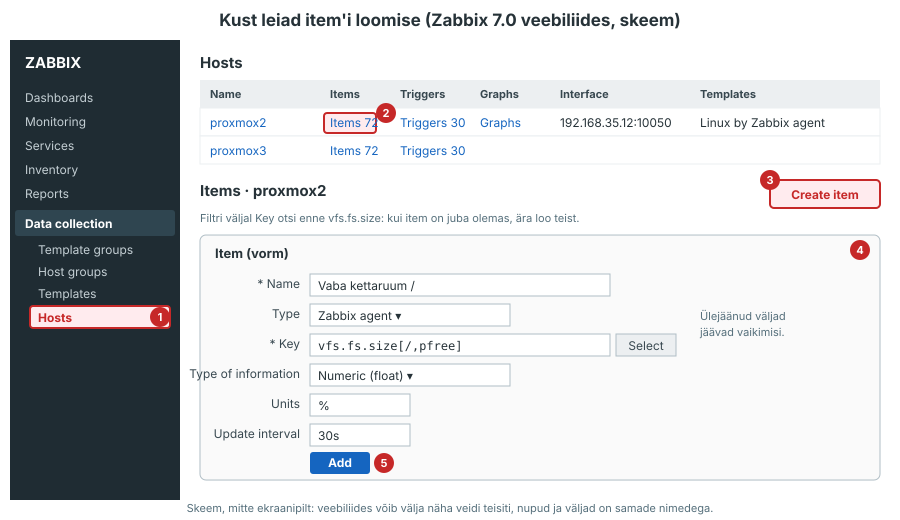
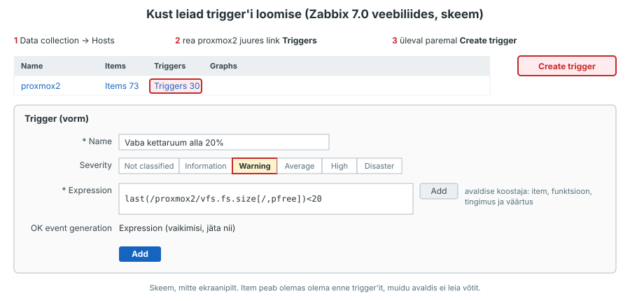
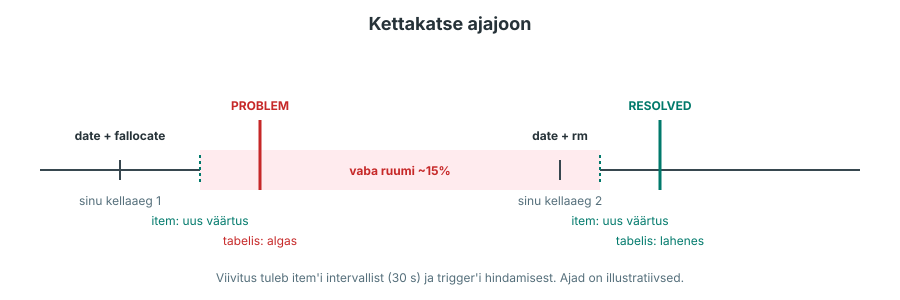

---
tags:
  - Praktikum
  - Monitooring
  - Ansible
---

# Praktikum: agent suhtleb serveriga

Täna paigaldad Zabbix agent 2 Ansible'i playbook'iga mõlemasse jälgitavasse masinasse. Seod hostid valmis template'itega, kontrollid mõõteväärtuste uuenemist ning lood oma trigger'i vaba kettaruumi jälgimiseks.

**Edenemine:** laboritahvel <http://192.168.125.187:8092/> (VPN-iga).

??? abstract "Õpiväljundid"
    Pärast loengut ja praktikumi oskad:

    1. paigaldada ja seadistada Zabbix agent 2 Ansible'i playbook'iga mitmes masinas;
    2. eristada passiivseid ja aktiivseid kontrolle ühenduse algataja järgi;
    3. siduda hostid sobivate template'itega ja kontrollida mõõteväärtuste uuenemist;
    4. luua oma trigger'i ning tõendada probleemi tekkimist ja lahenemist.

<figure markdown="span">
  
  <figcaption>Joonis 4.8. Praktikumi ülesehitus. `proxmox2` on passiivne ja `proxmox3` aktiivne agent (Talvik, 2026).</figcaption>
</figure>

Lisad playbook'i ülesanded ükshaaval. Enne käivitamist ennusta tulemust, seejärel vaata väljundit ja põhjenda, mis muutus. Kui tulemus erineb oodatust, uuri erinevust enne järgmise sammu lisamist. Esimesed ülesanded on näidatud tervikuna, järgmised koostad ise sama mustri järgi. Näidislahendus on kokkuvolditud plokis, ava see, kui jääd kinni või tahad oma lahendust kontrollida. Kirjuta ennustused ja tulemuste võrdlus README vastava osa alla. Kui tuleb veateade, ava plokk, mis algab sõnaga **Kui**.

## Osa 1 · Repositoorium ja Zabbix

Ava Classroom 50 link ([Praktikum 4 - Agent suhtleb serveriga](https://classroom50.org/hkhk-monitoring/it24-monitooring/assignments)) ja klooni oma repositoorium:

```bash
git clone <sinu-repo-url>
cd <sinu-repo>
ls
```

??? success "Oodatav tulemus"

    ```text
    README.md  konf  logid  zabbix
    ```

    `README.md`-sse kirjutad vastused, pealkirjad on juba olemas. Kaustas `konf/` on Ansible'i playbook'i algus `agent.yml`, tõendid lähevad kausta `logid/`. Kaustas `zabbix/` on Zabbixi Compose'i fail neile, kellel Zabbix veel puudub.

Agent saadab andmed Zabbixi serverile. Seepärast peab Zabbix `proxmox1`-s töötama ja seal peavad olema hostid `proxmox2` ja `proxmox3`. Kontrolli seda ja jälgitavate masinate tulemüüri, sest osade 2 ja 4 katsed sõltuvad sellest:

```bash
ssh proxmox1 "cd ~/zabbix && docker compose start && docker compose ps"
ssh proxmox1 "hostname -I"
ssh proxmox2 "sudo firewall-cmd --state"
ssh proxmox3 "sudo firewall-cmd --state"
```

??? success "Oodatav tulemus"

    Kolm konteinerit olekus `Up`, siis `proxmox1` IP-aadressid ja kaks korda `running`. Vali aadressidest laborivõrgu IPv4-aadress (näiteks `192.168.35.11`), mitte Dockeri sisevõrgu aadress (`172.…`). See läheb playbook'i muutujasse `zabbix_server`. Veebiliides on aadressil `http://<proxmox1-IP>:8080` ja seal on hostid `proxmox2` ja `proxmox3` template'iga *ICMP Ping*.

??? warning "Kui näed `No such file or directory` või `no configuration file provided`"
    Sul ei ole `proxmox1` kaustas `~/zabbix` Compose'i faili. Kontrolli enne, kas varasem Zabbixi andmebaas on alles:

    ```bash
    ssh proxmox1 "ls -a ~/zabbix; docker volume ls | grep zbx"
    ```

    Kui kaustas on `.env` või volume'ide nimekirjas on `zbx-db`, on Zabbix varem paigaldatud: ära loo uut parooli, sest vana andmebaas ei avane uuega. Otsi üles oma N2 kaust või küsi õpetajalt. Kui mõlemad puuduvad, käivita Zabbix starteri failiga oma arvutist, repositooriumi kaustas:

    **Oma arvutis:**

    ```bash
    ssh proxmox1 "mkdir -p ~/zabbix"
    scp zabbix/compose.yaml proxmox1:zabbix/
    ssh proxmox1
    ```

    **Nüüd töötad `proxmox1` terminalis.** Kui `cd` annab vea, ära käivita järgmisi käske:

    ```bash
    cd ~/zabbix
    test -e .env || echo "ZBX_DB_PASSWORD=$(openssl rand -hex 12)" > .env
    docker compose up -d
    docker compose ps
    ```

    `test -e .env ||` loob parooli ainult siis, kui faili `.env` veel pole.

    **Naase oma arvutisse:** `exit`.

    Esimesel käivitusel loob server andmebaasi tabelid, see võtab 1–3 minutit. Oota, kuni `ssh proxmox1 "cd ~/zabbix && docker compose logs zabbix-server" | grep "server #0 started"` annab rea. Seejärel ava `http://<proxmox1-IP>:8080`, kasutaja on **Admin** ja parool **zabbix**.

    Lisa kaks hosti: **Data collection → Hosts → Create host**, **Host name** `proxmox2`, **Templates** **ICMP Ping**, **Host groups** **Linux servers**, **Interfaces → Add → Agent** ja masina IP-aadress (`ssh proxmox2 "hostname -I"`). Vajuta **Add** ja tee sama `proxmox3` jaoks. Täpsemalt on see kirjas [praktikumis 2](../week02/lab.md).

??? warning "Kui konteiner `zabbix-web` on olekus `Created` või `Exited`"
    Vaata kõigepealt, miks see ei käivitunud: `ssh proxmox1 "cd ~/zabbix && docker compose logs zabbix-web | tail -20"`. Kui veateade on `port is already allocated`, hoiab porti 8080 mõni teine konteiner. Leia see käsuga `ssh proxmox1 "docker ps"` ja peata ainult see projekt tema kaustas käsuga `docker compose stop`.

??? warning "Kui näed `FirewallD is not running`"
    Masinas pole tulemüür sees. Logi sisse sellesse masinasse (näiteks `ssh proxmox2`) ja jäta see seanss avatuks. Käivita tulemüür ja kontrolli kohe, et SSH on lubatud:

    ```bash
    sudo systemctl enable --now firewalld
    sudo firewall-cmd --get-active-zones
    sudo firewall-cmd --list-services
    ```

    Teenuste hulgas peab olema `ssh`. Seejärel ava teine terminal ja kontrolli `ssh proxmox2 hostname`. Kui uus ühendus ei õnnestu, peata tulemüür avatud seansis (`sudo systemctl disable --now firewalld`) ja anna õpetajale teada.

## Osa 2 · Agent Ansible'i playbook'iga kahes masinas

Paigalduse põhiosa on mõlemas masinas sama ja agendi seadetes erineb ainult masina nimi. Seepärast teed paigalduse Ansible'i playbook'iga: Ansible teeb samad sammud mõlemas masinas ja masina nimi tuleb muutujast. Koostad playbook'i `konf/agent.yml` ülesannete kaupa: lisad ülesande, käivitad playbook'i ja vaatad tulemust. Starteri failis on play algus, allkirjavõtme ülesanne ja kaks EPEL-i ülesannet. Iga sammu juures on selgitus ja ülesanne. Esimesed näited kopeerid faili kommentaariga märgitud kohta, järgmised koostad ise sama mustri järgi. Vajadusel ava näidislahendus. Käivita playbook pärast iga sammu ja uuri, milline ülesanne midagi muutis.

Playbook teeb järjest seda, mida Zabbixi juhend [Download and install Zabbix](https://www.zabbix.com/download?zabbix=7.0&os_distribution=alma_linux&os_version=9&components=agent_2&db=&ws=) käsitsi teeb: impordib allkirjavõtme, lisab Zabbix 7.0 hoidla, välistab EPEL-ist Zabbixi vanemad paketid, paigaldab `zabbix-agent2`, muudab seadeid, avab tulemüüris pordi ja käivitab teenuse. Uued moodulid on tabelis 4.5.

??? note "Tabel 4.5. Playbook'i moodulid"
    | Moodul | Mida teeb | Parameetrid selles playbook'is |
    |---|---|---|
    | [`ansible.builtin.rpm_key`](https://docs.ansible.com/ansible/latest/collections/ansible/builtin/rpm_key_module.html) | impordib paketihalduri allkirjavõtme | `key`, `state` |
    | [`ansible.builtin.dnf`](https://docs.ansible.com/ansible/latest/collections/ansible/builtin/dnf_module.html) | paigaldab paketi nimest või URL-ist | `name`, `state` |
    | [`ansible.builtin.stat`](https://docs.ansible.com/ansible/latest/collections/ansible/builtin/stat_module.html) | uurib, kas fail on olemas, midagi ei muuda | `path` |
    | [`ansible.builtin.lineinfile`](https://docs.ansible.com/ansible/latest/collections/ansible/builtin/lineinfile_module.html) | tagab, et failis on üks kindel rida | `path`, `regexp`, `line`, `insertafter` |
    | [`ansible.posix.firewalld`](https://docs.ansible.com/ansible/latest/collections/ansible/posix/firewalld_module.html) | avab või sulgeb pordi firewalld-s | `port`, `permanent`, `immediate`, `state` |
    | [`ansible.builtin.service`](https://docs.ansible.com/ansible/latest/collections/ansible/builtin/service_module.html) | käivitab teenuse ja lisab selle käivitusse | `name`, `state`, `enabled` |

`register`, `when`, `loop` ja `notify` on ülesande võtmesõnad, mooduli parameetrite hulka need ei kuulu. `register` salvestab mooduli tulemuse muutujasse, `when` jätab ülesande vahele, kui tingimus pole tõene, `loop` kordab ülesannet iga loendi elemendi jaoks ja `notify` teavitab handler'it, kui ülesanne midagi muutis. Teavitatud handler käivitub play lõpus, pärast kõiki ülesandeid.

<figure markdown="span">
  
  <figcaption>Joonis 4.9. Playbook'i käik. Seadete muutus teavitab handler'it, mis käivitub play lõpus (Talvik, 2026).</figcaption>
</figure>

### 2.1 Play algus ja allkirjavõti

Ava `konf/agent.yml` VS Code'is. Faili alguses on play: `hosts: all` tähendab kõiki masinaid, mille annad käsus `-i`, ja `become: true` kasutab ülesannete täitmiseks õiguste tõstmist, selles laboris `sudo` kaudu. Määra muutuja `zabbix_server` väärtuseks `proxmox1` laborivõrgu IP-aadress osast 1. Seda kasutavad hiljem agendi seaded.

Esimene ülesanne impordib Zabbixi allkirjavõtme. Ilma selleta keeldub `dnf` Zabbixi hoidla pakette paigaldamast, sest ei saa kontrollida, et need tulevad Zabbixilt. Iga ülesanne on samal kujul: `name` ütleb inimesele, mida see teeb, järgmine rida on mooduli nimi ja selle all mooduli parameetrid.

See ülesanne on starteri failis juba olemas. Vaata see läbi:

???+ example "Ülesanne: Zabbixi pakettide allkirjavõti"
    ```yaml
        - name: Zabbixi pakettide allkirjavõti
          ansible.builtin.rpm_key:
            key: https://repo.zabbix.com/RPM-GPG-KEY-ZABBIX-B5333005
            state: present
    ```

`state: present` tähendab soovitud olekut: võti peab olemas olema. Kui see juba on, ei tee Ansible midagi.

??? tip "Vihje"
    YAML-is loeb taane. `tasks:` ja `handlers:` on samal taandel, nende loendite elemendid (`- name:`) algavad ühe taandetaseme võrra sügavamalt. Taande illustratsioon, mitte faili lisatav ülesanne:

    ```yaml
    - name: Näidisplay
      hosts: all
      become: true

      tasks:
        - name: Näidisülesanne
          ansible.builtin.debug:
            msg: "Ülesanne on tasks-loendi sees"

      handlers:
        - name: Näidishandler
          ansible.builtin.debug:
            msg: "Handler on handlers-loendi sees"
    ```

    Kui `ansible-playbook` annab vea `mapping values are not allowed here`, kontrolli taanet ja koolonit pärast võtit. VS Code näitab taandeid, kui valid **View → Render Whitespace**.

Moodul `ansible.posix.firewalld`, mida vajad hiljem, on kollektsioonis `ansible.posix`, mis ei kuulu `ansible-core` koosseisu. Kontrolli, kas see on olemas, ja paigalda vajadusel:

```bash
ansible-galaxy collection list ansible.posix
ansible-galaxy collection install ansible.posix
```

??? question "Ennusta"
    Kas agendi puudumisest piisab, et ennustada allkirjavõtme ülesande olekuks `changed`? Millest tulemus tegelikult sõltub?

```bash
ansible-playbook -i proxmox2,proxmox3, konf/agent.yml
```

??? success "Oodatav tulemus"
    Kui võtit masinas polnud, on ülesanne `changed`, kui see oli juba olemas (näiteks varasemast katsest), on see `ok`. Käivita uuesti: kui võti on alles ja ülesanne õnnestub, on see nüüd `ok`.

### 2.2 Zabbixi hoidla

Agent ei ole AlmaLinuxi enda hoidlates, see tuleb Zabbixi hoidlast. Hoidla kirjelduse lisab masinasse pakett `zabbix-release`. Zabbixi juhend [Download and install Zabbix](https://www.zabbix.com/download?zabbix=7.0&os_distribution=alma_linux&os_version=9&components=agent_2&db=&ws=) (Zabbix 7.0, Alma Linux 9, Agent 2) näitab selle paigaldamist käsuga `rpm -Uvh <aadress>`.

Ülesanne kasutab moodulit `ansible.builtin.dnf`, mis oskab paketi paigaldada ka veebiaadressilt. `name` on paketi nimi või aadress, `state: present` tähendab, et pakett peab olema paigaldatud. Aadress on sama, mis juhendi käsus `rpm -Uvh`. Kopeeri ülesanne faili allkirjavõtme ülesande järele (kommentaari `# Osa 2.2` asemele):

???+ example "Ülesanne: Zabbix 7.0 hoidla"
    ```yaml
        - name: Zabbix 7.0 hoidla
          ansible.builtin.dnf:
            name: https://repo.zabbix.com/zabbix/7.0/alma/9/x86_64/zabbix-release-latest-7.0.el9.noarch.rpm
            state: present
    ```

Võrdle aadressi Zabbixi juhendi omaga ja käivita playbook. Kui hoidla pakett puudus, on uus ülesanne `changed`, allkirjavõtme ülesanne `ok`.

??? tip "Vihje"
    Ülesanne tuleb allkirjavõtme ülesande järele, sest `dnf` kontrollib hoidla paketi allkirja. Kui näed viga `Failed to validate GPG signature`, kontrolli kõigepealt ülesannete järjekorda. Kontrolli masinas, et hoidla on lisatud: `ssh proxmox2 "dnf repolist | grep -i zabbix"`.

### 2.3 EPEL ilma Zabbixita

Kui masinas on ka EPEL-i hoidla, pakub see Zabbixi vanemat versiooni ja `dnf` võib selle valida. Zabbixi juhend soovitab EPEL-i kirjeldusse lisada rea `excludepkgs=zabbix*`. Need kaks ülesannet on starteris olemas, sest need ei ole agendi paigalduse põhiosa. Loe need läbi: `stat` uurib, kas fail on olemas, `register` salvestab tulemuse muutujasse `epel` ja `when` jätab teise ülesande vahele, kui EPEL-i pole.

??? tip "Vihje"
    `when: epel.stat.exists` kasutab eelmise ülesande tulemust: `register: epel` salvestas selle muutujasse `epel`. Kui masinas EPEL-it pole, on teine ülesanne `skipping`. See on õige.

### 2.4 Agendi pakett

Eelmises osas kasutasid moodulit `ansible.builtin.dnf` hoidla paketi paigaldamiseks veebiaadressilt. Sama mooduliga saad paigaldada paketi ka nime järgi.

Lisa EPEL-i ülesannete järele (kommentaari `# Osa 2.4–2.6` alla) ülesanne, mis tagab paketi olemasolu. Paketi nime leiad Zabbixi juhendi käsust `dnf install`. Anna ülesande nimeks `Agendi pakett`.

??? tip "Vihje"
    Kasuta parameetreid `name` ja `state`. Erinevalt hoidla ülesandest on `name` väärtus paketi nimi, mitte veebiaadress.

??? example "Näidislahendus"
    ```yaml
        - name: Agendi pakett
          ansible.builtin.dnf:
            name: zabbix-agent2
            state: present
    ```

Käivita playbook ja kontrolli masinas, et agent on paigaldatud:

```bash
ssh proxmox2 "rpm -q zabbix-agent2"
```

??? success "Oodatav tulemus"
    `zabbix-agent2-7.0.…` Kui Ansible paigaldas paketi selles käivituses, oli ülesanne `changed`, kui see oli juba olemas, `ok`. Kui versioon algab `6.`, tuli pakett EPEL-ist: kontrolli osa 2.3 ülesandeid.

??? tip "Vihje"
    Kui `rpm -q` ütleb `package zabbix-agent2 is not installed`, vaata playbook'i väljundist, kas ülesanne *Agendi pakett* oli `ok`, `changed` või `failed`. `failed` puhul on veateade kohe ülesande all.

### 2.5 Agendi seaded ja handler

Agendi konfiguratsioonifailis on vaikimisi `Server=127.0.0.1`, `ServerActive=127.0.0.1` ja `Hostname=Zabbix server`. Kolm rida tuleb muuta (loengu [tabel 4.1](lecture.md#2-agendi-paigaldus-ja-kolm-seadet)). Moodul `ansible.builtin.lineinfile` tagab, et failis on üks kindel rida: `regexp` leiab olemasoleva rea ja `line` on selle uus sisu. Kolme rea jaoks ei kirjuta kolme ülesannet, vaid ühe ülesande `loop`-iga, mis kordub iga loendi elemendi jaoks:

```yaml
    - name: Agendi seaded
      ansible.builtin.lineinfile:
        path: /etc/zabbix/zabbix_agent2.conf
        regexp: "^{{ item.key }}="
        line: "{{ item.key }}={{ item.value }}"
      loop:
        - { key: Server, value: "{{ zabbix_server }}" }
```

See fragment muudab praegu ainult seadet `Server`. Kopeeri see paketi ülesande järele ja lisa loendisse ise:

- `ServerActive`, mille väärtus on samuti `zabbix_server`;
- `Hostname`, mille väärtus tuleb muutujast `inventory_hostname`. See on nimi, mille kirjutad käsus `-i` järel, ja see peab olema sama mis veebiliideses **Host name**.

`regexp: "^Server="` ei leia rida `ServerActive=`, sest pärast sõna `Server` peab kohe tulema `=`.

Agent loeb seaded ainult käivitumisel, seega pärast muudatust tuleb see taaskäivitada, aga ainult siis, kui fail muutus. Selleks on **handler**: ülesanne, mis käivitub ainult siis, kui mõni teine ülesanne teda võtmesõnaga `notify` teavitab. Teavitatud handler käivitub play lõpus.

Lisa seadete ülesandele `notify: Taaskäivita agent`. Seejärel lisa faili lõppu (kommentaari `# Osa 2.5` asemele) plokk `handlers:` ühe handler'iga nimega `Taaskäivita agent`. See kasutab moodulit `ansible.builtin.service` teenusega `zabbix-agent2`. Millise `state` väärtusega teenus taaskäivitub? Leia see `ansible-doc ansible.builtin.service` väljundist. Lisa handler enne käivitamist, muidu annab `notify` vea.

??? tip "Vihje"
    `handlers:` on samal taandel kui `tasks:`, mitte ülesannete sees. Handler'i nimi peab olema täpselt sama mis `notify` väärtus, ka suur- ja väiketähed.

??? example "Näidislahendus: seaded ja handler"
    ```yaml
        - name: Agendi seaded
          ansible.builtin.lineinfile:
            path: /etc/zabbix/zabbix_agent2.conf
            regexp: "^{{ item.key }}="
            line: "{{ item.key }}={{ item.value }}"
          loop:
            - { key: Server, value: "{{ zabbix_server }}" }
            - { key: ServerActive, value: "{{ zabbix_server }}" }
            - { key: Hostname, value: "{{ inventory_hostname }}" }
          notify: Taaskäivita agent
    ```

    ```yaml
      handlers:
        - name: Taaskäivita agent
          ansible.builtin.service:
            name: zabbix-agent2
            state: restarted
    ```

Käivita playbook ja kontrolli masinas, et seaded muutusid: `ssh proxmox2 "sudo grep -E '^(Server|ServerActive|Hostname)=' /etc/zabbix/zabbix_agent2.conf"`.

### 2.6 Tulemüür ja teenus

Passiivse kontrolli jaoks peab jälgitavas masinas olema port 10050 lahti. Uuri moodulit:

```bash
ansible-doc ansible.posix.firewalld
```

Leia, mida teeb `immediate` ja mis juhtub, kui on ainult `permanent: true`. Kirjuta vastus README jaotisse **Osa 2**.

??? tip "Vihje: dokumentatsioon"
    Kirjuta `ansible-doc` väljundis `/immediate` ja vajuta **Enter**. Loe ka `permanent` kirjeldust: kumb muudab seadistust kohe, kumb alles pärast tulemüüri uuesti laadimist või taaskäivitust?

Lisa seadete ülesande järele ülesanne nimega `Passiivse agendi port tulemüüris`, mis kasutab moodulit `ansible.posix.firewalld`. Nõuded: port `10050/tcp` on lubatud, seadistus kehtib kohe ja jääb alles ka pärast taaskäivitust.

Viimane ülesanne nimega `Agent töötab ja käivitub koos masinaga` kasutab moodulit `ansible.builtin.service`. Nõuded: teenus `zabbix-agent2` töötab ja käivitub koos masinaga. Leia `ansible-doc ansible.builtin.service` väljundist kaks parameetrit, mis seda ütlevad.

??? example "Näidislahendus: tulemüür ja teenus"
    ```yaml
        - name: Passiivse agendi port tulemüüris
          ansible.posix.firewalld:
            port: 10050/tcp
            permanent: true
            immediate: true
            state: enabled

        - name: Agent töötab ja käivitub koos masinaga
          ansible.builtin.service:
            name: zabbix-agent2
            state: started
            enabled: true
    ```

??? warning "Kui näed `couldn't resolve module/action 'ansible.posix.firewalld'`"
    Kollektsioon puudub: paigalda see osa 2.1 käsuga. Kui viga on `firewalld is not running`, vaata osa 1 hoiatust tulemüüri kohta.

### 2.7 Kogu playbook

Kontrolli süntaksit ja seda, et `<TÄIDA>` kohti pole alles:

```bash
ansible-playbook -i proxmox2,proxmox3, --syntax-check konf/agent.yml
grep -n "TÄIDA" konf/agent.yml
```

??? success "Oodatav tulemus"
    Esimene käsk väljastab `playbook: konf/agent.yml`. `grep` ei leia midagi.

??? question "Ennusta"
    Osa 2.5 lõpus käivitasid playbook'i juba koos seadete ja handler'iga. Nüüd lisasid tulemüüri ja teenuse ülesande. Millised ülesanded võiksid selles käivituses midagi muuta? Kas handler peab käivituma?

```bash
ansible-playbook -i proxmox2,proxmox3, konf/agent.yml
```

??? success "Oodatav tulemus"
    Varem edukalt rakendatud ülesanded on `ok`. Äsja lisatud tulemüüri või teenuse ülesanne võib olla `changed`. Handler käivitub ainult siis, kui selles käivituses muutus seda teavitav ülesanne: kui agendi seaded on juba õiged, ei käivitu see uuesti. Mõlema masina kohta on `failed=0`.

??? warning "Kui näed `Failed to validate GPG signature for zabbix-release`"
    Ansible kontrollib ka URL-ist paigaldatava paketi allkirja. Ülesanne `rpm_key` peab olema enne hoidla paketi ülesannet.

??? warning "Kui agendi versioon algab `6.`"
    Pakett tuli EPEL-ist. Kontrolli `ssh proxmox2 "grep excludepkgs /etc/yum.repos.d/epel.repo"`: rida peab olema sektsioonis `[epel]`.

??? question "Ennusta"
    Esimene käivitus lõppes edukalt ja masinaid pole vahepeal muudetud. Mida näitab `PLAY RECAP` teisel käivitusel? Kas handler käivitub uuesti?

```bash
ansible-playbook -i proxmox2,proxmox3, konf/agent.yml | tee logid/a2-teine-kaivitus.txt
```

??? success "Oodatav tulemus"
    `PLAY RECAP` all kaks rida, mõlemas `changed=0` ja `failed=0`. Handler ei käivitunud, sest seadete fail ei muutunud. Kui kuskil on `changed=1`, vaata, mis ülesanne muutis midagi ka teisel korral, ja paranda see.

Salvesta mõlema masina agendi olek tõendiks:

```bash
for h in proxmox2 proxmox3; do
  echo "== $h"
  ssh $h "systemctl is-active zabbix-agent2; ss -ltn | grep 10050; sudo grep -E '^(Server|ServerActive|Hostname)=' /etc/zabbix/zabbix_agent2.conf"
done > logid/a2-agendid.txt
cat logid/a2-agendid.txt
```

??? success "Oodatav tulemus"
    Kummagi masina kohta `active`, pordi 10050 rida ja kolm seadet. `Hostname` on `proxmox2` ja `proxmox3`, `Server` ja `ServerActive` on `proxmox1` IP-aadress.

Kontrolli `proxmox1`-st, kas server saab `proxmox2` agendiga ühendust. Bash avab TCP-ühenduse aadressile `/dev/tcp/<IP>/<port>`, eraldi tööriista pole vaja. `<proxmox2-IP>` leiad käsuga `ssh proxmox2 hostname -I`.

```bash
ssh proxmox1 "timeout 3 bash -c '</dev/tcp/<proxmox2-IP>/10050' && echo lahti || echo kinni"
```

??? success "Oodatav tulemus"
    `lahti`. TCP-ühendus `proxmox1`-st porti 10050 õnnestus: agent kuulab ja tulemüür laseb ühenduse läbi. See ei tõenda veel, et agent vastab Zabbixi päringule. Seda näitab osa 3: kui agent päringu tagasi lükkab, on logis `rejected`.

**Küsimus (README):** mis juhtuks, kui playbook'is poleks tulemüüri ülesannet? Kumma hosti andmed jääksid tulemata?

??? tip "Vihje"
    Joonista mõlema kontrolliviisi ühenduse suund (loengu joonis 4.3). Märgi ühenduse sihtport ja masin, mille tulemüür seda ühendust mõjutab.

## Osa 3 · Template'id: passiivne ja aktiivne

Agent töötab mõlemas masinas, kuid Linuxi mõõdikute kogumine pole veel template'itega seadistatud. Template annab hostile item'id ja trigger'id. `proxmox2` saab passiivse agendi template'i ja `proxmox3` aktiivse oma (loengu [tabel 4.2](lecture.md#3-passiivne-ja-aktiivne-agent)).

<figure markdown="span">
  
  <figcaption>Joonis 4.10. Template'i sidumine hostiga ja väärtuste kontroll Latest data lehel (Talvik, 2026).</figcaption>
</figure>

**Data collection → Hosts → proxmox2**, väljal **Templates** kirjuta `Linux by` ja vali **Linux by Zabbix agent**. *ICMP Ping* jääb alles. **Update**.

**Data collection → Hosts → proxmox3**, vali **Linux by Zabbix agent active**. **Update**.

Oota 1-2 minutit ja ava **Monitoring → Latest data**, filtris **Hosts:** `proxmox2` ja `proxmox3`.

??? success "Oodatav tulemus"

    Mõlemal hostil on kümneid uusi ridu: *Load average (1m avg)*, *Available memory*, *CPU utilization* ja teised. Kettaruumi ja võrguliideste read loob template discovery-reeglitega, mis käivituvad kord tunnis, seega võivad need veel puududa. Uued discovery-reeglid kontrollitakse esimest korda varem. `proxmox2` (passiivne) puhul saad selle ise käivitada: **Data collection → Hosts → proxmox2 → Discovery**, vali reeglid ja **Execute now**. Aktiivse kontrolli (`proxmox3`) reeglitel **Execute now** ei tööta, seal tuleb oodata reegli intervalli. **Data collection → Hosts** lehel on `proxmox2` juures ZBX roheline. Zabbix 7.0 näitab samas veerus ka aktiivse agendi olekut, seega on roheline ka `proxmox3` juures.

Ava **Data collection → Hosts → proxmox2 → Items** ja sama `proxmox3` kohta. Vaata veergu **Type**.

Kui mõne hosti mõõteväärtused ei uuene, alusta agendi logist `/var/log/zabbix/zabbix_agent2.log` (`sudo tail -20 /var/log/zabbix/zabbix_agent2.log`).

??? warning "Kui `proxmox2` ZBX on punane, kuigi port on lahti"
    Otsi agendi logist sõna `rejected`. Seal on aadress, kust päring tuli, ja aadressid, mis on seades `Server`. Need peavad klappima. Pärast seadete muutmist taaskäivita agent (playbook teeb seda handleriga).

??? warning "Kui `proxmox3` andmeid ei tule"
    Otsi agendi logist sõna `not found`. Kui server ei leidnud hosti, ei klapi agendi `Hostname` veebiliidese väljaga **Host name** (ka suur- ja väiketäht loevad). Kui logis on `cannot connect`, kontrolli `proxmox3`-st: `timeout 3 bash -c '</dev/tcp/<proxmox1-IP>/10051' && echo lahti` ja `proxmox1`-s `docker compose ps`.

**Küsimus (README):** mis on veerus **Type** `proxmox2` ja `proxmox3` item'ite erinevus ja mida see tähendab selle kohta, kes ühenduse avab?

??? tip "Vihje"
    Leia ühe ja sama item'i (näiteks *Load average (1m avg)*) rida mõlemal hostil ja kirjuta üles veeru **Type** väärtused. Seejärel vaata loengu tabelit 4.2: mida need tüübid ütlevad selle kohta, kes ühenduse avab?

### 3.1 Kas väärtused uuenevad

Template annab kümneid item'eid. Kontrolli kolme põhinäitu: mälu, protsessor ja kettaruum. Ava **Monitoring → Latest data**, filtris **Hosts:** `proxmox2` ja kirjuta väljale **Name** järjest `Available memory`, `CPU utilization` ja `Space: Available`. Iga rea juures on veerud **Last check** ja **Last value**.

Kirjuta README tabelisse **Osa 3** iga item'i väärtus ja **Last check** aeg. Oota 1–2 minutit, värskenda lehte ja kirjuta uus aeg. Kui aeg ei muutunud, kontrolli item'i intervalli (**Data collection → Hosts → Items**, veerg **Interval**) ja olekut. Mõne item'i eeltöötlus jätab muutumata väärtuse salvestamata, siis ei muutu ka aeg.

??? warning "Kui `Space: Available` rida puudub"
    Kettaruumi item'id loob discovery-reegel. Vali **Data collection → Hosts → proxmox2 → Discovery**, märgi reeglid ja vajuta **Execute now**.

Võrdle üht väärtust masina seest loetuga. Agent ise loeb sama võtme nii:

```bash
ssh proxmox2 "sudo zabbix_agent2 -t 'vm.memory.size[available]'"
```

??? success "Oodatav tulemus"
    Rida `vm.memory.size[available]  [u|1432551424]`. Väärtus on baitides, veebiliides näitab sama arvu ümardatuna (näiteks `1.33 GB`). Väike erinevus tuleb sellest, et mõõtmised tehti eri hetkel.

**Küsimus (README):** kas käsu ja veebiliidese väärtus klapivad? Kui ei, siis miks?

??? tip "Vihje"
    Vaata ühikuid: käsk annab baidid, veebiliides ümardab gigabaitideks. Vaata ka aega: millal tehti käsu mõõtmine ja millal veebiliidese **Last check**?

## Osa 4 · Kes avab ühenduse

Passiivne agent vajab avatud porti 10050, aktiivne ei vaja. Kontrolli seda katsega. Järgmine käsk eemaldab tulemüüri vaiketsoonist pordi 10050 lubava kirje, mille playbook lisas. Muudatus kehtib ainult praeguseks, püsiseadistust see ei muuda.

??? question "Ennusta"
    Kumma hosti item'ite väärtused lakkavad uuenemast?

```bash
ansible all -i proxmox2,proxmox3, -b -m ansible.builtin.command -a "firewall-cmd --remove-port=10050/tcp"
```

Oota 4–5 minutit. Ootamise ajal vaata loengust üle ühendussuunad. Seejärel kontrolli vaadetes **Data collection → Hosts**, **Monitoring → Problems** ja **Latest data**, kuidas katse mõjutas mõlemat hosti, ja võrdle tulemust oma ennustusega.

Alles pärast vaatlust taasta port allpool oleva playbook'i käsuga. Osa 5 alusta siis, kui `proxmox2` väärtused jälle uuenevad.

??? success "Oodatav tulemus"

    `proxmox2` juures läheb ZBX punaseks ja **Problems** alla tuleb *Linux: Zabbix agent is not available*. Server ei pääse porti 10050. `proxmox3` aktiivsete item'ite väärtused uuenevad edasi (**Latest data**, veerg **Last check**), sest aktiivne agent avab ühenduse ise serveri porti 10051.

Masina tegelik olek erineb nüüd sellest, mida playbook kirjeldab. **Triiv** (configuration drift) on erinevus kirjeldatud soovitud oleku ja masina tegeliku oleku vahel. Siin tekitasid selle ise käsitsi.

<figure markdown="span">
  
  <figcaption>Joonis 4.11. Käsitsi muudatus tekitab triivi, playbook'i uus käivitus parandab ainult erinevuse (Talvik, 2026).</figcaption>
</figure>

??? question "Ennusta"
    Mida teeb playbook, kui käivitad selle nüüd uuesti?

```bash
ansible-playbook -i proxmox2,proxmox3, konf/agent.yml
```

??? success "Oodatav tulemus"

    Ülesanne *Passiivse agendi port tulemüüris* on mõlemas masinas `changed`, kõik teised `ok`. Moodul nägi, et port puudub tulemüüri töötavast seadistusest, ja lisas selle tagasi (`immediate: true`). Mõne minuti pärast on `proxmox2` ZBX jälle roheline ja probleem lahenes.

**Küsimus (README):** miks uuenesid `proxmox3` väärtused edasi ja kuidas playbook'i uus käivitus triivi parandas?

??? tip "Vihje"
    Kumb pool avab ühenduse aktiivse kontrolli puhul ja millisesse porti? Playbook'i teise osa jaoks vaata, milline ülesanne oli `changed` ja mida tähendab, et kõik teised olid `ok`.

## Osa 5 · Oma trigger: vaba kettaruum alla 20%

Template'is on ketta trigger'id juba olemas, aga nende piiri ja raskusastme on valinud Zabbix. Selles osas teed oma item'i ja trigger'i, tekitad probleemi ja vaatad, kuidas see laheneb.

### 5.1 Item

Ühel hostil peab item'i võti olema unikaalne. Otsi enne **Data collection → Hosts → proxmox2 → Items** filtris **Key** väärtust `vfs.fs.size[/,pfree]`. Kui see on juba olemas, kasuta seda ja ära loo teist.

<figure markdown="span">
  
  <figcaption>Joonis 4.12. Kust leiad item'i loomise: 1 Hosts, 2 Items, 3 Create item, 4 vorm, 5 Add (Talvik, 2026).</figcaption>
</figure>

**Data collection → Hosts → proxmox2 → Items → Create item** ([Item'i loomine](https://www.zabbix.com/documentation/7.0/en/manual/config/items/item)):

- **Name:** `Vaba kettaruum /`
- **Type:** **Zabbix agent**
- **Key:** `vfs.fs.size[/,pfree]` (kontrolli seda enne: `ssh proxmox2 "sudo zabbix_agent2 -t 'vfs.fs.size[/,pfree]'"`)
- **Type of information:** **Numeric (float)**
- **Units:** `%`
- **Update interval:** `30s`
- **Add**. Väärtust näed poole minuti pärast **Monitoring → Latest data** all.

??? warning "Kui item on olekus Not supported"
    Vii hiir punase ikooni kohale ja loe veateadet. Põhjus võib olla vale võti, aga ka viga väärtuse kogumisel. Kontrolli võtit masina seest: `sudo zabbix_agent2 -t '<võti>'`.

### 5.2 Trigger

<figure markdown="span">
  
  <figcaption>Joonis 4.13. Kust leiad trigger'i loomise: Hosts, Triggers, Create trigger ja vorm (Talvik, 2026).</figcaption>
</figure>

**Data collection → Hosts → proxmox2 → Triggers → Create trigger** ([Trigger'i loomine](https://www.zabbix.com/documentation/7.0/en/manual/config/triggers/trigger)):

- **Name:** `Vaba kettaruum alla 20%`
- **Severity:** **Warning**
- **Expression:** `last(/proxmox2/vfs.fs.size[/,pfree])<20`
- **Add**

Avaldise võid ka koostada nupuga **Add** välja **Expression** kõrval: vali item, funktsioon `last()`, tingimus `<` ja väärtus `20`.

### 5.3 Täida ketas

Selleks, et probleem tekiks, peab vaba ruumi olema alla 20%. `fallocate` loob faili, mis võtab kettal ruumi kohe, ilma andmeid kirjutamata.

<figure markdown="span">
  
  <figcaption>Joonis 4.14. Kettakatse ajajoon. Pane kellaajad kirja, et neid hiljem tabeli algus- ja lahenemisajaga võrrelda (Talvik, 2026).</figcaption>
</figure>

Enne täitmist kontrolli lähteolekut. Sinu item'il peab olema värske väärtus (**Latest data**, veerg **Last check**), vaba ruumi üle 20% ja trigger olekus OK. Probleemi puudumine vaates **Problems** üksi ei ole piisav eelkontroll. Katsefaili `/ketas-tais` ei tohi olla. Logi sisse ja arvuta, kui suur fail jätab vabaks umbes 15%:

```bash
ssh proxmox2
ls -l /ketas-tais
df -h /
vaba=$(df --output=avail -B1 / | tail -1); kokku=$(df --output=size -B1 / | tail -1)
taida=$(( vaba - kokku * 15 / 100 ))
echo "Reserveerin $(( taida / 1024 / 1024 )) MiB"
```

??? success "Oodatav tulemus"
    `ls` ütleb `No such file or directory`. `echo` näitab positiivset arvu, laborimasinas mõni tuhat megabaiti.

!!! warning "Katse vähendab juurfailisüsteemi vaba ruumi"
    Tee katse ainult oma `proxmox2`-s. Kui vaba ruumi on vähe, ei saa teised programmid selles masinas faile kirjutada. Ära jätka, kui `/ketas-tais` on juba olemas, kui `echo` näitas nulli või negatiivset arvu või kui arv on üle 20 000 MiB. Kui katse katkeb, kustuta ainult see fail: `sudo rm /ketas-tais`.

Pane kellaaeg kirja ja täida ketas:

```bash
date +%T
sudo fallocate -l "$taida" /ketas-tais
df -h /
```

??? success "Oodatav tulemus"
    `df` näitab veerus `Use%` umbes 85%. Kirjuta `date` kellaaeg README-sse, seda on vaja osa 5 küsimuse jaoks.

??? question "Ennusta"
    Item'i intervall on 30 sekundit. Millal ilmub probleem **Monitoring → Problems** alla?

Ava **Monitoring → Problems** ja oota.

??? success "Oodatav tulemus"

    Minuti jooksul ilmub rida **Host** `proxmox2`, **Problem** *Vaba kettaruum alla 20%*, **Severity** **Warning**. Võib tulla ka template'i trigger *FS [/]: Space is low*, sest see kontrollib sama asja oma piiriga.

### 5.4 Paranda

Kustuta fail ja vaata, kuidas probleem laheneb. Pane jälle kellaaeg kirja:

```bash
date +%T
sudo rm /ketas-tais
df -h /
exit
```

Oota minut ja vali **Monitoring → Problems** filtris **Show: History**.

??? success "Oodatav tulemus"

    *Vaba kettaruum alla 20%* on olekus **RESOLVED** ja veerus **Duration** on näha, kui kaua see kestis.

### 5.5 Tõend andmebaasist

Zabbix hoiab template'ide seoseid ja probleeme andmebaasis. Oma arvutis repositooriumi kaustas:

```bash
ssh proxmox1 "cd ~/zabbix && docker compose exec -T postgres psql -U zabbix -c \"SELECT h.host, t.host AS template FROM hosts h JOIN hosts_templates ht ON ht.hostid = h.hostid JOIN hosts t ON t.hostid = ht.templateid WHERE h.host LIKE 'proxmox%' ORDER BY 1, 2;\" -c \"SELECT name, severity, to_timestamp(clock) AS algas, to_timestamp(NULLIF(r_clock, 0)) AS lahenes FROM problem WHERE name LIKE '%kettaruum%' ORDER BY clock;\"" > logid/a5-andmebaas.txt
cat logid/a5-andmebaas.txt
```

??? success "Oodatav tulemus"

    Esimeses tabelis on `proxmox2` juures *ICMP Ping* ja *Linux by Zabbix agent*, `proxmox3` juures *ICMP Ping* ja *Linux by Zabbix agent active*. Teises tabelis on *Vaba kettaruum alla 20%*, `severity` on `2` (Warning) ning olemas on nii `algas` kui ka `lahenes`. Kui `lahenes` on tühi, pole probleem veel lahenenud: kontrolli, et `/ketas-tais` on kustutatud, ja oota veel minut. Salvesta tõend samal päeval, kui probleem lahenes. Zabbixi koristus (housekeeping) võib vanad lahenenud probleemid tabelist hiljem eemaldada.

**Küsimus (README):** mitu minutit kulus täitmisest probleemini ja kustutamisest lahenemiseni? Võrdle oma `date` kellaaegu tabeli veergudega `algas` ja `lahenes`. Miks see ei juhtunud kohe?

??? tip "Vihje"
    Viivitus koosneb kahest osast: millal item toob järgmise väärtuse (**Update interval**) ja millal trigger seda hindab. Võrdle oma kellaaegu joonisega 4.14.

??? note "Kontrollnimekiri"
    - [ ] Mõlema masina agenditeenus töötab.
    - [ ] Mõlema hosti mõõteväärtused uuenevad.
    - [ ] Tulemüürikatse muudatus on playbook'iga taastatud.
    - [ ] Katsefail `/ketas-tais` on eemaldatud.
    - [ ] Sinu kettaruumi trigger on olekus OK.
    - [ ] Kolm tõendifaili on olemas ja nende sisu on kontrollitud.
    - [ ] README-s on ennustused, tulemuste võrdlused ja vastused.

## Töö esitamine

Repositooriumis on README vastused, täidetud playbook `konf/agent.yml` ja kolm tõendifaili. Oma arvutis repositooriumi kaustas:

```bash
git status
git add README.md konf logid
git commit -m "Praktikum 4: agent suhtleb serveriga"
git push
```

Tulemuse näed Classroom 50-s.

Agendid jäävad masinatesse alles ja Zabbix võib tööle jääda. Kui pead Zabbixi peatama, kasuta `docker compose stop`. Käsk `docker compose down -v` kustutab andmebaasi koos kõigi hostidega.

Kodutöö: [Kas varundus töötas?](homework.md)

## Lisaülesanded

??? example "1 · Hüsterees"
    Kui vaba ruum kõigub 20% ümber, võib probleem iga uue väärtusega kord tekkida ja kord laheneda. Ava oma trigger, vali **OK event generation: Recovery expression** ja kirjuta `last(/proxmox2/vfs.fs.size[/,pfree])>25` ([hüsterees](https://www.zabbix.com/documentation/7.0/en/manual/config/triggers/expression#hysteresis)).

    Täida ketas nagu osas 5.3, nii et vaba jääb 15%, ja oota probleemi. Seejärel vähenda sama faili nii, et vaba jääb 22%. Käivita järgmised käsud `proxmox2` SSH-seansis. `truncate` muudab olemasoleva faili väiksemaks, nii et vahepeal ei ole vaba ruumi üle 25%:

    ```bash
    kokku=$(df --output=size -B1 / | tail -1); vaba=$(df --output=avail -B1 / | tail -1)
    uus=$(( $(stat -c %s /ketas-tais) - (kokku * 22 / 100 - vaba) ))
    sudo truncate -s "$uus" /ketas-tais
    df -h /
    ```

    Mis olekus on probleem ja miks? Lõpus kustuta fail (`sudo rm /ketas-tais`) ja kontrolli, et probleem lahenes.

??? example "2 · Template'i piir hosti makroga"
    Template'i ketta trigger kasutab makrot `{$VFS.FS.PUSED.MAX.WARN}` (vaikimisi 80). Ava **Data collection → Hosts → proxmox3 → Macros → Inherited and host macros** ja muuda see `proxmox3` jaoks 50 peale. Kas `proxmox3` juures tekib probleem? Miks on makro parem kui template'i muutmine? Lõpus kustuta makro `proxmox3` juurest, et template'i vaikeväärtus kehtiks jälle.

??? example "3 · Agent ka proxmox1-sse"
    Host **Zabbix server** on N2-st saati punane, sest seal pole agenti. Lisa `proxmox1` playbook'i käsule (`-i proxmox1,proxmox2,proxmox3,`) ja muuda hosti **Zabbix server** liidese IP `proxmox1` IP-ks. Kas ZBX läheb roheliseks? Vaata `proxmox1`-s `sudo tail /var/log/zabbix/zabbix_agent2.log`. Server töötab konteineris ja ühendus konteinerist sama masina IP-le ei läbi Dockeri aadressi asendust. Millise aadressi pead lisama seadesse `Server` (vihje: `docker network inspect zabbix_default`)?
