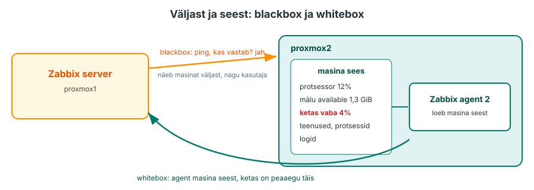
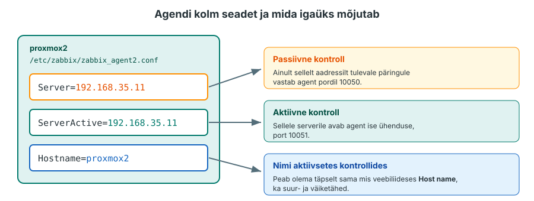
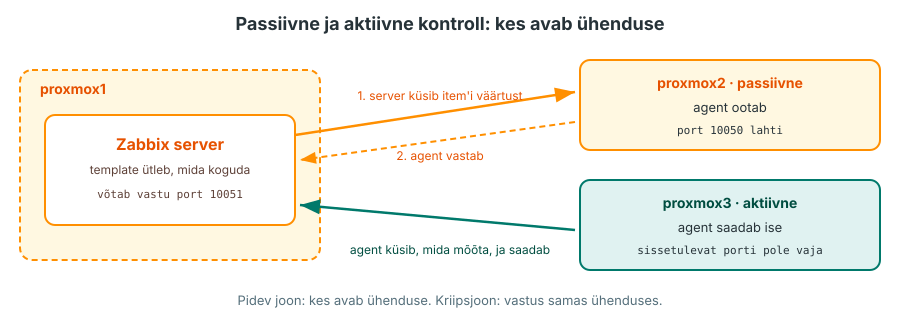
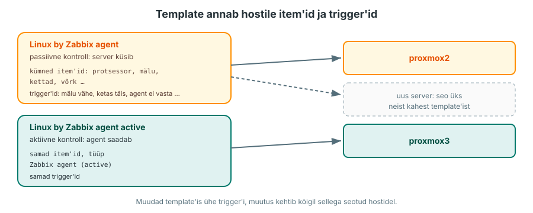
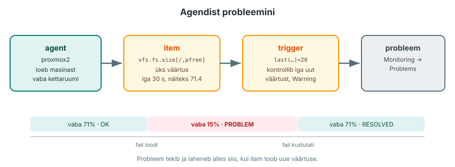
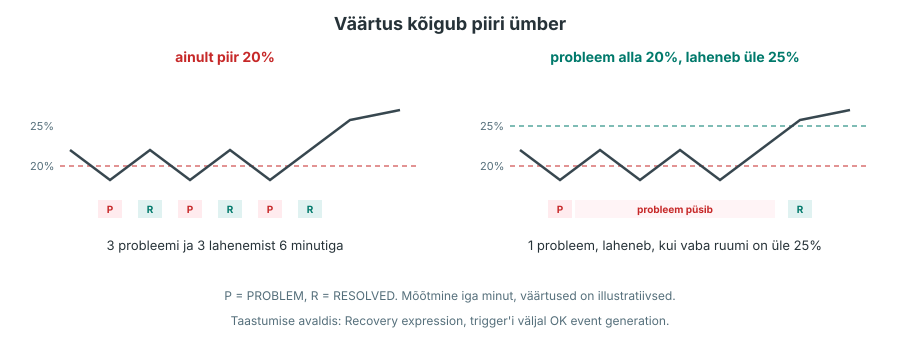
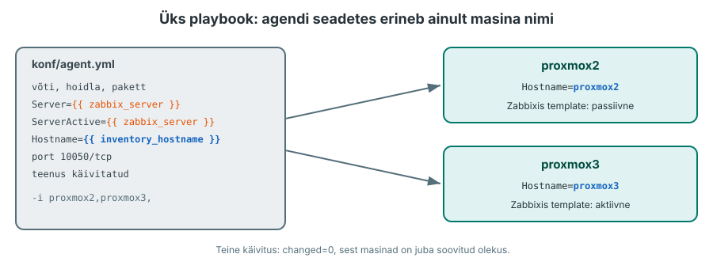

---
tags:
  - Loeng
  - Monitooring
  - Ansible
---

# Loeng: agent suhtleb serveriga

N2-s käivitasid Zabbixi ja see kontrollis pingiga, kas `proxmox2` ja `proxmox3` vastavad. N3 loengus nägid, millised näidud masina sees on: protsessori kasutus, mälu ja kettaruum. Täna paigaldad mõlemasse masinasse agendi, seod hostid valmis template'iga ja kirjutad oma trigger'i.

??? abstract "Õpiväljundid"
    Pärast loengut ja praktikumi oskad:

    - paigaldada ja seadistada Zabbix agent 2 Ansible'i playbook'iga mitmes masinas;
    - eristada passiivseid ja aktiivseid kontrolle ühenduse algataja järgi;
    - siduda hostid sobivate template'itega ja kontrollida mõõteväärtuste uuenemist;
    - luua oma trigger'i ning tõendada probleemi tekkimist ja lahenemist.

## 1. Ping ei näe masina sisse

N2-s kontrollis Zabbix pingiga, kas masin vastab, mitte masina sisemist olekut. Ketas võib olla täis, kuigi masin vastab pingile ja Zabbix näitab rohelist. Ketta täituvust loed jälgitava masina sees, nagu N3 loengus käsuga `df -h`. Pidevaks mõõtmiseks on vaja programmi, mis töötab jälgitavas masinas, loeb numbrid ja annab need serverile. Seda programmi nimetatakse **agendiks** (agent).

Need on kaks vaadet: **blackbox**- ja **whitebox**-monitooring ([Application monitoring: black box vs white box](https://dev.to/rafaeljcamara/application-monitoring-black-box-vs-white-box-32ij)). Blackbox-kontroll vaatab süsteemi väljast. Ping kontrollib, kas masin vastab, veebikontroll võib kontrollida, kas leht avaneb. Tulemus näitab ainult seda, mida see kontroll katsetab. Whitebox-kontroll kasutab süsteemi sisemisi näite: protsessori kasutust, mälu, kettaruumi ja teenuste olekut. See näitab probleemi sageli enne, kui kasutaja seda märkab, näiteks ketas täitub. N2 ping oli blackbox, tänane agent on whitebox. Vaja on mõlemat, N11-s lisandub veebiteenuse blackbox-kontroll.

<figure markdown="span">
  
  <figcaption>Joonis 4.1. Ping näeb masinat väljast (blackbox), agent loeb masina seest (whitebox) (Talvik, 2026).</figcaption>
</figure>

Zabbixil on kaks agenti. Vanem [Zabbix agent](https://www.zabbix.com/documentation/7.0/en/manual/concepts/agent) on kirjutatud C-s. Uuem [Zabbix agent 2](https://www.zabbix.com/documentation/7.0/en/manual/concepts/agent2) on kirjutatud Go-s ja oskab pluginate kaudu jälgida ka näiteks Dockerit, PostgreSQL-i ja MySQL-i. Põhilised item'id (protsessor, mälu, ketas, võrk) on mõlemal samad. Kursusel kasutad Zabbix agent 2 programmi. Selle võimalusi saab laiendada pluginatega, näiteks andmebaaside ja Dockeri jälgimiseks.

Zabbixis on kolm mõistet, mida praktikumis kasutad. **Item** on ühe kogutava väärtuse seadistus: mida mõõta, millise võtmega ja kui tihti. **Trigger** on avaldis, mis otsustab kogutud väärtuste põhjal, kas on probleem. **Template** on korduskasutatav mall, mis annab hostile korraga palju item'eid ja trigger'eid.

??? question "Kontrolli ennast"
    N2 praktikumis oli hosti **Zabbix server** juures ZBX punane. Mida Zabbix seal proovis ja miks see ei õnnestunud?

## 2. Agendi paigaldus ja kolm seadet

Agent tuleb Zabbixi ametlikust paketihoidlast. AlmaLinux 9 jaoks lisab pakett `zabbix-release` masinasse hoidla kirjelduse (`/etc/yum.repos.d/zabbix.repo`) ja allkirjavõtme. Võtmega kontrollib `dnf`, et pakett tuleb Zabbixilt ja seda pole teel muudetud. Paigaldamise juhend on Zabbixi lehel [Download and install Zabbix](https://www.zabbix.com/download?zabbix=7.0&os_distribution=alma_linux&os_version=9&components=agent_2&db=&ws=).

Kui masinas on ka EPEL-i hoidla, on seal Zabbixi vanemad paketid. Zabbixi juhendi järgi lisa EPEL-i kirjeldusse rida `excludepkgs=zabbix*`, muidu võib `dnf` paigaldada vale versiooni.

Agendi seaded on failis `/etc/zabbix/zabbix_agent2.conf`. Fail on pikk, kuid enamik ridu on kommentaarid. Praktikumis muudad kolme põhiseadet. Passiivse kontrolli jaoks on vaja seadet `Server`, aktiivse kontrolli jaoks `ServerActive` ja `Hostname`. Kui `Server` on määramata, on passiivsed kontrollid keelatud, ja kui `ServerActive` on määramata, on keelatud aktiivsed ([agent 2 parameetrid](https://www.zabbix.com/documentation/7.0/en/manual/appendix/config/zabbix_agent2)).

??? note "Tabel 4.1. Agendi konfiguratsioonifaili kolm põhiseadet"
    | Seade | Paketi konfiguratsioonifailis | Mida tähendab | Selles praktikumis |
    |---|---|---|---|
    | `Server` | `127.0.0.1` | aadressid, kust agent lubab endalt küsida (passiivne agent) | `proxmox1` IP |
    | `ServerActive` | `127.0.0.1` | server, kuhu agent ise andmeid saadab (aktiivne agent) | `proxmox1` IP |
    | `Hostname` | `Zabbix server` | nimi, millega agent end serverile tutvustab | `proxmox2` või `proxmox3` |

<figure markdown="span">
  
  <figcaption>Joonis 4.2. Agendi kolm seadet ja mida igaüks mõjutab (Talvik, 2026).</figcaption>
</figure>

`Hostname` peab olema täpselt sama mis veebiliideses hosti väli **Host name**, ka suur- ja väiketähed peavad klappima. Kui need erinevad, ei leia server õiget hosti ja aktiivse agendi andmed jäävad vastu võtmata. N2-s panid hostide nimeks `proxmox2` ja `proxmox3`, need lähevad ka agendi seadesse.

Konfiguratsioonifaili õigused on `640` ja see kuulub grupile `zabbix`. Tavakasutaja faili lugeda ei saa, sest seal võivad olla paroolid, näiteks andmebaasi pluginate jaoks. Faili vaatamiseks kasuta `sudo`.

??? question "Kontrolli ennast"
    Agent töötab, aga `proxmox3` aktiivse kontrolli väärtused ei uuene. Mida võrdled agendi konfiguratsioonifailis ja veebiliideses? Millisest logifailist otsid rida, mis sinu oletust kinnitab?

## 3. Passiivne ja aktiivne agent

Agent saab andmed serverile anda kahel viisil. Vahe on selles, kes alustab andmevahetust ehk avab ühenduse.

<figure markdown="span">
  
  <figcaption>Joonis 4.3. Passiivse kontrolli puhul avab ühenduse server jälgitava masina porti 10050. Aktiivse kontrolli puhul avab ühenduse agent serveri porti 10051 (Talvik, 2026).</figcaption>
</figure>

**Passiivne agent** (passive check) ootab pordil 10050. Server küsib iga item'i kohta eraldi ja agent vastab. Agent vastab ainult aadressidele, mis on seades `Server`. Jälgitava masina tulemüüris peab port 10050 olema lahti.

**Aktiivne agent** (active check) küsib serverilt kõigepealt, milliseid item'eid temalt oodatakse ja kui tihti. Seejärel mõõdab ta ise ja saadab väärtused serveri porti 10051. Aktiivse kontrolli jaoks ei pea jälgitavas masinas avama sissetulevat porti 10050. Agent peab saama ise ühenduse serveri porti 10051. Server leiab õige hosti seade `Hostname` järgi.

??? note "Tabel 4.2. Passiivne ja aktiivne agent"
    | | Passiivne | Aktiivne |
    |---|---|---|
    | Kes avab ühenduse | server | agent |
    | Port | 10050 jälgitavas masinas | 10051 serveris |
    | Seade agendi failis | `Server` | `ServerActive`, `Hostname` |
    | Item'i tüüp Zabbixis | Zabbix agent | Zabbix agent (active) |
    | Template | *Linux by Zabbix agent* | *Linux by Zabbix agent active* |
    | Sobib, kui | server pääseb masinani | masin on NAT-i või tulemüüri taga ja server sinna ei pääse |

Üks agent oskab mõlemat korraga. Millist viisi kasutatakse, määrab item'i tüüp. Praktikumis kasutab `proxmox2` passiivset ja `proxmox3` aktiivset template'i, et saaksid erinevust ise näha. Kui katses blokeerid mõlemas masinas sissetuleva pordi 10050, lakkavad uuenemast `proxmox2` passiivsete kontrollide väärtused. `proxmox3` aktiivsete kontrollide väärtused uuenevad edasi, sest ühendus serveri porti 10051 jääb alles.

Selle kursuse Zabbix server töötab Dockeri konteineris. Dockeri vaikimisi võrgus (bridge) asendatakse konteinerist väljuva ühenduse lähteaadress masina aadressiga. Seepärast näeb `proxmox2` serveri päringu lähteaadressina `proxmox1` IP-aadressi ja see läheb seadesse `Server`. Kui agent päringu tagasi lükkab, on tegelik lähteaadress agendi logis `/var/log/zabbix/zabbix_agent2.log` real `connection from ... rejected`.

??? question "Kontrolli ennast"
    Kooli serverid on tulemüüri taga ja väljast ühendusi sisse ei lubata. Zabbix server on pilves. Kumba agenti kasutad ja miks?

## 4. Template ja item'i võti

N2-s panid hostidele template'i *ICMP Ping*, millel on kolm item'it. Template *Linux by Zabbix agent* on palju suurem: protsessor, mälu, kettad, võrguliidesed ja protsessid, kokku kümneid item'eid ja trigger'eid. Kettad ja võrguliidesed leiab template ise üles (low-level discovery), neid ei pea ükshaaval lisama ([Linuxi template'id](https://www.zabbix.com/integrations/linux)).

<figure markdown="span">
  
  <figcaption>Joonis 4.4. Template annab item'id ja trigger'id kõigile seotud hostidele. Passiivne ja aktiivne kontroll on eri template'ites (Talvik, 2026).</figcaption>
</figure>

Iga item'i taga on võti, mis ütleb agendile, mida mõõta.

??? note "Tabel 4.3. Agendi item'ide võtmed"
    | Võti | Mida tagastab | Kust agent selle võtab |
    |---|---|---|
    | `system.cpu.load[all,avg1]` | 1 minuti koormus | `/proc/loadavg` |
    | `vm.memory.size[available]` | rakendustele saadaval oleva mälu hinnang baitides (nagu `free` veerg `available`) | `/proc/meminfo` |
    | `vfs.fs.size[/,pfree]` | juurfailisüsteemi vaba ruum protsentides | tuum, sama mis `df` |
    | `agent.ping` | 1, kui agent vastab | agent ise |

    Kõik võtmed on Zabbixi dokumentatsioonis: [Zabbix agent items](https://www.zabbix.com/documentation/7.0/en/manual/config/items/itemtypes/zabbix_agent).

Võtme väärtust saad kontrollida masina seest, ilma veebiliideseta. Agent 2 teeb selle võtmega kontrolli ühe korra ja väljastab tulemuse:

```bash
sudo zabbix_agent2 -t 'vfs.fs.size[/,pfree]'
```

Rea lõpus on nurksulgudes väärtuse tüüp ja väärtus, näiteks `[s|71.420543]`. Kui võti on vale, on väljundis `ZBX_NOTSUPPORTED` koos põhjusega. Nii kontrollid enne item'i lisamist, kas agent oskab seda väärtust anda. See kontrollib võtit ainult masinas kohapeal. See ei tõenda, et server saab sama väärtuse kätte või et aktiivne agent selle serverisse saadab.

??? question "Kontrolli ennast"
    Sul on 30 Linuxi serverit ja kõigil on sama jälgimisvajadus. Kuidas kasutad template'i, et ei peaks samu item'eid igale hostile käsitsi looma?

## 5. Trigger, avaldis ja raskusaste

Trigger'i tingimus on [avaldis](https://www.zabbix.com/documentation/7.0/en/manual/config/triggers/expression). Avaldises on funktsioon, host, item'i võti ja võrdlus:

```text
last(/proxmox2/vfs.fs.size[/,pfree])<20
```

Avaldis töötab ainult siis, kui hostil `proxmox2` on item võtmega `vfs.fs.size[/,pfree]` ja sellel on väärtus. Template *Linux by Zabbix agent* kogub kettaruumi teiste võtmetega, seepärast lood selle item'i praktikumis ise. Agendi toetatud võti ja hostile lisatud item ei ole sama asi.

`last()` võtab viimase väärtuse. Avaldis on tõene, kui `proxmox2` juurfailisüsteemis on vaba ruumi alla 20%. Siis läheb trigger olekusse PROBLEM ja tekib probleem. Kui väärtus on jälle 20 või rohkem, läheb trigger olekusse OK ja probleem saab märke RESOLVED, nagu nägid N2-s pingiga.

<figure markdown="span">
  
  <figcaption>Joonis 4.5. Agent annab väärtuse, item salvestab selle, trigger võrdleb seda piiriga ja probleem tekib või laheneb. Väärtused on illustratiivsed (Talvik, 2026).</figcaption>
</figure>

Igal trigger'il on [raskusaste](https://www.zabbix.com/documentation/7.0/en/manual/config/triggers/severity) (severity). See näitab probleemi olulisust. N6-s valitakse selle järgi, kes teavituse saab. Tabelis olevad reageerimisajad ja näited on selle kursuse näidiskokkulepe, mitte Zabbixi reegel: iga ettevõte otsustab need ise.

??? note "Tabel 4.4. Zabbixi raskusastmed ja kursuse näidiskokkulepe"
    | Raskusaste | Tähendus | Näide |
    |---|---|---|
    | Not classified | määramata | |
    | Information | teadmiseks, kohene sekkumine pole vajalik | operatsioonisüsteemi versioon muutus |
    | Warning | vaata tööpäeva jooksul | vaba kettaruumi alla 20% |
    | Average | lahenda täna | teenus taaskäivitub korduvalt |
    | High | lahenda kohe | masin ei vasta |
    | Disaster | ettevõtte töö seisab | e-pood ei tööta |

Kui väärtus kõigub piiri ümber (19, 21, 19, 21), võib probleem iga uue väärtusega kord tekkida ja kord laheneda. Selle vastu aitab [taastumise avaldis](https://www.zabbix.com/documentation/7.0/en/manual/config/triggers/expression#hysteresis) (recovery expression). Probleem tekib alla 20% juures, kuid laheneb alles siis, kui vaba ruumi on üle 25%. Seda nimetatakse **hüstereesiks**. Probleem laheneb siis, kui probleemi avaldis ei ole enam tõene ja taastumise avaldis on tõene. Veebiliideses vali trigger'i juures **OK event generation: Recovery expression**, muidu teist avaldist ei kasutata.

<figure markdown="span">
  
  <figcaption>Joonis 4.6. Ilma taastumise avaldiseta tekib ja laheneb probleem iga kõikumisega. Väärtused on illustratiivsed (Talvik, 2026).</figcaption>
</figure>

??? question "Kontrolli ennast"
    Template'is on ketta trigger juba olemas (kasutusel üle 80%). Miks võib olla vaja oma trigger'it teise piiri või teise raskusastmega?

## 6. Miks agent paigaldatakse Ansible'iga

Agendi paigaldus on igas masinas sama: võti, hoidla, pakett, kolm seadet, tulemüür ja teenus. Agendi konfiguratsioonifailis erineb ainult `Hostname`. Kas host kasutab passiivset või aktiivset kontrolli, otsustab Zabbixis template, mitte agendi seaded. Kahes masinas saab seda teha käsitsi, kuid 50 masinas jääb mõni samm kergesti vahele. Hiljem ei ole ka teada, millised seaded igas masinas on.

<figure markdown="span">
  
  <figcaption>Joonis 4.7. Sama playbook kahes masinas: agendi seadetes erineb ainult masina nimi, kontrolliviisi valib Zabbixis template (Talvik, 2026).</figcaption>
</figure>

Playbook kirjeldab soovitud olekut ja Ansible rakendab vajalikud muudatused. `Hostname` tuleb inventarifailist muutujaga `inventory_hostname`, seega saab sama playbook'iga seadistada mõlemad praktikumi masinad. Teine käivitus annab `changed=0`, kui masinad on juba soovitud olekus. Uue masina lisamiseks paned selle inventarifaili ja käivitad playbook'i uuesti.

Praktikumis on playbook pooleli: ülesanded on olemas ja sina täidad seaded, pordi ja handler'i. Siis käivitad selle mõlemas masinas.

??? question "Kontrolli ennast"
    1. Mida näeb agent, mida ping ei näe? Too kaks näidet.
    2. Passiivse agendi item'id ei tööta, aktiivse omad töötavad. Mida kontrollid kõigepealt?
    3. Miks on agendi seades `Server` selles praktikumis `proxmox1` IP, kuigi server töötab konteineris?
    4. Kirjuta avaldis, mille täitumisel tekib probleem, kui `proxmox3` 1 minuti koormus on üle 4.
    5. Mis vahe on raskusastmetel Warning ja High? Too kummastki näide.

??? abstract "Kokkuvõte"
    | Mõiste | Lühidalt |
    |---|---|
    | agent | töötab jälgitavas masinas, loeb numbrid tuumast ja annab need serverile |
    | `Server`, `ServerActive`, `Hostname` | agendi kolm põhiseadet; `Hostname` = hosti nimi veebiliideses |
    | passiivne agent | server alustab andmevahetust, jälgitavas masinas peab port 10050 olema lahti |
    | aktiivne agent | agent alustab andmevahetust ja saadab väärtused serveri porti 10051 |
    | template | annab hostile item'id ja trigger'id |
    | item'i võti | ütleb agendile, mida mõõta; kontroll käsuga `zabbix_agent2 -t` |
    | trigger | avaldis ja raskusaste; probleem tekib, kui avaldis on tõene |
    | Ansible | paigaldab agendi igasse masinasse ühe playbook'iga |
