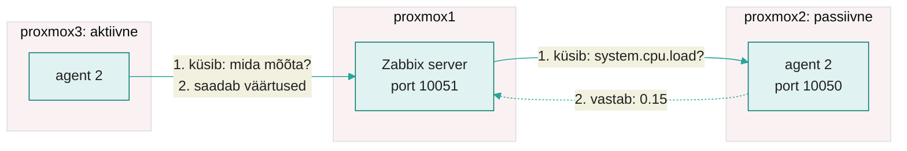

---
tags:
  - Loeng
  - Monitooring
  - Ansible
---

# Loeng: agent räägib serverile

**Maht:** ~20 min klassis, ~20 min iseseisvalt lugedes
**Tase:** K2 on tehtud: Zabbix töötab `proxmox1`-s ja pingib `proxmox2` ja `proxmox3`. K3 loengust tead, et masina numbrid tulevad tuumast kausta `/proc` kaudu.

K3 lõppes järeldusega: ping näitab ainult, kas masin vastab, ja masina sisu saab lugeda ainult masina seest. Täna paigaldame mõlemasse jälgitavasse masinasse Zabbix agent 2, seome hostid valmis template'iga ja kirjutame oma triggeri, mis annab teada, kui kettaruum hakkab otsa saama.

---

!!! abstract "Õpiväljundid"
    Pärast seda materjali oskad:

    - selgitada, mida teeb Zabbix agent ja millised kolm seadet peavad selle konfiguratsioonifailis õiged olema;
    - eristada passiivset ja aktiivset agenti: kes ühenduse avab, mis port peab olema lahti ja millal kumbagi kasutada;
    - valida hostile õige template'i ja kontrollida item'i väärtust masina seest;
    - kirjutada trigger'i avaldise ja valida sellele raskusastme;
    - põhjendada, miks agent paigaldatakse Ansible'iga.

---

## 1. Ping ei näe masina sisse

K3 loengus oli Kati e-poe lugu: ketas sai reede õhtul täis, aga Zabbix oli roheline, sest masin vastas pingile. Ketta täituvus on kirjas tuumas ja seda saab lugeda ainult masina seest. Seepärast on vaja programmi, mis töötab jälgitavas masinas, loeb sealt numbrid ja annab need serverile. Seda programmi nimetatakse **agendiks** (agent).

Zabbixil on kaks agenti. Vanem [Zabbix agent](https://www.zabbix.com/documentation/7.0/en/manual/concepts/agent) on kirjutatud C-s. Uuem [Zabbix agent 2](https://www.zabbix.com/documentation/7.0/en/manual/concepts/agent2) on kirjutatud Go-s ja oskab lisaks pluginate kaudu jälgida näiteks Dockerit, PostgreSQL-i ja MySQL-i. Põhilised item'id (protsessor, mälu, ketas, võrk) on mõlemal samad. Kasutame agent 2-t, sest uued pluginad tulevad ainult sinna.

??? question "Kordamisküsimus"
    K2 praktikumis oli hosti **Zabbix server** juures ZBX punane. Mida Zabbix seal proovis ja miks see ei õnnestunud?

---

## 2. Agendi paigaldus ja kolm seadet

Agent tuleb Zabbixi ametlikust paketihoidlast. AlmaLinux 9 jaoks on see pakett `zabbix-release`, mis lisab masinasse hoidla kirjelduse (`/etc/yum.repos.d/zabbix.repo`) ja allkirja võtme. Võtmega kontrollib `dnf`, et pakett tuleb Zabbixilt ja seda pole teel muudetud. Paigaldamise juhend on Zabbixi lehel [Download and install Zabbix](https://www.zabbix.com/download?zabbix=7.0&os_distribution=alma_linux&os_version=9&components=agent_2&db=&ws=).

Kui masinas on ka EPEL-i hoidla, on seal Zabbixi vanemad paketid. Zabbixi juhend ütleb, et EPEL-i kirjeldusse tuleb lisada rida `excludepkgs=zabbix*`, muidu võib `dnf` paigaldada vale versiooni.

Agendi seaded on failis `/etc/zabbix/zabbix_agent2.conf`. Fail on pikk, aga enamik ridu on kommentaarid. Tööle saamiseks peavad õiged olema kolm seadet ([agent 2 parameetrid](https://www.zabbix.com/documentation/7.0/en/manual/appendix/config/zabbix_agent2)):

| Seade | Vaikimisi | Mida tähendab | Meie laboris |
|---|---|---|---|
| `Server` | `127.0.0.1` | aadressid, kust agent lubab endalt küsida (passiivne agent) | `proxmox1` IP |
| `ServerActive` | `127.0.0.1` | server, kuhu agent ise andmeid saadab (aktiivne agent) | `proxmox1` IP |
| `Hostname` | `Zabbix server` | nimi, millega agent end serverile tutvustab | `proxmox2` või `proxmox3` |

*Tabel 4.1. Agendi konfiguratsioonifaili kolm põhiseadet*

`Hostname` peab olema täpselt sama mis veebiliideses hosti väli **Host name**. Kui need erinevad, ei tea server, millise hosti andmed tulid, ja aktiivse agendi andmed jäävad vastu võtmata. K2-s panid hostide nimeks `proxmox2` ja `proxmox3`, need lähevad ka agendi seadesse.

Pane tähele, et fail on õigustega `640` ja kuulub grupile `zabbix`. Tavakasutaja seda lugeda ei saa, sest seal võivad olla paroolid (näiteks andmebaasi pluginate jaoks). Vaatamiseks kasuta `sudo`.

??? question "Kordamisküsimus"
    Agent töötab, aga veebiliides ei näita `proxmox3` kohta ühtegi aktiivse agendi väärtust. Agendi failis on `Hostname=Proxmox3`. Mis on viga?

---

## 3. Passiivne ja aktiivne agent

Agent saab andmed serverile anda kahel viisil. Vahe on selles, kes avab ühenduse.

<figure markdown="span">

  <figcaption>Joonis 4.1. Passiivse agendi puhul avab ühenduse server (porti 10050 jälgitavas masinas). Aktiivne agent avab ühenduse ise serveri porti 10051.</figcaption>
</figure>

**Passiivne agent** (passive check) ootab pordil 10050. Server küsib iga item'i kohta eraldi ja agent vastab. Agent vastab ainult aadressidele, mis on seades `Server`. Jälgitava masina tulemüüris peab port 10050 olema lahti.

**Aktiivne agent** (active check) küsib serverilt kõigepealt, milliseid item'eid temalt oodatakse ja kui tihti. Siis mõõdab ta ise ja saadab väärtused serveri porti 10051. Jälgitava masina tulemüüris ei pea ühtegi porti avama, sest ühendus läheb masinast välja. Server leiab õige hosti seade `Hostname` järgi.

| | Passiivne | Aktiivne |
|---|---|---|
| Kes avab ühenduse | server | agent |
| Port | 10050 jälgitavas masinas | 10051 serveris |
| Seade agendi failis | `Server` | `ServerActive`, `Hostname` |
| Item'i tüüp Zabbixis | Zabbix agent | Zabbix agent (active) |
| Template | *Linux by Zabbix agent* | *Linux by Zabbix agent active* |
| Sobib, kui | server pääseb masinani | masin on NAT-i või tulemüüri taga, server sinna ei pääse |

*Tabel 4.2. Passiivne ja aktiivne agent*

Üks agent oskab mõlemat korraga: millist viisi kasutatakse, otsustab item'i tüüp. Laboris kasutab `proxmox2` passiivset ja `proxmox3` aktiivset template'i, et saaksid erinevust ise näha. Kui suleme mõlemas masinas pordi 10050, jääb üks host andmeteta ja teine töötab edasi.

Meie Zabbix server töötab Dockeri konteineris. Kui server küsib `proxmox2`-lt, näeb `proxmox2` päringu allikana `proxmox1` IP-d, sest Docker asendab konteineri aadressi masina aadressiga. Seepärast on seades `Server` just `proxmox1` IP.

??? question "Kordamisküsimus"
    Kooli serverid on tulemüüri taga ja väljast ühendusi sisse ei lubata. Zabbix server on pilves. Kumba agenti kasutad ja miks?

---

## 4. Template ja item'i võti

K2-s panid hostidele template'i *ICMP Ping*, millel on kolm item'it. Template *Linux by Zabbix agent* on palju suurem: protsessor, mälu, kettad, võrguliidesed ja protsessid, kokku kümneid item'eid ja trigger'eid. Kettad ja võrguliidesed leiab template ise üles (low-level discovery), sa ei pea neid ükshaaval lisama ([Linuxi template'id](https://www.zabbix.com/integrations/linux)).

Iga item'i taga on võti. Mõned näited:

| Võti | Mida tagastab | Kust agent selle võtab |
|---|---|---|
| `system.cpu.load[all,avg1]` | 1 minuti koormus | `/proc/loadavg` |
| `vm.memory.size[available]` | kasutatav mälu baitides | `/proc/meminfo` |
| `vfs.fs.size[/,pfree]` | juurfailisüsteemi vaba ruum protsentides | tuum, sama mis `df` |
| `agent.ping` | 1, kui agent vastab | agent ise |

*Tabel 4.3. Agendi item'ide võtmed ([kõik võtmed](https://www.zabbix.com/documentation/7.0/en/manual/config/items/itemtypes/zabbix_agent))*

Võtme väärtust saad kontrollida masina seest, ilma veebiliideseta. Agent 2 käivitab võtme üks kord ja trükib tulemuse:

```bash
sudo zabbix_agent2 -t 'vfs.fs.size[/,pfree]'
```

Rea lõpus on nurksulgudes väärtuse tüüp ja väärtus, näiteks `[s|71.420543]`. Kui võti on vale, tuleb `ZBX_NOTSUPPORTED` koos põhjusega. Nii saad enne item'i lisamist kontrollida, kas agent seda väärtust üldse oskab anda.

??? question "Kordamisküsimus"
    Sul on 30 Linuxi serverit, kõigil aktiivne agent. Mitu template'it lisad ja mitu item'it kirjutad käsitsi?

---

## 5. Trigger, avaldis ja raskusaste

Trigger'i tingimus on [avaldis](https://www.zabbix.com/documentation/7.0/en/manual/config/triggers/expression). Avaldises on funktsioon, host, item'i võti ja võrdlus:

```text
last(/proxmox2/vfs.fs.size[/,pfree])<20
```

`last()` võtab viimase väärtuse. Avaldis on tõene, kui `proxmox2` juurfailisüsteemis on vaba ruumi alla 20%. Siis läheb trigger olekusse PROBLEM ja tekib probleem. Kui väärtus on jälle 20 või rohkem, läheb trigger olekusse OK ja probleem saab märke RESOLVED, nagu nägid K2-s ping'iga.

Igal trigger'il on [raskusaste](https://www.zabbix.com/documentation/7.0/en/manual/config/triggers/severity) (severity). See ütleb, kui kiiresti peab inimene reageerima, ja selle järgi valitakse K6-s, kes teavituse saab.

| Raskusaste | Tähendus | Näide |
|---|---|---|
| Not classified | määramata | |
| Information | teadmiseks, tegutseda pole vaja | operatsioonisüsteemi versioon muutus |
| Warning | vaata tööpäeva jooksul | vaba kettaruumi alla 20% |
| Average | lahenda täna | teenus taaskäivitub korduvalt |
| High | lahenda kohe | masin ei vasta |
| Disaster | äri seisab | e-pood on maas |

*Tabel 4.4. Zabbixi raskusastmed*

Kui väärtus kõigub piiri ümber (19, 21, 19, 21), tekib ja laheneb probleem iga minut. Selle vastu on [taastumise avaldis](https://www.zabbix.com/documentation/7.0/en/manual/config/triggers/expression#hysteresis) (recovery expression): probleem tekib alla 20% juures, aga laheneb alles siis, kui vaba ruumi on üle 25%. Seda nimetatakse hüstereesiks.

??? question "Kordamisküsimus"
    Template'is on ketta trigger juba olemas (kasutusel üle 80%). Miks võib olla vaja oma trigger'it teise piiri või teise raskusastmega?

---

## 6. Miks agent paigaldatakse Ansible'iga

Agendi paigaldus on igas masinas sama: võti, hoidla, pakett, kolm seadet, tulemüür, teenus. Erinev on ainult `Hostname`. Kahes masinas saab seda teha käsitsi, aga 50 masinas läheb mõni samm kindlasti meelest. Hiljem ei tea ka keegi, millised seaded igas masinas on.

Playbook kirjeldab soovitud olekut ja Ansible rakendab vajalikud muudatused. `Hostname` tuleb inventory'st muutujaga `inventory_hostname`, seega sama playbook sobib igale masinale. Teine käivitus annab `changed=0`, kui masinad on juba soovitud olekus. Uue masina lisamiseks paned selle inventory'sse ja käivitad playbook'i uuesti.

Laboris teed paigalduse kõigepealt käsitsi `proxmox2`-s, et näha iga sammu tulemust. Siis kirjutad sama playbook'iks ja käivitad selle mõlemas masinas.

---

## Kokkuvõte

- **Agent** töötab jälgitavas masinas, loeb numbrid tuumast ja annab need serverile.
- Agendi failis peavad õiged olema **`Server`**, **`ServerActive`** ja **`Hostname`**. `Hostname` = hosti nimi veebiliideses.
- **Passiivne** agent: server küsib, port 10050 jälgitavas masinas peab olema lahti. **Aktiivne** agent: agent saadab ise serveri porti 10051.
- **Template** annab hostile item'id ja trigger'id. Item'i võtit saad kontrollida käsuga `zabbix_agent2 -t`.
- **Trigger** = avaldis + **raskusaste**. Probleem tekib, kui avaldis on tõene, ja laheneb, kui see on jälle väär.
- Agent paigaldatakse **Ansible'iga**, sest see on igas masinas sama ja playbook kirjeldab soovitud olekut.

---

## Küsimused enda kontrolliks

1. Mida näeb agent, mida ping ei näe? Too kaks näidet.
2. Passiivse agendi item'id ei tööta, aktiivse omad töötavad. Mida kontrollid kõigepealt?
3. Miks on agendi seades `Server` meie laboris `proxmox1` IP, kuigi server töötab konteineris?
4. Kirjuta avaldis, mis teeb probleemi, kui `proxmox3` 1 minuti koormus on üle 4.
5. Mis vahe on raskusastmetel Warning ja High? Too kummastki näide.

---

*Järgmine: praktikumis paigaldad agendi käsitsi `proxmox2`-sse, kirjutad sama playbook'iks, seod hostid template'iga ja tekitad oma trigger'iga probleemi, mis pärast parandust laheneb.*
