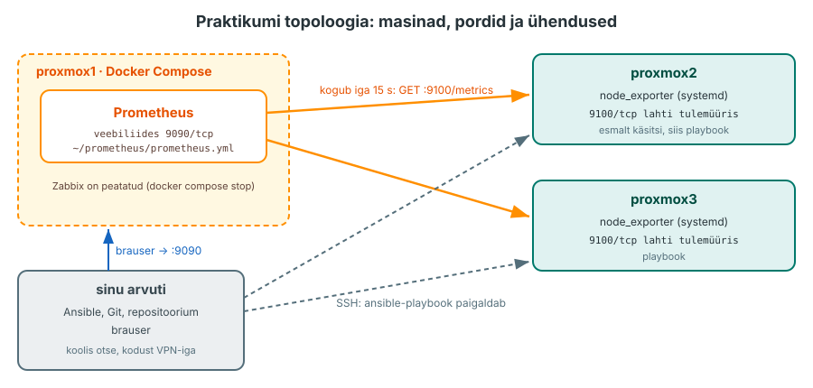

---
tags:
  - Monitooring
  - Ansible
  - Praktikum
---

# Praktikum: server küsib mõõdikuid

Täna paigaldad node_exporteri kõigepealt käsitsi `proxmox2`-sse ja seejärel Ansible'i playbook'iga mõlemasse jälgitavasse masinasse, käivitad `proxmox1`-s Prometheuse ja leiad PromQL-iga vastuse küsimusele: millises masinas on ressursse kõige vähem alles?

**Edenemine:** laboritahvel <http://192.168.125.187:8092/> (VPN-iga).

??? abstract "Õpiväljundid"
    Pärast loengut ja praktikumi oskad:

    1. paigaldada node_exporteri ametlikust väljalaskest systemd teenusena ja kontrollida aadressi `/metrics`;
    2. kirjutada Ansible'i playbook'i, mis paigaldab node_exporteri mitmesse masinasse ja annab teisel käivitusel `changed=0`;
    3. käivitada Prometheuse Docker Compose'iga, kontrollida **Targets**-lehelt, et target'id on olekus `UP`, ja leida seal viimase kogumise viga, kui target on `DOWN`;
    4. koostada ja kohandada PromQL-i päringuid saadaval oleva mälu, failisüsteemi vaba ruumi ja protsessori kasutuse uurimiseks ning selgitada tulemuste ühikuid ja ulatust;
    5. selgitada, kes avab ühenduse ja milline komponent tagastab väärtused Zabbixi agendi ja Prometheuse puhul.

<figure markdown="span">
  
  <figcaption>Joonis 5.15. Praktikumi topoloogia: masinad, pordid ja ühendused (Talvik, 2026).</figcaption>
</figure>

Lisad seadistusi ja playbook'i ülesandeid ükshaaval. Enne käivitamist ennusta tulemust, seejärel vaata väljundit ja põhjenda, mis muutus. Kui tulemus erineb oodatust, uuri erinevust enne järgmise sammu lisamist. Esimesed osad on näidatud tervikuna, järgmised koostad ise sama mustri järgi. Näidislahendus on kokkuvolditud plokis. Ava see, kui jääd kinni või tahad oma lahendust kontrollida. Kirjuta ennustused ja tulemuste võrdlus README vastava osa alla. Kui tuleb veateade, ava plokk, mis algab sõnaga **Kui**.

## Osa 1 · Repositoorium ja mälu

Töötad neljas kohas. Kasutatavad versioonid on node_exporter 1.12.1 ja Prometheus 3.15.1, jälgitavates masinates on AlmaLinux 9.

??? note "Tabel 5.4. Kus mida teed"
    | Koht | Mis seal töötab | Mida seal teed | Eeltingimus |
    |---|---|---|---|
    | Sinu arvuti | repositoorium, Ansible | kirjutad playbook'i ja seaded, käivitad `ansible-playbook`, salvestad tõendid | Ansible ja kollektsioon `ansible.posix` |
    | `proxmox1` | Prometheus (Docker Compose) | käivitad Prometheuse | Docker ja Docker Compose töötavad |
    | `proxmox2`, `proxmox3` | node_exporter (systemd teenus) | paigaldad node_exporteri, `proxmox2`-s esmalt käsitsi | AlmaLinux 9 |
    | Brauser | Prometheuse veebiliides | vaatad Targets-lehte ja kirjutad päringuid | koolis laborivõrk, kodust VPN |

Kontrolli eeltingimusi oma arvutist:

```bash
ansible-galaxy collection list ansible.posix
ssh proxmox1 "docker compose version"
```

??? success "Oodatav tulemus"
    Kollektsiooni `ansible.posix` rida ja Docker Compose'i versioon. Kui kollektsioon puudub, paigalda see: `ansible-galaxy collection install ansible.posix`.

Prometheuse veebiliides ja API on autentimiseta: igaüks, kes pordini 9090 jõuab, näeb kõiki andmeid. Ära ava neid internetti. Praktikumis kasutad neid ainult laborivõrgus, kodust VPN-iga.

Ava Classroom 50 link ([Praktikum 5 - Server küsib mõõdikuid](https://classroom50.org/hkhk-monitoring/it24-monitooring/assignments)) ja klooni oma repositoorium. Käivita käsud oma arvutis:

```bash
git clone <sinu-repo-URL>
cd <repo-kaust>
ls
```

??? success "Oodatav tulemus"
    ```text
    README.md  konf  logid
    ```

    README-sse kirjutad ennustused ja vastused. Playbook ja Prometheuse seaded lähevad kausta `konf/`, tõendid kausta `logid/`.

Prometheus vajab `proxmox1`-s umbes 300 MB mälu. Kui seal töötab N2 Zabbix, peata see. Vaata enne, mis selles projektis töötab:

```bash
ssh proxmox1 "test -d ~/zabbix && cd ~/zabbix && docker compose ps"
```

Kui väljundis on Zabbixi konteinerid, peata need ja kontrolli mälu.

!!! warning "Kasuta `stop`, mitte `docker compose down -v`"
    `stop` jätab konteinerid ja andmed alles, hiljem saad Zabbixi käsuga `docker compose start` tagasi. Võti `-v` kustutaks ka andmeköited ja Zabbixi puhul kaoksid kõik hostid ja ajalugu.

```bash
ssh proxmox1 "cd ~/zabbix && docker compose stop"
ssh proxmox1 "free -h"
```

??? success "Oodatav tulemus"
    Kolm rida `Stopped`. Real `Mem:` on veerus `available` vähemalt 1 GB. Kui kausta `~/zabbix` ei olnud, jäta peatamine vahele.

Pane kirja kolme masina IP-aadressid. Neid on vaja Prometheuse seadetes:

```bash
for h in proxmox1 proxmox2 proxmox3; do echo "$h: $(ssh $h hostname -I)"; done
```

Iga masina juures võib olla mitu aadressi. Vali laborivõrgu IPv4-aadress (näiteks `192.168.35.12`), mitte Dockeri sisevõrgu (`172.…`) ega loopback-aadress (`127.…`).

Koormuskatseks osas 6 on vaja programmi `stress-ng`, mis on EPEL-i hoidlas. Paigalda see nüüd `proxmox2`-sse. Kui see on juba olemas, ei muuda käsk midagi:

```bash
ssh proxmox2 "sudo dnf install -y epel-release && sudo dnf install -y stress-ng && stress-ng --version"
```

## Osa 2 · node_exporter käsitsi proxmox2-s

Enne playbook'i teed paigalduse ühes masinas käsitsi, et näha iga sammu tulemust. Hiljem kirjutad samad sammud playbook'iks ja siis tead, mida iga ülesanne teeb.

node_exporter on üks programmifail. Selle ametlikud väljalasked on GitHubis lehel [node_exporter releases](https://github.com/prometheus/node_exporter/releases). Ava versioon **1.12.1** ja leia jaotisest **Assets** kaks faili: Linuxi 64-bitise arhiivi (nimes on `linux-amd64`) ja faili `sha256sums.txt`. Kopeeri nende allalaadimise aadressid (paremklõps, **Copy link address**) ja laadi mõlemad `proxmox2`-s kausta `/tmp`:

```bash
ssh proxmox2
cd /tmp
curl -LO <arhiivi aadress>
curl -LO <sha256sums.txt aadress>
```

Fail `sha256sums.txt` sisaldab iga väljalaske faili SHA-256 kontrollsummat. Käsk `sha256sum --check` arvutab allalaaditud faili summa ja võrdleb seda nimekirjaga. Võti `--ignore-missing` jätab vahele failid, mida sa alla ei laadinud:

```bash
sha256sum --check --ignore-missing sha256sums.txt
```

??? success "Oodatav tulemus"
    `node_exporter-1.12.1.linux-amd64.tar.gz: OK`. Kontrollsumma kinnitab, et allalaaditud fail vastab samal väljalaskelehel avaldatud summale. Allika usaldusväärsust see ei asenda: summa ja fail tulevad samast kohast.

Paki fail lahti, paigalda programm kausta `/usr/local/bin` ja loo talle oma süsteemikasutaja. Teenus ei tööta `root`-ina, sest see ainult loeb masina näitajaid:

Muutuja `V` hoiab versiooni, et seda ei peaks mitu korda kirjutama:

```bash
V=1.12.1
tar xzf "node_exporter-${V}.linux-amd64.tar.gz"
sudo install -m 0755 "node_exporter-${V}.linux-amd64/node_exporter" /usr/local/bin/
sudo useradd --system --no-create-home --shell /sbin/nologin node_exporter
node_exporter --version
```

`install` loob uue faili, seega saab see kausta `/usr/local/bin` SELinuxi sildi. Kui teisaldad faili käsuga `mv`, jääb alles kausta `/tmp` silt ja systemd ei saa programmi käivitada.

systemd käivitab programmi teenusena, kui sellel on **unit-fail**. Unit-failis on kolm sektsiooni:

- `[Unit]`: teenuse kirjeldus ja millal see käivitub teiste teenuste suhtes;
- `[Service]`: millise kasutajana ja millise käsuga programm käivitub ning mida teha, kui see seiskub;
- `[Install]`: millise süsteemi oleku osana teenus koos masinaga käivitub.

node_exporteri repositooriumis on ametlik näidis kaustas [examples/systemd](https://github.com/prometheus/node_exporter/tree/master/examples/systemd). See on tehtud teistsuguse paigalduse jaoks (socket-fail ja keskkonnafail), sinu fail on lihtsam.

Loo `proxmox2`-s fail `/etc/systemd/system/node_exporter.service` (`sudo nano`). Fail jääb alles: osas 4 kirjutab playbook täpselt sama sisu. Esimene sektsioon on antud: `Description` on teenuse kirjeldus ja `After=network-online.target` paneb teenuse käivitusjärjekorras pärast võrgu sihtmärki.

???+ example "Failiosa: [Unit]"
    ```ini
    [Unit]
    Description=Prometheus node_exporter
    After=network-online.target
    ```

Kaks järgmist sektsiooni kirjuta ise. Vaata ametlikust näidisest, kuidas read on kirjutatud, ja kohanda neid oma paigaldusele:

- `[Service]`: programm käivitub kasutajana `node_exporter` (`User`), käsk on programmi täielik tee `/usr/local/bin/node_exporter` (`ExecStart`) ja kui programm vea tõttu seiskub, käivitab systemd selle uuesti (`Restart=on-failure`);
- `[Install]`: teenus käivitub koos masinaga, kui see on lubatud (`WantedBy=multi-user.target`).

??? tip "Vihje"
    Iga rida on kujul `Võti=väärtus`, sektsiooni nimi on nurksulgudes omaette real. Ametlikus näidises on `ExecStart` real ka lisavõtmed, sinu failis on ainult programmi tee.

??? example "Näidislahendus: kogu fail"
    ```ini
    [Unit]
    Description=Prometheus node_exporter
    After=network-online.target

    [Service]
    User=node_exporter
    ExecStart=/usr/local/bin/node_exporter
    Restart=on-failure

    [Install]
    WantedBy=multi-user.target
    ```

Kontrolli faili enne käivitamist: `sudo systemd-analyze verify /etc/systemd/system/node_exporter.service`. Kui väljund on tühi, leidis systemd failist kõik vajaliku.

Pärast unit-faili loomist või muutmist peab systemd selle uuesti lugema (`daemon-reload`), muidu kasutab ta vana versiooni. Käivita teenus ja kontrolli, et see vastab:

```bash
sudo systemctl daemon-reload
sudo systemctl enable --now node_exporter
systemctl is-active node_exporter
curl -s localhost:9100/metrics | grep '^node_memory_MemAvailable_bytes'
```

??? success "Oodatav tulemus"
    `active` ja rida `node_memory_MemAvailable_bytes 1.47e+09` (sinu arv on teine). See on sama väärtus baitides, mida `free -b` näitab veerus `available`.

??? warning "Kui `systemctl status node_exporter` näitab `status=203/EXEC`"
    systemd ei saa programmi käivitada. Kontrolli SELinuxi silti: `ls -Z /usr/local/bin/node_exporter`. Kui seal on `user_tmp_t`, paranda: `sudo restorecon -v /usr/local/bin/node_exporter`.

Prometheus küsib mõõdikuid `proxmox1`-st, seega peab port 9100 jälgitavas masinas lahti olema. Ava see tulemüüris:

```bash
exit
ssh proxmox2 "sudo firewall-cmd --permanent --add-port=9100/tcp && sudo firewall-cmd --reload"
```

## Osa 3 · Mida /metrics sisaldab

node_exporter avaldab sadu mõõdikuid. Vaata kolme, mida kasutad hiljem PromQL-is, ja salvesta need tõendiks:

```bash
ssh proxmox2 "curl -fsS localhost:9100/metrics" | grep -E '^node_(cpu_seconds_total|memory_MemAvailable_bytes|memory_MemTotal_bytes|filesystem_avail_bytes)' > logid/n5-metrics.txt
cat logid/n5-metrics.txt
```

??? question "Ennusta"
    Mitu rida on failis mõõdikul `node_cpu_seconds_total`? Vihje: `ssh proxmox2 nproc`.

```bash
grep -c '^node_cpu_seconds_total' logid/n5-metrics.txt
```

??? success "Oodatav tulemus"
    Loogiliste protsessorite arv korda kaheksa. Selles masinas on iga protsessori kohta kaheksa `mode` väärtust (`idle`, `user`, `system`, `iowait`, `irq`, `softirq`, `nice`, `steal`). Mõõdiku nimi koos siltide väärtustega määrab ühe aegrea.

Leia `proxmox2` väljundist üks gauge ja üks counter koos nende `# TYPE` reaga:

```bash
ssh proxmox2 "curl -fsS localhost:9100/metrics" | grep -E '^# TYPE node_(memory_MemAvailable_bytes|cpu_seconds_total) '
```

Kirjuta README jaotisse **Osa 3** kummagi nimi, tüüp ja ühik. Kuidas tunned counteri ära ka ilma `# TYPE` reata?

??? tip "Vihje"
    Vaata mõõdiku nime lõppu. Prometheuse nimetustava järgi on counteri nime lõpus kindel järelliide ([Metric and label naming](https://prometheus.io/docs/practices/naming/)).

## Osa 4 · Sama playbook'iga kahes masinas

`proxmox3` vajab samu samme. Käsitsi võib teises masinas mõne sammu teisiti teha, playbook teeb igas masinas samad sammud. Koostad playbook'i `konf/node_exporter.yml` ülesannete kaupa: lisad ülesande, käivitad playbook'i ja vaatad tulemust. Iga ülesanne vastab ühele osa 2 sammule.

??? question "Ennusta"
    Milline osa seadistusest on mõlemas masinas sama ja mis võib masinati erineda? Kirjuta vastus README jaotisse **Osa 4**.

??? note "Tabel 5.5. Playbook'i moodulid"
    | Moodul | Mida teeb | Osa 2 samm |
    |---|---|---|
    | [`ansible.builtin.get_url`](https://docs.ansible.com/ansible/latest/collections/ansible/builtin/get_url_module.html) | laadib faili alla ja kontrollib kontrollsummat | `curl` ja `sha256sum` |
    | [`ansible.builtin.unarchive`](https://docs.ansible.com/ansible/latest/collections/ansible/builtin/unarchive_module.html) | pakib arhiivi lahti | `tar` |
    | [`ansible.builtin.copy`](https://docs.ansible.com/ansible/latest/collections/ansible/builtin/copy_module.html) | kopeerib faili või kirjutab sisu faili | `install`, unit-fail |
    | [`ansible.builtin.user`](https://docs.ansible.com/ansible/latest/collections/ansible/builtin/user_module.html) | loob kasutaja | `useradd` |
    | [`ansible.builtin.systemd_service`](https://docs.ansible.com/ansible/latest/collections/ansible/builtin/systemd_service_module.html) | käivitab teenuse, loeb unit-failid uuesti | `systemctl` |
    | [`ansible.posix.firewalld`](https://docs.ansible.com/ansible/latest/collections/ansible/posix/firewalld_module.html) | avab pordi firewalld-s | `firewall-cmd` |

### 4.1 Play ja allalaadimine

Loo fail `konf/node_exporter.yml`. Play algus ütleb, millistes masinates ülesanded käivituvad (`hosts: all` tähendab kõiki, mille annad käsus `-i`) ja et need käivituvad `sudo` kaudu (`become: true`). Versioon ja aadressid on muutujates, et versiooni vahetamiseks piisaks ühest reast. `{{ ... }}` asendab muutuja väärtusega.

???+ example "Ülesanne: play algus"
    ```yaml
    - name: node_exporter jälgitavatesse masinatesse
      hosts: all
      become: true
      vars:
        ne_version: "1.12.1"
        ne_name: "node_exporter-{{ ne_version }}.linux-amd64"
        ne_url: "https://github.com/prometheus/node_exporter/releases/download/v{{ ne_version }}"
      tasks:
    ```

Esimene ülesanne laadib arhiivi alla ja kontrollib kontrollsummat, nagu tegid osas 2 käskudega `curl` ja `sha256sum`. `dest` on fail sihtmasinas. `checksum` ütleb, et summa võetakse veebiaadressilt `sha256sums.txt`: kui fail ei vasta, ülesanne ebaõnnestub.

???+ example "Ülesanne: väljalase alla koos kontrollsummaga"
    ```yaml
        - name: Väljalase alla koos kontrollsummaga
          ansible.builtin.get_url:
            url: "{{ ne_url }}/{{ ne_name }}.tar.gz"
            dest: "/tmp/{{ ne_name }}.tar.gz"
            checksum: "sha256:{{ ne_url }}/sha256sums.txt"
    ```

Leia `ansible-doc ansible.builtin.get_url` väljundist parameetri `checksum` kirjeldus ja kirjuta README jaotisse **Osa 4**, mis kujul saab kontrollsumma anda. Käivita playbook:

??? tip "Vihje"
    Kirjuta `ansible-doc` väljundis `/checksum` ja vajuta **Enter**. Kirjelduses on kaks kuju: summa otse ja summa failist veebiaadressil.

```bash
ansible-playbook -i proxmox2,proxmox3, konf/node_exporter.yml
```

??? success "Oodatav tulemus"
    Ülesanne on `proxmox3`-s `changed`. `proxmox2`-s laadisid osas 2 sama arhiivi kausta `/tmp`, seal on see `ok`, kui fail on alles ja kontrollsumma klapib. Käivita uuesti: nüüd on see mõlemas `ok`.

### 4.2 Lahtipakkimine ja programm

Need kaks ülesannet teevad sama, mis osas 2 käsud `tar` ja `install`. Arhiiv ja programm on juba sihtmasinas, mitte sinu arvutis, seda ütleb `remote_src: true`. `creates` jätab lahtipakkimise vahele, kui programm on juba lahti pakitud, muidu oleks ülesanne igal käivitusel `changed`.

???+ example "Ülesanne: arhiiv lahti"
    ```yaml
        - name: Arhiiv lahti
          ansible.builtin.unarchive:
            src: "/tmp/{{ ne_name }}.tar.gz"
            dest: /tmp
            remote_src: true
            creates: "/tmp/{{ ne_name }}/node_exporter"
    ```

???+ example "Ülesanne: programm kausta /usr/local/bin"
    ```yaml
        - name: Programm kausta /usr/local/bin
          ansible.builtin.copy:
            src: "/tmp/{{ ne_name }}/node_exporter"
            dest: /usr/local/bin/node_exporter
            remote_src: true
            mode: "0755"
    ```

Käivita playbook ja kontrolli: `ssh proxmox3 "/usr/local/bin/node_exporter --version"`.

??? success "Oodatav tulemus"
    Kaks uut ülesannet on `proxmox3`-s `changed`, allalaadimine on `ok`. `proxmox2`-s on arhiiv osas 2 juba lahti pakitud, seal on lahtipakkimine `skipping` ja programmi ülesanne `ok`. `--version` näitab `node_exporter, version 1.12.1`.

### 4.3 Kasutaja

Alates siit kirjutad ülesanded ise. Lisa ülesanne, mis teeb sama, mis osas 2 käsk `useradd`: süsteemikasutaja `node_exporter` ilma kodukaustata ja ilma sisselogimisõiguseta. Moodul on `ansible.builtin.user`. Leia `ansible-doc ansible.builtin.user` väljundist parameetrid, mis vastavad käsu võtmetele `--system`, `--shell` ja `--no-create-home`.

??? tip "Vihje"
    Otsi väljundist `/system`, `/shell` ja `/create_home`. Ühe neist väärtus on `false`.

??? example "Näidislahendus"
    ```yaml
        - name: Süsteemikasutaja node_exporter
          ansible.builtin.user:
            name: node_exporter
            system: true
            shell: /sbin/nologin
            create_home: false
    ```

Käivita playbook.

??? success "Oodatav tulemus"
    `proxmox3`-s on uus ülesanne `changed`. `proxmox2`-s lõid kasutaja osas 2 juba käsitsi, seal on see `ok`. Varasemad ülesanded on `ok`.

### 4.4 Unit-fail ja handler

Unit-failis peavad olema samad seaded, mis osas 2 käsitsi loodud failis. Kui sisu erineb kas või ühe tühiku võrra, kirjutab playbook `proxmox2`-s faili esimesel käivitusel üle ja ülesanne on `changed`. See on lubatud, oluline on, et järgmine käivitus on muutusteta. Moodul `ansible.builtin.copy` kirjutab faili ka ilma lähtefailita: sisu on siis parameetris `content`. Märk `|` tähendab mitmerealist teksti, read on selle all ühe taandega.

Lisa ülesanne, mis kirjutab faili `/etc/systemd/system/node_exporter.service` õigustega `0644` ja sisuga osast 2. Lisa ülesandele `notify` handler'i jaoks nimega `node_exporter uuesti`. Praktikumis paigaldad node_exporteri esimest korda. Kui hiljem vahetad versiooni, peab ka programmi kopeerimise ülesanne teavitama sama handler'it, muidu töötab edasi vana programm.

Handler'id on play lõpus eraldi plokis `handlers:`, samal tasemel kui `tasks:`. Handler kasutab moodulit `ansible.builtin.systemd_service`: see taaskäivitab teenuse, aga enne peab systemd unit-faili uuesti lugema, nagu tegid osas 2 käsuga `daemon-reload`. Leia `ansible-doc ansible.builtin.systemd_service` väljundist parameeter, mis teeb `daemon-reload`-i, ja `state` väärtus taaskäivituseks. Lisa handler enne käivitamist, muidu annab `notify` vea.

??? tip "Vihje"
    Kopeeri `content` alla osa 2 faili read nii, nagu need on, ja lisa igale reale sama taane. Handler'i nimi peab olema täpselt sama mis `notify` väärtus.

??? example "Näidislahendus: unit-fail ja handler"
    ```yaml
        - name: Unit-fail, sama sisu mis osas 2
          ansible.builtin.copy:
            dest: /etc/systemd/system/node_exporter.service
            mode: "0644"
            content: |
              [Unit]
              Description=Prometheus node_exporter
              After=network-online.target

              [Service]
              User=node_exporter
              ExecStart=/usr/local/bin/node_exporter
              Restart=on-failure

              [Install]
              WantedBy=multi-user.target
          notify: node_exporter uuesti
    ```

    ```yaml
      handlers:
        - name: node_exporter uuesti
          ansible.builtin.systemd_service:
            name: node_exporter
            state: restarted
            daemon_reload: true
    ```

??? question "Ennusta"
    Kas unit-faili ülesanne on `proxmox2`-s `changed` või `ok`? Kas handler käivitub `proxmox2`-s ja `proxmox3`-s?

Käivita playbook.

??? success "Oodatav tulemus"
    `proxmox3`-s on unit-fail `changed` ja play lõpus käivitub handler. `proxmox2`-s on unit-fail `ok` ja handler ei käivitu, kui sisu on täpselt sama mis osas 2. Kui see on `changed`, erines sisu millegi poolest: võrdle `ssh proxmox2 cat /etc/systemd/system/node_exporter.service` oma playbook'iga.

### 4.5 Teenus ja port

Need kaks ülesannet teevad sama, mis osas 2 `systemctl enable --now` ja `firewall-cmd`. Need lähevad `tasks:` loendi lõppu, enne plokki `handlers:`.

- Teenus: moodul `ansible.builtin.systemd_service`. Teenus `node_exporter` töötab ja käivitub koos masinaga. Ülesanne kirjeldab soovitud olekut, mitte taaskäivitust: kui teenus juba töötab, ei tee see midagi.
- Port: moodul `ansible.posix.firewalld`. Port `9100/tcp` on lubatud kohe (`immediate: true`) ja jääb alles pärast taaskäivitust (`permanent: true`), sest Prometheus küsib mõõdikuid väljast.

??? tip "Vihje"
    Teenuse jaoks vaata N4 praktikumi teenuse ülesannet: parameetrid on samad, moodul on teine. Pordi ülesanne on sama mis N4-s, ainult port on teine.

??? example "Näidislahendus: teenus ja port"
    ```yaml
        - name: Teenus töötab ja käivitub koos masinaga
          ansible.builtin.systemd_service:
            name: node_exporter
            state: started
            enabled: true
            daemon_reload: true

        - name: Port 9100 tulemüüris
          ansible.posix.firewalld:
            port: 9100/tcp
            permanent: true
            immediate: true
            state: enabled
    ```

### 4.6 Kaks käivitust

Kui kõik ülesanded on lisatud, käivita playbook veel kaks korda. Teise käivituse väljund läheb tõendiks:

```bash
ansible-playbook -i proxmox2,proxmox3, konf/node_exporter.yml
ansible-playbook -i proxmox2,proxmox3, konf/node_exporter.yml | tee logid/n5-teine-kaivitus.txt
```

??? success "Oodatav tulemus"
    Esimeses käivituses on `changed` ainult need ülesanded, mis lisasid 4.5-s ja mis sellel masinal veel tegemata olid. `proxmox2`-s tegid teenuse ja pordi osas 2 käsitsi, seal võivad need olla `ok`. Teisel käivitusel on mõlemal real `changed=0` ja `failed=0`.

??? warning "Kui teisel käivitusel on `changed=1`"
    Tavaliselt on põhjus `command` või `shell` ülesanne, mis käivitub iga kord. Kasuta mooduleid tabelist 5.5. Kui muutub unit-faili ülesanne, kontrolli, et `content:` ei sõltu ajast ega muutujast, mis iga kord muutub.

Kontrolli, et mõlemad masinad vastavad:

```bash
for h in proxmox2 proxmox3; do ssh $h "systemctl is-active node_exporter; curl -fsS localhost:9100/metrics | grep -c '^node_'"; done
```

## Osa 5 · Prometheus proxmox1-s

Prometheus töötab `proxmox1`-s konteineris. Kirjutad kaks faili: Prometheuse seaded ja Compose'i faili, mis konteineri käivitab. Seadete võtmed on kirjeldatud lehel [Configuration](https://prometheus.io/docs/prometheus/latest/configuration/configuration/) ja konteinerina käivitamine lehel [Installation, Using Docker](https://prometheus.io/docs/prometheus/latest/installation/#using-docker).

**Seaded, `konf/prometheus.yml`.** Esimene osa on üldseaded: `scrape_interval` ütleb, kui tihti Prometheus kõiki target'eid küsib.

???+ example "Failiosa: global"
    ```yaml
    global:
      scrape_interval: 15s
    ```

Teine osa on `scrape_configs`: loend job'e. Igal job'il on nimi (`job_name`, sellest tuleb silt `job`) ja `static_configs`, mille all `targets` on aadresside loend kujul `"<IP>:<port>"`. Esimene job küsib Prometheust ennast.

???+ example "Failiosa: scrape_configs ja job prometheus"
    ```yaml
    scrape_configs:
      - job_name: prometheus
        static_configs:
          - targets: ["localhost:9090"]
    ```

Teise job'i kirjuta ise samasse `scrape_configs` loendisse. Nõuded: `job_name` on `node` ja `targets` loendis on mõlemad node_exporterid pordiga 9100. Kasuta osas 1 kirja pandud IP-aadresse, mitte SSH aliaseid: Prometheus konteineris ei tunne nimesid `proxmox2` ja `proxmox3`.

??? tip "Vihje"
    Job `node` on samal taandel ja samal kujul nagu job `prometheus`, ainult nimi ja aadressid on teised. Aadresse eraldab loendis koma.

??? example "Näidislahendus: job node"
    ```yaml
      - job_name: node
        static_configs:
          - targets: ["<proxmox2-IP>:9100", "<proxmox3-IP>:9100"]
    ```

**Compose'i fail, `konf/compose.yaml`.** Teenus kasutab image'it kindla sildiga ([sildid Docker Hubis](https://hub.docker.com/r/prom/prometheus/tags)), et sama fail annaks ka hiljem sama tulemuse. `ports` avab masinas pordi 9090 ja `restart` käivitab konteineri uuesti, kui see seiskub.

???+ example "Failiosa: teenus, image ja port"
    ```yaml
    services:
      prometheus:
        image: prom/prometheus:v3.15.1
        ports:
          - "9090:9090"
        restart: unless-stopped
    ```

Ühendused (`volumes`) kirjuta ise. Nõuded:

- kaust `./config` on konteineris kaustas `/etc/prometheus`, ainult lugemiseks (`:ro`). Kaust, mitte üksik fail: kui fail hiljem uuega asendatakse, näeb konteiner kausta kaudu uut faili, üksiku faili ühendus võib jääda vana faili külge;
- nimega andmeköide `prometheus-data` on konteineris kaustas `/prometheus`, nii et andmed jäävad alles ka siis, kui konteiner luuakse uuesti;
- nimega andmeköide on kirjeldatud ka faili lõpus, ilma taandeta.

Kuju leiad lehelt [Installation, Using Docker](https://prometheus.io/docs/prometheus/latest/installation/#using-docker) ja Compose'i dokumentatsioonist [volumes](https://docs.docker.com/reference/compose-file/services/#volumes).

??? tip "Vihje"
    Võti `volumes` läheb teenuse alla, sama taandega kui `ports`. Iga ühendus on kujul `<kust>:<kuhu>` või `<kust>:<kuhu>:ro`.

??? example "Näidislahendus: ühendused ja andmeköide"
    ```yaml
        volumes:
          - ./config:/etc/prometheus:ro
          - prometheus-data:/prometheus
    ```

    ```yaml
    volumes:
      prometheus-data:
    ```

Kopeeri failid `proxmox1`-sse ja käivita. `prometheus.yml` läheb kausta `~/prometheus/config/`:

```bash
ssh proxmox1 "mkdir -p ~/prometheus/config"
scp konf/compose.yaml proxmox1:prometheus/
scp konf/prometheus.yml proxmox1:prometheus/config/
ssh proxmox1 "cd ~/prometheus && docker compose up -d && docker compose ps"
```

??? success "Oodatav tulemus"
    Konteiner `prometheus-prometheus-1` on olekus `Up`. Ava brauseris `http://<proxmox1-IP>:9090`.

??? warning "Kui konteiner taaskäivitub ja logis on `permission denied` või `no such file` faili `prometheus.yml` kohta"
    Vaata logi: `ssh proxmox1 "cd ~/prometheus && docker compose logs prometheus | tail"`. Kontrolli, et fail on kaustas `~/prometheus/config/` ja on loetav (`ls -l ~/prometheus/config`): Prometheus töötab konteineris kasutajana `nobody`. Kui Docker kasutab SELinuxi, lisa kaustale märge `:ro,Z` (`./config:/etc/prometheus:ro,Z`) ja käivita uuesti `docker compose up -d`.

Ava veebiliideses **Status → Target health**. Seal on kolm target'it: Prometheus ise ja kaks node_exporterit. Leia mõlema node_exporteri juurest olek, **Last scrape** ja **Error**. Kirjuta README jaotisse **Osa 5**, mis kinnitab, et Prometheus kogub mõlemast masinast.

??? success "Oodatav tulemus"
    Mõlemad on olekus `UP`, **Last scrape** on alla 15 sekundi tagasi ja **Error** on tühi. Kui mõni on `DOWN`, vaata **Error** veergu ja loengu 4. peatüki samme.

Salvesta Prometheuse vaade tõendiks. Failis on laborimasinate IP-aadressid, muud tundlikku seal pole:

```bash
ssh proxmox1 "curl -fsS localhost:9090/api/v1/targets" > logid/n5-targets.json
grep -o '"health":"[a-z]*"' logid/n5-targets.json
```

??? success "Oodatav tulemus"
    Kolm rida `"health":"up"`: Prometheus ise ja kaks node_exporterit. Failis on iga target'i juures ka `lastScrape`.

### 5.1 Kogumisvea katse

Nüüd tekitad kogumisvea meelega ja leiad selle Prometheusest.

??? question "Ennusta"
    Mis olek, **Error** ja `up` väärtus on `proxmox3` target'il, kui peatad seal node_exporteri? Kirjuta ennustus README jaotisse **Osa 5**.

Peata `proxmox3`-s node_exporter:

```bash
ssh proxmox3 "sudo systemctl stop node_exporter"
```

Oota vähemalt 15 sekundit, et Prometheus jõuaks järgmise kogumiseni. Värskenda Targets-lehte ja leia `proxmox3` juurest **Error** väli. Salvesta tõend, kui target on `DOWN`:

```bash
ssh proxmox1 "curl -fsS localhost:9090/api/v1/targets" > logid/n5-viga.json
```

??? success "Oodatav tulemus"
    `proxmox3` on `DOWN` ja **Error** on näiteks `Get "http://192.168.35.13:9100/metrics": dial tcp 192.168.35.13:9100: connect: connection refused`. Päring `up` annab `proxmox3` kohta 0. Failis `logid/n5-viga.json` on selle target'i juures `"health":"down"` ja `lastError`.

Taasta soovitud olek playbook'iga. Playbook nõuab, et teenus on olekus `started`, seega käivitab see node_exporteri uuesti:

```bash
ansible-playbook -i proxmox2,proxmox3, konf/node_exporter.yml
```

Kontrolli Targets-lehelt, et mõlemad on jälle `UP`. Kirjuta README jaotisse **Osa 5**, milline **Error** tekst oli ja mida see ütles.

## Osa 6 · Kolm küsimust PromQL-iga

Ava veebiliideses **Query**. Kirjuta päring, vajuta **Execute** ja vaata vahekaarte **Table** ja **Graph**. Iga küsimus lisab päringukeelest ühe osa, selgitus on loengu 5. peatükis.

### 6.1 Kui palju mälu on masinas saadaval?

Vali mõõdik. Kirjuta ainult mõõdiku nimi:

```text
node_memory_MemAvailable_bytes
```

Miks tagastab üks mõõdiku nimi mitu tulemust? Kirjuta vastus README jaotisse **Osa 6**.

??? tip "Vihje"
    Vaata tulemuse ridade silte. Milline silt on igal real erinev? Loengu joonis 5.4.

Piira tulemus ühe masinaga:

```text
node_memory_MemAvailable_bytes{instance="<proxmox2-IP>:9100"}
```

Kontrolli ühikut. Mis ühikus on väärtus ja kui palju on see gigabaitides?

??? question "Ennusta"
    Masinas on ka mõõdik `node_memory_MemFree_bytes`. Kas `MemAvailable` on suurem või väiksem kui `MemFree`? Kontrolli mõlemat ja kirjuta README jaotisse **Osa 6**, mida nende erinevus näitab.

Arvuta osakaal. Muuda päringut nii, et see näitab iga masina kohta saadaval oleva mälu protsentides kogu mälust (`node_memory_MemTotal_bytes`). Kirjuta päring ja tulemus iga masina kohta README jaotisse **Osa 6**.

??? tip "Vihje"
    Kaks mõõdikut saab jagada nagu arve, Prometheus paaritab read samade siltide järgi (loengu joonis 5.9). Protsendi saamiseks korruta tulemus.

??? success "Oodatav tulemus"
    Mõõdiku nimi annab rea iga target'i kohta, sest silt `instance` on erinev. Väärtus on baitides, näiteks `1.47e+09` on umbes 1,4 GiB. `MemAvailable` on suurem. `MemFree` jätab välja puhvri- ja vahemälu, mille tuum vajadusel vabastab. `MemAvailable` on tuuma hinnang mälule, mille uued programmid saavad ilma saalimiseta, mitte garantii igale programmile. Osakaalu päring annab iga masina kohta arvu 0 ja 100 vahel.

### 6.2 Millises masinas on juurfailisüsteemis kõige vähem vaba ruumi?

Selle päringu koostad ise. Vaja on kahte mõõdikut: `node_filesystem_avail_bytes` ja `node_filesystem_size_bytes`. Kirjuta kõigepealt ainult esimese nimi ja vaata, mitu rida tuleb iga masina kohta.

Kirjuta README jaotisse **Osa 6**:

1. päring, mis annab iga masina juurfailisüsteemi (`/`) vaba ruumi protsentides;
2. kummas masinas on vaba ruumi vähem ja kui palju;
3. mida sellest järeldad ja mille põhjal saaksid öelda, et see on probleem.

??? tip "Vihje"
    Iga failisüsteemi kohta on eraldi rida, silt `mountpoint` ütleb, mis failisüsteem see on. Sildifilter käib mõlema mõõdiku juurde.

### 6.3 Kuidas muutub protsessori kasutus koormuskatse ajal?

Protsessori kasutuse päring koosneb neljast osast. Kaks esimest on antud. Käivita need ja kirjuta README jaotisse **Osa 6**, mida tulemus näitab ja mis on selle ühik:

```text
node_cpu_seconds_total{mode="idle"}
rate(node_cpu_seconds_total{mode="idle"}[1m])
```

Kolmanda ja neljanda osa koostad ise:

3. teine päring annab rea iga loogilise protsessori kohta. Muuda see nii, et tulemuses on üks rida masina kohta: protsessorite keskmine;
4. tulemus on jõudeaja osa vahemikus 0 kuni 1. Muuda see protsessori kasutuseks protsentides.

Kirjuta mõlemad päringud ja nende tulemuse tähendus README jaotisse **Osa 6**.

??? tip "Vihje"
    Keskmise silti `instance` kaupa annab koondamisoperaator `avg` koos võtmesõnaga `by` ([Aggregation operators](https://prometheus.io/docs/prometheus/latest/querying/operators/#aggregation-operators)). Kasutus on see osa ajast, mis ei olnud jõudeaeg. Aritmeetika (`*`, `-`) töötab PromQL-is ka arvu ja päringu vahel ([Arithmetic binary operators](https://prometheus.io/docs/prometheus/latest/querying/operators/#arithmetic-binary-operators)).

??? success "Oodatav tulemus"
    1. Counter: iga loogilise protsessori jõudeaeg sekundites alates masina käivitusest, suured kasvavad arvud.
    2. Iga protsessori jõudeaja kasv sekundis viimase minuti aknas, arv 0 ja 1 vahel.
    3. Üks arv masina kohta, protsessorite keskmine, samuti 0 ja 1 vahel.
    4. Protsent, mis on arvutatud jõudeaja osakaalust: 100 miinus jõudeaja protsent. See kehtib viimase minuti akna kohta, mitte ühe hetke kohta.

Pane oma neljas päring vahekaardile **Graph** ja tekita `proxmox2`-s 60 sekundiks koormus (`stress-ng` paigaldasid osas 1). `$(nproc)` on masina loogiliste protsessorite arv, igaühele tuleb üks koormav protsess. Käsk näitab katse algus- ja lõpuaega:

```bash
date +%T; ssh proxmox2 'stress-ng --cpu $(nproc) --timeout 60s'; date +%T
```

Kirjuta README jaotisse **Osa 6** protsessori kasutus enne katset, katse ajal ja pärast katset. Kas graafiku muutus algas ja lõppes täpselt samal hetkel kui katse? Mis seda selgitab?

??? tip "Vihje"
    Kaks asja mõjutavad, millal muutus graafikule jõuab: kui tihti Prometheus kogub (`scrape_interval` failis `prometheus.yml`) ja kui pika ajavahemiku põhjal `rate()` arvutab (`[1m]`).

??? success "Oodatav tulemus"
    Enne ja pärast on kasutus mõne protsendi juures, katse ajal 100 lähedal. Servad on kaldu ja nihkes. Prometheus kogub iga 15 sekundi järel ja `rate(...[1m])` on viimase minuti keskmine, seega jõuab muutus graafikule täielikult alles umbes minuti jooksul.

### 6.4 Võrdlus

Kirjuta päring, mis tagastab ainult masinad, kus juurfailisüsteemis on vaba ruumi alla 99%. Seejärel muuda piiri nii, et tulemusse jääb ainult üks masin. Kirjuta mõlemad päringud README jaotisse **Osa 6**. N6-s saab sellisest päringust alarmireegel.

??? tip "Vihje"
    Võta oma 6.2 päring ja lisa selle lõppu võrdlus. Võrdlus jätab alles ainult read, mille kohta tingimus kehtib (loengu joonis 5.13). Tühi tulemus tähendab, et tingimus ei kehti ühegi masina kohta.

## Osa 7 · Kokkuvõte

Vasta README jaotises **Osa 7**:

1. Kes avab ühenduse ja milline komponent tagastab väärtused Zabbixi passiivse kontrolli, Zabbixi aktiivse kontrolli ja Prometheuse puhul? Millise pordi peab igal juhul avama ja millises masinas?
2. Millises masinas on ressursse kõige vähem alles? Põhjenda osa 6 kolme küsimuse tulemustega.
3. N4-s kogus andmeid Zabbix, täna Prometheus. Kumba eelistaksid nende kahe masina jälgimiseks? Põhjenda ühe asjaga, mida oma katsetes tegid või nägid.

Prometheus `proxmox1`-s ja node_exporter `proxmox2`-s ning `proxmox3`-s jäävad tööle. N6 alustab neist: Grafana loeb Prometheuse andmeid ja alarmireegel tuleb päringust 6.4.

??? note "Kontrollnimekiri"
    - [ ] node_exporter töötab `proxmox2`-s ja `proxmox3`-s ning käivitub koos masinaga.
    - [ ] Playbook'i teine käivitus annab mõlemas masinas `changed=0`.
    - [ ] Prometheus töötab `proxmox1`-s ja Targets-lehel on mõlemad node_exporterid olekus `UP`.
    - [ ] Kogumisvea katse on tehtud, tõend on failis `logid/n5-viga.json` ja node_exporter on uuesti käivitatud.
    - [ ] README-s on osade 3, 5 ja 6 ennustused ja vastused, osa 6 kolme küsimuse päringud koos ühiku ja selgitusega ning vastus küsimusele, millises masinas on ressursse kõige vähem alles.
    - [ ] Prometheus ja node_exporterid jäävad N6 jaoks tööle.

## Töö esitamine

Repositooriumis on playbook, Prometheuse seaded, tõendid kaustas `logid/` ja README vastused. Vaata `git status` väljund enne lisamist läbi: repositooriumisse ei lähe paroole ega SSH-võtmeid.

```bash
git status
git add README.md konf logid
git commit -m "Praktikum 5: server küsib mõõdikuid"
git push
```

Tulemuse näed Classroom 50-s.

## Lisaülesanded

??? example "1 · Oma silt"
    Lisa `prometheus.yml`-is target'itele silt `roll`: `proxmox2` on `veeb`, `proxmox3` on `andmebaas` (vaata `static_configs` võtit `labels` dokumentatsioonist [static_config](https://prometheus.io/docs/prometheus/latest/configuration/configuration/#static_config)). Kopeeri fail uuesti kausta `proxmox1:prometheus/config/`. Kontrolli, et konteiner näeb uut faili: `ssh proxmox1 "cd ~/prometheus && docker compose exec prometheus cat /etc/prometheus/prometheus.yml"`. Seejärel loe seaded uuesti ilma taaskäivituseta: `ssh proxmox1 "cd ~/prometheus && docker compose kill -s HUP prometheus"`. Kirjuta päring, mis näitab ainult rolli `veeb` vaba mälu.

??? example "2 · Kas target vastab"
    Kirjuta päring, mis tagastab ainult target'id, mille kogumine ebaõnnestus (`up == 0`). **Ennusta** enne katset: kui tihti Prometheus target'it küsib (`scrape_interval`) ja kui kaua ta vastust ootab (`scrape_timeout`, vaikimisi 10 s)? Peata `proxmox2`-s node_exporter ja kontrolli. Kui kaua läheb, enne kui päring midagi tagastab? Kas see on igal katsel sama?

??? example "3 · Mitu aegrida"
    Päring `count({__name__=~"node_.*"})` loeb kõik node_exporteri aegread. Mitu neid on? Leia päringuga `topk(5, count by (__name__) ({__name__=~"node_.*"}))`, millistel mõõdikutel on kõige rohkem aegridu ja miks.
