---
tags:
  - Loeng
  - Monitooring
  - Ansible
---

# Loeng: server küsib mõõdikuid

N4-s paigaldasid Zabbixi agendi ja valmis template andis hostile item'id ja trigger'id. Täna vaatad teist kogumisteed: node_exporter avaldab masina mõõdikud, Prometheus küsib need ise ja päringud koostad sina. Kogu nädala läbiv küsimus on: **millises masinas on ressursse kõige vähem alles?**

??? abstract "Õpiväljundid"
    Pärast loengut ja praktikumi oskad:

    - selgitada, kes alustab ühendust ja milline komponent tagastab väärtused Zabbixi agendi ja Prometheuse puhul;
    - lugeda exporter'i väljundist mõõdiku nime, silte, väärtust, tüüpi ja ühikut;
    - kontrollida kogumist sammhaaval: exporter, `/metrics`, Targets-leht, päring;
    - koostada ja kohandada PromQL-i päringuid saadaval oleva mälu, failisüsteemi vaba ruumi ja protsessori kasutuse uurimiseks ning selgitada tulemuste ühikuid ja ulatust.

<figure markdown="span">
  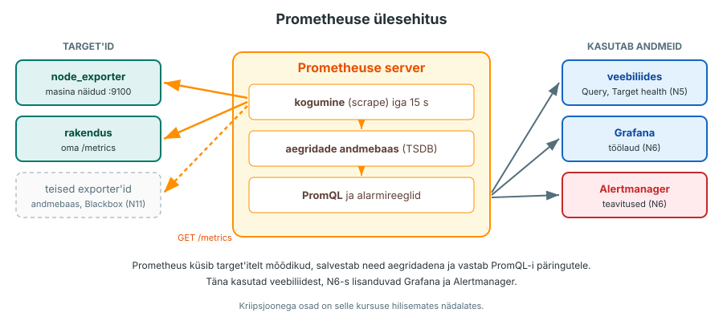
  <figcaption>Joonis 5.1. Prometheuse ülesehitus: kogumine, aegridade andmebaas ja PromQL ([Prometheuse ülevaade](https://prometheus.io/docs/introduction/overview/)) (Talvik, 2026).</figcaption>
</figure>

## 1. Kes alustab ühendust ja kes tagastab väärtused

Mõõdikute kogumisel on kaks küsimust: kes avab ühenduse ja milline komponent tagastab väärtused. Zabbixi passiivse kontrolli puhul küsib server väärtusi ja agent vastab. Aktiivse kontrolli puhul avab ühenduse agent ja saadab väärtused ise. Prometheuse puhul avab ühenduse Prometheus ja exporter tagastab korraga kõik oma mõõdikud.

Zabbixi passiivne kontroll ja Prometheus on seega sarnased: mõlemal juhul küsib server. Seda nimetatakse **pull-mudeliks**. Kui jälgitav masin saadab andmed ise, on see **push-mudel**. Zabbixis määravad hostile seadistatud item'id, milliseid väärtusi kogutakse. Item'id tulevad template'ist või on lisatud käsitsi. Selles praktikumis määravad node_exporteri lubatud collector'id, mis mõõdikud avaldatakse, ja Prometheus kogub kogu väljundi. PromQL-i päring valib kogutud andmetest selle, mida soovid uurida.

??? note "Tabel 5.1. Kes alustab ühendust ja kes tagastab väärtused"
    | | Zabbix, passiivne kontroll | Zabbix, aktiivne kontroll | Prometheus + node_exporter selles praktikumis |
    |---|---|---|---|
    | Kes avab ühenduse | server | agent | Prometheus |
    | Kes tagastab väärtused | agent vastab serveri küsimusele | agent saadab ise | exporter vastab, kogu väljund korraga |
    | Mis määrab kogutavad väärtused | hosti item'id, sh template'ist | hosti item'id, sh template'ist | exporteri väljund ja Prometheuse kogumisseadistus |
    | Kuidas uurid kogutud andmeid | Latest data, graafikud | Latest data, graafikud | PromQL-i päringud |
    | Port | 10050 jälgitavas masinas | 10051 serveris | 9100 jälgitavas masinas (node_exporteri vaikeport) |
    | Protokoll | Zabbixi oma | Zabbixi oma | HTTP, Prometheuse tekstivorming |

<figure markdown="span">
  
  <figcaption>Joonis 5.2. Prometheus küsib jälgitavate masinate node_exporteritelt mõõdikuid. Ühenduse avab Prometheus, exporter ainult vastab (Talvik, 2026).</figcaption>
</figure>

<figure markdown="span">
  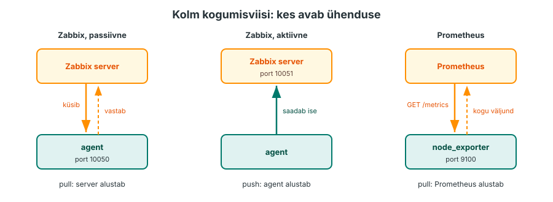
  <figcaption>Joonis 5.3. Zabbixi passiivne kontroll ja Prometheus on pull, Zabbixi aktiivne kontroll on push (Talvik, 2026).</figcaption>
</figure>

??? question "Kontrolli ennast"
    Jälgitav masin on tulemüüri taga, kuhu väljast ühendusi sisse ei lubata. Kas Prometheus saab sealt andmeid küsida? Millist N4 kontrolliviisi kasutaksid?

## 2. Exporter ja /metrics

**Exporter** on programm, mis loeb mõõdikud ja avaldab need HTTP-aadressil `/metrics`. Masina näitude jaoks on [node_exporter](https://github.com/prometheus/node_exporter). See loeb samu faile kaustast `/proc` ja `/sys`, mida N3 loengus nägid.

Exporter'i väljund on tekst. Väike väljavõte node_exporterist:

```text
# HELP node_memory_MemAvailable_bytes Memory information field MemAvailable_bytes.
# TYPE node_memory_MemAvailable_bytes gauge
node_memory_MemAvailable_bytes 1.473433600e+09
# HELP node_filesystem_avail_bytes Filesystem space available to non-root users in bytes.
# TYPE node_filesystem_avail_bytes gauge
node_filesystem_avail_bytes{device="/dev/sda2",fstype="xfs",mountpoint="/"} 1.2034e+10
# HELP node_cpu_seconds_total Seconds the CPUs spent in each mode.
# TYPE node_cpu_seconds_total counter
node_cpu_seconds_total{cpu="0",mode="idle"} 81432.17
```

<figure markdown="span">
  
  <figcaption>Joonis 5.4. Mõõdiku nimi ja sildid ehk label'id valivad päringu jaoks õige aegrea. Prometheus lisab kogumisel sildid `job` ja `instance` (Talvik, 2026).</figcaption>
</figure>

Mõõteväärtuse real on mõõdiku **nimi** (`node_filesystem_avail_bytes`) ja **väärtus** (`1.2034e+10`). Kui mõõdikul on **sildid** ehk label'id, on need nime järel loogelistes sulgudes (`mountpoint="/"`), mälumõõdikul neid pole. `e+10` tähendab korrutamist arvuga 10¹⁰. Read `# TYPE` ja `# HELP` kirjeldavad mõõdiku tüüpi (`gauge` või `counter`) ja tähendust. Ühik on nime lõpus: `_bytes` tähendab baite ja `_seconds_total` sekundeid kokku. See on nimetustava, tähenduse kontrollimiseks loe ka `HELP`-rida. Prometheuse tavade järgi tähistab `_total` counterit ([Metric types](https://prometheus.io/docs/concepts/metric_types/)).

`node_memory_MemAvailable_bytes` on sama number, mida `free` näitab veerus `available`. Sama mõõdikut kasutad 5. peatükis esimeses päringus.

??? question "Kontrolli ennast"
    `/metrics` avaneb sinu brauseris aadressil `http://<proxmox2-IP>:9100/metrics`. Kas see tõendab, et Prometheus saab samast aadressist koguda?

    ??? success "Vastus"
        Ei tõenda. Brauser ühendub sinu arvutist VPN-i kaudu, Prometheus aga `proxmox1` konteinerist. Teel võivad olla teised tulemüürireeglid ja `prometheus.yml`-is võib olla vale aadress või port. Kogumist tõendab Prometheuse **Targets**-leht ja päring, mis leiab aegrea.

## 3. Target, scrape ja silt

Prometheus loeb oma seadeid failist `prometheus.yml`. Seal on kirjas, keda küsida ja kui tihti. Näite aadressid asenda oma laborimasinate aadressidega:

```yaml
global:
  scrape_interval: 15s

scrape_configs:
  - job_name: node
    static_configs:
      - targets: ["192.168.35.12:9100", "192.168.35.13:9100"]
```

**Target** on üks aadress, kust mõõdikuid küsitakse. **Scrape** on üks küsimine ja `scrape_interval` ütleb, kui tihti seda tehakse. Prometheus lisab igale mõõdikule kaks silti: `job` (siin `node`) ja `instance` (target'i aadress). Iga kogumise järel salvestab Prometheus ka mõõdiku `up`: `1` tähendab, et selle target'i mõõdikute kogumine õnnestus, ja `0`, et kogumine ebaõnnestus. `up=1` ei tõenda, et jälgitav rakendus töötab kasutaja jaoks õigesti.

<figure markdown="span">
  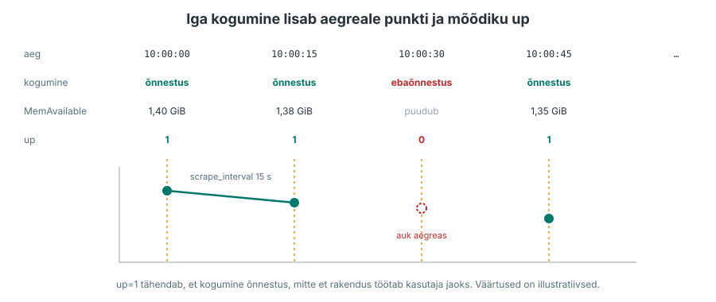
  <figcaption>Joonis 5.5. Iga kogumine lisab aegreale punkti ja salvestab mõõdiku up. Väärtused on illustratiivsed (Talvik, 2026).</figcaption>
</figure>

<figure markdown="span">
  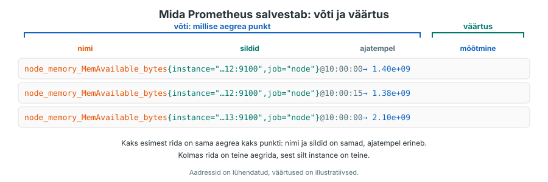
  <figcaption>Joonis 5.6. Mida Prometheus salvestab: nimi, sildid ja ajatempel kokku on võti, millele kuulub mõõdetud väärtus (Talvik, 2026).</figcaption>
</figure>

Mõõdiku nimi koos siltide väärtustega määrab ühe aegrea. Kui näidismasin avaldab iga loogilise protsessori kohta kaheksa `mode` väärtust, tekib kahe loogilise protsessori korral `node_cpu_seconds_total` jaoks 16 aegrida. Kaks sellist masinat annavad 32 aegrida.

??? question "Kontrolli ennast"
    Lisad `prometheus.yml`-i kolmanda masina, kus on neli loogilist protsessorit ja samad kaheksa `mode` väärtust. Mitu uut aegrida lisandub mõõdikule `node_cpu_seconds_total`?

## 4. Kuidas kogumist kontrollida

Kui päring ei leia midagi, võib viga olla viies kohas. Kontrolli neid järjest, sest iga samm eeldab eelmist.

??? note "Tabel 5.2. Kogumise kontroll sammhaaval"
    | Samm | Kus | Kuidas kontrollid | Mida tulemus tõendab |
    |---|---|---|---|
    | 1. Exporter töötab | jälgitav masin | `systemctl is-active node_exporter` | systemd peab teenust aktiivseks |
    | 2. `/metrics` on kättesaadav | jälgitav masin, siis `proxmox1` | `curl -s localhost:9100/metrics`, siis ühendus `proxmox1`-st | mõõdikud on olemas ja port on võrgus lahti; Prometheuse konteinerist kontrollib seda alles samm 3 |
    | 3. Prometheus kogub | **Status → Target health** | olek UP, **Last scrape** värske, **Error** tühi | Prometheus jõuab target'ini |
    | 4. Päring leiab aegread | **Query** | siltide hulgas on mõlemad oodatud target'id | andmed on salvestatud |
    | 5. Tulemus vastab küsimusele | **Query** | ühik ja sildid (masin, failisüsteem) | vaatad õiget asja |

    Kui olek on DOWN, ütleb **Error**, mis juhtus, näiteks `connection refused` või `context deadline exceeded`.

<figure markdown="span">
  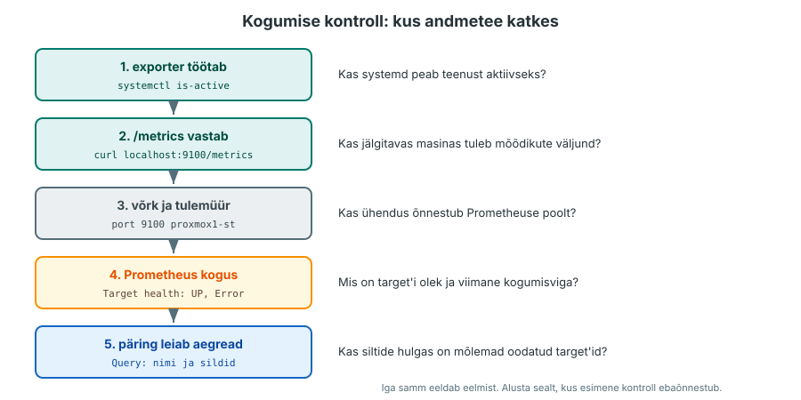
  <figcaption>Joonis 5.7. Kogumise kontroll: alusta sealt, kus esimene kontroll ebaõnnestub (Talvik, 2026).</figcaption>
</figure>

??? question "Kontrolli ennast"
    Targets-lehel on `proxmox3` olekus DOWN ja **Error** on `connection refused`. `proxmox2` on UP. Millise sammu juurest alustad ja mida kontrollid `proxmox3`-s?

## 5. PromQL kolme küsimuse kaudu

Prometheuse päringukeel on [PromQL](https://prometheus.io/docs/prometheus/latest/querying/basics/). Päringu kirjutad Prometheuse veebiliideses lehel **Query**. Praktikumis koostad päringud kolmele küsimusele ja iga küsimus lisab päringukeelest ühe osa.

**Kui palju mälu on masinas saadaval?** Kõige lihtsam päring on mõõdiku nimi. See tagastab viimase väärtuse igast aegreast, seega iga masina kohta ühe rea. Sildifilter loogelistes sulgudes piirab tulemuse ühe masinaga. Ühik on nimes: `_bytes`. Osakaalu saad, kui jagad saadaval mälu kogu mäluga. Need on kaks eraldi käivitatavat päringut:

```text
node_memory_MemAvailable_bytes{instance="192.168.35.12:9100"}
node_memory_MemAvailable_bytes / node_memory_MemTotal_bytes * 100
```

Jagamine paneb kokku read, millel on samad sildid, seega saad iga masina kohta ühe protsendi.

<figure markdown="span">
  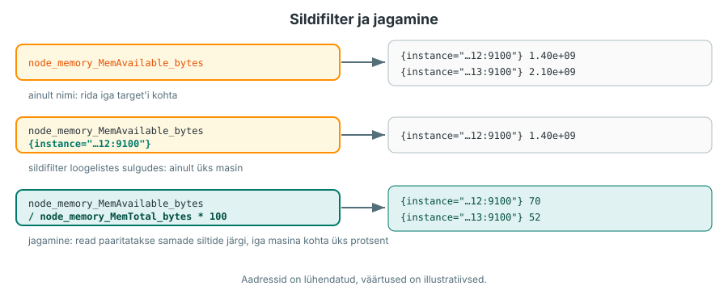
  <figcaption>Joonis 5.8. Sildifilter valib aegread, jagamine paaritab read samade siltide järgi. Väärtused on illustratiivsed (Talvik, 2026).</figcaption>
</figure>

<figure markdown="span">
  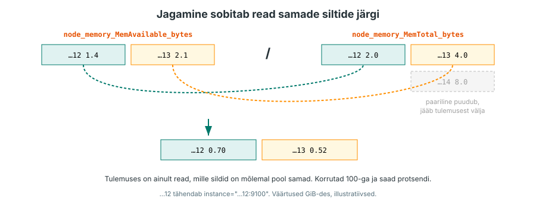
  <figcaption>Joonis 5.9. Jagamine sobitab read samade siltide järgi (Talvik, 2026).</figcaption>
</figure>

Sildifiltris saab kasutada nelja operaatorit ([Querying basics](https://prometheus.io/docs/prometheus/latest/querying/basics/#time-series-selectors)):

??? note "Tabel 5.3. Sildifiltri operaatorid"
    | Operaator | Tähendus | Näide |
    |---|---|---|
    | `=` | võrdne | `node_filesystem_avail_bytes{mountpoint="/"}` |
    | `!=` | ei ole võrdne | `node_filesystem_avail_bytes{mountpoint!="/boot"}` |
    | `=~` | vastab regulaaravaldisele | `node_filesystem_avail_bytes{fstype=~"xfs\|ext4"}` |
    | `!~` | ei vasta regulaaravaldisele | `node_filesystem_avail_bytes{mountpoint!~"/run.*"}` |

**Millises masinas on juurfailisüsteemis kõige vähem vaba ruumi?** Masinas on mitu failisüsteemi ja `node_filesystem_avail_bytes` annab rea igaühe kohta. Õige failisüsteemi valid sildiga `mountpoint="/"`. Vaba ruumi osakaal tuleb samamoodi nagu mälu puhul, jagades suurusega `node_filesystem_size_bytes`.

<figure markdown="span">
  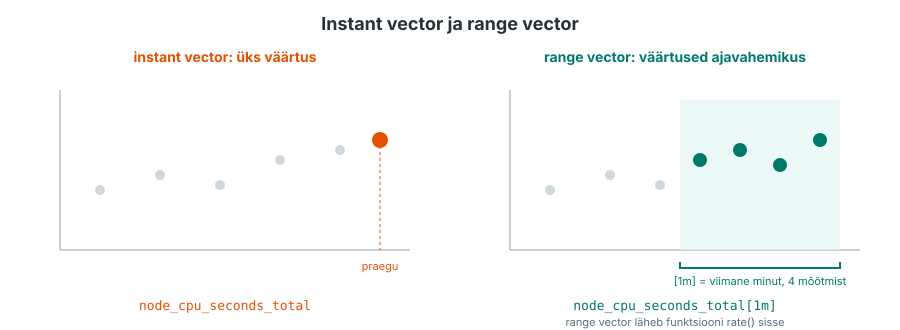
  <figcaption>Joonis 5.10. Instant vector annab ühe väärtuse, range vector `[1m]` annab väärtused ajavahemikus (Talvik, 2026).</figcaption>
</figure>

**Kuidas muutub protsessori kasutus koormuskatse ajal?** `node_cpu_seconds_total` on counter. N3 loengus nägid, et counterist arvutatakse kiirus: loed kaks väärtust ja jagad vahe ajaga. Funktsioon `rate()` teeb sama mõtte järgi rohkem: see arvutab ajavahemiku `[1m]` väärtuste põhjal counteri keskmise kasvu sekundis ja arvestab ka counteri lähtestumist ([rate()](https://prometheus.io/docs/prometheus/latest/querying/functions/#rate)). Kasuta seda counterite, mitte gauge'ide jaoks. Jõudeoleku (`mode="idle"`) kasv on iga protsessori kohta 0 ja 1 vahel. `avg by (instance)` arvutab iga masina loogiliste protsessorite jõudeaja aritmeetilise keskmise ja `100 * (1 - ...)` teeb sellest jõudeajast üle jäänud aja protsendi:

<figure markdown="span">
  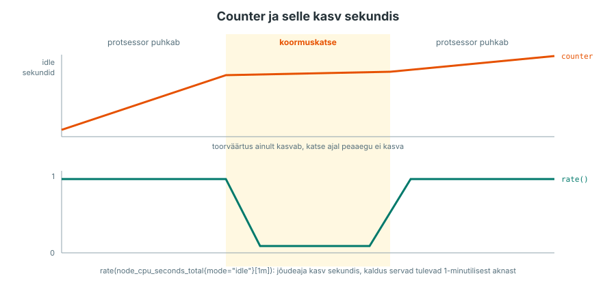
  <figcaption>Joonis 5.11. Counteri toorväärtus ja selle kasv sekundis koormuskatse ajal. Väärtused on illustratiivsed (Talvik, 2026).</figcaption>
</figure>

```text
node_cpu_seconds_total{mode="idle"}
rate(node_cpu_seconds_total{mode="idle"}[1m])
avg by (instance) (rate(node_cpu_seconds_total{mode="idle"}[1m]))
100 * (1 - avg by (instance) (rate(node_cpu_seconds_total{mode="idle"}[1m])))
```

<figure markdown="span">
  
  <figcaption>Joonis 5.12. Protsessori kasutuse päring tekib neljas sammus: loendur, kasv sekundis, keskmine masina kohta ja jõudeajast üle jäänud aja osakaal protsentides. Väärtused on illustratiivsed (Talvik, 2026).</figcaption>
</figure>

Selle praktikumi 15-sekundilise kogumisintervalli juures kasutame üheminutilist akent. Mitut mõõtmist hõlmav aken teeb tulemuse stabiilsemaks, pikem aken silub lühikesi muutusi rohkem. Uus mõõtmine mõjutab tulemust kohe, aga täielikult jõuab muutus tulemusse alles akna jooksul.

Võrdlus, näiteks `< 20`, jätab alles ainult read, mille kohta tingimus kehtib. Sellest tuleb N6-s alarmireegel.

<figure markdown="span">
  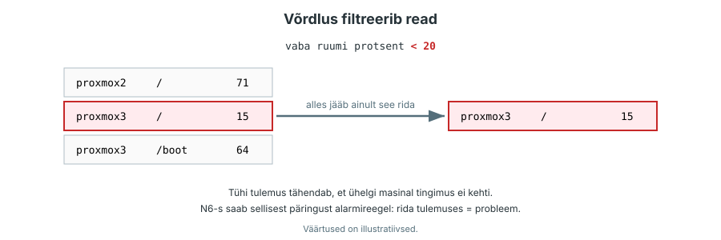
  <figcaption>Joonis 5.13. Võrdlus filtreerib read: alles jäävad ainult need, mille kohta tingimus kehtib (Talvik, 2026).</figcaption>
</figure>

??? question "Kontrolli ennast"
    1. Mida näitab päringu `node_cpu_seconds_total` graafik ja miks vajad kasutuse uurimiseks teistsugust päringut?
    2. Kas `[1m]` tähendab, et pärast koormuse algust peab minut ootama, enne kui tulemus üldse muutub?
    3. Mis on päringu `node_memory_MemAvailable_bytes / node_memory_MemTotal_bytes * 100` tulemuse ühik ja ulatus?

## 6. Zabbix ja Prometheus

Mõlemad koguvad mõõdikuid ja annavad teada probleemidest. N4-s valis Zabbixi template item'id ja trigger'id sinu eest. N5-s avaldab exporter oma collector'ite mõõdikud ja päringu koostad ise. Prometheuse seadistus on tekstifail, mille saab panna Giti ja paigaldada Ansible'iga. Paljudes ettevõtetes on kasutusel mõlemad.

<figure markdown="span">
  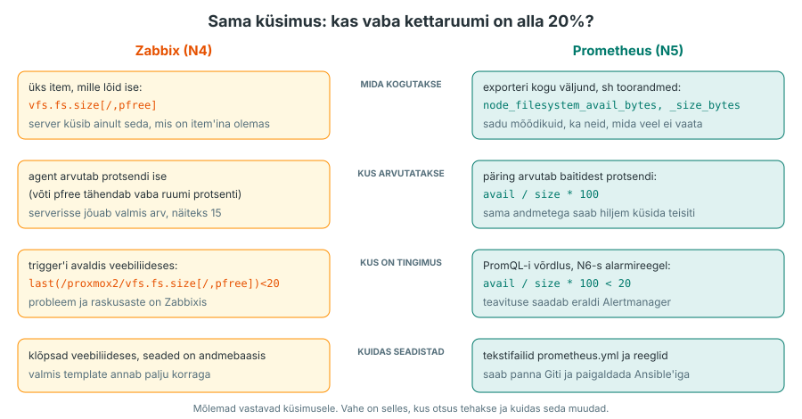
  <figcaption>Joonis 5.14. Sama küsimus Zabbixis (N4) ja Prometheuses (N5): mida kogutakse, kus arvutatakse ja kus on tingimus (Talvik, 2026).</figcaption>
</figure>

??? question "Kontrolli ennast"
    Sul on samad kolm püsivat laborimasinat. Milline tegevus oli Zabbixis ja Prometheuses erinev: jälgimise lisamine, mõõdikute leidmine või probleemitingimuse koostamine? Too oma tööst kaks näidet.

??? abstract "Kokkuvõte"
    | Mõiste | Lühidalt |
    |---|---|
    | pull-mudel | server avab ühenduse ja küsib mõõdikud ise |
    | exporter | programm, mis avaldab mõõdikud aadressil `/metrics` |
    | mõõdiku rida | nimi, vajadusel sildid ja väärtus; tüüp ja selgitus ridadel `# TYPE` ja `# HELP` |
    | target | aadress, kust Prometheus mõõdikuid küsib |
    | `scrape_interval` | kui tihti Prometheus küsib |
    | silt (label) | nimi ja väärtus mõõdiku juures; mõõdiku nimi koos siltidega määrab aegrea |
    | `up` | 1, kui target'i kogumine õnnestus, 0, kui ebaõnnestus |
    | Targets-leht | olek, **Last scrape** ja **Error** iga target'i kohta |
    | `rate()` | counteri keskmine kasv sekundis, nagu N3 loengu näites |
    | `avg by (instance)` | arvutab keskmise, iga `instance` kohta eraldi tulemus |
