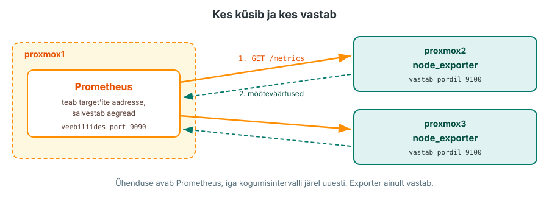
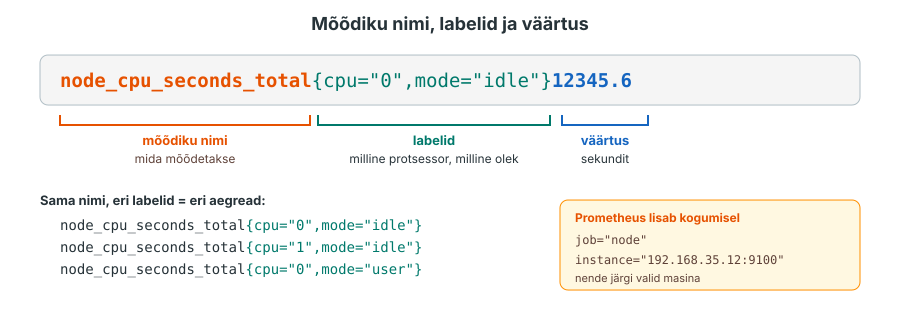
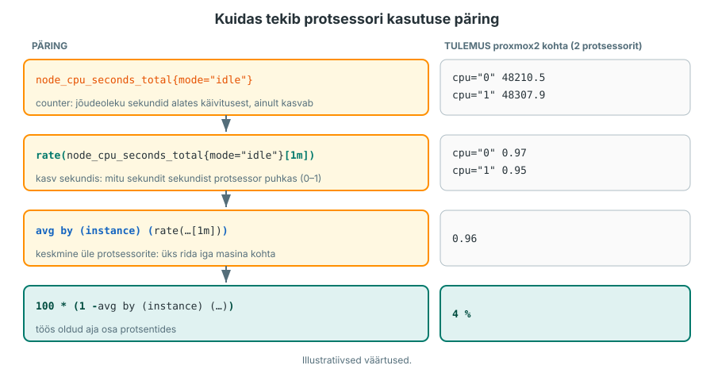

---
tags:
  - Loeng
  - Monitooring
  - Ansible
---

# Loeng: server küsib mõõdikuid

N4-s paigaldasid Zabbixi agendi ja valmis template andis hostile item'id ja trigger'id. Täna vaatad teist kogumisteed: node_exporter avaldab masina mõõdikud, Prometheus küsib need ise ja päringud koostad sina. Kogu nädala läbiv küsimus on: **millises masinas on ressursse kõige vähem alles?**

??? abstract "Õpiväljundid"
    Pärast loengut ja praktikumi oskad:

    - selgitada, kes alustab ühendust ja milline komponent tagastab väärtused Zabbixi agendi ja Prometheuse puhul;
    - lugeda exporter'i väljundist mõõdiku nime, labeleid, väärtust, tüüpi ja ühikut;
    - kontrollida kogumist sammhaaval: exporter, `/metrics`, Targets-leht, päring;
    - koostada ja kohandada PromQL-i päringuid saadaval oleva mälu, failisüsteemi vaba ruumi ja protsessori kasutuse uurimiseks ning selgitada tulemuste ühikuid ja ulatust.

## 1. Kes alustab ühendust ja kes tagastab väärtused

Mõõdikute kogumisel on kaks küsimust: kes avab ühenduse ja milline komponent tagastab väärtused. Zabbixi passiivse kontrolli puhul avab ühenduse server ja agent tagastab ühe item'i väärtuse. Aktiivse kontrolli puhul avab ühenduse agent ja saadab väärtused ise. Prometheuse puhul avab ühenduse Prometheus ja exporter tagastab korraga kõik oma mõõdikud.

Zabbixi passiivne kontroll ja Prometheus on seega sarnased: mõlemal juhul küsib server. Seda nimetatakse **pull-mudeliks**. Kui jälgitav masin saadab andmed ise, on see **push-mudel**. Erinevus Zabbixi ja Prometheuse vahel on selles, kes otsustab, mida koguda. Zabbixis otsustab template, milliseid item'eid küsitakse. Prometheuse exporter avaldab kõik, mida ta oskab, ja sina valid päringus, mida vaadata.

??? note "Tabel 5.1. Kes alustab ühendust ja kes tagastab väärtused"
    | | Zabbix, passiivne kontroll | Zabbix, aktiivne kontroll | Prometheus |
    |---|---|---|---|
    | Kes avab ühenduse | server | agent | Prometheus |
    | Kes tagastab väärtused | agent, üks item korraga | agent, oma item'id | exporter, kõik mõõdikud korraga |
    | Kes otsustab, mida koguda | template serveris | template serveris | exporter avaldab kõik, päring valib |
    | Port | 10050 jälgitavas masinas | 10051 serveris | 9100 jälgitavas masinas |
    | Protokoll | Zabbixi oma | Zabbixi oma | HTTP, tekst |

<figure markdown="span">
  
  <figcaption>Joonis 5.1. Prometheus küsib jälgitavate masinate node_exporteritelt mõõdikuid. Ühenduse avab Prometheus, exporter ainult vastab (Talvik, 2026).</figcaption>
</figure>

??? question "Kontrolli ennast"
    Jälgitav masin on tulemüüri taga, kuhu väljast ühendusi sisse ei lubata. Kas Prometheus saab sealt andmeid küsida? Millist N4 kontrolliviisi kasutaksid?

## 2. Exporter ja /metrics

**Exporter** on programm, mis loeb mõõdikud ja avaldab need HTTP aadressil `/metrics`. Masina näitude jaoks on [node_exporter](https://github.com/prometheus/node_exporter). See loeb samu faile kaustast `/proc` ja `/sys`, mida N3-s lugesid käsitsi.

Exporter'i väljund on tekst. Väike väljavõte node_exporterist:

```text
# HELP node_memory_MemAvailable_bytes Memory information field MemAvailable_bytes.
# TYPE node_memory_MemAvailable_bytes gauge
node_memory_MemAvailable_bytes 1.473433600e+09
# HELP node_filesystem_avail_bytes Filesystem space available to non-root users in bytes.
# TYPE node_filesystem_avail_bytes gauge
node_filesystem_avail_bytes{device="/dev/sda2",fstype="xfs",mountpoint="/"} 1.2034e+10
# HELP node_cpu_seconds_total Seconds the CPUs spent in each mode.
# TYPE node_cpu_seconds_total counter
node_cpu_seconds_total{cpu="0",mode="idle"} 81432.17
```

<figure markdown="span">
  
  <figcaption>Joonis 5.2. Mõõdiku nimi ja labelid valivad päringu jaoks õige aegrea. Prometheus lisab kogumisel labelid `job` ja `instance` (Talvik, 2026).</figcaption>
</figure>

Iga mõõdiku real on kolm osa: **nimi** (`node_filesystem_avail_bytes`), **labelid** loogelistes sulgudes (`mountpoint="/"`) ja **väärtus** (`1.2034e+10`). Real `# TYPE` on mõõdiku tüüp: `gauge` või `counter`. Real `# HELP` on selgitus. Ühik on nime lõpus: `_bytes` tähendab baite ja `_seconds_total` sekundeid kokku. Prometheuse tavade järgi tähistab `_total` counterit ([Metric types](https://prometheus.io/docs/concepts/metric_types/)).

`node_memory_MemAvailable_bytes` on sama number, mida `free` näitab veerus `available`. Sama mõõdikut kasutad 4. peatükis esimeses päringus.

??? question "Kontrolli ennast"
    `/metrics` avaneb sinu brauseris aadressil `http://<proxmox2-IP>:9100/metrics`. Kas see tõendab, et Prometheus saab samast aadressist koguda?

    ??? success "Vastus"
        Ei tõenda. Brauser ühendub sinu arvutist VPN-i kaudu, Prometheus aga `proxmox1` konteinerist. Teel võivad olla teised tulemüürireeglid ja `prometheus.yml`-is võib olla vale aadress või port. Kogumist tõendab Prometheuse **Targets**-leht ja päring, mis leiab aegrea.

## 3. Target, scrape ja label

Prometheus loeb oma seadeid failist `prometheus.yml`. Seal on kirjas, keda küsida ja kui tihti.

```yaml
global:
  scrape_interval: 15s

scrape_configs:
  - job_name: node
    static_configs:
      - targets: ["192.168.35.12:9100", "192.168.35.13:9100"]
```

**Target** on üks aadress, kust mõõdikuid küsitakse. **Scrape** on üks küsimine ja `scrape_interval` ütleb, kui tihti seda tehakse. Prometheus lisab igale mõõdikule kaks labelit: `job` (siin `node`) ja `instance` (target'i aadress). Iga küsimise järel salvestab Prometheus ka mõõdiku `up`: 1, kui target vastas, ja 0, kui ei vastanud.

Mõõdiku nimi koos labelite väärtustega määrab ühe aegrea. Kahe protsessoriga masinas on `node_cpu_seconds_total` jaoks 2 protsessorit korda 8 olekut ehk 16 aegrida. Kaks masinat annavad 32 aegrida ühe mõõdiku nime kohta.

??? question "Kontrolli ennast"
    Lisad `prometheus.yml`-i kolmanda masina, kus on 4 protsessorit. Mitu uut aegrida tekib mõõdikule `node_cpu_seconds_total`?

## 4. Kuidas kogumist kontrollida

Kui päring ei leia midagi, võib viga olla viies kohas. Kontrolli neid järjest, sest iga samm eeldab eelmist.

??? note "Tabel 5.2. Kogumise kontroll sammhaaval"
    | Samm | Kus | Kuidas kontrollid | Mida tulemus tõendab |
    |---|---|---|---|
    | 1. Exporter töötab | jälgitav masin | `systemctl is-active node_exporter` | programm töötab |
    | 2. `/metrics` on kättesaadav | jälgitav masin, siis `proxmox1` | `curl -s localhost:9100/metrics`, siis ühendus `proxmox1`-st | mõõdikud on olemas ja port on võrgus lahti |
    | 3. Prometheus kogub | **Status → Target health** | olek UP, **Last scrape** värske, **Error** tühi | Prometheus jõuab target'ini |
    | 4. Päring leiab aegrea | **Query** | mõõdiku nimi annab rea iga target'i kohta | andmed on salvestatud |
    | 5. Tulemus vastab küsimusele | **Query** | ühik ja labelid (masin, failisüsteem) | vaatad õiget asja |

    Kui olek on DOWN, ütleb **Error**, mis juhtus, näiteks `connection refused` või `context deadline exceeded`.

??? question "Kontrolli ennast"
    Targets-lehel on `proxmox3` olekus DOWN ja **Error** on `connection refused`. `proxmox2` on UP. Millise sammu juurest alustad ja mida kontrollid `proxmox3`-s?

## 5. PromQL kolme küsimuse kaudu

Prometheuse päringukeel on [PromQL](https://prometheus.io/docs/prometheus/latest/querying/basics/). Päringu kirjutad Prometheuse veebiliideses lehel **Query**. Praktikumis koostad päringud kolmele küsimusele ja iga küsimus lisab päringukeelest ühe osa.

**Kui palju mälu on masinas saadaval?** Kõige lihtsam päring on mõõdiku nimi. See tagastab viimase väärtuse igast aegreast, seega iga masina kohta ühe rea. Labelifilter loogelistes sulgudes piirab tulemuse ühe masinaga. Ühik on nimes: `_bytes`. Osakaalu saad, kui jagad saadaval mälu kogu mäluga:

```text
node_memory_MemAvailable_bytes{instance="192.168.35.12:9100"}
node_memory_MemAvailable_bytes / node_memory_MemTotal_bytes * 100
```

Jagamine paneb kokku read, millel on samad labelid, seega saad iga masina kohta ühe protsendi.

**Millises masinas on juurfailisüsteemis kõige vähem vaba ruumi?** Masinas on mitu failisüsteemi ja `node_filesystem_avail_bytes` annab rea igaühe kohta. Õige failisüsteemi valid labeliga `mountpoint="/"`. Vaba ruumi osakaal tuleb samamoodi nagu mälu puhul, jagades suurusega `node_filesystem_size_bytes`.

**Kuidas muutub protsessori kasutus koormuskatse ajal?** `node_cpu_seconds_total` on counter. N3-s lugesid counterit kaks korda ja jagasid vahe ajaga. Funktsioon `rate()` teeb sama: see võtab ajavahemiku `[1m]` väärtused ja arvutab keskmise kasvu sekundis. Jõudeoleku (`mode="idle"`) kasv on iga protsessori kohta 0 ja 1 vahel. `avg by (instance)` paneb ühe masina protsessorid kokku ja `100 * (1 - ...)` teeb jõudeoleku osast kasutuse protsentides:

```text
node_cpu_seconds_total{mode="idle"}
rate(node_cpu_seconds_total{mode="idle"}[1m])
avg by (instance) (rate(node_cpu_seconds_total{mode="idle"}[1m]))
100 * (1 - avg by (instance) (rate(node_cpu_seconds_total{mode="idle"}[1m])))
```

<figure markdown="span">
  
  <figcaption>Joonis 5.3. Protsessori kasutuse päring tekib neljas sammus: loendur, kasv sekundis, keskmine masina kohta ja töös oldud aja protsent. Väärtused on illustratiivsed (Talvik, 2026).</figcaption>
</figure>

Ajavahemik `[1m]` peaks olema vähemalt neli korda `scrape_interval`, et sinna jääks piisavalt mõõtmisi. Sellepärast reageerib päring muutusele viivitusega.

Võrdlus, näiteks `< 20`, jätab alles ainult read, mille kohta tingimus kehtib. Sellest tuleb N6-s alarmireegel.

??? question "Kontrolli ennast"
    1. Miks ei ole mõtet joonistada graafikut päringust `node_cpu_seconds_total`?
    2. Mis on päringu `node_memory_MemAvailable_bytes / node_memory_MemTotal_bytes * 100` tulemuse ühik ja ulatus?

## 6. Zabbix ja Prometheus

Mõlemad koguvad mõõdikuid ja annavad teada probleemidest. N4-s valis Zabbixi template item'id ja trigger'id sinu eest. N5-s avaldab exporter kõik mõõdikud ja päringu koostad ise. Prometheuse seadistus on tekstifail, mille saab panna Giti ja paigaldada Ansible'iga. Paljudes ettevõtetes on kasutusel mõlemad.

??? question "Kontrolli ennast"
    Arendajad käivitavad iga päev kümneid uusi konteinereid, mis töötavad paar tundi. Kumba süsteemi eelistad ja miks?

??? abstract "Kokkuvõte"
    | Mõiste | Lühidalt |
    |---|---|
    | pull-mudel | server avab ühenduse ja küsib mõõdikud ise |
    | exporter | programm, mis avaldab mõõdikud aadressil `/metrics` |
    | mõõdiku rida | nimi, labelid ja väärtus; tüüp ja selgitus ridadel `# TYPE` ja `# HELP` |
    | target | aadress, kust Prometheus mõõdikuid küsib |
    | `scrape_interval` | kui tihti Prometheus küsib |
    | label | nimi ja väärtus mõõdiku juures; nimi koos labelitega määrab aegrea |
    | `up` | 1, kui target vastas, 0, kui ei vastanud |
    | Targets-leht | olek, **Last scrape** ja **Error** iga target'i kohta |
    | `rate()` | counteri keskmine kasv sekundis, nagu N3 käsitsi arvutus |
    | `avg by (instance)` | paneb ühe masina aegread kokku |
