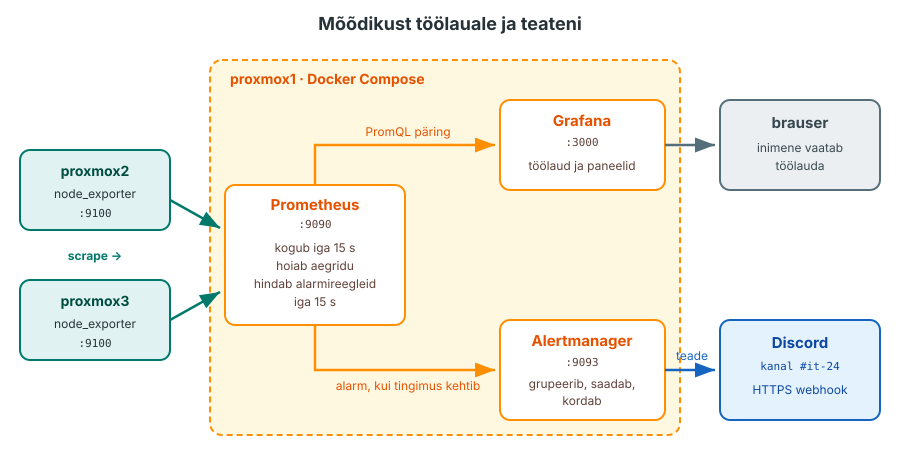
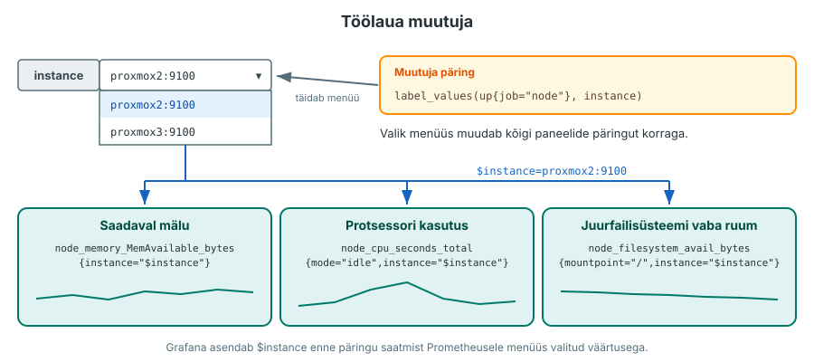
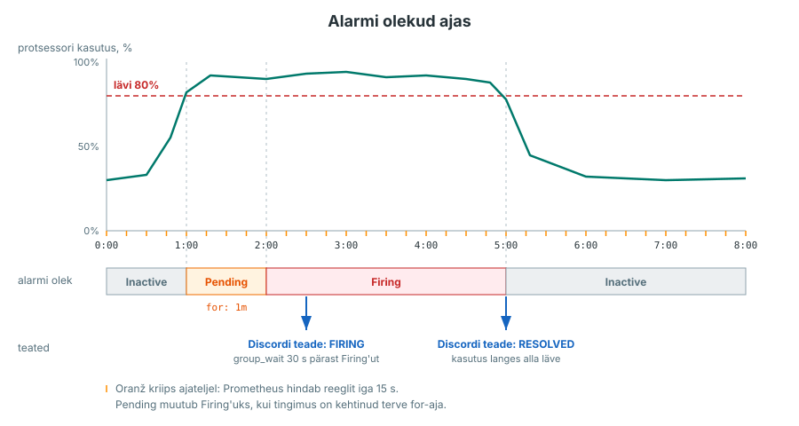
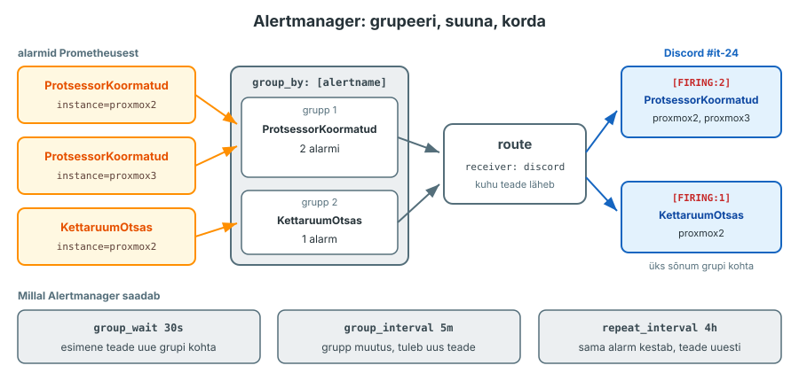

---
tags:
  - Monitooring
  - Prometheus
  - Grafana
  - Alertmanager
  - Loeng
---

# Loeng: töölaud ja alarm

N5-s kogus Prometheus node_exporteritelt mõõdikuid ja PromQL-i päringud vastasid küsimusele, millises masinas on ressursse kõige vähem alles. Vastuse nägid aga ainult siis, kui ise päringu käivitasid. Täna saavad samad päringud kaks uut kasutust: Grafana töölaud näitab olukorda ühe pilguga ja alarmireegel saadab Discordi teate siis, kui tingimus kehtib.

??? abstract "Õpiväljundid"
    Pärast loengut ja praktikumi oskad:

    1. selgitada, mis vahe on töölaual ja alarmil ning millal kumbagi kasutada;
    2. lisada Grafanale Prometheuse andmeallika failiga ja koostada paneeli õige ühiku ja legendiga;
    3. kasutada töölaua muutujat, et samad paneelid näitaksid valitud masinat;
    4. kirjutada Prometheuse alarmireegli ja selgitada võtmete `expr`, `for`, `labels` ja `annotations` tähendust;
    5. kirjeldada alarmi olekuid Inactive, Pending ja Firing ning seda, millal teade saadetakse;
    6. seadistada Alertmanageri, mis grupeerib alarmid ja saadab need Discordi, ning hoida webhooki aadressi repositooriumist väljas.

## 1. Töölaud ja alarm

Mõõdikuid saab kasutada kahel moel. **Töölauda** (dashboard) vaatab inimene: ta avab selle, kui tahab teada masinate olukorda või uurib, millal probleem algas. **Alarm** töötab ilma inimeseta: süsteem kontrollib tingimust pidevalt ja teatab ainult siis, kui on vaja midagi teha. Öösel ei vaata keegi graafikut, seega ilma alarmita jääb täis saav ketas märkamata kuni hommikuni.

<figure markdown="span">
  
  <figcaption>Joonis 6.1. Mõõdikust töölauale ja teateni (Talvik, 2026).</figcaption>
</figure>

Mõlemad kasutavad sama allikat. Grafana ja alarmireegel ei kogu ise midagi, nad esitavad Prometheusele PromQL-i päringu. Kui päring on vale, on vale nii graafik kui ka alarm. Seepärast koostatakse päring kõigepealt Prometheuse veebiliideses, nagu tegid N5-s, ja alles siis pannakse see paneeli või reeglisse.

??? question "Kontrolli ennast"
    Kas Grafana töölaud jätkab andmete kogumist, kui Prometheus seisab?

    ??? success "Vastus"
        Ei. Grafana küsib andmeid Prometheuselt iga kord, kui paneel värskendab. Kui Prometheus seisab, on paneelid tühjad ja selle aja kohta jääb ka ajalukku auk.

## 2. Grafana: andmeallikas ja paneel

Grafana on veebiliides, mis joonistab andmeid mitmest allikast: Prometheus, Loki, InfluxDB, andmebaasid. **Andmeallikas** (data source) ütleb Grafanale, kust ja kuidas andmeid küsida. Selle võib lisada veebiliideses, aga praktikumis kirjeldad selle failiga ([Provisioning](https://grafana.com/docs/grafana/latest/administration/provisioning/#data-sources)). Siis tekib andmeallikas igas uues konteineris ise ja seadistus on repositooriumis.

Grafana ja Prometheus töötavad samas Compose'i projektis. Compose'i võrgus leiab üks konteiner teise teenuse nime järgi, seega on andmeallika aadress `http://prometheus:9090`. Aadress `localhost` tähendaks konteineris Grafana konteinerit ennast.

**Paneel** on üks graafik või näit töölaual. Sellel on kolm osa:

??? note "Tabel 6.1. Paneeli osad"
    | Osa | Mis see on | Näide |
    |---|---|---|
    | Päring | PromQL-i avaldis, sama mis Prometheuse veebiliideses | `node_memory_MemAvailable_bytes` |
    | Visualiseering | kuidas tulemus välja näeb | **Time series** ajas muutuva väärtuse jaoks, **Stat** ühe arvu jaoks, **Gauge** osakaalu jaoks |
    | Seaded | ühik, legend, värvid ja lävid | ühik **bytes(IEC)**, legend `{{instance}}` |

Ühik on paneeli seadetes, mitte päringus. Kui ühik on **bytes(IEC)**, näitab Grafana väärtust `1470000000` kujul `1.37 GiB`. Legend `{{instance}}` paneb iga joone juurde sildi `instance` väärtuse, muidu on legendis kogu sildikomplekt.

**Töölaud** (dashboard) on paneelide kogum. Grafana hoiab seda JSON-failina. Selle faili saab eksportida, repositooriumi panna ja teises Grafanas importida. Kogukond jagab valmis töölaudu, näiteks Node Exporter Full (ID 1860) näitab kõike, mida node_exporter avaldab.

??? question "Kontrolli ennast"
    Paneelil on mälu väärtus `1.47e+09` ja kõrval ei ole ühikut. Mida muudad: päringut või paneeli seadeid?

    ??? success "Vastus"
        Paneeli seadeid: **Standard options → Unit**. Päring annab väärtuse baitides ja see on õige. Ühik ütleb Grafanale, kuidas arvu näidata.

## 3. Töölaua muutuja

Kui töölaual on kolm paneeli ja kaks masinat, on igal paneelil kaks joont. Masinate arvu kasvades muutub graafik loetamatuks. **Muutuja** (variable) lisab töölaua ülaossa rippmenüü ja paneelide päringud kasutavad valitud väärtust ([Variables](https://grafana.com/docs/grafana/latest/dashboards/variables/)).

<figure markdown="span">
  
  <figcaption>Joonis 6.2. Muutuja väärtus läheb kõigi paneelide päringusse (Talvik, 2026).</figcaption>
</figure>

Muutuja väärtused tulevad samuti Prometheusest. Funktsioon `label_values(up{job="node"}, instance)` tagastab kõik sildi `instance` väärtused, mis mõõdikul `up` job'i `node` all on ([Prometheus template variables](https://grafana.com/docs/grafana/latest/datasources/prometheus/template-variables/)). Kui Prometheusesse lisandub uus masin, tekib see menüüsse ise. Paneeli päringus kirjutatakse muutuja kujul `$instance`:

```text
node_memory_MemAvailable_bytes{instance="$instance"}
```

??? question "Kontrolli ennast"
    Miks ei kirjutata menüü väärtusi käsitsi muutuja seadetesse?

    ??? success "Vastus"
        Käsitsi loend tuleb iga uue või eemaldatud masina juures muuta. Päringust tulev loend vastab alati sellele, mida Prometheus tegelikult kogub.

## 4. Alarmireegel

**Alarmireegel** (alerting rule) on PromQL-i päring, mida Prometheus hindab kindla intervalliga ise ([Alerting rules](https://prometheus.io/docs/prometheus/latest/configuration/alerting_rules/)). Kui päring tagastab tulemuse, kehtib alarm iga tulemuse rea kohta. Tühi tulemus tähendab, et kõik on korras. N5 osas 6.4 kirjutasid päringu, mis tagastas ainult masinad, kus vaba ruumi oli alla piiri. See ongi reegli tingimus.

```yaml
groups:
  - name: masinad
    rules:
      - alert: KettaruumOtsas
        expr: 100 * node_filesystem_avail_bytes{mountpoint="/"} / node_filesystem_size_bytes{mountpoint="/"} < 20
        for: 5m
        labels:
          severity: hoiatus
        annotations:
          summary: "{{ $labels.instance }}: juurfailisüsteemis on vaba ruumi {{ $value | printf \"%.0f\" }}%"
```

??? note "Tabel 6.2. Reegli võtmed"
    | Võti | Tähendus |
    |---|---|
    | `alert` | alarmi nimi, sellest tuleb silt `alertname` |
    | `expr` | PromQL-i tingimus, iga tulemuse rida on eraldi alarm |
    | `for` | kui kaua peab tingimus järjest kehtima, enne kui alarm on Firing |
    | `labels` | sildid, mis lisatakse alarmile, näiteks raskusaste `severity` |
    | `annotations` | inimesele mõeldud tekst, `{{ $labels.instance }}` ja `{{ $value }}` asendatakse väärtustega |

Reeglid on eraldi failis, mille nimi on `prometheus.yml`-is võtme `rule_files` all. Kui tihti Prometheus reegleid hindab, ütleb `evaluation_interval` (praktikumis 15 sekundit). Enne Prometheuse taaskäivitust kontrollib faili käsk `promtool check rules`.

<figure markdown="span">
  
  <figcaption>Joonis 6.3. Alarmi olekud ajas, kui reeglis on `for: 1m` (Talvik, 2026).</figcaption>
</figure>

Alarmil on kolm olekut. **Inactive**: tingimus ei kehti. **Pending**: tingimus kehtib, aga vähem aega, kui `for` nõuab. **Firing**: tingimus on kehtinud vähemalt `for` aja ja Prometheus saadab alarmi Alertmanagerile. Kui tingimus lakkab kehtimast, läheb alarm tagasi olekusse Inactive ja Alertmanager saadab teate, et probleem lahenes.

Võti `for` hoiab ära teated lühikestest piikidest. Protsessori kasutus võib mõne sekundi olla 100%, kui käivitub suur programm. Kui reegel nõuab, et see kestaks minuti, tuleb teade ainult püsiva koormuse korral. Liiga pikk `for` teeb teate hiljaks: ketas võib selle ajaga täis saada.

??? question "Kontrolli ennast"
    Reeglis on `for: 5m`. Tingimus kehtib 4 minutit, siis 30 sekundit mitte, siis jälle 4 minutit. Kas teade tuleb?

    ??? success "Vastus"
        Ei. Iga kord, kui tingimus lakkab kehtimast, läheb alarm tagasi olekusse Inactive ja `for` arvestus algab otsast.

## 5. Alertmanager

Prometheus ütleb ainult seda, et alarm kehtib. Teate saatmisega tegeleb eraldi programm **Alertmanager** ([Alertmanager](https://prometheus.io/docs/alerting/latest/alertmanager/)). Nii saavad mitu Prometheust saata alarmid ühte kohta ja teavituste reeglid on ühes failis.

Alertmanager teeb nelja asja:

- **grupeerib**: sama nimega alarmid mitmest masinast tulevad ühe teatena;
- **suunab**: puu `route` ütleb, milline vastuvõtja (receiver) teate saab, näiteks kriitilised alarmid valvetelefonile ja hoiatused vestluskanalisse;
- **kordab**: kui alarm kestab, saadab teate uuesti kindla aja tagant;
- **vaigistab**: hoolduse ajaks saab alarmid veebiliideses vaigistada (silence).

<figure markdown="span">
  
  <figcaption>Joonis 6.4. Alertmanager grupeerib alarmid ja saadab grupi kohta ühe teate (Talvik, 2026).</figcaption>
</figure>

??? note "Tabel 6.3. Marsruudi ajastused"
    | Võti | Tähendus | Praktikumis |
    |---|---|---|
    | `group_by` | millised sildid määravad grupi | `[alertname]` |
    | `group_wait` | kui kaua oodatakse enne grupi esimest teadet, et samasse gruppi jõuaksid ka teised alarmid | 30 s |
    | `group_interval` | kui kaua oodatakse, enne kui teatatakse grupi muutusest, näiteks uuest masinast | 5 min |
    | `repeat_interval` | kui tihti korratakse teadet alarmi kohta, mis kestab edasi | 4 h |

Teade jõuab Discordi seega mitte kohe, kui alarm on Firing, vaid umbes `group_wait` aja pärast. Alertmanageri veebiliides pordil 9093 näitab, millised alarmid on kohale jõudnud ja millisesse gruppi need kuuluvad.

??? question "Kontrolli ennast"
    Kümnes masinas saab samal ajal ketas täis. Mitu Discordi teadet tuleb, kui `group_by: [alertname]`? Aga kui `group_by: [alertname, instance]`?

    ??? success "Vastus"
        Esimesel juhul üks teade, milles on kümme masinat. Teisel juhul kümme teadet, iga masina kohta eraldi.

## 6. Teavituskanal ja saladus

Discordi kanalisse saab sõnumeid saata **webhooki** kaudu: kanali seadetes tehakse aadress, millele saadetud HTTP-päring ilmub kanalisse sõnumina. Alertmanageril on selleks vastuvõtja tüüp `discord_configs` ([Configuration, discord_config](https://prometheus.io/docs/alerting/latest/configuration/#discord_config)). Sama ülesehitusega on vastuvõtjad e-posti, Slacki, Microsoft Teamsi ja paljude teiste jaoks.

Webhooki aadress on saladus. Kes aadressi teab, saab kanalisse sõnumeid saata ilma Discordi kontota. Seepärast ei kirjutata aadressi faili `alertmanager.yml`, vaid eraldi faili, mis on ainult `proxmox1`-s. Seadetes on võti `webhook_url_file`, mis ütleb, millisest failist Alertmanager aadressi loeb. Nii võib `alertmanager.yml` olla repositooriumis.

```yaml
receivers:
  - name: discord
    discord_configs:
      - webhook_url_file: /saladus/discord_url
```

??? question "Kontrolli ennast"
    Webhooki aadress jõudis kogemata avalikku repositooriumisse. Kas piisab, kui kustutad selle failist ja teed uue commit'i?

    ??? success "Vastus"
        Ei. Aadress jääb Giti ajalukku. Webhook tuleb Discordis kustutada ja teha uus, siis on vana aadress kasutu.

## 7. Hea alarm

Iga teade katkestab kellegi tööd või und. Kui teateid on palju ja enamik ei nõua tegevust, hakatakse neid eirama ja oluline teade jääb märkamata. Google'i SRE raamatu peatükk [Monitoring Distributed Systems](https://sre.google/sre-book/monitoring-distributed-systems/) ja Prometheuse juhend [Alerting](https://prometheus.io/docs/practices/alerting/) annavad samad soovitused:

- teata **sümptomist**, mida kasutaja tunneb (leht ei avane, vastus on aeglane), mitte igast võimalikust põhjusest;
- igale teatele peab järgnema tegevus, muidu on see töölaua paneel, mitte alarm;
- lävi ja `for` valitakse nii, et lühike piik ei tekita teadet, aga püsiv probleem jõuab teateni enne, kui midagi katki läheb;
- raskusaste (`severity`) ütleb, kas teade ootab hommikuni või äratab valvaja kohe.

Grafanal on oma alarmisüsteem ([Grafana Alerting](https://grafana.com/docs/grafana/latest/alerting/)): reegel ja teavituskanal seadistatakse Grafana veebiliideses ning sama reegel saab kasutada mitut andmeallikat. Praktikumis on reeglid Prometheuses, sest need on failis, käivad repositooriumiga kaasa ja töötavad ka siis, kui Grafana seisab.

??? question "Kontrolli ennast"
    Kumb on parem alarm: „protsessori kasutus üle 80%“ või „veebilehe vastus aeglasem kui 2 sekundit“?

    ??? success "Vastus"
        Teine näitab sümptomit, mida kasutaja tunneb. Kõrge protsessori kasutus võib olla täiesti normaalne, kui lehed avanevad kiiresti. Praktikumis kasutad protsessori reeglit, sest seda on lihtne koormuskatsega esile kutsuda.

??? abstract "Kokkuvõte"
    - Töölaud on vaatamiseks ja uurimiseks, alarm teatab, kui on vaja tegutseda. Mõlemad kasutavad Prometheuse päringuid.
    - Grafana andmeallikas tuleb failist, paneelil on päring, visualiseering ja ühik. Muutuja `$instance` laseb samadel paneelidel näidata valitud masinat.
    - Alarmireegel on päring koos võtmetega `for`, `labels` ja `annotations`. Olekud on Inactive, Pending ja Firing.
    - Alertmanager grupeerib, suunab, kordab ja vaigistab teateid. Discordi webhooki aadress on saladus ja on eraldi failis, mitte repositooriumis.
