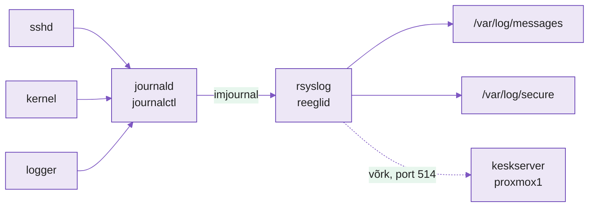
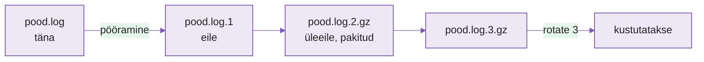
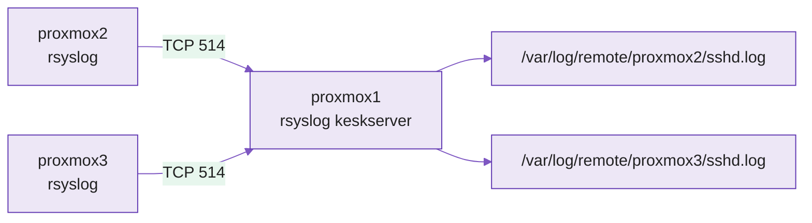

---
tags:
  - Loeng
  - Monitooring
  - Logid
  - Linux
---

# Masina päevik ja logid ühte kohta

*Server kirjutab kõik üles. Küsimus on, kas sa leiad selle üles ja kas see on alles, kui sul seda vaja on.*

!!! abstract "Õpiväljundid"
    Pärast seda loengut oskad:

    - selgitada, miks logid on seire esimene signaal ja millele need vastavad;
    - lugeda logikirjest välja aja, masina, programmi, tõsiduse ja sõnumi;
    - kirjeldada, kuidas journald ja rsyslog AlmaLinuxis koos töötavad;
    - kasutada logi päritolu (facility) ja tõsidust (severity), et otsustada, kuhu kirje läheb;
    - selgitada, miks logisid pööratakse (logrotate) ja mis juhtub, kui seda ei tehta;
    - põhjendada, miks logid saadetakse keskserverisse, ja võrrelda UDP ja TCP saatmist.

## Sisukord

1. [Mis juhtus kell 03:12?](#1-mis-juhtus-kell-0312)
2. [Kaks päevikupidajat](#2-kaks-paevikupidajat)
3. [Kust ja kui tõsine](#3-kust-ja-kui-tosine)
4. [Päevik ei tohi kasvada lõputult](#4-paevik-ei-tohi-kasvada-loputult)
5. [Logid ühte kohta](#5-logid-uhte-kohta)
6. [Taust ja edasijõudnutele](#6-taust-ja-edasijoudnutele)

---

## 1. Mis juhtus kell 03:12?

!!! abstract "Miks see oluline on?"
    Kui midagi läks öösel katki, ei olnud keegi seda nägemas. Ainus tunnistaja on masin ise ja tema päevik.

`journalctl` ja `tail -f` oskad sa juba. Sel kursusel vaatame logisid teise pilguga: mitte "mis siin failis on", vaid "kuidas ma saan teada, mis juhtus, kui mind seal ei olnud".

!!! example "Näidisstsenaarium"
    Kati teeb praktikat väikeses e-poes. Esmaspäeva hommikul ütleb juhataja: "Pood oli öösel pool tundi maas. Klient kirjutas kell 03:20. Mis juhtus?"

    Kati logib serverisse ja küsib päevikult:

    ```text
    Oct 13 03:12:04 pood kernel: Out of memory: Killed process 2211 (php-fpm)
    Oct 13 03:12:05 pood systemd[1]: php-fpm.service: Main process exited, status=9/KILL
    Oct 13 03:41:17 pood systemd[1]: php-fpm.service: Scheduled restart job
    ```

    Kolm rida ja vastus on käes: kell 03:12 sai mälu otsa, tuum sulges veebipoe protsessi ja see käivitus uuesti alles 29 minutit hiljem. Ilma logideta oleks Kati vastus olnud "ei tea".

Pane tähele, kes rikke esimesena avastas: klient. Seire mõte on, et **kasutaja ei tohi olla see, kes rikke esimesena avastab.** Kogu see kursus käib selle ühe lause ümber.

Logi (log) on programmi päevik: iga rida on üks sündmus koos ajaga. Logid vastavad küsimusele **"mis juhtus?"**. Hiljem kursusel lisanduvad mõõdikud ("kui palju?") ja jäljed ("kust läbi?"), aga logid on alati esimene koht, kust otsima hakatakse.

Igal logikirjel on samad osad:

<figure markdown="span">
```text
Oct 13 03:12:04   pood   kernel:   Out of memory: Killed process 2211 (php-fpm)
└──── aeg ────┘   └masin┘ └programm┘ └──────────────── sõnum ─────────────────┘

nähtamatud, aga olemas:  päritolu = kern   tõsidus = err (3)
```
  <figcaption>Joonis 7.1. Logikirje osad. Aeg, masin, programm ja sõnum on reas näha. Päritolu (facility) ja tõsidus (severity) on kirje küljes, aga tekstireal neid vaikimisi ei näidata.</figcaption>
</figure>

Neli osa on reas näha. Kaks viimast (päritolu ja tõsidus) on peidus, aga just need otsustavad, kuhu kirje läheb. Nendest räägib osa 3.

??? question "✅ Kontrolli ennast"
    1. Miks ei piisa Katil sellest, et pood praegu töötab?
    2. Mida ütleb Katile see, et rea 2 ja rea 3 vahel on 29 minutit?

---

## 2. Kaks päevikupidajat

!!! abstract "Miks see oluline on?"
    Kui tead, kes logi vastu võtab ja kuhu edasi saadab, tead ka, kus seda otsida ja kust saab selle teise masinasse suunata.

AlmaLinuxis peab päevikut kaks programmi korraga:

- **journald** (osa systemd-st) võtab vastu kõik: tuuma sõnumid, teenuste väljundi, `logger` käsu read. Hoiab neid kahendvormingus andmebaasis, mida loed käsuga `journalctl`.
- **rsyslog** loeb journaldist kõik kirjed ja kirjutab need tavalistesse tekstifailidesse kaustas `/var/log/`. Lisaks oskab ta neid **võrgu kaudu teise masinasse saata**.

<figure markdown="span">

  <figcaption>Joonis 7.2. Logi teekond AlmaLinuxis: programmid kirjutavad journaldisse, rsyslog loeb sealt mooduli imjournal kaudu ja jagab kirjed reeglite järgi failidesse. Katkendjoon on võrguühendus, mille laboris ise seadistad.</figcaption>
</figure>

Kõik programmid räägivad journaldiga. rsyslog on journaldi järel ja otsustab reeglite järgi, mis faili iga kirje läheb ja kas see saadetakse ka võrku.

| | journald | rsyslog |
|---|---|---|
| Vorming | kahendandmebaas | tekstifailid |
| Asukoht | `/var/log/journal/` | `/var/log/messages`, `/var/log/secure` jt |
| Loed | `journalctl` | `less`, `grep`, `tail` |
| Tugevus | kiire otsing välja järgi (`-u`, `-p`, `--since`) | reeglid, failid, saatmine võrku |

*Tabel 7.1. journald ja rsyslog*

Ubuntus on failide nimed teised (`/var/log/syslog`, `/var/log/auth.log`), aga põhimõte on sama.

??? question "✅ Kontrolli ennast"
    1. Kati käivitab `logger "tere"`. Kus kahes kohas see rida nüüd on?
    2. Miks on vaja rsyslogi, kui journald hoiab niikuinii kõike?

---

## 3. Kust ja kui tõsine

!!! abstract "Miks see oluline on?"
    Masin kirjutab tuhandeid ridu päevas. Kui kõik läheb ühte hunnikusse, ei leia sa olulist üles. Päritolu ja tõsidus lasevad kirjeid sorteerida enne, kui neid lugema hakkad.

Igal kirjel on kaks silti.

**Päritolu (facility)** ütleb, millisest süsteemi osast kirje tuli: `kern` (tuum), `authpriv` (sisselogimised, sudo), `cron` (ajastatud tööd), `daemon` (teenused). Sildid `local0` kuni `local7` on jäetud sinu enda rakendustele.

**Tõsidus (severity)** ütleb, kui tõsine asi on, skaalal 0-7. Väiksem number on tõsisem:

| Nr | Nimi | Tähendus | Näide koolist |
|---|---|---|---|
| 0 | `emerg` | süsteem ei tööta | maja põleb |
| 1 | `alert` | tegutse kohe | tuletõrjesignalisatsioon |
| 2 | `crit` | kriitiline | elekter on ära |
| 3 | `err` | viga, aga muu töötab | ühes klassis projektor katki |
| 4 | `warning` | võib probleemiks muutuda | printeril on toonerit 10% |
| 5 | `notice` | tavaline, aga tähelepanuväärne | tunniplaan muutus |
| 6 | `info` | informatsioon | söökla on avatud |
| 7 | `debug` | detailid veaotsinguks | kes mis kell ukse avas |

*Tabel 7.2. Tõsiduse tasemed*

Kui küsid `journalctl -p warning`, saad kõik tasemed 0-4 ehk "hoiatus ja hullem".

rsyslogi reegel ühendab need kaks: **vasakul on filter (päritolu.tõsidus), paremal on tegevus (kuhu kirje läheb).**

```text
authpriv.*                  /var/log/secure
*.info;authpriv.none        /var/log/messages
local0.warning              /var/log/pood-hoiatused.log
```

Esimene rida saadab kõik sisselogimised faili `secure`. Teine saadab kõik tasemest `info` alates faili `messages`, aga mitte sisselogimisi (need sisaldavad tundlikku infot). Kolmas on sinu reegel: poe rakenduse hoiatused ja hullemad eraldi faili.

??? question "✅ Kontrolli ennast"
    1. Rakendus kirjutab `local0.err`. Kas see jõuab reegli `local0.warning` faili? Miks?
    2. Miks hoitakse sisselogimiste logi (`secure`) eraldi ja rangemate õigustega?

---

## 4. Päevik ei tohi kasvada lõputult

!!! abstract "Miks see oluline on?"
    Logi, mis kasvab igavesti, täidab lõpuks ketta. Täis ketas peatab programmid. Logi, mis peaks probleeme näitama, tekitab siis ise probleemi.

Mati koolis on veebiserver, mis kirjutab iga päringu kohta rea. Päevas on see 200 MB, aastas 70 GB. Ühel päeval on ketas täis ja server lõpetab vastamise. Põhjus on päevik, mida keegi ei lugenud.

Lahendus on **logrotate**: programm, mis käib regulaarselt (tavaliselt kord ööpäevas) logifailid üle ja **pöörab** need. Praegune fail saab nimeks `.1`, vana `.1` saab `.2`, vanad pakitakse kokku ja kõige vanem kustutatakse.

<figure markdown="span">

  <figcaption>Joonis 7.3. Logrotate pöörab faili: iga pööramise järel liigub iga fail sammu edasi, vanemad pakitakse ja reegel `rotate 3` hoiab alles kolm vana faili.</figcaption>
</figure>

Joonisel liigub fail iga pööramisega paremale. Kolmest vanemast fail kustutatakse, nii et kettal on alati kindel arv faile ja maht ei kasva lõputult.

| Valik | Tähendus |
|---|---|
| `daily` / `weekly` / `size 10M` | millal pöörata: ajaga või suuruse järgi |
| `rotate 7` | mitu vana faili alles hoida |
| `compress` | vanad failid pakitakse (`.gz`) |
| `missingok` | ära anna viga, kui faili pole |
| `postrotate` | käsk pärast pööramist, tavaliselt "rsyslog, ava uus fail" |

*Tabel 7.3. Logrotate'i põhivalikud*

Kui kaua logisid hoida, sõltub sellest, milleks neid vaja on. Veaotsinguks piisab paarist nädalast. Sisselogimiste logisid hoitakse kauem (kuude või aastate kaupa), sest turvaintsident avastatakse sageli alles hiljem.

??? question "✅ Kontrolli ennast"
    1. Reegel on `daily` ja `rotate 7`. Mitu päeva vana logi leiad kettalt kõige rohkem?
    2. Miks peab rsyslog pärast pööramist "uue faili avama"? Mis juhtuks, kui ta seda ei teeks?

---

## 5. Logid ühte kohta

!!! abstract "Miks see oluline on?"
    Masina enda päevik on kasutu, kui masin ise on kadunud või kui keegi on päeviku ära kustutanud. Keskserver hoiab koopiat kohas, kuhu probleem ei ulatu.

Kujuta ette kolme olukorda:

1. **Masin on kadunud.** `proxmox2` ketas läks katki. Logid, mis oleksid öelnud, miks, olid samal kettal.
2. **Keegi kustutas jäljed.** Ründaja pääses `proxmox3`-sse. Esimene asi, mida ta tegi, oli `/var/log/secure` tühjendamine.
3. **Sul on kolm masinat.** Viga tekkis veebiserveris, aga põhjus oli andmebaasis. Pead nägema mõlema logisid kõrvuti, ajajärjekorras.

Kõigi kolme lahendus on sama: iga masin saadab oma logid kohe ka **keskserverisse** (central log server). Sinu laboris on keskserver `proxmox1`.

<figure markdown="span">

  <figcaption>Joonis 7.4. Keskne logimine: `proxmox2` ja `proxmox3` saadavad iga kirje ka `proxmox1`-le, mis kirjutab need masina ja programmi järgi eraldi kaustadesse.</figcaption>
</figure>

Klient **saadab ise** (push): iga uus kirje läheb kohe võrku. Selline mudel tuleb kursusel veel ette (Zabbixi agent N10-s). N11-s näed vastupidist mudelit, kus server käib ise küsimas.

Saata saab kahel viisil:

| | UDP | TCP |
|---|---|---|
| Võrdlus | tavaline kiri postkasti | tähitud kiri |
| Kinnitus | ei ole, saadad ja unustad | server kinnitab kättesaamist |
| Kui server on maas | kirjed kaovad | klient hoiab järjekorras ja saadab hiljem |
| Sobib | palju vähetähtsaid kirjeid | turvalogid, kõik, mis ei tohi kaduda |

*Tabel 7.4. UDP ja TCP logide saatmisel*

Laboris kasutad TCP-d ja annad kliendile järjekorra, et logid ei kaoks ka siis, kui keskserver on hetkeks maas.

??? question "✅ Kontrolli ennast"
    1. Ründaja tühjendas `proxmox3`-s faili `/var/log/secure`. Kust leiad tema sisselogimise jäljed ja miks seal veel on?
    2. Miks valid turvalogide jaoks TCP, kuigi UDP on lihtsam?

---

## 6. Taust ja edasijõudnutele

See osa ei ole kohustuslik, aga kui tahad teada, kuidas seda tööd päriselt tehakse, loe edasi.

**Krüpteerimine.** Port 514 saadab logid avatud tekstina. Päriselus kasutatakse TLS-i (port 6514), et keegi ei saaks logisid pealt kuulata ega võltsida. Vaata [rsyslogi dokumentatsioonist](https://www.rsyslog.com/doc/) otsingusõna "TLS".

**auditd.** rsyslog ütleb, et fail muutus. Tuuma auditisüsteem `auditd` ütleb, **kes** seda muutis, mis protsessiga ja mis õigustega. Seda nõuavad pangad ja muud reguleeritud valdkonnad.

**Struktureeritud logid.** Tekstirida on inimesele mugav, aga masinale raske lugeda. Paljud rakendused kirjutavad logi JSON-vormingus, kus iga väli on eraldi. N14-N15 näed, miks see logide otsimisel oluline on.

**Edasi.** Failid keskserveris on esimene samm. N14 saadad samad logid Lokisse, kus saad neid sildi järgi otsida, ja N15 OpenSearchi, kus saad otsida iga sõna järgi.

---

## Kokkuvõte

Logid vastavad küsimusele "mis juhtus?". AlmaLinuxis võtab kõik kirjed vastu journald ja rsyslog jagab need reeglite järgi failidesse. Päritolu ja tõsidus otsustavad, kuhu kirje läheb. Logrotate hoiab ära, et logid ketta täis kirjutaks. Keskserver hoiab koopiat ka siis, kui masin on kadunud või jäljed on kustutatud.

### Logid ühe pilguga

| Mõiste | Selgitus | Kus näed |
|---|---|---|
| **Logi (log)** | programmi päevik, iga rida on sündmus koos ajaga | `/var/log/`, `journalctl` |
| **journald** | võtab vastu kõik kirjed, kahendvormingus | `journalctl` |
| **rsyslog** | jagab kirjed failidesse ja saadab võrku | `/etc/rsyslog.conf`, `/etc/rsyslog.d/` |
| **Päritolu (facility)** | millisest süsteemi osast kirje tuli | `authpriv`, `kern`, `local0` |
| **Tõsidus (severity)** | kui tõsine, 0 (hullem) kuni 7 | `journalctl -p err` |
| **Reegel** | filter (päritolu.tõsidus) + tegevus (fail või võrk) | `authpriv.* /var/log/secure` |
| **Logrotate** | pöörab, pakib ja kustutab vanu logisid | `/etc/logrotate.d/` |
| **Keskserver** | võtab vastu kõigi masinate logid | `/var/log/remote/` |

*Tabel 7.5. Mõisted ühe pilguga*

## 🎯 Lõplik kontroll

1. Selgita oma sõnadega, miks logid on seire esimene signaal ja millisele küsimusele need vastavad.
2. Joonista paberile logikirje teekond programmist kuni keskserveri failini ja nimeta iga sammu juures, kes seda teeb.
3. Kirjuta rsyslogi reegel, mis saadab rakenduse `local3` vead ja hullemad faili `/var/log/rakendus-vead.log`. Selgita, kumb pool on filter ja kumb tegevus.
4. Mati server jäi seisma, sest ketas sai täis. Mis oli tõenäoline põhjus ja kuidas logrotate oleks seda takistanud?
5. Nimeta kolm olukorda, kus masina enda logist ei ole abi, aga keskserverist on.
6. Selgita sõbrale UDP ja TCP vahet logide saatmisel kirja ja tähitud kirja abil.

---

*Laboris uurid kõigepealt üht masinat: kus logid elavad, kuidas kirjutada oma reegel ja kuidas logi pöörata. Siis teed `proxmox1`-st keskserveri ja saadad sinna teiste sõlmede logid. Nüüd oled valmis laboriks! 🚀*
