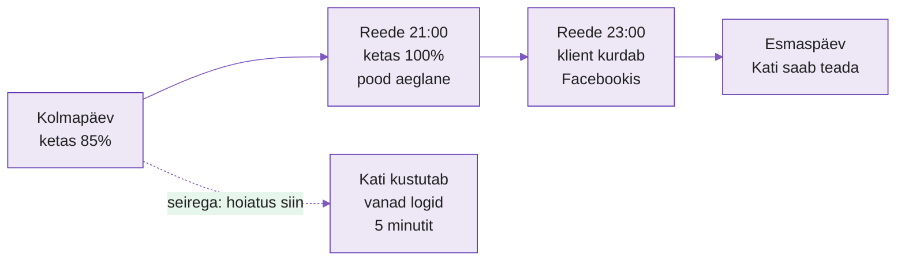
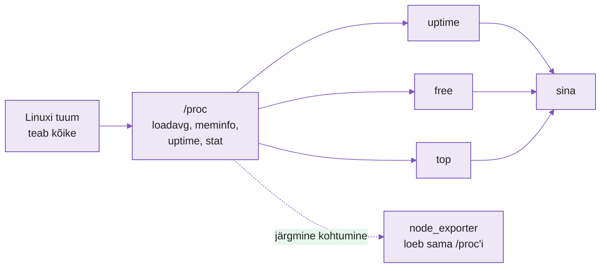
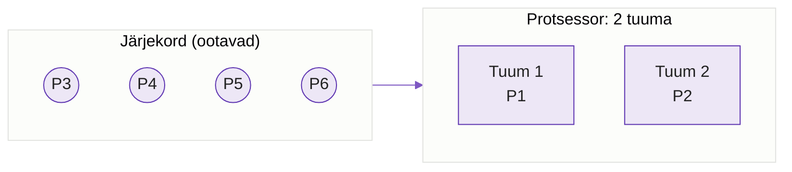

---
tags:
  - Loeng
  - Monitooring
  - Linux
  - Algaja
---

# Kuidas masin oma seisundist räägib

*Server ei oska kurta. Ta näitab numbreid ja sinu töö on neid lugeda.*

!!! abstract "Õpiväljundid"
    Pärast seda loengut oskad:

    - selgitada, miks serverit jälgitakse ja mis juhtub, kui seda ei tehta;
    - eristada mõõdikut (üks number) ja aegrida (number ajas);
    - kirjeldada nelja küsimust, mida serverilt alati küsitakse: kas ta on üleval, kas ta jõuab, kas tal on ruumi mõelda ja kas tal on ruumi hoida;
    - tõlgendada koormust (load average) protsessorituumade arvu järgi;
    - selgitada, miks Linuxi "vaba mälu" on väike ja miks see on normaalne;
    - selgitada, kust käsud `top`, `free` ja `uptime` oma numbrid saavad.

## Sisukord

1. [Märteni skript oli juba monitooring](#1-marteni-skript-oli-juba-monitooring)
2. [Mõõdik ja aegrida](#2-moodik-ja-aegrida)
3. [Neli küsimust serverile](#3-neli-kusimust-serverile)
4. [Kust numbrid tulevad](#4-kust-numbrid-tulevad)
5. [Kuidas numbreid õigesti lugeda](#5-kuidas-numbreid-oigesti-lugeda)
6. [Number üksi ei ütle midagi](#6-number-uksi-ei-utle-midagi)
7. [Taust ja edasijõudnutele](#7-taust-ja-edasijoudnutele)

---

## 1. Märteni skript oli juba monitooring

!!! abstract "Miks see oluline on?"
    Kui sa ei jälgi oma serverit, saad probleemist teada kasutajalt. Tavaliselt vihaselt ja tavaliselt liiga hilja.

Mäletad automatiseerimise kursusest Märteni `monitor.sh`-i? See kontrollis, kas nginx töötab, ja kirjutas tulemuse logifaili. Skript oli katki, aga idee oli õige: **masin kontrollib masinat, et inimene ei peaks.** Seda nimetataksegi seireks ehk monitooringuks (monitoring).

Märteni skript vastas ainult ühele küsimusele: kas teenus käib, jah või ei. Päris elus see ei piisa.

!!! example "Näidisstsenaarium"
    Kati teeb praktikat väikeses e-poes. Reede õhtul kell 21 läheb pood aeglaseks: leht laeb 15 sekundit. Nginx töötab, seega Märteni-tüüpi skript ütleks "kõik korras".

    Kell 22 lahkuvad esimesed ostjad. Kell 23 kirjutab üks klient Facebooki, et "pood on katki". Esmaspäeva hommikul näeb Kati seda postitust ja logib serverisse. Ketas on 100% täis, sest logifail kasvas terve nädala.

    Kui keegi oleks kolmapäeval vaadanud, oleks ta näinud: ketas 85%, kasvab 5% päevas. Viis minutit tööd, null kaotatud ostjat.

<figure markdown="span">

  <figcaption>Joonis 7.1. Sama probleem kahe teekonnaga: ilma seireta saab Kati teada kasutajalt neli päeva hiljem, seirega märkab ta seda kaks päeva enne katkestust.</figcaption>
</figure>

Ülemine rida näitab, mis juhtus päriselt. Alumine katkendjoon näitab, mis oleks juhtunud, kui keegi oleks kolmapäeval ketta täituvust näinud.

Seire eesmärk on lihtne: **tea enne kasutajat.** Kõik muu sel kursusel (graafikud, alarmid, logid) on selle ühe lause teenistuses.

??? question "✅ Kontrolli ennast"
    1. Miks Märteni skript oleks Kati reede õhtul öelnud "kõik korras"?
    2. Too oma elust üks näide, kus said probleemist teada liiga hilja, kuigi märgid olid varem olemas (telefoni aku, mäng, arvuti).

---

## 2. Mõõdik ja aegrida

!!! abstract "Miks see oluline on?"
    Üks number ütleb, kus sa praegu oled. Numbrite rida ütleb, kuhu sa liigud. Seire töötab teisega.

Mõtle telefoni akule. Ekraanil on **37%**. See on **mõõdik** (metric): üks mõõdetav suurus, millel on nimi ja väärtus.

Kas 37% on hea või halb? Sellest numbrist üksi ei saa aru. Kui hommikul oli 100% ja praegu on kell 10, on midagi valesti. Kui hommikul oli 100% ja praegu on kell 22, on kõik hästi.

Telefoni seadetes on aku graafik: sama number iga paari minuti järel terve päeva jooksul. Sellist numbrite rida koos ajatemplitega nimetatakse **aegreaks** (time series).

<figure markdown="span">
```text
aku %
100 |█
 80 |  █
 60 |    █ █
 40 |        █ █ █
 20 |              █
  0 +--------------------
     8  10  12  14  16  18  kell
```
  <figcaption>Joonis 7.2. Aegrida: sama mõõdik (aku laetus) mõõdetuna iga kahe tunni järel. Graafikult on näha, et kell 12-14 ei kulunud akut peaaegu üldse.</figcaption>
</figure>

Graafikul on näha midagi, mida ükski üksik number ei näita: aku kulus kiiresti hommikul, keskpäeval peaaegu üldse mitte ja õhtul jälle. Arsti juures on sama loogika: üks palavikumõõtmine ütleb "38,5", aga palavikukõver ütleb, kas haigus läheb paremaks või halvemaks.

Täna loed numbreid käsitsi, ühe kaupa. Järgmisel kohtumisel paned masina neid ise koguma, iga 15 sekundi järel, ja siis on sul aegrida.

??? question "✅ Kontrolli ennast"
    1. Mis vahe on mõõdikul ja aegreal? Too näide autost.
    2. Kati nägi kolmapäeval "ketas 85%". Miks sellest üksi ei piisa, et öelda, millal ketas täis saab?

---

## 3. Neli küsimust serverile

!!! abstract "Miks see oluline on?"
    Server mõõdab tuhandeid asju. Algaja upub neisse. Neli küsimust annavad sulle järjekorra, millest alustada.

Auto armatuurlaual on kümneid tulesid, aga juht vaatab kõigepealt nelja: kiirus, kütus, mootori temperatuur ja kas mõni punane tuli põleb. Serveriga on sama.

| Küsimus | Mida mõõdetakse | Käsk | Võrdlus autoga |
|---|---|---|---|
| Kas ta on üleval? | tööaeg (uptime) | `uptime` | kas mootor käib |
| Kas ta jõuab? | protsessori koormus | `uptime`, `top` | pöörded |
| Kas tal on ruumi mõelda? | mälu (RAM) | `free -h` | kõrvalistuja süli: mis on käepärast |
| Kas tal on ruumi hoida? | ketas | `df -h` | pagasiruum |

*Tabel 7.1. Neli küsimust, mida igalt serverilt esimesena küsitakse*

Mälu ja ketta erinevus ajab algajaid sageli segadusse. **Mälu** on kiire ja väike ning kaob, kui masin välja lülitada. Seal on asjad, millega praegu töötatakse. **Ketas** on aeglane ja suur ning jääb alles. Seal on asjad, mida hoitakse. Kui mälu saab täis, läheb masin aeglaseks. Kui ketas saab täis, lakkavad programmid töötamast, sest nad ei saa enam midagi kirjutada (nagu Kati e-poes).

??? question "✅ Kontrolli ennast"
    1. Kati e-pood jäi seisma täis ketta tõttu. Millise neljast küsimusest oleks ta pidanud esimesena küsima?
    2. Miks täis mälu teeb masina aeglaseks, aga täis ketas peatab programmi?

---

## 4. Kust numbrid tulevad

!!! abstract "Miks see oluline on?"
    Kui tead, kust number tuleb, tead ka, kuidas seda kontrollida. Järgmisel nädalal hakkab sama allikat lugema masin.

Linuxis teab kõike masina kohta **tuum** (kernel): mitu protsessi ootab, kui palju mälu on kasutusel, kaua masin on üleval olnud. Tuum ei kirjuta neid numbreid kettale. Ta näitab neid kaustas **`/proc`**, mis näeb välja nagu tavaline kaust failidega, aga on tegelikult aken tuuma sisse. Iga kord, kui faili loed, paneb tuum sinna värsked numbrid.

<figure markdown="span">

  <figcaption>Joonis 7.3. Käsud `uptime`, `free` ja `top` ei mõõda midagi ise. Nad loevad tuuma numbreid kaustast `/proc` ja vormistavad need inimesele loetavaks. Järgmisel kohtumisel teeb sama node_exporter.</figcaption>
</figure>

Joonisel on kõigil kolmel käsul sama allikas. Erinevus on ainult selles, kuidas nad numbrid sulle ette panevad.

| Fail | Mis seal on | Mis käsk seda loeb |
|---|---|---|
| `/proc/uptime` | sekundid alates käivitusest | `uptime` |
| `/proc/loadavg` | koormus 1, 5 ja 15 minuti keskmisena | `uptime`, `top` |
| `/proc/meminfo` | mälu, umbes 50 rida | `free`, `top` |
| `/proc/stat` | protsessori aeg alates käivitusest | `top` |

*Tabel 7.2. Olulisemad failid kaustas `/proc`*

Ketta kohta küsib `df` tuumalt otse iga failisüsteemi kohta eraldi, seega ühte `/proc` faili seal pole. Põhimõte on sama: number tuleb tuumast.

??? question "✅ Kontrolli ennast"
    1. Miks `cat /proc/uptime` näitab iga kord erinevat numbrit, kuigi keegi faili ei muuda?
    2. Kui `free` ja `top` näitavad mälu kohta veidi erinevaid numbreid, kumba usud? Kust saaksid kontrollida?

---

## 5. Kuidas numbreid õigesti lugeda

!!! abstract "Miks see oluline on?"
    Kaks numbrit, koormus ja vaba mälu, lähevad algajatel kõige sagedamini valesti. Valesti loetud number on halvem kui lugemata number, sest sa paanitsed ilma põhjuseta või rahuned ilma põhjuseta.

### Koormus ja poe kassad

Käsk `uptime` näitab rea lõpus kolme numbrit:

```text
 10:14:02 up 3 days,  2:41,  1 user,  load average: 1.85, 0.92, 0.40
```

Need on **koormus** (load average): keskmiselt mitu protsessi tahtis viimase 1, 5 ja 15 minuti jooksul protsessorit kasutada (kas töötas või ootas järjekorras).

Mõtle poele. Kassad on protsessori **tuumad** (core). Ostjad on protsessid.

- 2 kassat, koormus 1: üks kassa töötab, teine ootab ostjat. Kõik on rahulik.
- 2 kassat, koormus 2: mõlemad kassad töötavad, järjekorda pole. Täis, aga hea.
- 2 kassat, koormus 6: mõlemad töötavad ja 4 inimest seisab järjekorras. Asjad venivad.

<figure markdown="span">

  <figcaption>Joonis 7.4. Koormus 6 kahe tuumaga masinas: kaks protsessi töötavad, neli ootavad. Koormus jagatud tuumade arvuga on 3, mis tähendab, et masin on kolm korda üle koormatud.</figcaption>
</figure>

Seega **koormus ilma tuumade arvuta ei tähenda midagi.** Tuumade arvu näitab käsk `nproc`. Rusikareegel: jaga koormus tuumade arvuga. Kuni 1 on korras, üle selle tekib järjekord.

Kolm numbrit koos näitavad suunda. Kui `1.85, 0.92, 0.40` (viimane minut on kõrgeim), siis koormus **kasvab**. Kui `0.40, 0.92, 1.85`, siis koormus **langeb** ja hullem on möödas.

### Mälu: miks "vaba" on väike

Käsk `free -h` näitab umbes nii:

```text
               total        used        free      shared  buff/cache   available
Mem:           3.8Gi       1.1Gi       210Mi        12Mi       2.5Gi       2.4Gi
```

Algaja näeb `free 210Mi` ja ehmatab: ainult 210 megat vaba! Tegelikult on kõik korras.

Linux ei lase mälul tühjalt seista. Kõik, mida programmid parasjagu ei kasuta, läheb **puhvrisse ja vahemällu** (buff/cache): seal hoitakse hiljuti loetud faile, et järgmine lugemine oleks kiire. Kui mõni programm vajab mälu, annab tuum selle vahemälust kohe ära.

Seepärast vaata alati veergu **`available`**: see on mälu, mille programm saaks kohe kasutada. Selles näites 2.4 GiB, mis on täiesti piisav. Kui `available` läheb nulli lähedale, alles siis on mure.

??? question "✅ Kontrolli ennast"
    1. Kahel masinal on koormus 4. Ühel on 2 tuuma, teisel 8. Kumb on hädas ja miks?
    2. Mida tähendab `load average: 0.20, 1.50, 3.80`? Kas olukord läheb paremaks või halvemaks?
    3. Sõber saadab sulle `free -h` väljundi, kus `free` on 90 MiB ja `available` on 3 GiB. Mida talle vastad?

---

## 6. Number üksi ei ütle midagi

!!! abstract "Miks see oluline on?"
    Sama number võib ühes masinas tähendada "kõik hästi" ja teises "kohe kukub kokku". Selleks pead teadma, milline on sinu masina tavaline päev.

Mati vastutab koolis varukoopiaserveri eest. Iga öö kell 02:00 pakib see kõik failid kokku ja protsessor on tund aega 95% hõivatud. Kas see on probleem? Ei, see on tavaline öö. Aga kui sama 95% on keskpäeval, kui ühtegi varukoopiat ei tehta, on midagi valesti.

Masina tavalist seisu nimetatakse **baasjooneks** (baseline). Ilma baasjooneta ei saa öelda, kas number on hea või halb. Baasjoone leiad ainult aegreast: pead nägema, mis toimub tavaliselt päeval, öösel ja nädalavahetusel.

Siin on käsitsi vaatamise piir. `top` näitab ainult **praegust hetke**. Kui avad selle kolmapäeval kell 10, ei tea sa midagi sellest, mis juhtus öösel kell 3. Sellepärast jõuame järgmisel kohtumisel automaatse kogumiseni.

Testides tekitatakse koormus meelega. Tööriist **`stress-ng`** paneb protsessori, mälu või ketta tööle nii kauaks, kui ütled. Nii näed, mis juhtub numbritega, kui masin päriselt hätta jääb, ja tead hiljem, mida otsida. Seda teed täna laboris.

??? question "✅ Kontrolli ennast"
    1. Miks Mati ei peaks varukoopiaserveri 95% protsessorikoormusest öösel muretsema?
    2. Miks ei piisa sellest, et vaatad serverit `top`-iga kord päevas?

---

## 7. Taust ja edasijõudnutele

See osa ei ole kohustuslik, aga kui tahad teada, kuidas seda tööd päriselt tehakse, loe edasi.

**USE-meetod.** Brendan Gregg pakkus välja lihtsa reegli: iga ressursi (protsessor, mälu, ketas, võrk) kohta küsi kolme asja. Kui palju see on kasutusel (Utilization), kas tekib järjekord (Saturation) ja kas on vigu (Errors). Sinu "neli küsimust" on selle lihtsustatud versioon. Loe lähemalt [Gregg'i lehelt](https://www.brendangregg.com/usemethod.html).

**Koormus ja ketas.** Linuxi koormuse sees on ka protsessid, mis ootavad ketast. Seega võib koormus olla kõrge ka siis, kui protsessor on peaaegu tühi. Seda näed `top`-is real `%Cpu(s)` väärtusena `wa` (wait).

**Tööriistade maailm.** Sel kursusel kasutame Prometheust, Grafanat ja Lokit. Lisaks on olemas Zabbix (vanem ja laialt levinud kõik-ühes süsteem), ELK (logide otsing), OpenTelemetry (päringu jälitamine läbi mitme teenuse) ja Kubernetes'i jaoks loodud seiresüsteemid. Mõisted, mida siin õpid, kehtivad kõigis neis. Tööriist vahetub, küsimused jäävad samaks.

---

## Kokkuvõte

Seire tähendab, et masin mõõdab masinat ja sina saad probleemist teada enne kasutajat. Kõik numbrid tulevad tuumast kausta `/proc` kaudu. Koormust loe alati tuumade arvu järgi, mälu puhul vaata `available` veergu. Üks number ütleb vähe, aegrida ja baasjoon ütlevad palju.

### Seisund ühe pilguga

| Mõiste | Selgitus | Kuidas näed |
|---|---|---|
| **Seire (monitoring)** | masin jälgib masinat, et inimene teaks enne kasutajat | - |
| **Mõõdik (metric)** | üks number, millel on nimi | `free -h` veerg `available` |
| **Aegrida (time series)** | sama mõõdik mitu korda ajas | aku graafik telefonis |
| **Koormus (load average)** | mitu protsessi tahab protsessorit, 1/5/15 min | `uptime` |
| **Tuum (core)** | üks "kassa" protsessoris | `nproc` |
| **available** | mälu, mida programm saab kohe kasutada | `free -h` |
| **/proc** | aken tuuma, kust kõik käsud numbreid loevad | `cat /proc/loadavg` |
| **Baasjoon (baseline)** | masina tavaline seis | ainult aegreast |

*Tabel 7.3. Mõisted ühe pilguga*

## 🎯 Lõplik kontroll

1. Selgita oma sõnadega, mis on seire ja miks Märteni "teenus töötab, jah/ei" kontrollist ei piisa.
2. Selgita sõbrale poe kassade abil, mida tähendab koormus 3.0 neljatuumalises masinas.
3. Miks Linux kasutab peaaegu kogu "vaba" mälu ära ja miks see ei ole viga?
4. Kust saab `top` oma numbrid? Mida see tähendab, kui tahame numbreid hiljem automaatselt koguda?
5. Kati ütleb: "Server on täna aeglane." Milliseid nelja küsimust küsid ja millise käsuga igaühele vastuse leiad?
6. Miks on baasjoon vajalik ja miks seda käsitsi kontrollides ei näe?

---

*Laboris loed neid numbreid oma kolmest sõlmest, paned masina `stress-ng`-ga higistama ja vaatad, kuidas numbrid liiguvad. Nüüd oled valmis laboriks! 🚀*
